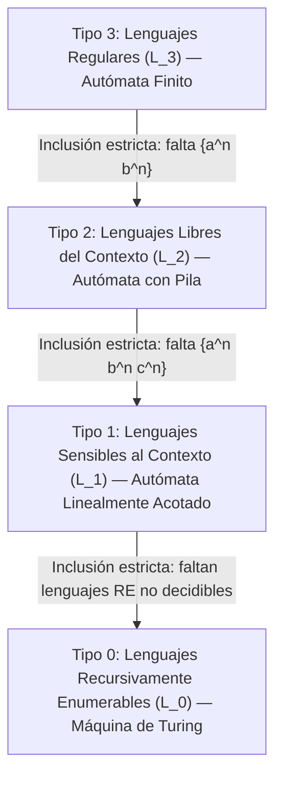
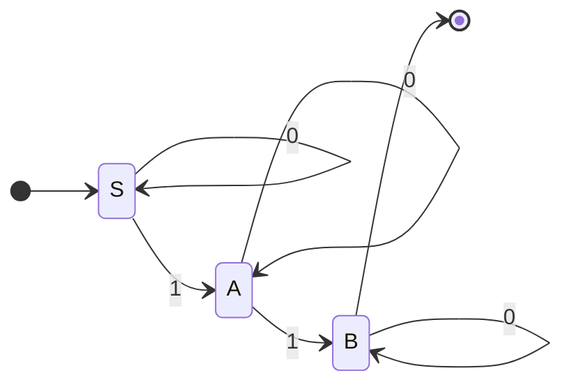

# 2.4 Tipos de gramáticas

## Introducción: la jerarquía de Chomsky

En sus trabajos fundacionales de 1956 y 1959, Noam Chomsky propuso clasificar las gramáticas generativas $G = (V, \Sigma, P, S)$ en **cuatro tipos** —numerados de $0$ a $3$— de acuerdo con la forma sintáctica permitida en sus producciones $\alpha \to \beta$ (De Castro Korgi, 2004, pp. 4, 82; Acevedo Juárez, 2006, pp. 48–50). A medida que el índice aumenta de $0$ a $3$, las restricciones sobre las producciones se vuelven más severas, lo que reduce el poder expresivo de la gramática pero hace más sencillo y eficiente su reconocimiento algorítmico.

Se dice que un lenguaje $L \subseteq \Sigma^*$ es de **tipo $i$** ($i \in \{0, 1, 2, 3\}$) si existe una gramática de tipo $i$ que lo genera. Si denotamos por $\mathcal{L}_i$ a la familia de los lenguajes de tipo $i$, las cuatro familias conforman una cadena estricta de inclusiones conocida como la **jerarquía de Chomsky**:

$$\mathcal{L}_3 \subsetneq \mathcal{L}_2 \subsetneq \mathcal{L}_1 \subsetneq \mathcal{L}_0$$

Más aún, cada nivel de la jerarquía de Chomsky coincide exactamente con la clase de lenguajes aceptados por un modelo clásico de autómata o máquina abstracta:

### Cuadro comparativo de la jerarquía de Chomsky

| Tipo | Clase de gramática | Restricción en $\alpha \to \beta$ | Familia de lenguajes | Autómata reconocedor equivalente | Lenguaje testigo (separación) |
| :--- | :--- | :--- | :--- | :--- | :--- |
| **Tipo 0** | Sin restricción (estructura de frase) | $\alpha \in (V \cup \Sigma)^+$ con al menos un símbolo en $V$; $\beta \in (V \cup \Sigma)^*$ | Recursivamente enumerables ($\mathcal{L}_0$) | Máquina de Turing (MT) | Lenguajes RE no decidibles ($L_u$, problema de la parada) |
| **Tipo 1** | De contexto sensitivo | $\alpha A \beta \to \alpha \gamma \beta$ ($\gamma \ne \lambda$) o no contractiva $|\alpha| \le |\beta|$ (salvo $S \to \lambda$) | Sensibles al contexto ($\mathcal{L}_1$) | Autómata Linealmente Acotado (ALA) | $\{a^n b^n c^n \mid n \ge 1\} \in \mathcal{L}_1 \setminus \mathcal{L}_2$ |
| **Tipo 2** | Libres del contexto (GIC) | $A \to \alpha$ con $A \in V$ y $\alpha \in (V \cup \Sigma)^*$ | Libres del contexto / LIC ($\mathcal{L}_2$) | Autómata con Pila no determinista (AP) | $\{a^n b^n \mid n \ge 0\} \in \mathcal{L}_2 \setminus \mathcal{L}_3$ |
| **Tipo 3** | Regulares (GR) | Lineales derechas ($A \to wB \mid w$) o lineales izquierdas ($A \to Bw \mid w$) | Regulares ($\mathcal{L}_3$) | Autómata Finito (AFD / AFN) | $a^* b^* \in \mathcal{L}_3$ |

> **Observación sobre $\lambda$ en la inclusión $\mathcal{L}_2 \subsetneq \mathcal{L}_1$:** En sentido estricto, una gramática no contractiva sin excepción para $S \to \lambda$ solo genera cadenas no vacías ($\lambda \notin L$). Para garantizar que todo lenguaje libre del contexto pertenezca a $\mathcal{L}_1$, se admite en las gramáticas de Tipo 1 la producción excepcional $S \to \lambda$ siempre que $S$ no aparezca en el lado derecho de ninguna producción. Bajo esta convención estándar (Chomsky, 1959; Hopcroft et al., 2007), la cadena de inclusiones $\mathcal{L}_3 \subsetneq \mathcal{L}_2 \subsetneq \mathcal{L}_1 \subsetneq \mathcal{L}_0$ se cumple sin excepciones.

---

## 2.4.1 Gramáticas sin restricción

### Definición formal

Una **gramática sin restricción** (también llamada **gramática de tipo 0** o **gramática con estructura de frase**) es cualquier gramática formal $G = (V, \Sigma, P, S)$ cuyas producciones tienen la forma general:

$$\alpha \to \beta$$

donde:
- $\alpha \in (V \cup \Sigma)^+$ contiene al menos una variable de $V$ (es decir, $\alpha \in (V \cup \Sigma)^* V (V \cup \Sigma)^*$), y
- $\beta \in (V \cup \Sigma)^*$ no está sujeto a ninguna restricción adicional.

En particular, en una gramática de Tipo 0:
1. La cabeza $\alpha$ puede estar compuesta por varios símbolos terminales y no terminales.
2. Se permiten **producciones contractivas**, es decir, reglas en las que $|\alpha| > |\beta|$ (la cadena se acorta al reescribirse).
3. Se permiten **producciones de borrado** ($\alpha \to \lambda$), donde un grupo de símbolos puede desaparecer por completo durante una derivación.

### Lenguajes y máquina asociada

Las gramáticas de Tipo 0 generan exactamente la familia $\mathcal{L}_0$ de los **lenguajes recursivamente enumerables (RE)**. Un resultado fundamental de la teoría de la computabilidad establece que $L$ es generado por una gramática de Tipo 0 si y solo si $L$ es aceptado por una **Máquina de Turing** (De Castro Korgi, 2004, Cap. 6).

Debido a que existen lenguajes recursivamente enumerables que **no son decidibles** (recursivos) —es decir, para los cuales una Máquina de Turing puede ciclar infinitamente sobre cadenas que no pertenecen al lenguaje— y dado que todo lenguaje de Tipo 1 es decidible, se demuestra la inclusión estricta $\mathcal{L}_1 \subsetneq \mathcal{L}_0$. Asimismo, fuera de $\mathcal{L}_0$ existen lenguajes que ni siquiera son recursivamente enumerables, como el lenguaje de diagonalización $L_d$ (De Castro Korgi, 2004, Secc. 7.4).

### Ejemplo desarrollado paso a paso (Tipo 0)

Considere la siguiente gramática sin restricción $G_0 = (V, \Sigma, P, S)$ para el lenguaje $L = \{a^{2^n} \mid n \ge 0\} = \{a, aa, aaaa, aaaaaaaa, \dots\}$ (adaptada de Hopcroft et al., 2007):

- $V = \{S, A, B, C, D, E\}$, $\Sigma = \{a\}$
- Producciones $P$:
  $$\begin{aligned}
  S &\to a \mid ACaB \\
  Ca &\to aaC \\
  CB &\to DB \mid E \\
  aD &\to Da \\
  AD &\to AC \\
  aE &\to Ea \\
  AE &\to \lambda
  \end{aligned}$$

*Por qué es Tipo 0:* Las reglas $CB \to E$ ($|CB|=2 > 1=|E|$) y $AE \to \lambda$ ($|AE|=2 > 0=|\lambda|$) son **contractivas** (esta última es una regla de borrado sobre dos variables), lo que viola las condiciones de los Tipos 1, 2 y 3.

*Funcionamiento intuitivo:* $A$ y $B$ actúan como marcadores de extremo izquierdo y derecho. Un mensajero $C$ recorre los $a$ hacia la derecha duplicando cada uno ($Ca \to aaC$). Al chocar con $B$, puede iniciar otra duplicación ($CB \to DB$, donde $D$ regresa hasta $A$ y se transforma de nuevo en $C$) o iniciar la limpieza final ($CB \to E$, donde $E$ regresa hacia la izquierda y se elimina junto con $A$ mediante $AE \to \lambda$).

*Derivación paso a paso de $a^4 = aaaa$ ($n = 2$):*

1. $S \Rightarrow ACaB$ &nbsp; *(inicia con una $a$ entre marcadores $A$ y $B$)*
2. $ACaB \Rightarrow AaaCB$ &nbsp; *(duplicación: $Ca \to aaC$)*
3. $AaaCB \Rightarrow AaaDB$ &nbsp; *(decide hacer una duplicación más: $CB \to DB$)*
4. $AaaDB \Rightarrow AaDaB \Rightarrow ADaaB$ &nbsp; *(el marcador $D$ viaja a la izquierda: $aD \to Da$ dos veces)*
5. $ADaaB \Rightarrow ACaaB$ &nbsp; *(se convierte en $C$ al llegar al límite izquierdo: $AD \to AC$)*
6. $ACaaB \Rightarrow AaaCaB \Rightarrow AaaaaCB$ &nbsp; *(duplica ambas $a$: $Ca \to aaC$ dos veces)*
7. $AaaaaCB \Rightarrow AaaaaE$ &nbsp; *(decide terminar y borrar $B$: $CB \to E$)*
8. $AaaaaE \Rightarrow AaaaEa \Rightarrow AaaEaa \Rightarrow AaEaaa \Rightarrow AEaaaa$ &nbsp; *($E$ viaja a la izquierda: $aE \to Ea$ cuatro veces)*
9. $AEaaaa \Rightarrow aaaa$ &nbsp; *(borrado de marcadores: $AE \to \lambda$)*

---

## 2.4.2 Gramáticas de contexto sensitivo

### Definición formal

Las **gramáticas de contexto sensitivo** (o **sensibles al contexto**, **Tipo 1**) admiten dos caracterizaciones matemáticas equivalentes (Chomsky, 1959; De Castro Korgi, 2004, p. 82; Acevedo Juárez, 2006, p. 49):

1. **Caracterización contextual:** Toda producción en $P$ tiene la forma:
   $$\alpha A \beta \to \alpha \gamma \beta$$
   donde $A \in V$, $\alpha, \beta \in (V \cup \Sigma)^*$ representan el **contexto** izquierdo y derecho, y $\gamma \in (V \cup \Sigma)^+$ ($\gamma \ne \lambda$). Es decir, la variable $A$ solo puede ser sustituida por $\gamma$ cuando se encuentra flanqueada exactamente por $\alpha$ a su izquierda y $\beta$ a su derecha.
2. **Caracterización no contractiva (o monótona):** Toda producción $\alpha \to \beta \in P$ satisface la condición de longitud:
   $$|\alpha| \le |\beta|$$
   donde $\alpha \in (V \cup \Sigma)^* V (V \cup \Sigma)^*$ y $\beta \in (V \cup \Sigma)^+$.

**Excepción para la cadena vacía:** Si el lenguaje contiene $\lambda$, se permite únicamente la regla $S \to \lambda$ bajo la condición de que $S$ no aparezca en el cuerpo (lado derecho) de ninguna producción de $P$.

> **Equivalencia entre ambas definiciones:** Toda gramática en forma contextual satisface obviamente $|\alpha A \beta| = |\alpha| + 1 + |\beta| \le |\alpha| + |\gamma| + |\beta| = |\alpha \gamma \beta|$, por lo que es no contractiva. Recíprocamente, toda gramática no contractiva puede transformarse en una gramática equivalente en forma contextual introduciendo variables auxiliares para descomponer reescrituras de varios símbolos en pasos individuales dentro de un contexto fijo.

### Lenguajes y máquina asociada

Las gramáticas de Tipo 1 generan la familia $\mathcal{L}_1$ de los **lenguajes sensibles al contexto (LSC)**, los cuales coinciden exactamente con los lenguajes aceptados por los **Autómatas Linealmente Acotados (ALA)** —Máquinas de Turing no deterministas cuya cinta de trabajo está restringida a la longitud de la cadena de entrada—.

Una consecuencia importante de la propiedad $|\alpha| \le |\beta|$ es que, en una derivación de $w \in \Sigma^*$ ($w \ne \lambda$), ninguna forma sentencial intermedia puede tener longitud mayor que $|w|$. Dado que el conjunto de cadenas sobre $(V \cup \Sigma)$ de longitud $\le |w|$ es finito, existe un algoritmo que decide en tiempo finito si $w \in L(G)$. Por ello, **todo lenguaje sensible al contexto es decidible (recursivo)**.

### Ejemplo desarrollado paso a paso (Tipo 1): $L = \{a^n b^n c^n \mid n \ge 1\}$

El lenguaje $L = \{a^n b^n c^n \mid n \ge 1\} = \{abc, aabbcc, aaabbbccc, \dots\}$ es el ejemplo canónico que demuestra la separación estricta $\mathcal{L}_2 \subsetneq \mathcal{L}_1$: mediante el lema de bombeo para LIC se prueba que $L \notin \mathcal{L}_2$ (ninguna GIC puede coordinar tres conteos dependientes simultáneos), pero sí puede generarse mediante una gramática de Tipo 1.

Considere la gramática no contractiva $G_1 = (\{S, B, C\}, \{a, b, c\}, P, S)$ con las siguientes $7$ producciones:

$$\begin{aligned}
(1)\quad S &\to aSBC \mid aBC \\
(2)\quad CB &\to BC \\
(3)\quad aB &\to ab \\
(4)\quad bB &\to bb \\
(5)\quad bC &\to bc \\
(6)\quad cC &\to cc
\end{aligned}$$

*Verificación de Tipo 1:* En todas las reglas $|\alpha| \le |\beta|$ (en (1), $|S|=1 \le 4$ y $1 \le 3$; en (2)–(6), ambos lados tienen longitud $2$). *(Nota: la regla de intercambio $CB \to BC$ puede escribirse además en forma estrictamente contextual $\alpha A \beta \to \alpha \gamma \beta$ empleando dos variables auxiliares $X, Y$ mediante las cuatro reglas $CB \to XB$, $XB \to XY$, $XY \to BY$ y $BY \to BC$).*

**Derivación paso a paso de la cadena $aaabbbccc$ ($n = 3$):**

1. **Generación de tripletas $a, B, C$:**
   $$S \Rightarrow aSBC \Rightarrow aaSBCBC \Rightarrow aaaBCBCBC$$
   *(Se aplicó $S \to aSBC$ dos veces y finalmente $S \to aBC$, obteniendo tres $a$ y tres pares $BC$).*
2. **Ordenamiento mediante contexto ($CB \to BC$):**
   $$aaaB\underline{CB}CBC \Rightarrow aaaBBC\underline{CB}C \Rightarrow aaaBB\underline{CB}CC \Rightarrow aaaBBBCCC$$
3. **Conversión contextual de variables en terminales:**
   - Conversión de $B$ en $b$ (solo en contexto izquierdo de $a$ o $b$):
     $$aa\underline{aB}BBCCC \Rightarrow aaa\underline{bB}BCCC \Rightarrow aaab\underline{bB}CCC \Rightarrow aaabbbCCC$$
   - Conversión de $C$ en $c$ (solo en contexto izquierdo de $b$ o $c$):
     $$aaabb\underline{bC}CC \Rightarrow aaabbb\underline{cC}C \Rightarrow aaabbbc\underline{cC} \Rightarrow aaabbbccc$$

*¿Por qué la gramática no genera cadenas fuera de $\{a^n b^n c^n \mid n \ge 1\}$?* Si alguna $B$ se convirtiera prematuramente en $b$ antes de rebasar todas las $C$ situadas a su izquierda (por ejemplo, $aaBCBC \Rightarrow aabCBC \Rightarrow aabcBC$), la variable $B$ quedaría atrapada a la derecha de una $c$, donde ninguna regla puede reescribirla ni desplazarla, abortando la derivación sin producir una sentencia en $\Sigma^*$.

---

## 2.4.3 Gramáticas libres del contexto

### Definición formal

Una **gramática libre del contexto (GIC)** (también llamada **independiente del contexto**, **no contextual** o **gramática de tipo 2**) es una cuádrupla $G = (V, \Sigma, P, S)$ donde toda producción tiene la forma (De Castro Korgi, 2004, pp. 82–83):

$$A \to \alpha$$

con:
- $A \in V$ (la cabeza es **una única variable**), y
- $\alpha \in (V \cup \Sigma)^*$ (el cuerpo es una cadena arbitraria de variables y terminales, incluida la cadena vacía $\lambda$).

El calificativo **"independiente (o libre) del contexto"** radica en que la regla $A \to \alpha$ puede aplicarse a cualquier ocurrencia de la variable $A$ en una forma sentencial, **sin importar qué símbolos la rodeen** a izquierda o derecha.

### Lenguajes y máquina asociada

Las gramáticas de Tipo 2 generan la familia $\mathcal{L}_2$ de los **lenguajes independientes (o libres) del contexto (LIC)**. Como se demostrará en la Unidad 5, esta familia coincide exactamente con los lenguajes aceptados por los **Autómatas con Pila no deterministas (AP)** (De Castro Korgi, 2004, Cap. 5; Acevedo Juárez, 2006, Secc. 3.9).

Toda gramática de Tipo 2 puede transformarse en una gramática equivalente de Tipo 1 (eliminando las producciones $\lambda$ salvo eventualmente $S \to \lambda$, y las producciones unitarias, tema de la Unidad 6), por lo que $\mathcal{L}_2 \subseteq \mathcal{L}_1$. Además, dado que $\{a^n b^n c^n \mid n \ge 1\} \in \mathcal{L}_1 \setminus \mathcal{L}_2$, la inclusión es estricta: $\mathcal{L}_2 \subsetneq \mathcal{L}_1$. En la práctica de la ingeniería de software, las GIC (usualmente escritas en formato BNF) constituyen el estándar para especificar la sintaxis de casi todos los lenguajes de programación.

### Ejemplos desarrollados paso a paso (Tipo 2)

#### Ejemplo A: El lenguaje $\{a^n b^n \mid n \ge 0\}$

Sea $G_2 = (\{S\}, \{a, b\}, \{S \to aSb \mid \lambda\}, S)$. Claramente es una GIC porque toda cabeza es la única variable $S \in V$.

*Derivación paso a paso de $a^3 b^3$:*
$$S \Rightarrow_{G_2} aSb \Rightarrow_{G_2} aaSbb \Rightarrow_{G_2} aaaSbbb \Rightarrow_{G_2} aaa\lambda bbb = aaabbb$$

Esta derivación requiere la memoria ilimitada tipo pila (LIFO) de un autómata con pila para emparejar cada $a$ abierta con su correspondiente $b$ de cierre, por lo cual $\{a^n b^n \mid n \ge 0\} \in \mathcal{L}_2 \setminus \mathcal{L}_3$.

#### Ejemplo B: Expresiones balanceadas con dos tipos de paréntesis

Considere las cadenas de paréntesis circulares y angulares debidamente anidados y equilibrados sobre $\Sigma = \{(, ), [, ]\}$, tales como `([()])`, `([])[()]`, `[()()]`, excluyendo cruces indebidos como `([)]` (De Castro Korgi, 2004, Ejercicio 4, p. 87):

Sea $G_b = (\{S\}, \{(, ), [, ]\}, P, S)$ con producciones:

$$S \to (S)S \mid [S]S \mid \lambda$$

*Derivación paso a paso de la cadena `[()[]]` :*
1. $S \Rightarrow [S]S$ &nbsp; *(abre el paréntesis angular exterior)*
2. $[S]S \Rightarrow [(S)S]S$ &nbsp; *(expande el interior con `(...)` seguido de `S`)*
3. $[(S)S]S \Rightarrow [()S]S$ &nbsp; *(cierra el primer paréntesis interno con $S \to \lambda$)*
4. $[()S]S \Rightarrow [()[S]S]S$ &nbsp; *(expande el segundo bloque interno con `[...]`)*
5. $[()[S]S]S \Rightarrow [()[]S]S$ &nbsp; *(aplica $S \to \lambda$ en el interior)*
6. $[()[]S]S \Rightarrow [()[]]S$ &nbsp; *(aplica $S \to \lambda$ dentro del bloque exterior)*
7. $[()[]]S \Rightarrow [()[]]$ &nbsp; *(aplica $S \to \lambda$ al final)*

---

## 2.4.4 Gramáticas regulares

### Definición formal y variantes equivalentes

Las **gramáticas regulares** (o **gramáticas de tipo 3**) representan la clase más restringida de la jerarquía de Chomsky. En la literatura se presentan mediante varias definiciones equivalentes (De Castro Korgi, 2004, Secc. 4.7, pp. 98–101):

1. **Forma regular estándar (De Castro Korgi, Def. 4.7.1):** Toda producción tiene una de estas formas:
   $$A \to aB \qquad \text{o} \qquad A \to \lambda$$
   donde $A, B \in V$ y $a \in \Sigma$ (equivalentemente, $A \to aB \mid a$, permitiendo $S \to \lambda$ si $\lambda \in L$).
2. **Gramática lineal por la derecha (De Castro Korgi, Def. 4.7.5):** Toda producción tiene la forma:
   $$A \to wB \qquad \text{o} \qquad A \to w$$
   donde $A, B \in V$ y $w \in \Sigma^*$ (notar que $w$ puede ser cualquier cadena de terminales, incluyendo $\lambda$).
3. **Gramática lineal por la izquierda:** Toda producción tiene la forma:
   $$A \to Bw \qquad \text{o} \qquad A \to w$$
   donde $A, B \in V$ y $w \in \Sigma^*$.

> **¡Precaución fundamental!** Una gramática regular debe ser **exclusivamente lineal por la derecha** o **exclusivamente lineal por la izquierda**. Si se mezclan producciones lineales por la derecha y por la izquierda en una misma gramática, el lenguaje generado **puede dejar de ser regular**. Por ejemplo, la gramática $S \to aA,\; A \to Sb \mid b$ combina una regla lineal derecha ($S \to aA$) con una regla lineal izquierda ($A \to Sb$), pero en realidad genera el lenguaje no regular $\{a^n b^n \mid n \ge 1\}$.

### Teoremas de equivalencia y máquina asociada

Los siguientes resultados de De Castro Korgi (2004, Secc. 4.7, pp. 98–101) vinculan de manera exacta las gramáticas de Tipo 3 con los autómatas finitos:

- **Teorema 4.7.2 (De AFD a gramática regular):** Dado un AFD $M = (Q, \Sigma, q_0, F, \delta)$, la gramática regular $G = (Q, \Sigma, P, q_0)$ con producciones $q \to ap$ siempre que $\delta(q, a) = p$, y $q \to \lambda$ siempre que $q \in F$, cumple $L(G) = L(M)$.
- **Teorema 4.7.3 (De gramática regular a AFN):** Dada una gramática regular $G = (V, \Sigma, P, S)$ en forma estándar, existe un AFN $M = (V, \Sigma, S, F, \Delta)$ (con $B \in \Delta(A, a)$ si $A \to aB \in P$ y $A \in F$ si $A \to \lambda \in P$) tal que $L(M) = L(G)$.
- **Teorema 4.7.6 y Corolario 4.7.4:** Las gramáticas regulares estándar, las lineales por la derecha y las lineales por la izquierda generan exactamente la misma clase de lenguajes: la familia $\mathcal{L}_3$ de los **lenguajes regulares**. En consecuencia, todo lenguaje regular es un LIC ($\mathcal{L}_3 \subsetneq \mathcal{L}_2$), pero la inclusión es estricta porque $\{a^n b^n \mid n \ge 0\} \in \mathcal{L}_2 \setminus \mathcal{L}_3$.

### Ejemplo desarrollado paso a paso (Tipo 3): de AFD a gramática regular

Considere el lenguaje $L = 0^* 1 0^* 1 0^*$ sobre $\Sigma = \{0, 1\}$ (cadenas con exactamente dos unos), analizado por De Castro Korgi (2004, p. 85 y pp. 99–100).

La gramática $G_{\text{GIC}}: S \to A1A1A,\; A \to 0A \mid \lambda$ genera $L$, pero **no es regular** porque en el cuerpo de la producción de $S$ aparece la cadena $A1A1A$ con tres variables, violando el formato permitido en las gramáticas regulares.

Para construir una **gramática regular equivalente**, partimos del AFD mínimo que acepta cadenas con exactamente dos unos (con estados $S$: cero unos leídos; $A$: un uno leído; $B$: dos unos leídos y estado de aceptación; omitiendo el estado de error al leer un tercer uno):

Aplicando la construcción del Teorema 4.7.2 ($q \to ap$ por cada transición $\delta(q, a) = p$, y $q \to \lambda$ para cada estado de aceptación $q \in F = \{B\}$), obtenemos la gramática regular $G_3 = (\{S, A, B\}, \{0, 1\}, P_3, S)$:

$$\begin{aligned}
S &\to 0S \mid 1A \\
A &\to 0A \mid 1B \\
B &\to 0B \mid \lambda
\end{aligned}$$

*Derivación paso a paso de la cadena $010010$:*
$$S \Rightarrow 0S \Rightarrow 01A \Rightarrow 010A \Rightarrow 0100A \Rightarrow 01001B \Rightarrow 010010B \Rightarrow 010010$$

Obsérvese cómo cada paso de la derivación en una gramática regular refleja exactamente el avance paso a paso de izquierda a derecha del AFD sobre la cadena de entrada, almacenando el estado actual como la única variable situada en el extremo derecho de la forma sentencial.

## Ejercicios propuestos

1. Clasifica cada una de las siguientes gramáticas en el tipo **más específico** posible (3, 2, 1 o 0) de la jerarquía de Chomsky, justificando tu respuesta con base en sus producciones:
   - a) $S \to aSb \mid ab$
   - b) $S \to 0S \mid 1A \mid \lambda,\; A \to 0B,\; B \to 1B \mid \lambda$
   - c) $S \to AB,\; AB \to BA,\; A \to a,\; B \to b$
   - d) $S \to aB,\; B \to Sa \mid b$
   - e) $S \to Aa,\; Aa \to \lambda$
2. Utilizando el Teorema 4.7.2, convierte el siguiente lenguaje en una **gramática regular** sobre $\Sigma = \{a, b\}$: *"todas las cadenas que terminan con la subcadena `ba`"*. Dibuja primero el AFD en Mermaid, escribe las producciones de la gramática regular y deriva la cadena `aabba`.
3. Empleando la gramática sensible al contexto para $\{a^n b^n c^n \mid n \ge 1\}$ presentada en la subsección 2.4.2, realiza la derivación completa paso a paso de `aabbcc`. Luego explica qué sucede si intentas convertir la primera $B$ en $b$ antes de intercambiarla con la primera $C$.
4. Construye una gramática libre del contexto (Tipo 2) para cada uno de los siguientes lenguajes y argumenta por qué ninguno pertenece a $\mathcal{L}_3$:
   - a) $L_1 = \{a^i b^j c^j d^i \mid i, j \ge 1\}$ sobre $\Sigma = \{a, b, c, d\}$.
   - b) $L_2 = \{w \in \{0, 1\}^* \mid w \text{ tiene el mismo número de } 0 \text{ que de } 1\}$.
5. Muestra mediante un contraejemplo que la gramática $S \to aA,\; A \to Sb \mid \lambda$ (que mezcla linealidad derecha e izquierda) genera un lenguaje no regular, determinando $L(G)$ y verificando la derivación de `aaabbb`.

## Referencias

- Acevedo Juárez, A. (2006). *Teoría de la computación* [Tesis de licenciatura, Instituto Tecnológico de Celaya].
- Chomsky, N. (1956). Three models for the description of language. *IRE Transactions on Information Theory*, *2*(3), 113–124.
- Chomsky, N. (1959). On certain formal properties of grammars. *Information and Control*, *2*(2), 137–167.
- De Castro Korgi, R. (2004). *Teoría de la computación: Lenguajes, autómatas, gramáticas*. Universidad Nacional de Colombia.
- Hopcroft, J. E., Motwani, R., & Ullman, J. D. (2007). *Introduction to automata theory, languages, and computation* (3.ª ed.). Pearson Addison-Wesley.
