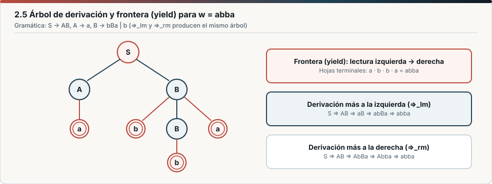
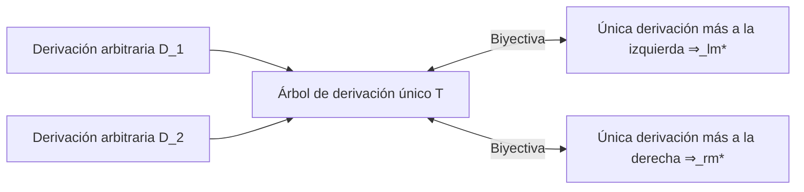
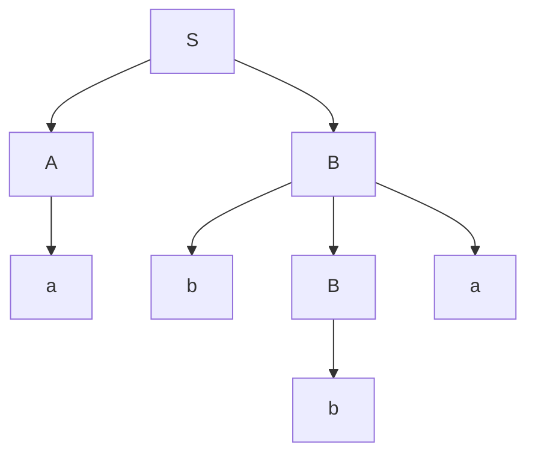
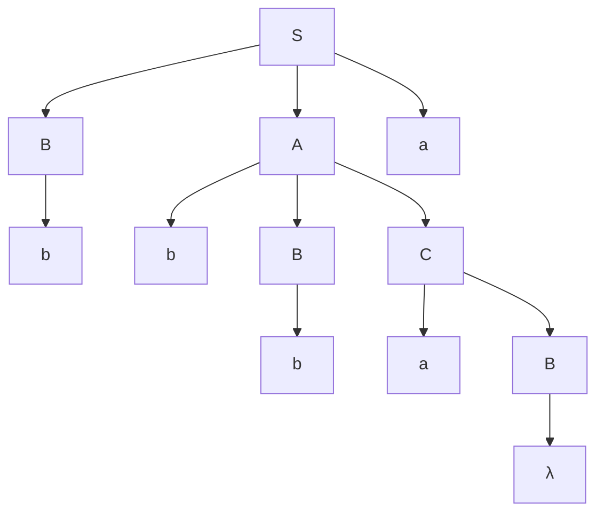
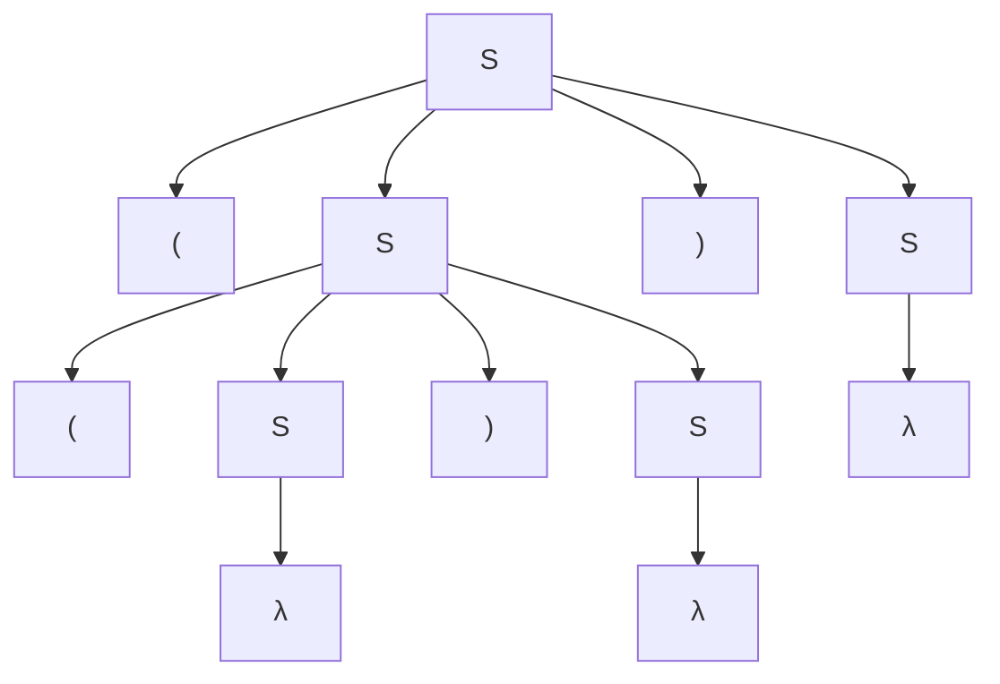

# 2.5 Árboles y diagramas de derivación

## Introducción

En una gramática libre del contexto (Tipo 2), una misma cadena puede derivarse mediante distintas secuencias de aplicación de reglas simplemente porque en cada paso se elige expandir una variable diferente de la forma sentencial. Sin embargo, muchas de estas derivaciones representan exactamente la **misma estructura sintáctica jerárquica** y únicamente difieren en el orden cronológico en que se aplicaron las producciones.

Para abstraer ese orden irrelevante y capturar la estructura sintáctica subyacente de una cadena, se utilizan los **árboles de derivación** (también denominados **árboles sintácticos** o **árboles de análisis sintáctico**, De Castro Korgi, 2004, Secc. 4.3, pp. 88–90; Acevedo Juárez, 2006, Secc. 3.3, pp. 90–92). La construcción de un árbol de derivación constituye la tarea central del **análisis sintáctico** (*parsing*) en los compiladores.

## Definiciones formales

### Definición 2.5.1 (Árbol ordenado con raíz)

Un **árbol con raíz** es un grafo acíclico conexo con un nodo distinguido llamado **raíz**, tal que existe una única trayectoria entre cualquier nodo y la raíz (De Castro Korgi, 2004, p. 88). En un árbol ordenado, los descendientes inmediatos (**hijos**) de cada nodo poseen un orden fijo de izquierda a derecha. Los nodos con al menos un hijo (excepto eventualmente la raíz en la terminología estricta, aunque aquí la raíz también se ramifica salvo derivaciones triviales) se llaman **nodos interiores**, mientras que los nodos sin hijos se denominan **hojas**.

### Definición 2.5.2 (Árbol de derivación para una GIC)

Sea $G = (V, \Sigma, P, S)$ una gramática libre del contexto. Un árbol ordenado con raíz cuyos nodos están etiquetados con símbolos de $V \cup \Sigma \cup \{\lambda\}$ es un **árbol de derivación** (o **diagrama de derivación**) en $G$ si satisface las siguientes condiciones (De Castro Korgi, 2004, p. 89):

1. La **raíz** está etiquetada con el símbolo inicial $S$ (o, en el caso de un subárbol de derivación, con una variable $A \in V$).
2. Todo **nodo interior** está etiquetado con una variable $A \in V$.
3. Si un nodo interior etiquetado con $A$ tiene exactamente $k$ hijos etiquetados, de izquierda a derecha, con $X_1, X_2, \dots, X_k \in V \cup \Sigma$, entonces debe existir la producción:
   $$A \to X_1 X_2 \cdots X_k \in P$$
4. Si un nodo está etiquetado con $\lambda$, entonces dicho nodo es una **hoja** y es el **único hijo** de su nodo padre $A$, correspondiendo necesariamente a una producción $A \to \lambda \in P$.
5. Las demás **hojas** pueden estar etiquetadas con símbolos terminales $a \in \Sigma$ (en un árbol completo de derivación de una sentencia) o con variables de $V$ (en un árbol parcial correspondiente a una forma sentencial).

### Definición 2.5.3 (Frontera o producto / *yield* del árbol)

La **frontera** (o **producto**, del inglés *yield*) de un árbol de derivación $T$ es la cadena formada al leer y concatenar, estrictamente **de izquierda a derecha**, las etiquetas de todas las hojas de $T$. Puesto que $\lambda$ es la identidad de la concatenación ($\lambda u = u \lambda = u$), las hojas etiquetadas con $\lambda$ no aportan símbolos visibles a la frontera.

Si todas las hojas de $T$ están etiquetadas con símbolos de $\Sigma \cup \{\lambda\}$, la frontera de $T$ es una sentencia $w \in \Sigma^*$ generada por $G$.

## Derivaciones canónicas: más a la izquierda y más a la derecha

Para establecer una correspondencia única entre derivaciones lineales y árboles de derivación, se definen dos estrategias disciplinadas de reescritura (De Castro Korgi, 2004, Secc. 4.4, p. 91):

### Definición 2.5.4 (Derivación más a la izquierda y más a la derecha)

Sea $G = (V, \Sigma, P, S)$ una GIC y sea $\gamma_0 \Rightarrow_G \gamma_1 \Rightarrow_G \cdots \Rightarrow_G \gamma_k$ una derivación.

- Se denomina **derivación más a la izquierda** (o *derivación a izquierda*), y se denota mediante $\Rightarrow_{lm}$ (*leftmost*), si en cada paso $\gamma_i \Rightarrow_G \gamma_{i+1}$ la producción se aplica **siempre a la variable situada más a la izquierda** en $\gamma_i$. Formalmente, $\gamma_i = u A v$ con $u \in \Sigma^*$, $A \in V$, $v \in (V \cup \Sigma)^*$, y $\gamma_{i+1} = u \alpha v$ con $A \to \alpha \in P$. Su cierre reflexivo y transitivo se denota $\Rightarrow_{lm}^*$.
- Se denomina **derivación más a la derecha** (o *derivación a derecha*), y se denota mediante $\Rightarrow_{rm}$ (*rightmost*), si en cada paso $\gamma_i \Rightarrow_G \gamma_{i+1}$ la producción se aplica **siempre a la variable situada más a la derecha** en $\gamma_i$. Formalmente, $\gamma_i = u A v$ con $u \in (V \cup \Sigma)^*$, $A \in V$, $v \in \Sigma^*$, y $\gamma_{i+1} = u \alpha v$. Su cierre reflexivo y transitivo se denota $\Rightarrow_{rm}^*$.

En el diseño de compiladores, las derivaciones $\Rightarrow_{lm}$ modelan la traza de los analizadores sintácticos descendentes (**LL**), mientras que las derivaciones $\Rightarrow_{rm}$ en orden inverso modelan las reducciones de los analizadores ascendentes (**LR**).

## Teorema de equivalencia entre derivaciones y árboles

### Teorema 2.5.1 (Equivalencia entre derivaciones y árboles de derivación)

Sea $G = (V, \Sigma, P, S)$ una gramática libre del contexto y sea $w \in \Sigma^*$ una cadena de terminales. Las cuatro afirmaciones siguientes son equivalentes:

1. Existe una derivación arbitraria $S \Rightarrow_G^* w$.
2. Existe un árbol de derivación completo en $G$ con raíz $S$ cuya frontera es $w$.
3. Existe una derivación más a la izquierda $S \Rightarrow_{lm}^* w$.
4. Existe una derivación más a la derecha $S \Rightarrow_{rm}^* w$.

Más aún, existe una **correspondencia biyectiva** entre el conjunto de los árboles de derivación distintos con raíz $S$ y frontera $w$ y el conjunto de las derivaciones más a la izquierda distintas de $w$ (así como con el de las derivaciones más a la derecha). En contraste, varias derivaciones generales distintas pueden corresponder a un **mismo** árbol de derivación.

**Idea de la demostración:**
- $(1 \implies 2)$: Por inducción en el número de pasos $k$ de $S \Rightarrow_G^* \gamma$. El caso $k = 0$ corresponde al árbol de un solo nodo $S$. Si $\gamma_k = uAv \Rightarrow_G u\alpha v$, se toman las hojas del árbol asociado a $\gamma_k$ (que en orden izquierda-derecha forman $uAv$) y se añaden como hijos de la hoja correspondiente a $A$ los símbolos de $\alpha$ (o $\lambda$ si $\alpha = \lambda$). La nueva frontera es $u\alpha v$.
- $(2 \implies 3)$ y $(2 \implies 4)$: Dado un árbol de derivación $T$, si se reconstruye la derivación expandiendo siempre la hoja variable situada más a la izquierda en el árbol parcial actual (recorrido en preorden izquierda-derecha), se obtiene una **única** derivación $\Rightarrow_{lm}^*$ cuya frontera final coincide con la de $T$. Análogamente, expandiendo siempre la hoja variable situada más a la derecha se obtiene una única derivación $\Rightarrow_{rm}^*$.
- $(3 \implies 1)$ y $(4 \implies 1)$: Son inmediatas, ya que toda derivación $\Rightarrow_{lm}$ o $\Rightarrow_{rm}$ es un caso particular de $\Rightarrow_G$.

## Ejemplos desarrollados paso a paso

### Ejemplo 1: Múltiples derivaciones que generan un mismo árbol (De Castro Korgi, 2004, p. 89)

Considere la gramática libre del contexto $G = (\{S, A, B\}, \{a, b\}, P, S)$ con las producciones:

$$\begin{aligned}
S &\to AB \mid AaB \\
A &\to aA \mid a \\
B &\to bBa \mid b
\end{aligned}$$

Analicemos la generación de la cadena $w = abba$ mediante diferentes derivaciones:

1. **Derivación más a la izquierda ($\Rightarrow_{lm}$):** En cada paso se subraya la variable situada más a la izquierda:
   $$\underline{S} \Rightarrow_{lm} \underline{A}B \Rightarrow_{lm} a\underline{B} \Rightarrow_{lm} ab\underline{B}a \Rightarrow_{lm} abba$$
   *(Reglas aplicadas: $S \to AB$, $A \to a$, $B \to bBa$, $B \to b$)*.

2. **Derivación más a la derecha ($\Rightarrow_{rm}$):** En cada paso se subraya la variable situada más a la derecha:
   $$\underline{S} \Rightarrow_{rm} A\underline{B} \Rightarrow_{rm} Ab\underline{B}a \Rightarrow_{rm} \underline{A}bba \Rightarrow_{rm} abba$$
   *(Reglas aplicadas: $S \to AB$, $B \to bBa$, $B \to b$, $A \to a$)*.

3. **Árbol de derivación resultante:**

**Lectura paso a paso de la frontera (*yield*):**  
Al recorrer las hojas del árbol de izquierda a derecha encontramos exactamente los nodos terminales: `a1`, `b1`, `b2`, `a2`. Concatenando sus etiquetas obtenemos:

$$\text{Frontera}(T) = a \cdot b \cdot b \cdot a = abba$$

Obsérvese que tanto la derivación $\Rightarrow_{lm}$ como la derivación $\Rightarrow_{rm}$ (al igual que cualquier otra derivación mixta que aplique las mismas reglas a $A$ y $B$ en otro orden) producen exactamente **este mismo árbol**, pues el árbol únicamente registra qué producción expandió cada nodo, no en qué instante temporal se aplicó.

---

### Ejemplo 2: Árbol de derivación con producción $\lambda$ (De Castro Korgi, 2004, p. 90)

Sea la gramática $G = (\{S, A, B, C\}, \{a, b\}, P, S)$ definida por:

$$\begin{aligned}
S &\to BAa \\
A &\to bBC \mid a \\
B &\to bB \mid b \mid \lambda \\
C &\to aB \mid aa
\end{aligned}$$

Construyamos las derivaciones canónicas y el árbol de derivación de la cadena $w = bbbaa$:

1. **Derivación más a la izquierda ($\Rightarrow_{lm}$):**
   $$\underline{S} \Rightarrow_{lm} \underline{B}Aa \Rightarrow_{lm} b\underline{A}a \Rightarrow_{lm} bb\underline{B}Ca \Rightarrow_{lm} bbb\underline{C}a \Rightarrow_{lm} bbba\underline{B}a \Rightarrow_{lm} bbba\lambda a = bbbaa$$
   Reglas en orden:
   - Paso 1: $S \to BAa$
   - Paso 2: primer $B \to b$
   - Paso 3: $A \to bBC$
   - Paso 4: segundo $B \to b$
   - Paso 5: $C \to aB$
   - Paso 6: tercer $B \to \lambda$

2. **Derivación más a la derecha ($\Rightarrow_{rm}$):**
   $$\underline{S} \Rightarrow_{rm} B\underline{A}a \Rightarrow_{rm} BbB\underline{C}a \Rightarrow_{rm} BbBa\underline{B}a \Rightarrow_{rm} Bb\underline{B}aa \Rightarrow_{rm} \underline{B}bbaa \Rightarrow_{rm} bbbaa$$
   *(Obsérvese que se aplican exactamente las mismas seis producciones sobre los mismos subnodos, pero resolviendo la rama derecha antes que la izquierda).*

3. **Árbol de derivación en `mermaid`:**

**Lectura paso a paso de la frontera (*yield*):**  
Leyendo las hojas estrictamente de izquierda a derecha (`b1`, `b2`, `b3`, `a1`, `lam`, `a3`):

$$\text{Frontera}(T) = b \cdot b \cdot b \cdot a \cdot \lambda \cdot a = bbbaa$$

Nótese cómo el nodo `B3` tiene un único hijo etiquetado con `λ` (por la regla $B \to \lambda$), el cual figura como hoja en el árbol para reflejar fielmente la producción aplicada pero no añade caracteres visibles a la cadena final $bbbaa$.

## Ejercicios propuestos

1. Dada la gramática $G$ (De Castro Korgi, 2004, p. 90):
   $$S \to aS \mid AaB, \qquad A \to aA \mid a, \qquad B \to bBbB \mid b$$
   - a) Encuentra una derivación más a la izquierda ($\Rightarrow_{lm}$) y una derivación más a la derecha ($\Rightarrow_{rm}$) para la cadena `aaaabbbb`.
   - b) Construye el árbol de derivación correspondiente y verifica su frontera.
2. Considere la gramática (De Castro Korgi, 2004, p. 91):
   $$S \to ABC \mid BaC \mid aB, \qquad A \to Aa \mid a, \qquad B \to BAB \mid bab, \qquad C \to cC \mid \lambda$$
   Construye una derivación $\Rightarrow_{lm}$ y el árbol de derivación (incluyendo las hojas $\lambda$ si aparecen) para:
   - a) $w_1 = abab$
   - b) $w_2 = babacc$
   - c) $w_3 = ababababc$
3. Dado el siguiente árbol de derivación sobre la gramática $S \to (S)S \mid \lambda$, reconstruye:
   - a) La cadena $w \in \Sigma^*$ representada por su frontera.
   - b) La **única** derivación más a la izquierda ($\Rightarrow_{lm}$) asociada a este árbol.
   - c) La **única** derivación más a la derecha ($\Rightarrow_{rm}$) asociada a este árbol.

4. Demuestra que si una gramática libre del contexto no contiene producciones $\lambda$ ni producciones unitarias ($A \to B$), entonces la profundidad de un árbol de derivación que genera una cadena $w$ determina una cota inferior sobre $|w|$ o viceversa, y explica por qué esto resulta útil en la construcción de analizadores sintácticos.

## Referencias

- Acevedo Juárez, A. (2006). *Teoría de la computación* [Tesis de licenciatura, Instituto Tecnológico de Celaya].
- De Castro Korgi, R. (2004). *Teoría de la computación: Lenguajes, autómatas, gramáticas*. Universidad Nacional de Colombia.
