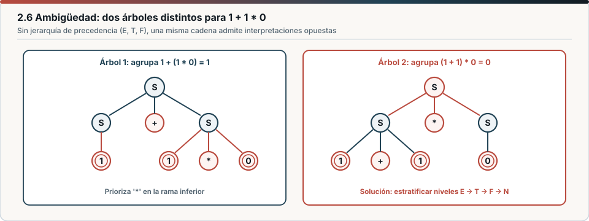
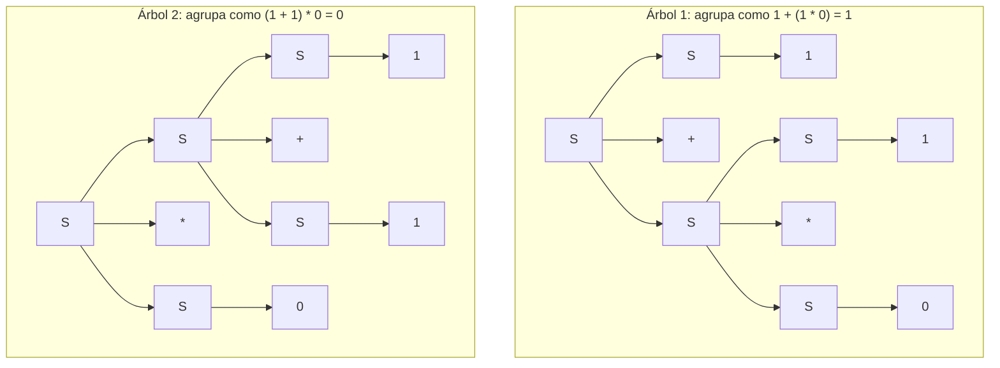
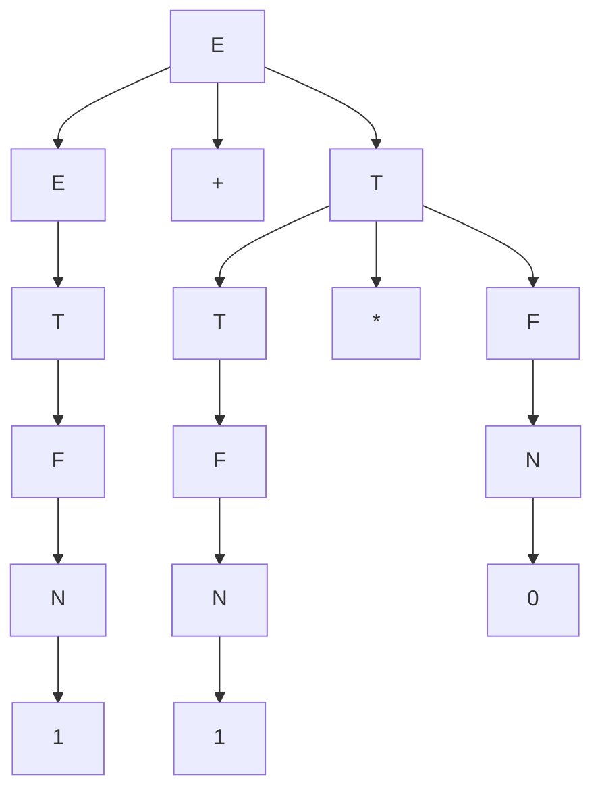
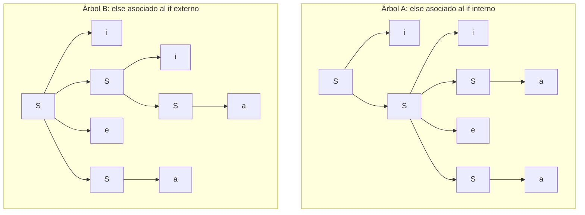

# 2.6 Ambigüedad

## Introducción

En la sección anterior se comprobó que dos derivaciones arbitrarias distintas pueden generar exactamente el mismo árbol de derivación, puesto que el árbol solo captura la estructura jerárquica de la cadena y no el orden en que se expanden ramas independientes. Sin embargo, cuando una gramática libre del contexto admite **dos o más árboles de derivación diferentes** para una misma cadena terminal $w$, dicha cadena posee **múltiples estructuras sintácticas**. En el diseño de compiladores, donde el árbol sintáctico determina directamente la evaluación semántica de una expresión o el flujo de control de un programa, esta multiplicidad representa una ambigüedad crítica que debe detectarse y resolverse (De Castro Korgi, 2004, Secc. 4.4–4.5; Acevedo Juárez, 2006, Secc. 3.3, 3.8).

## Definición formal de gramática ambigua

### Definición 2.6.1 (Gramática ambigua)

Una gramática libre del contexto $G = (V, \Sigma, P, S)$ es **ambigua** si existe al menos una cadena $w \in L(G)$ para la cual existen **dos o más árboles de derivación distintos** (De Castro Korgi, 2004, Def. 4.4.2, p. 91).

Por el Teorema 2.5.1 (biyección entre árboles de derivación y derivaciones canónicas), esta definición admite dos formulaciones equivalentes:

$$G \text{ es ambigua} \iff \exists w \in L(G) \text{ con al menos dos derivaciones } \Rightarrow_{lm}^* \text{ distintas}$$
$$\phantom{G \text{ es ambigua}} \iff \exists w \in L(G) \text{ con al menos dos derivaciones } \Rightarrow_{rm}^* \text{ distintas}$$

Si toda cadena $w \in L(G)$ posee exactamente un único árbol de derivación (equivalentemente, una única derivación más a la izquierda), se dice que $G$ es **no ambigua**.

> **Advertencia metodológica:** Mostrar dos derivaciones generales distintas para una misma cadena $w$ **no demuestra ambigüedad**, ya que ambas pueden corresponder al mismo árbol sintáctico. Para demostrar que $G$ es ambigua debe exhibirse una cadena testigo $w \in L(G)$ junto con **dos árboles de derivación distintos**, o bien **dos derivaciones más a la izquierda** ($\Rightarrow_{lm}$) distintas (o dos $\Rightarrow_{rm}$ distintas).

## Desambiguación de gramáticas

La **ambigüedad** es una propiedad de la **gramática**, no necesariamente del lenguaje. Con frecuencia es posible **desambiguar** una gramática ambigua $G$ construyendo una nueva gramática equivalente $G'$ ($L(G') = L(G)$) que sea no ambigua.

En el contexto de los lenguajes de programación existen dos estrategias principales:
1. **Reescritura estructural de la gramática:** Introducir variables auxiliares por niveles para codificar explícitamente la **precedencia** de operadores, la **asociatividad** (por la izquierda o por la derecha) o el **emparejamiento** de estructuras condicionales.
2. **Reglas externas de desambiguación (De Castro Korgi, 2004, p. 92):** Conservar una gramática más compacta aunque ambigua —como $E \to E + E \mid E * E \mid \dots$— e indicar directamente a la herramienta que construye el analizador sintáctico del compilador qué operador tiene mayor prioridad (por ejemplo, que `*` se evalúe antes que `+`).

### El problema del *dangling else* (*else* colgante)

Un caso célebre de ambigüedad en lenguajes imperativos (como C, Java o Pascal) surge en sentencias condicionales anidadas donde la cláusula `else` es opcional. Considere la gramática simplificada sobre terminales $\Sigma = \{i, e, a\}$, donde $i$ abrevia `if cond then`, $e$ abrevia `else` y $a$ representa una instrucción simple:

$$S \to iS \mid iSeS \mid a$$

La cadena `iiaea` (es decir, `if c1 then if c2 then s1 else s2`) admite dos árboles de derivación distintos: uno asocia el `else` con el `if` interno (`if c1 then (if c2 then s1 else s2)`) y el otro lo asocia con el `if` externo (`if c1 then (if c2 then s1) else s2`), alterando radicalmente el comportamiento del programa cuando `c1` es falsa.

La solución estándar consiste en **desambiguar la gramática** diferenciando entre sentencias **apareadas / completas** ($M$, donde todo `if` entre `then` y `else` tiene su propio `else`) y sentencias **abiertas / no apareadas** ($U$):

$$\begin{aligned}
S &\to M \mid U \\
M &\to iMeM \mid a \\
U &\to iS \mid iMeU
\end{aligned}$$

Al exigir en $M \to iMeM$ que la rama del `then` que precede a un `else` sea obligatoriamente una sentencia completa $M$, ningún `if` sin `else` puede quedar encerrado entre `then` y `else`, forzando de manera única que cada `else` se vincule con el `if` pendiente más cercano (el interno).

## Lenguajes inherentemente ambiguos e indecidibilidad

### Definición 2.6.2 (Lenguaje inherentemente ambiguo)

Un lenguaje independiente del contexto $L$ se denomina **inherentemente ambiguo** si **toda** gramática libre del contexto $G$ que lo genera ($L(G) = L$) es ambigua (De Castro Korgi, 2004, p. 93). Es decir, no existe ninguna gramática no ambigua equivalente para $L$.

El ejemplo clásico citado por De Castro Korgi (2004, p. 93) es el lenguaje sobre $\Sigma = \{a, b, c, d\}$:

$$L = \{a^i b^i c^j d^j \mid i, j \ge 1\} \cup \{a^i b^j c^j d^i \mid i, j \ge 1\}$$

Intuitivamente, aunque cada componente por separado posee una GIC no ambigua ($S_1 \to A B$, $A \to aAb \mid ab$, $B \to cBd \mid cd$ para el primero; $S_2 \to a S_2 d \mid a C d$, $C \to bCc \mid bc$ para el segundo), cualquier GIC que genere la unión debe usar dos mecanismos incompatibles para generar cadenas de la intersección $\{a^n b^n c^n d^n \mid n \ge 1\}$ (emparejar $(a,b)$ con $(c,d)$ frente a emparejar $(a,d)$ con $(b,c)$). Mediante técnicas avanzadas de bombeo puede demostrarse que toda GIC para $L$ genera forzosamente dos árboles distintos para $a^n b^n c^n d^n$ cuando $n$ es suficientemente grande.

### Indecidibilidad de la ambigüedad

Un resultado teórico profundo (De Castro Korgi, 2004, p. 93) establece que **el problema de determinar si una GIC arbitraria $G$ es ambigua es indecidible**: no existe ningún algoritmo general que reciba cualquier GIC $G$ y responda siempre correctamente `SÍ` o `NO` a la pregunta *"¿es $G$ ambigua?"*. Esto no impide demostrar la ambigüedad de gramáticas concretas exhibiendo una cadena con dos árboles, ni diseñar gramáticas sin ambigüedad que los compiladores puedan analizar paso a paso sin dudar (como las que se estudiarán en asignaturas posteriores de compiladores).

## Ejemplos desarrollados paso a paso

### Ejemplo 1: Expresiones aritméticas — ambigüedad y desambiguación por precedencia y asociatividad

#### Parte A: Gramática ambigua (De Castro Korgi, 2004, pp. 91–92)

Considere la gramática $G_{\text{amb}}$ sobre $\Sigma = \{0, 1, +, *, (, )\}$ para expresiones aritméticas en binario:

$$S \to S + S \mid S * S \mid (S) \mid 0S \mid 1S \mid 0 \mid 1$$

Tomemos la cadena $w = 1 + 1 * 0 \in L(G_{\text{amb}})$. A continuación exhibimos **dos derivaciones más a la izquierda distintas** para $w$:

- **Derivación $\Rightarrow_{lm}$ 1 (expande primero $+$):**
  $$\underline{S} \Rightarrow_{lm} \underline{S} + S \Rightarrow_{lm} 1 + \underline{S} \Rightarrow_{lm} 1 + \underline{S} * S \Rightarrow_{lm} 1 + 1 * \underline{S} \Rightarrow_{lm} 1 + 1 * 0$$
- **Derivación $\Rightarrow_{lm}$ 2 (expande primero $*$):**
  $$\underline{S} \Rightarrow_{lm} \underline{S} * S \Rightarrow_{lm} \underline{S} + S * S \Rightarrow_{lm} 1 + \underline{S} * S \Rightarrow_{lm} 1 + 1 * \underline{S} \Rightarrow_{lm} 1 + 1 * 0$$

Los dos árboles de derivación distintos correspondientes muestran el conflicto semántico:

La existencia de dos árboles distintos prueba que $G_{\text{amb}}$ es **ambigua**: según el Árbol 1 la expresión evalúa a $1$, mientras que según el Árbol 2 evalúa a $0$. (Incluso con un único operador, $1 + 1 + 0$ también tiene dos agrupaciones distintas: $(1 + 1) + 0$ y $1 + (1 + 0)$).

#### Parte B: Desambiguación por jerarquía de variables ($E, T, F$)

Adaptando la gramática de la sección 4.5 de De Castro Korgi (2004, p. 95), introducimos tres niveles sintácticos —**Expresión** ($E$), **Término** ($T$) y **Factor** ($F$)— además de **Número** ($N$):

$$\begin{aligned}
E &\to E + T \mid T \\
T &\to T * F \mid F \\
F &\to (E) \mid N \\
N &\to 1N \mid 0N \mid 0 \mid 1
\end{aligned}$$

¿Cómo logra esta gramática eliminar la ambigüedad?
1. **Precedencia ($*$ antes que $+$):** El operador $+$ reside en el nivel superior ($E$), mientras que $*$ reside en un nivel más profundo ($T$). Para usar $+$ dentro de una multiplicación es obligatorio rodearlo con paréntesis mediante $F \to (E)$.
2. **Asociatividad por la izquierda:** Las reglas $E \to E + T$ y $T \to T * F$ son **recursivas por la izquierda**, obligando a que una cadena como $1 + 1 + 0$ se agrupe únicamente como $(1 + 1) + 0$ (pues el operando derecho de $+$ debe ser un $T$, incapaz de contener una suma sin paréntesis).

**Única derivación más a la izquierda ($\Rightarrow_{lm}$) para $1 + 1 * 0$ en la gramática desambiguada:**

$$\begin{aligned}
\underline{E} &\Rightarrow_{lm} \underline{E} + T \Rightarrow_{lm} \underline{T} + T \Rightarrow_{lm} \underline{F} + T \Rightarrow_{lm} \underline{N} + T \\
&\Rightarrow_{lm} 1 + \underline{T} \Rightarrow_{lm} 1 + \underline{T} * F \Rightarrow_{lm} 1 + \underline{F} * F \Rightarrow_{lm} 1 + \underline{N} * F \\
&\Rightarrow_{lm} 1 + 1 * \underline{F} \Rightarrow_{lm} 1 + 1 * \underline{N} \Rightarrow_{lm} 1 + 1 * 0
\end{aligned}$$

Ahora el árbol es **único** y respeta automáticamente la precedencia algebraica $1 + (1 * 0)$.

---

### Ejemplo 2: Ambigüedad y desambiguación del *dangling else*

En la gramática ambigua $S \to iS \mid iSeS \mid a$, derivemos la cadena `iiaea` mediante dos derivaciones más a la izquierda distintas:

- **Derivación $\Rightarrow_{lm}$ 1 ($e$ pertenece al `if` interno):**
  $$\underline{S} \Rightarrow_{lm} i\underline{S} \Rightarrow_{lm} ii\underline{S}eS \Rightarrow_{lm} iiae\underline{S} \Rightarrow_{lm} iiaea$$
- **Derivación $\Rightarrow_{lm}$ 2 ($e$ pertenece al `if` externo):**
  $$\underline{S} \Rightarrow_{lm} i\underline{S}eS \Rightarrow_{lm} ii\underline{S}eS \Rightarrow_{lm} iiae\underline{S} \Rightarrow_{lm} iiaea$$

**Comprobación con la gramática desambiguada** ($S \to M \mid U$, $M \to iMeM \mid a$, $U \to iS \mid iMeU$):
- Toda cadena derivada de $M$ contiene exactamente el mismo número de $i$ que de $e$. Como `iiaea` posee dos $i$ y una sola $e$, no puede derivarse desde $M$ ni aplicando $U \to iMeU$ (pues el bloque $M$ no puede generar el prefijo `ia`).
- Por lo tanto, la única derivación más a la izquierda posible comienza obligatoriamente con $S \Rightarrow_{lm} U \Rightarrow_{lm} iS$:
  $$\underline{S} \Rightarrow_{lm} \underline{U} \Rightarrow_{lm} i\underline{S} \Rightarrow_{lm} i\underline{M} \Rightarrow_{lm} ii\underline{M}eM \Rightarrow_{lm} iiae\underline{M} \Rightarrow_{lm} iiaea$$
*(En $i\underline{S}$, la única forma de derivar `iaea` —que posee un `i` y un `e`— es pasando por $S \to M$ y $M \to iMeM$, ligando el `else` al `if` interno de manera única).*

---

### Ejemplo 3: Ambigüedad sin operadores y gramática equivalente no ambigua (De Castro Korgi, 2004, pp. 92–93)

Considere la gramática $G$ sobre $\Sigma = \{a, b\}$:

$$S \to aSA \mid \lambda, \qquad A \to bA \mid \lambda$$

La cadena `aab` posee dos derivaciones más a la izquierda distintas:

- **Derivación 1:**
  $$\underline{S} \Rightarrow_{lm} a\underline{S}A \Rightarrow_{lm} aa\underline{S}AA \Rightarrow_{lm} aa\underline{A}A \Rightarrow_{lm} aa\underline{A} \Rightarrow_{lm} aab\underline{A} \Rightarrow_{lm} aab$$
  *(El primer $A$ se anuló con $A \to \lambda$ y el segundo produjo $b$).*
- **Derivación 2:**
  $$\underline{S} \Rightarrow_{lm} a\underline{S}A \Rightarrow_{lm} aa\underline{S}AA \Rightarrow_{lm} aa\underline{A}A \Rightarrow_{lm} aab\underline{A}A \Rightarrow_{lm} aab\underline{A} \Rightarrow_{lm} aab$$
  *(El primer $A$ produjo $b$ y el segundo se anuló con $A \to \lambda$).*

Al poder repartirse las $b$ arbitrariamente entre múltiples copias de $A$, $G$ es ambigua. El lenguaje generado es $L(G) = a^+ b^* \cup \{\lambda\}$.

**Desambiguación:** Podemos separar la generación de $a$ de la generación de $b$ mediante la gramática $G'$:

$$S \to AB \mid \lambda, \qquad A \to aA \mid a, \qquad B \to bB \mid \lambda$$

En $G'$, la cadena $\lambda$ tiene una única derivación ($S \Rightarrow \lambda$), y cualquier cadena no vacía $a^m b^n$ ($m \ge 1, n \ge 0$) comienza forzosamente por $S \Rightarrow_{lm} AB$, genera las $m$ letras $a$ de forma única mediante $A$ ($m-1$ pasos $A \to aA$ y un paso $A \to a$) y genera las $n$ letras $b$ de forma única mediante $B$ ($n$ pasos $B \to bB$ y un paso $B \to \lambda$). Luego $G'$ es equivalente a $G$ y **no ambigua**.

## Ejercicios propuestos

1. Demuestra que las siguientes gramáticas son ambiguas exhibiendo una cadena con **dos derivaciones más a la izquierda distintas** y dibujando sus **dos árboles de derivación** (De Castro Korgi, 2004, p. 94):
   - a) $S \to aSbS \mid bSaS \mid \lambda$
   - b) $S \to abS \mid abScS \mid \lambda$
2. Muestra que las siguientes gramáticas son ambiguas, determina el lenguaje que genera cada una y construye una gramática equivalente **no ambigua** (De Castro Korgi, 2004, p. 94):
   - a) $G_1$: $S \to AaSbB \mid \lambda,\; A \to aA \mid a,\; B \to bB \mid \lambda$
   - b) $G_2$: $S \to ASB \mid AB,\; A \to aA \mid a,\; B \to bB \mid \lambda$
3. Amplía la gramática desambiguada de expresiones aritméticas ($E, T, F, N$) del Ejemplo 1 para incluir:
   - El operador de resta `-` con igual precedencia que `+` y asociatividad por la izquierda.
   - El operador de potencia `^` con mayor precedencia que `*` y **asociatividad por la derecha** (de modo que `1^0^1` se agrupe como `1^(0^1)`).
   Deriva y dibuja el árbol único para `1 + 1 * 0 ^ 1 ^ 0`.
4. Con la gramática desambiguada del *dangling else* ($S \to M \mid U$, $M \to iMeM \mid a$, $U \to iS \mid iMeU$), construye la derivación más a la izquierda y el árbol de derivación para la cadena `iiiaea`.
5. Construye una GIC **no ambigua** que genere el lenguaje $L = a^* b (a \cup b)^*$ sobre $\Sigma = \{a, b\}$ y explica brevemente por qué garantiza un único árbol para cada cadena.

## Referencias

- Acevedo Juárez, A. (2006). *Teoría de la computación* [Tesis de licenciatura, Instituto Tecnológico de Celaya].
- De Castro Korgi, R. (2004). *Teoría de la computación: Lenguajes, autómatas, gramáticas*. Universidad Nacional de Colombia.
- Hopcroft, J. E., Motwani, R., & Ullman, J. D. (2007). *Introduction to automata theory, languages, and computation* (3.ª ed.). Pearson Addison-Wesley.
