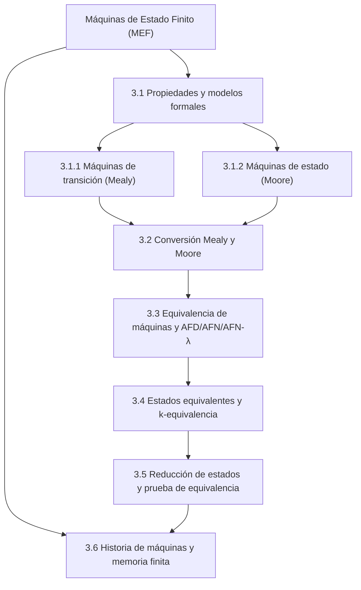
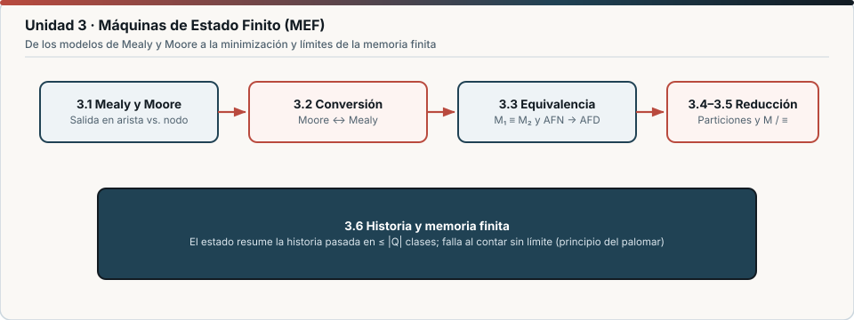

# Unidad 3: Máquinas de Estado Finito

- **Duración:** 20 horas
- **Competencia(s) a desarrollar:** Estudia la formulación matemática del autómata más simple: máquina de estado finito con la solución de ejercicios de manera creativa y transformando máquinas equivalentes.

## Introducción

Las **máquinas de estado finito** (MEF) constituyen el modelo computacional abstracto más elemental para procesar secuencias de símbolos utilizando una cantidad acotada de memoria interna. Tras estudiar las nociones preliminares de máquinas de información, aceptadores y traductores (Unidad 1) y los sistemas generativos de la jerarquía de Chomsky (Unidad 2), en esta unidad se formalizan los dispositivos finitos desde una doble perspectiva:

1. **Máquinas secuenciales deterministas con salida (traductores finitos):** modelos que transforman una cadena de entrada $w \in \Sigma^*$ en una cadena de salida sobre un alfabeto $\Delta$, clasificadas en **máquinas de transición** (modelo de Mealy, donde la salida depende del estado y del símbolo leído) y **máquinas de estado** (modelo de Moore, donde la salida depende únicamente del estado actual).
2. **Autómatas finitos aceptadores:** modelos reconocedores de lenguajes (AFD, AFN y AFN-$\lambda$) cuyo comportamiento externo se caracteriza por el conjunto de cadenas aceptadas $L(M) \subseteq \Sigma^*$, sirviendo como puente directo hacia los lenguajes regulares (Unidad 4).

A lo largo de la unidad se estudian sus definiciones matemáticas, los algoritmos de interconversión entre los modelos de Mealy y Moore, las nociones de equivalencia externa entre máquinas y equivalencia interna entre estados, los métodos sistemáticos de minimización y prueba de equivalencia, y la interpretación del estado como un resumen finito de la historia de entradas junto con la evolución histórica del modelo.

## Mapa conceptual

## Subtemas

- [3.1 Propiedades de las máquinas de estado finito](3-1-propiedades-de-las-maquinas-de-estado-finito.md)
  - Formalización matemática general de una MEF ($Q, \Sigma, \Delta, \delta, \omega, q_0$), propiedades estructurales de finitud, determinismo y secuencialidad, y distinción de notación entre la cadena vacía $\lambda$ y la función de salida $\omega$ (o $\lambda_{\text{out}}$).
  - **3.1.1 Máquinas de transición:** Modelo de Mealy con función de salida $\omega: Q \times \Sigma \to \Delta$ asociada a las transiciones.
  - **3.1.2 Máquinas de estado:** Modelo de Moore con función de salida $\omega: Q \to \Delta$ asociada a los estados, y su relación directa con los autómatas finitos aceptadores.
- [3.2 Conversión entre máquinas de transición y estados](3-2-conversion-entre-maquinas-de-transicion-y-estados.md)
  - Equivalencia entrada-salida módulo símbolo inicial, algoritmo de conversión Moore $\to$ Mealy conservando estados, y algoritmo de conversión Mealy $\to$ Moore mediante desdoblamiento de estados en $Q \times \Delta$.
- [3.3 Equivalencia de máquinas de estado finito](3-3-equivalencia-de-maquinas-de-estado-finito.md)
  - Extensión recursiva de $\hat{\delta}$ y $\hat{\omega}$ a cadenas $w \in \Sigma^*$, equivalencia de máquinas con salida ($M_1 \equiv M_2$) y equivalencia computacional entre AFD, AFN y AFN-$\lambda$ mediante construcción de subconjuntos y $\lambda$-clausura (De Castro Korgi, 2004, Secc. 2.5–2.7).
- [3.4 Estados equivalentes](3-4-estados-equivalentes.md)
  - Definición de estados equivalentes ($p \equiv q$) y distinguibles ($p \not\equiv q$), relación de $k$-equivalencia ($\equiv_k$), demostración de sus propiedades como relación de equivalencia y refinamiento inductivo de particiones $P_0, P_1, \dots, P_k$ con cota de convergencia.
- [3.5 Reducción de estados y prueba de equivalencia](3-5-reduccion-de-estados-y-prueba-de-equivalencia.md)
  - Eliminación de estados inaccesibles, minimización por refinamiento de particiones y tabla de pares distinguibles, construcción de la máquina mínima obtenida al fusionar estados equivalentes (máquina cociente $M / {\equiv}$), teorema de Myhill-Nerode y algoritmos de prueba de equivalencia entre dos máquinas $M_1$ y $M_2$.
- [3.6 Historia de máquinas y memoria finita](3-6-historia-de-maquinas-y-memoria-finita.md)
  - Interpretación del estado como resumen finito de la historia de entrada, máquinas de memoria finita y eventos definidos de orden $k$, limitaciones inherentes a la memoria finita y evolución histórica desde McCulloch y Pitts (1943) hasta Rabin y Scott (1959).

## Referencias

- Acevedo Juárez, A. (2006). *Teoría de la computación* [Tesis de licenciatura, Instituto Tecnológico de Celaya].
- De Castro Korgi, R. (2004). *Teoría de la computación: Lenguajes, autómatas, gramáticas*. Universidad Nacional de Colombia.
- Hopcroft, J. E., Motwani, R., & Ullman, J. D. (2002). *Introducción a la teoría de autómatas, lenguajes y computación* (2.ª ed.). Pearson Educación.
- Kohavi, Z., & Jha, N. K. (2010). *Switching and finite automata theory* (3.ª ed.). Cambridge University Press.
- Mealy, G. H. (1955). A method for synthesizing sequential circuits. *The Bell System Technical Journal*, *34*(5), 1045–1079.
- Moore, E. F. (1956). Gedanken-experiments on sequential machines. En C. E. Shannon & J. McCarthy (Eds.), *Automata studies* (pp. 129–153). Princeton University Press.
- Rabin, M. O., & Scott, D. (1959). Finite automata and their decision problems. *IBM Journal of Research and Development*, *3*(2), 114–125.
