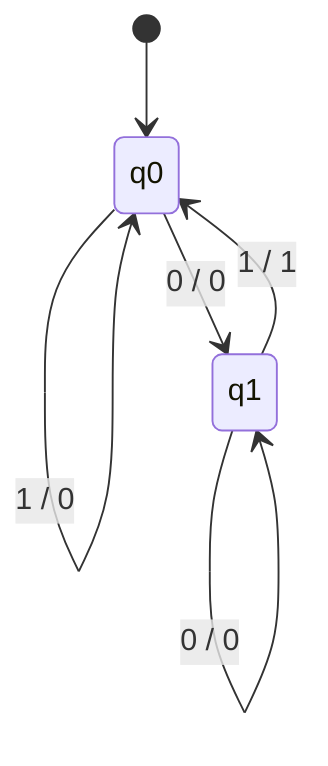
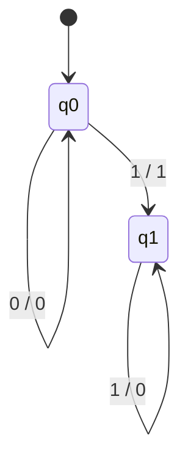
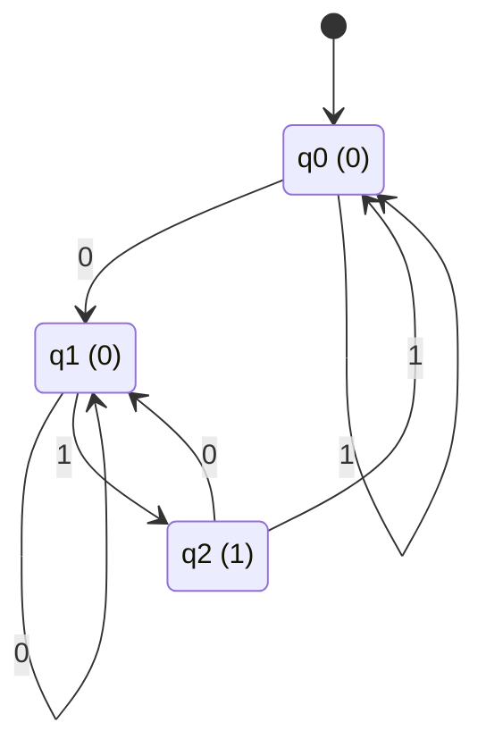
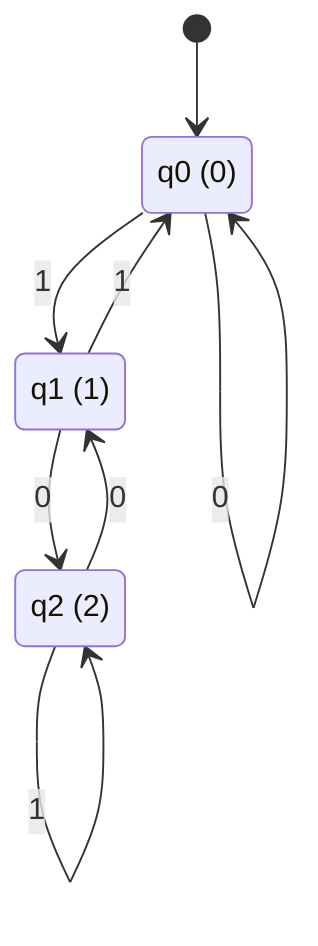

# 3.1 Propiedades de las máquinas de estado finito

## Introducción y motivación

En el estudio de los sistemas digitales, los protocolos de comunicación, los controladores embebidos y los analizadores léxicos de compiladores, con frecuencia se requiere modelar dispositivos que reciben una secuencia discreta de estímulos y responden produciendo una secuencia de acciones o señales de salida, utilizando únicamente una capacidad finita de almacenamiento interno. A diferencia de los sistemas puramente combinacionales —cuya salida depende solo de la entrada en el instante actual—, una **máquina de estado finito** (MEF) conserva en su *estado interno* la información esencial de las entradas procesadas con anterioridad.

Como señala De Castro Korgi (2004, Cap. 2), un autómata finito procesa los símbolos de entrada escritos sobre una cinta de izquierda a derecha, contando con una unidad de control o memoria que posee un número finito de configuraciones internas llamadas **estados**. Mientras que los autómatas aceptadores deciden únicamente si una cadena pertenece o no a un lenguaje, en la teoría clásica de máquinas secuenciales (Mealy, 1955; Moore, 1956) se incorpora explícitamente un alfabeto de salida y una función de respuesta, dando origen a dos formulaciones canónicas: las **máquinas de transición** (de Mealy) y las **máquinas de estado** (de Moore).

## Modelo matemático general y propiedades fundamentales

Una **máquina de estado finito determinista con salida** (o traductor secuencial finito) se especifica mediante seis componentes:

$$M = (Q, \Sigma, \Delta, \delta, \omega, q_0)$$

donde:

1. **$Q$:** conjunto finito y no vacío de **estados internos** ($|Q| < \infty$).
2. **$\Sigma$:** **alfabeto de entrada**, conjunto finito y no vacío de símbolos de entrada.
3. **$\Delta$:** **alfabeto de salida**, conjunto finito y no vacío de símbolos de salida.
4. **$\delta: Q \times \Sigma \to Q$:** **función de transición de estados** (o de próximo estado), que determina el único estado siguiente $\delta(q, a)$ cuando la máquina está en el estado $q \in Q$ y lee el símbolo $a \in \Sigma$.
5. **$\omega$ (o $\lambda_{\text{out}}$):** **función de salida**, cuya firma distingue a las máquinas de transición (Mealy) de las máquinas de estado (Moore).
6. **$q_0 \in Q$:** **estado inicial** en el que la máquina comienza todo cómputo.

> **Nota sobre notación:** Siguiendo a De Castro Korgi (2004, p. 11), en este curso se reserva el símbolo $\lambda$ exclusivamente para la **cadena vacía**. Por ello, para evitar confusión con la cadena vacía $\lambda$, la función de salida se denota mediante $\omega$ (o $\lambda_{\text{out}}$ cuando se haga referencia a literatura de diseño lógico que usa $\lambda$). Asimismo, aunque De Castro Korgi (2004, Secc. 2.4) emplea $\Delta$ para la relación de transición de autómatas no deterministas, en máquinas con salida $\Delta$ designa siempre al **alfabeto de salida**; cualquier colisión en el subtema 3.3 se aclarará explícitamente.

### Propiedades estructurales de las MEF

Todo sistema modelado por una máquina de estado finito satisface cinco propiedades matemáticas esenciales:

- **Finitud:** tanto la memoria interna ($Q$) como los vocabularios de interacción ($\Sigma$ y $\Delta$) son conjuntos finitos. Si $|Q| = n$, el estado actual puede codificarse en hardware usando $\lceil \log_2 n \rceil$ bits.
- **Determinismo y completitud:** dado que $\delta$ es una función total sobre $Q \times \Sigma$, desde cada estado $q$ y para cada símbolo $a \in \Sigma$ existe una única transición definida (máquina completamente especificada).
- **Operación síncrona y unidireccional:** la entrada $w = a_1 a_2 \cdots a_m \in \Sigma^*$ se procesa símbolo a símbolo en pasos discretos $t = 1, 2, \dots, m$, sin posibilidad de retroceder sobre símbolos ya leídos ni de reescribir la entrada (De Castro Korgi, 2004, p. 27).
- **Causalidad:** la salida emitida en el instante $t$ depende exclusivamente del estado alcanzado hasta ese momento y, en el modelo de Mealy, del símbolo presente en $t$; nunca depende de símbolos futuros.
- **Generalización de los aceptadores:** un autómata finito determinista (AFD) $M_{\text{AFD}} = (\Sigma, Q, q_0, F, \delta)$ equivale estructuralmente a una máquina de estado (Moore) con alfabeto de salida binario $\Delta = \{0, 1\}$ y función de salida $\omega(q) = 1$ si $q \in F$ y $\omega(q) = 0$ si $q \notin F$.

## 3.1.1 Máquinas de transición

### Definición formal (Máquina de Mealy)

Propuesta por George H. Mealy (1955), una **máquina de transición** (o **máquina de Mealy**) es una séxtupla:

$$M = (Q, \Sigma, \Delta, \delta, \omega, q_0)$$

donde $Q, \Sigma, \Delta, \delta$ y $q_0$ cumplen las condiciones del modelo general, y la función de salida está definida sobre las transiciones:

$$\omega: Q \times \Sigma \to \Delta \qquad \bigl(\text{también notada } \lambda_{\text{out}}: Q \times \Sigma \to \Delta\bigr)$$

### Explicación intuitiva y comportamiento temporal

En una máquina de transición, la salida se genera **durante la transición de un estado a otro**, por lo que depende tanto del estado actual $q \in Q$ como del símbolo de entrada $a \in \Sigma$ que dispara el cambio. En el diagrama de estados, cada flecha de transición se rotula con el par `a / y`, donde $a \in \Sigma$ es la entrada y $y = \omega(q, a) \in \Delta$ es la salida emitida.

Debido a que se emite exactamente un símbolo de salida por cada símbolo de entrada consumido, si la máquina procesa una cadena de entrada $w = a_1 a_2 \cdots a_m \in \Sigma^*$ de longitud $m \ge 0$, entonces:

- Para $w = \lambda$ ($m = 0$), no ocurre ninguna transición y la salida es la cadena vacía $\lambda$.
- Para $w = a_1 a_2 \cdots a_m$ ($m \ge 1$), la máquina emite una cadena de salida $y_1 y_2 \cdots y_m \in \Delta^*$ de **exactamente longitud $m$**, donde $y_i = \omega(q_{i-1}, a_i)$ y $q_i = \delta(q_{i-1}, a_i)$ para $1 \le i \le m$.

### Ejemplo 1: Detector de la subcadena `01` (con traslape) en máquina de transición

Diseñar una máquina de transición $M_1 = (Q, \Sigma, \Delta, \delta, \omega, q_0)$ sobre $\Sigma = \{0, 1\}$ y $\Delta = \{0, 1\}$ que emita `1` en el instante en que los dos últimos símbolos leídos formen la subcadena `01`, y `0` en cualquier otro caso.

**Paso 1. Definición de estados según la historia relevante:**
Para saber si al leer un `1` se completa el patrón `01`, la máquina solo necesita recordar si el último símbolo leído fue `0`:
- $q_0$: estado inicial; no se ha leído ningún símbolo aún, o el último símbolo leído fue `1`.
- $q_1$: el último símbolo leído fue `0`.

Por tanto, $Q = \{q_0, q_1\}$, $\Sigma = \{0, 1\}$, $\Delta = \{0, 1\}$ y el estado inicial es $q_0$.

**Paso 2. Tabla de transición ($\delta$) y salida ($\omega$):**

| Estado actual | $\delta(q, 0)$ | $\omega(q, 0)$ | $\delta(q, 1)$ | $\omega(q, 1)$ |
| :--- | :---: | :---: | :---: | :---: |
| $\to q_0$ | $q_1$ | $0$ | $q_0$ | $0$ |
| $q_1$ | $q_1$ | $0$ | $q_0$ | $1$ |

**Paso 3. Diagrama de transiciones:**

**Paso 4. Traza paso a paso para la entrada $w = 100101$:**

| Paso $t$ | Estado actual | Símbolo leído | Estado siguiente $\delta(q, a)$ | Salida $\omega(q, a)$ | Subcadena reciente |
| :---: | :---: | :---: | :---: | :---: | :--- |
| 1 | $q_0$ | `1` | $q_0$ | `0` | `1` |
| 2 | $q_0$ | `0` | $q_1$ | `0` | `10` |
| 3 | $q_1$ | `0` | $q_1$ | `0` | `00` |
| 4 | $q_1$ | `1` | $q_0$ | `1` | `01` (detectado) |
| 5 | $q_0$ | `0` | $q_1$ | `0` | `10` |
| 6 | $q_1$ | `1` | $q_0$ | `1` | `01` (detectado) |

Para la entrada $w = 100101$ ($|w| = 6$), la respuesta de $M_1$ es `000101` (también de longitud $6$).

### Ejemplo 2: Calculador en serie de complemento a dos

Diseñar una máquina de transición $M_2$ sobre $\Sigma = \{0, 1\}$ y $\Delta = \{0, 1\}$ que reciba un número binario bit a bit desde el bit menos significativo (LSB) hasta el bit más significativo (MSB) y genere en su salida el **complemento a dos** del número recibido.

**Paso 1. Regla aritmética e identificación de estados:**
Al recorrer un número binario de derecha a izquierda (LSB $\to$ MSB), el algoritmo del complemento a dos consiste en:
- Copiar todos los ceros iniciales y el **primer `1`** sin alterarlos.
- Invertir ($0 \mapsto 1$, $1 \mapsto 0$) todos los bits que lleguen **después** de ese primer `1`.

De aquí surgen dos estados:
- $q_0$: estado inicial (*aún no ha aparecido el primer `1`*).
- $q_1$: (*ya apareció el primer `1`*; modo de inversión).

**Paso 2. Tabla de transición y salida:**

| Estado actual | $\delta(q, 0)$ | $\omega(q, 0)$ | $\delta(q, 1)$ | $\omega(q, 1)$ |
| :--- | :---: | :---: | :---: | :---: |
| $\to q_0$ | $q_0$ | $0$ | $q_1$ | $1$ |
| $q_1$ | $q_1$ | $1$ | $q_1$ | $0$ |

**Paso 3. Diagrama de transiciones:**

**Paso 4. Verificación con el número de 4 bits $1010_2$ ($10_{10}$):**
Ingresando la cadena desde el LSB hacia el MSB, la entrada es $w = 0101$:
1. $(q_0, 0) \mapsto$ pasa a $q_0$, emite `0`.
2. $(q_0, 1) \mapsto$ pasa a $q_1$, emite `1`.
3. $(q_1, 0) \mapsto$ pasa a $q_1$, emite `1`.
4. $(q_1, 1) \mapsto$ pasa a $q_1$, emite `0`.

La salida obtenida es `0110` (en orden LSB $\to$ MSB, lo que corresponde al número $0110_2 = 6_{10} \equiv -10 \pmod{16}$), resultado exacto del complemento a dos en 4 bits.

## 3.1.2 Máquinas de estado

### Definición formal (Máquina de Moore)

Introducida por Edward F. Moore (1956), una **máquina de estado** (o **máquina de Moore**) es una séxtupla:

$$M = (Q, \Sigma, \Delta, \delta, \omega, q_0)$$

donde $Q, \Sigma, \Delta, \delta$ y $q_0$ tienen exactamente el mismo significado que en el modelo general, y la función de salida depende **únicamente del estado**:

$$\omega: Q \to \Delta \qquad \bigl(\text{también notada } \lambda_{\text{out}}: Q \to \Delta\bigr)$$

### Explicación intuitiva y comparación con las máquinas de transición

En una máquina de estado, la salida está anclada al nodo (estado) y no a la arista de transición. Como la máquina inicia su operación en $q_0$ antes de leer el primer símbolo, **emite inmediatamente $\omega(q_0)$ para la cadena vacía $\lambda$**. Luego, al procesar $w = a_1 a_2 \cdots a_m$ de longitud $m$, visita la sucesión de $m + 1$ estados $q_0, q_1, \dots, q_m$ (con $q_i = \delta(q_{i-1}, a_i)$) y genera la cadena de salida:

$$\omega(q_0)\,\omega(q_1)\,\omega(q_2)\cdots \omega(q_m) \in \Delta^+$$

de **longitud $m + 1$**.

| Característica | Máquina de transición (Mealy) | Máquina de estado (Moore) |
| :--- | :--- | :--- |
| **Firma de $\omega$** | $\omega: Q \times \Sigma \to \Delta$ | $\omega: Q \to \Delta$ |
| **Dependencia de la salida** | Estado actual y símbolo de entrada | Exclusivamente el estado actual |
| **Etiquetado en el diagrama** | En las aristas (`a / y`) | En los nodos (`q / y`) y aristas con `a` |
| **Salida para $w = \lambda$** | $\lambda$ (longitud $0$) | $\omega(q_0)$ (longitud $1$) |
| **Longitud de salida para $|w| = m$** | $m$ | $m + 1$ |
| **Relación con AFD** | Requiere trasladar aceptación a aristas | Un AFD es un caso particular con $\Delta = \{0, 1\}$ |

### Ejemplo 3: Detector de la subcadena `01` en máquina de estado (Moore)

Construir una máquina de estado (Moore) $M_3$ sobre $\Sigma = \{0, 1\}$ y $\Delta = \{0, 1\}$ que emita `1` cuando el último par de símbolos leídos haya sido `01`, y `0` en caso contrario.

**Paso 1. Definición de estados y salidas:**
En una máquina de Moore no es posible distinguir directamente si un `1` que entra proviene de `01` o de `11` dentro de un único estado con salida fija; por ello se requieren **3 estados**:
- $q_0$: estado inicial o el último símbolo leído fue `1` sin formar `01` ($\omega(q_0) = 0$).
- $q_1$: el último símbolo leído fue `0` ($\omega(q_1) = 0$).
- $q_2$: los últimos dos símbolos leídos fueron `01` ($\omega(q_2) = 1$).

**Paso 2. Tabla de transición y salida:**

| Estado actual | $\delta(q, 0)$ | $\delta(q, 1)$ | Salida $\omega(q)$ |
| :--- | :---: | :---: | :---: |
| $\to q_0$ | $q_1$ | $q_0$ | $0$ |
| $q_1$ | $q_1$ | $q_2$ | $0$ |
| $q_2$ | $q_1$ | $q_0$ | $1$ |

**Paso 3. Diagrama de transiciones:**

**Paso 4. Traza paso a paso para $w = 100101$:**

| Paso $t$ | Entrada acumulada | Estado actual | Salida emitida $\omega(q)$ |
| :---: | :--- | :---: | :---: |
| 0 (inicial) | $\lambda$ | $q_0$ | `0` |
| 1 | `1` | $\delta(q_0, 1) = q_0$ | `0` |
| 2 | `10` | $\delta(q_0, 0) = q_1$ | `0` |
| 3 | `100` | $\delta(q_1, 0) = q_1$ | `0` |
| 4 | `1001` | $\delta(q_1, 1) = q_2$ | `1` |
| 5 | `10010` | $\delta(q_2, 0) = q_1$ | `0` |
| 6 | `100101` | $\delta(q_1, 1) = q_2$ | `1` |

La salida total es `0000101` (longitud $6 + 1 = 7$). Si se omite el símbolo inicial $\omega(q_0) = 0$, la secuencia `000101` coincide exactamente con la obtenida en el Ejemplo 1.

### Ejemplo 4: Calculador de residuo módulo 3 de un número binario (Moore)

Diseñar una máquina de estado $M_4$ con $\Sigma = \{0, 1\}$ y $\Delta = \{0, 1, 2\}$ que lea un número binario de MSB a LSB y entregue en cada paso el residuo módulo $3$ del prefijo leído hasta ese momento.

**Paso 1. Estados y aritmética modular:**
Si el valor entero del prefijo leído es $N$ con residuo $r = N \bmod 3 \in \{0, 1, 2\}$, al leer un nuevo bit $b \in \{0, 1\}$ el nuevo número es $2N + b$, cuyo residuo módulo $3$ es:

$$r' = (2r + b) \bmod 3$$

Definimos $Q = \{q_0, q_1, q_2\}$ donde el subíndice coincide con el residuo ($\omega(q_i) = i$ para $i \in \{0, 1, 2\}$) y $q_0$ es el estado inicial (valor vacío $0 \equiv 0 \pmod 3$).

**Paso 2. Tabla de transición y salida:**

| Estado ($r$) | $\delta(q_r, 0) = (2r) \bmod 3$ | $\delta(q_r, 1) = (2r + 1) \bmod 3$ | Salida $\omega(q_r)$ |
| :--- | :---: | :---: | :---: |
| $\to q_0$ | $q_0$ | $q_1$ | $0$ |
| $q_1$ | $q_2$ | $q_0$ | $1$ |
| $q_2$ | $q_1$ | $q_2$ | $2$ |

**Paso 3. Diagrama de transiciones:**

**Paso 4. Traza paso a paso para $w = 1101$ ($1101_2 = 13_{10}$):**
1. Estado inicial ($\lambda \to 0$): $q_0$, emite `0` ($0 \bmod 3 = 0$).
2. Lee `1` ($1_2 = 1$): $\delta(q_0, 1) = q_1$, emite `1` ($1 \bmod 3 = 1$).
3. Lee `1` ($11_2 = 3$): $\delta(q_1, 1) = q_0$, emite `0` ($3 \bmod 3 = 0$).
4. Lee `0` ($110_2 = 6$): $\delta(q_0, 0) = q_0$, emite `0` ($6 \bmod 3 = 0$).
5. Lee `1` ($1101_2 = 13$): $\delta(q_0, 1) = q_1$, emite `1` ($13 \bmod 3 = 1$).

La salida completa es `01001`. Obsérvese que, si se fija como conjunto de aceptación $F = \{q_0\}$, la misma estructura de transición constituye el AFD que acepta los múltiplos binarios de $3$.

## Ejercicios propuestos

1. **Trazado de salidas:** Dada la máquina de Mealy del Ejemplo 1 (detector de `01`), determine la secuencia de estados visitados y la cadena de salida producida para las entradas $w_1 = \lambda$, $w_2 = 0011010$ y $w_3 = 111000$. Repita el ejercicio para la máquina de Moore del Ejemplo 3.
2. **Diseño de máquina de transición (Mealy):** Construya la tabla de transición, el diagrama en formato `stateDiagram-v2` y la definición formal de una máquina de Mealy con $\Sigma = \{a, b\}$ y $\Delta = \{0, 1\}$ que emita `1` cada vez que la cantidad acumulada de símbolos `a` sea par y la de símbolos `b` sea impar, y `0` en cualquier otro caso.
3. **Diseño de máquina de estado (Moore):** Diseñe una máquina de Moore sobre $\Sigma = \{0, 1\}$ y $\Delta = \{A, B, C\}$ que emita: `A` si el número de unos leídos hasta el momento es congruente con $0 \pmod 3$; `B` si es congruente con $1 \pmod 3$; y `C` si es congruente con $2 \pmod 3$. Evalúe la cadena $w = 1011011$.
4. **Relación con aceptadores (AFD $\leftrightarrow$ Moore):** Dado el AFD de De Castro Korgi (2004, Secc. 2.1, p. 27) con $Q = \{q_0, q_1, q_2\}$, $\Sigma = \{a, b\}$, $F = \{q_0, q_2\}$, $\delta(q_0, a) = q_0$, $\delta(q_0, b) = q_1$, $\delta(q_1, a) = q_1$, $\delta(q_1, b) = q_2$, $\delta(q_2, a) = q_1$, $\delta(q_2, b) = q_1$, expréselo formalmente como una máquina de Moore con $\Delta = \{0, 1\}$ y trace la salida completa para $u = aabab$ y $v = aababa$.

## Referencias

- Acevedo Juárez, A. (2006). *Teoría de la computación* [Tesis de licenciatura, Instituto Tecnológico de Celaya].
- De Castro Korgi, R. (2004). *Teoría de la computación: Lenguajes, autómatas, gramáticas*. Universidad Nacional de Colombia.
- Kohavi, Z., & Jha, N. K. (2010). *Switching and finite automata theory* (3.ª ed.). Cambridge University Press.
- Mealy, G. H. (1955). A method for synthesizing sequential circuits. *The Bell System Technical Journal*, *34*(5), 1045–1079.
- Moore, E. F. (1956). Gedanken-experiments on sequential machines. En C. E. Shannon & J. McCarthy (Eds.), *Automata studies* (pp. 129–153). Princeton University Press.
