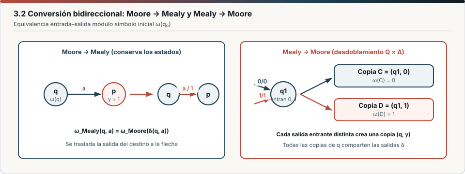
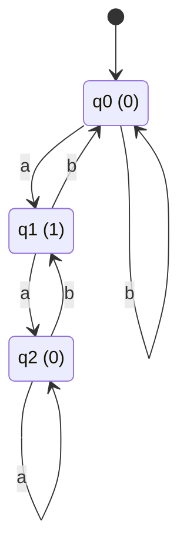
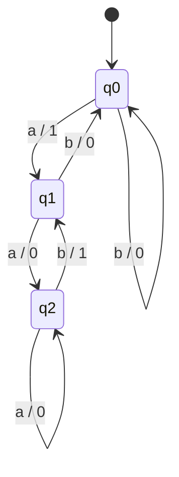
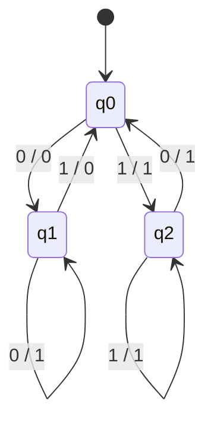
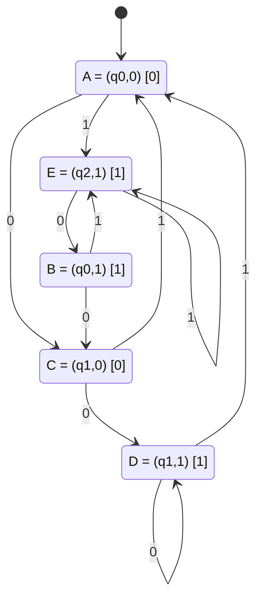

# 3.2 Conversión entre máquinas de transición y estados

## Introducción y motivación

En el subtema anterior se definieron dos variantes de máquinas de estado finito deterministas con salida: las **máquinas de transición** (Mealy), cuya salida se produce en las aristas ($\omega: Q \times \Sigma \to \Delta$), y las **máquinas de estado** (Moore), cuya salida está fija en los nodos ($\omega: Q \to \Delta$). Al diseñar un circuito secuencial o un analizador léxico, puede resultar más natural especificar la respuesta asociada a un evento (Mealy) o asociarla directamente a la situación alcanzada (Moore). Surge entonces una pregunta teórica fundamental: ¿poseen ambos modelos exactamente la misma capacidad de traducción?

La respuesta es afirmativa, salvo por una diferencia estructural inevitable: **el desfase de un símbolo en la longitud de la salida**. Mientras una máquina de Mealy responde a una cadena $w \in \Sigma^*$ de longitud $m$ con una cadena de salida de longitud $m$, una máquina de Moore emite primero la salida de su estado inicial $\omega(q_0)$ y produce en total $m + 1$ símbolos. Este tema formaliza dicha equivalencia y presenta los algoritmos constructivos de conversión en ambas direcciones.

## Equivalencia módulo símbolo inicial entre Mealy y Moore

Sea $M_{\text{Mealy}} = (Q_1, \Sigma, \Delta, \delta_1, \omega_1, q_{01})$ una máquina de transición y $M_{\text{Moore}} = (Q_2, \Sigma, \Delta, \delta_2, \omega_2, q_{02})$ una máquina de estado sobre los mismos alfabetos $\Sigma$ y $\Delta$.

Denotemos por $\hat{\omega}_1(q_{01}, w) \in \Delta^*$ la cadena de salida producida por $M_{\text{Mealy}}$ al procesar $w \in \Sigma^*$, y por $\hat{\omega}_2(q_{02}, w) \in \Delta^+$ la cadena de salida producida por $M_{\text{Moore}}$ al procesar $w$.

**Definición (Equivalencia Mealy–Moore):** Se dice que $M_{\text{Mealy}}$ y $M_{\text{Moore}}$ son **equivalentes** (módulo la salida inicial de Moore) si y solo si para toda cadena de entrada $w \in \Sigma^*$:

$$\hat{\omega}_2(q_{02}, w) = \omega_2(q_{02}) \cdot \hat{\omega}_1(q_{01}, w)$$

Intuitivamente, si se descarta el símbolo inicial $\omega_2(q_{02})$ que la máquina de Moore exhibe antes de recibir cualquier entrada ($w = \lambda$), los $m$ símbolos restantes coinciden posición a posición con la salida de la máquina de Mealy para toda entrada $w$ de longitud $m$.

## Conversión de máquina de estado (Moore) a máquina de transición (Mealy)

### Teorema 3.2.1 (Equivalencia Moore $\to$ Mealy)

Dada cualquier máquina de Moore $M = (Q, \Sigma, \Delta, \delta, \omega_{\text{Moore}}, q_0)$, existe una máquina de Mealy equivalente $M' = (Q, \Sigma, \Delta, \delta, \omega_{\text{Mealy}}, q_0)$ con el mismo conjunto de estados $Q$, el mismo estado inicial $q_0$ y la misma función de transición $\delta$, definida mediante:

$$\omega_{\text{Mealy}}(q, a) = \omega_{\text{Moore}}\bigl(\delta(q, a)\bigr) \qquad \forall q \in Q,\; \forall a \in \Sigma.$$

**Demostración (por inducción sobre la longitud de $w$):**
Para toda cadena $w \in \Sigma^*$, probaremos que $\hat{\omega}_{\text{Moore}}(q_0, w) = \omega_{\text{Moore}}(q_0) \cdot \hat{\omega}_{\text{Mealy}}(q_0, w)$ y que ambas máquinas finalizan en el mismo estado $\hat{\delta}(q_0, w)$:
- *Caso base ($w = \lambda$):* En Moore, $\hat{\omega}_{\text{Moore}}(q_0, \lambda) = \omega_{\text{Moore}}(q_0)$. En Mealy, $\hat{\omega}_{\text{Mealy}}(q_0, \lambda) = \lambda$, por lo que $\omega_{\text{Moore}}(q_0) \cdot \lambda = \omega_{\text{Moore}}(q_0)$. Ambas permanecen en $q_0$.
- *Paso inductivo:* Supóngase que el enunciado vale para $w \in \Sigma^*$, alcanzando el estado $p = \hat{\delta}(q_0, w)$. Al leer un símbolo adicional $a \in \Sigma$:
  - La máquina de Moore transita a $p' = \delta(p, a)$ y concatena $\omega_{\text{Moore}}(\delta(p, a))$ al final de su salida:
    $$\hat{\omega}_{\text{Moore}}(q_0, wa) = \hat{\omega}_{\text{Moore}}(q_0, w) \cdot \omega_{\text{Moore}}(\delta(p, a)).$$
  - La máquina de Mealy también transita a $p' = \delta(p, a)$ y concatena $\omega_{\text{Mealy}}(p, a) = \omega_{\text{Moore}}(\delta(p, a))$:
    $$\omega_{\text{Moore}}(q_0) \cdot \hat{\omega}_{\text{Mealy}}(q_0, wa) = \omega_{\text{Moore}}(q_0) \cdot \hat{\omega}_{\text{Mealy}}(q_0, w) \cdot \omega_{\text{Mealy}}(p, a).$$
  Por hipótesis de inducción y por la definición de $\omega_{\text{Mealy}}$, ambas expresiones son idénticas. $\blacksquare$

### Algoritmo 1: Moore $\to$ Mealy

1. Conservar exactamente $Q, \Sigma, \Delta, \delta$ y $q_0$.
2. Para cada estado $q \in Q$ y cada símbolo $a \in \Sigma$, consultar el estado destino $p = \delta(q, a)$ y asignar a la arista $(q, a)$ la salida $\omega_{\text{Mealy}}(q, a) = \omega_{\text{Moore}}(p)$.
3. *(Opcional)* Verificar si, tras trasladar las salidas a las transiciones, han surgido estados equivalentes que permitan minimizar $|Q|$ (véanse los subtemas 3.4 y 3.5).

### Ejemplo 1: Conversión Moore $\to$ Mealy paso a paso

Considérese la máquina de estado (Moore) $M_1 = (Q, \Sigma, \Delta, \delta, \omega_{\text{Moore}}, q_0)$ con $Q = \{q_0, q_1, q_2\}$, $\Sigma = \{a, b\}$, $\Delta = \{0, 1\}$, definida por la tabla y diagrama siguientes:

| Estado actual | $\delta(q, a)$ | $\delta(q, b)$ | $\omega_{\text{Moore}}(q)$ |
| :--- | :---: | :---: | :---: |
| $\to q_0$ | $q_1$ | $q_0$ | $0$ |
| $q_1$ | $q_2$ | $q_0$ | $1$ |
| $q_2$ | $q_2$ | $q_1$ | $0$ |

**Paso 1. Cálculo de $\omega_{\text{Mealy}}(q, s) = \omega_{\text{Moore}}(\delta(q, s))$ para cada par $(q, s)$:**
- Desde $q_0$:
  - $\omega_{\text{Mealy}}(q_0, a) = \omega_{\text{Moore}}(\delta(q_0, a)) = \omega_{\text{Moore}}(q_1) = 1$
  - $\omega_{\text{Mealy}}(q_0, b) = \omega_{\text{Moore}}(\delta(q_0, b)) = \omega_{\text{Moore}}(q_0) = 0$
- Desde $q_1$:
  - $\omega_{\text{Mealy}}(q_1, a) = \omega_{\text{Moore}}(\delta(q_1, a)) = \omega_{\text{Moore}}(q_2) = 0$
  - $\omega_{\text{Mealy}}(q_1, b) = \omega_{\text{Moore}}(\delta(q_1, b)) = \omega_{\text{Moore}}(q_0) = 0$
- Desde $q_2$:
  - $\omega_{\text{Mealy}}(q_2, a) = \omega_{\text{Moore}}(\delta(q_2, a)) = \omega_{\text{Moore}}(q_2) = 0$
  - $\omega_{\text{Mealy}}(q_2, b) = \omega_{\text{Moore}}(\delta(q_2, b)) = \omega_{\text{Moore}}(q_1) = 1$

**Paso 2. Tabla y diagrama de la máquina de Mealy equivalente $M_1'$:**

| Estado actual | $\delta(q, a)$ | $\omega_{\text{Mealy}}(q, a)$ | $\delta(q, b)$ | $\omega_{\text{Mealy}}(q, b)$ |
| :--- | :---: | :---: | :---: | :---: |
| $\to q_0$ | $q_1$ | $1$ | $q_0$ | $0$ |
| $q_1$ | $q_2$ | $0$ | $q_0$ | $0$ |
| $q_2$ | $q_2$ | $0$ | $q_1$ | $1$ |

**Paso 3. Verificación con la cadena de entrada $w = aaba$:**
- En $M_1$ (Moore): $q_0 \text{ [0]} \xrightarrow{a} q_1 \text{ [1]} \xrightarrow{a} q_2 \text{ [0]} \xrightarrow{b} q_1 \text{ [1]} \xrightarrow{a} q_2 \text{ [0]}$. Salida: `01010`.
- En $M_1'$ (Mealy): $q_0 \xrightarrow{a/1} q_1 \xrightarrow{a/0} q_2 \xrightarrow{b/1} q_1 \xrightarrow{a/0} q_2$. Salida: `1010`.

Se verifica que `01010` $= \omega_{\text{Moore}}(q_0) \cdot \text{1010}$.

## Conversión de máquina de transición (Mealy) a máquina de estado (Moore)

La conversión inversa requiere mayor cuidado porque en una máquina de Mealy distintas aristas que llegan a un mismo estado $q$ pueden producir salidas diferentes. Como una máquina de Moore solo puede asociar **una única salida** a cada estado, la solución consiste en **desdoblar** cada estado $q \in Q$ en tantas copias como salidas distintas puedan llegar a él.

### Teorema 3.2.2 (Equivalencia Mealy $\to$ Moore)

Dada una máquina de Mealy $M = (Q, \Sigma, \Delta, \delta, \omega_{\text{Mealy}}, q_0)$, existe una máquina de Moore equivalente $M' = (Q', \Sigma, \Delta, \delta', \omega_{\text{Moore}}, q_0')$ con a lo sumo $|Q'| \le |Q| \cdot |\Delta| + 1$ estados (y a lo sumo $|Q| \cdot |\Delta|$ si se reutiliza una copia de $q_0$ como estado inicial).

**Construcción formal (desdoblamiento de estados):**
Sea $Y(q) = \{\omega_{\text{Mealy}}(p, a) \in \Delta : p \in Q,\; a \in \Sigma,\; \delta(p, a) = q\}$ el conjunto de símbolos de salida emitidos por las transiciones que entran en $q$.

1. Para cada $q \in Q \setminus \{q_0\}$, se crea un estado $(q, y)$ por cada $y \in Y(q)$ (si $Y(q) = \emptyset$, $q$ es inaccesible desde cualquier transición y puede omitirse).
2. Para el estado inicial $q_0$:
   - Si $Y(q_0) \neq \emptyset$, puede tomarse cualquier par existente $(q_0, y_0)$ con $y_0 \in Y(q_0)$ como estado inicial $q_0'$ (cuando no importa cuál sea el símbolo inicial de Moore), o bien crearse un estado inicial dedicado $q_0' = (q_0, y_{\text{init}})$ con un símbolo predeterminado $y_{\text{init}} \in \Delta$ si la especificación exige una salida inicial fija.
   - Si $Y(q_0) = \emptyset$ (ninguna transición retorna a $q_0$), se crea $q_0' = (q_0, y_0)$ con algún $y_0 \in \Delta$ elegido.
3. La **función de salida** de $M'$ se define por:
   $$\omega_{\text{Moore}}\bigl((q, y)\bigr) = y.$$
4. La **función de transición** $\delta': Q' \times \Sigma \to Q'$ se define por:
   $$\delta'\bigl((q, y), a\bigr) = \bigl(\delta(q, a),\; \omega_{\text{Mealy}}(q, a)\bigr) \qquad \forall (q, y) \in Q',\; \forall a \in \Sigma.$$

Obsérvese la propiedad clave de esta construcción: $\delta'((q, y), a)$ depende únicamente de $q$ y $a$, y **no depende de $y$**. Todas las copias desdobladas $(q, y_1), (q, y_2)$ poseen exactamente las mismas transiciones salientes y solo difieren en la salida $\omega_{\text{Moore}}$ que emiten al llegar a ellas.

**Demostración (esquema inductivo):**
Se demuestra por inducción sobre $|w|$ que, si $\hat{\delta}(q_0, w) = q$, entonces $\hat{\delta}'(q_0', w) = (q, y)$ para algún $y \in \Delta$, y que $\hat{\omega}_{\text{Moore}}(q_0', w) = \omega_{\text{Moore}}(q_0') \cdot \hat{\omega}_{\text{Mealy}}(q_0, w)$:
- *Base ($w = \lambda$):* $\hat{\delta}'(q_0', \lambda) = q_0' = (q_0, y_0)$, y $\hat{\omega}_{\text{Moore}}(q_0', \lambda) = y_0 = \omega_{\text{Moore}}(q_0') \cdot \lambda$.
- *Paso inductivo:* Supóngase el resultado cierto para $w$, con $\hat{\delta}(q_0, w) = q$ y $\hat{\delta}'(q_0', w) = (q, y)$. Al leer $a \in \Sigma$, $M$ pasa a $\delta(q, a)$ emitiendo $\omega_{\text{Mealy}}(q, a)$, mientras $M'$ pasa a $\delta'((q, y), a) = (\delta(q, a), \omega_{\text{Mealy}}(q, a))$ y concatena $\omega_{\text{Moore}}((\delta(q, a), \omega_{\text{Mealy}}(q, a))) = \omega_{\text{Mealy}}(q, a)$. Así, la concatenación coincide en ambos modelos. $\blacksquare$

### Algoritmo 2: Mealy $\to$ Moore

1. Inspeccionar todas las entradas de la tabla de $M$ y listar, para cada estado $q \in Q$, el conjunto de salidas entrantes $Y(q)$.
2. Crear un nuevo estado $(q, y)$ por cada $q \in Q$ y cada $y \in Y(q)$ (es decir, solo se desdoblan los estados a los que llegan múltiples salidas distintas). Si $Y(q_0) = \emptyset$, añadir $(q_0, y_0)$ con un símbolo $y_0 \in \Delta$ arbitrario; si $Y(q_0) \neq \emptyset$, elegir un $(q_0, y_0)$ con $y_0 \in Y(q_0)$ como $q_0'$ (o añadir $(q_0, y_{\text{init}})$ si se requiere una salida inicial específica).
3. Asignar la salida de cada nuevo estado: $\omega_{\text{Moore}}((q, y)) = y$.
4. Completar las transiciones: desde cualquier copia $(q, y)$ bajo la entrada $a$, ir al estado $(\delta(q, a), \omega_{\text{Mealy}}(q, a))$.

### Ejemplo 2: Conversión Mealy $\to$ Moore paso a paso

Considérese la máquina de transición (Mealy) $M_2$ con $Q = \{q_0, q_1, q_2\}$, $\Sigma = \{0, 1\}$, $\Delta = \{0, 1\}$, dada por:

| Estado actual | $\delta(q, 0)$ | $\omega(q, 0)$ | $\delta(q, 1)$ | $\omega(q, 1)$ |
| :--- | :---: | :---: | :---: | :---: |
| $\to q_0$ | $q_1$ | $0$ | $q_2$ | $1$ |
| $q_1$ | $q_1$ | $1$ | $q_0$ | $0$ |
| $q_2$ | $q_0$ | $1$ | $q_2$ | $1$ |

**Paso 1. Identificar las salidas entrantes $Y(q)$ para cada estado:**
- Hacia $q_0$: desde $(q_1, 1)$ entra con salida `0`; desde $(q_2, 0)$ entra con salida `1`. Luego $Y(q_0) = \{0, 1\}$ $\implies$ **$q_0$ se desdobla** en $A = (q_0, 0)$ y $B = (q_0, 1)$.
- Hacia $q_1$: desde $(q_0, 0)$ entra con salida `0`; desde $(q_1, 0)$ entra con salida `1`. Luego $Y(q_1) = \{0, 1\}$ $\implies$ **$q_1$ se desdobla** en $C = (q_1, 0)$ y $D = (q_1, 1)$.
- Hacia $q_2$: desde $(q_0, 1)$ entra con salida `1`; desde $(q_2, 1)$ entra con salida `1`. Luego $Y(q_2) = \{1\}$ $\implies$ **$q_2$ no se desdobla**, basta un único estado $E = (q_2, 1)$.

Como $Y(q_0) = \{0, 1\}$ no es vacío, elegimos $A = (q_0, 0)$ como estado inicial $q_0'$ (con salida inicial `0`).

**Paso 2. Construcción de $\delta'$ y $\omega_{\text{Moore}}$:**
- Desde $A = (q_0, 0)$ y $B = (q_0, 1)$ (ambos replican las transiciones de $q_0$):
  - Con `0`: $(\delta(q_0, 0), \omega(q_0, 0)) = (q_1, 0) = C$.
  - Con `1`: $(\delta(q_0, 1), \omega(q_0, 1)) = (q_2, 1) = E$.
- Desde $C = (q_1, 0)$ y $D = (q_1, 1)$ (ambos replican las transiciones de $q_1$):
  - Con `0`: $(\delta(q_1, 0), \omega(q_1, 0)) = (q_1, 1) = D$.
  - Con `1`: $(\delta(q_1, 1), \omega(q_1, 1)) = (q_0, 0) = A$.
- Desde $E = (q_2, 1)$ (replica las transiciones de $q_2$):
  - Con `0`: $(\delta(q_2, 0), \omega(q_2, 0)) = (q_0, 1) = B$.
  - Con `1`: $(\delta(q_2, 1), \omega(q_2, 1)) = (q_2, 1) = E$.

**Paso 3. Tabla y diagrama de la máquina de Moore equivalente $M_2'$:**

| Estado de Moore | Par asociado | $\delta'(s, 0)$ | $\delta'(s, 1)$ | $\omega_{\text{Moore}}(s)$ |
| :--- | :---: | :---: | :---: | :---: |
| $\to A$ | $(q_0, 0)$ | $C$ | $E$ | $0$ |
| $B$ | $(q_0, 1)$ | $C$ | $E$ | $1$ |
| $C$ | $(q_1, 0)$ | $D$ | $A$ | $0$ |
| $D$ | $(q_1, 1)$ | $D$ | $A$ | $1$ |
| $E$ | $(q_2, 1)$ | $B$ | $E$ | $1$ |

**Paso 4. Verificación con la cadena de entrada $w = 00110$:**
- En $M_2$ (Mealy):
  $q_0 \xrightarrow{0/0} q_1 \xrightarrow{0/1} q_1 \xrightarrow{1/0} q_0 \xrightarrow{1/1} q_2 \xrightarrow{0/1} q_0$.
  Salida: `01011` (longitud $5$).
- En $M_2'$ (Moore):
  $A\text{ [0]} \xrightarrow{0} C\text{ [0]} \xrightarrow{0} D\text{ [1]} \xrightarrow{1} A\text{ [0]} \xrightarrow{1} E\text{ [1]} \xrightarrow{0} B\text{ [1]}$.
  Salida: `001011` (longitud $6$).

Quitando el primer símbolo $\omega_{\text{Moore}}(A) = 0$, la salida de $M_2'$ es exactamente `01011`, idéntica a la de $M_2$.

## Ejercicios propuestos

1. Convierta la máquina de Moore del Ejemplo 4 del subtema 3.1 (residuo módulo $3$ de números binarios) a una máquina de Mealy equivalente utilizando el Algoritmo 1. Verifique las salidas para $w = 1011$ ($11_{10}$).
2. Convierta la máquina de Mealy del complemento a dos (Ejemplo 2 del subtema 3.1) a una máquina de Moore equivalente mediante el Algoritmo 2, indicando qué estados se desdoblan y tomando como salida inicial `0`. Compruebe la respuesta para $w = 0101$.
3. Considere la máquina de Mealy $M$ con $Q = \{q_0, q_1\}$, $\Sigma = \{a, b\}$, $\Delta = \{0, 1, 2\}$, donde:
   - $\delta(q_0, a) = q_1$, $\omega(q_0, a) = 1$; $\delta(q_0, b) = q_0$, $\omega(q_0, b) = 0$;
   - $\delta(q_1, a) = q_1$, $\omega(q_1, a) = 2$; $\delta(q_1, b) = q_0$, $\omega(q_1, b) = 1$.
   Transforme $M$ en una máquina de Moore equivalente, dibuje su diagrama en `stateDiagram-v2` y evalúe $w = baab$.
4. **Reflexión teórica:** Si se parte de una máquina de Moore $M$ con $n$ estados, se convierte a Mealy $M'$ y luego se vuelve a convertir $M'$ a Moore $M''$ con los Algoritmos 1 y 2, ¿tiene $M''$ necesariamente el mismo número de estados que $M$? Justifique su respuesta mediante un ejemplo o contraejemplo.

## Referencias

- De Castro Korgi, R. (2004). *Teoría de la computación: Lenguajes, autómatas, gramáticas*. Universidad Nacional de Colombia.
- Hopcroft, J. E., Motwani, R., & Ullman, J. D. (2002). *Introducción a la teoría de autómatas, lenguajes y computación* (2.ª ed.). Pearson Educación.
- Kohavi, Z., & Jha, N. K. (2010). *Switching and finite automata theory* (3.ª ed.). Cambridge University Press.
- Mealy, G. H. (1955). A method for synthesizing sequential circuits. *The Bell System Technical Journal*, *34*(5), 1045–1079.
- Moore, E. F. (1956). Gedanken-experiments on sequential machines. En C. E. Shannon & J. McCarthy (Eds.), *Automata studies* (pp. 129–153). Princeton University Press.
