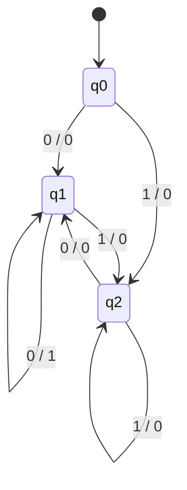
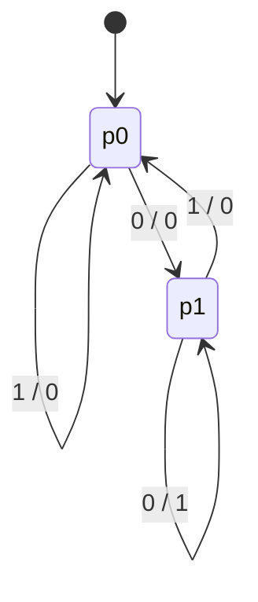
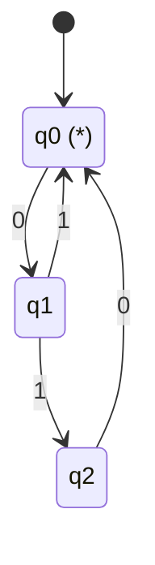
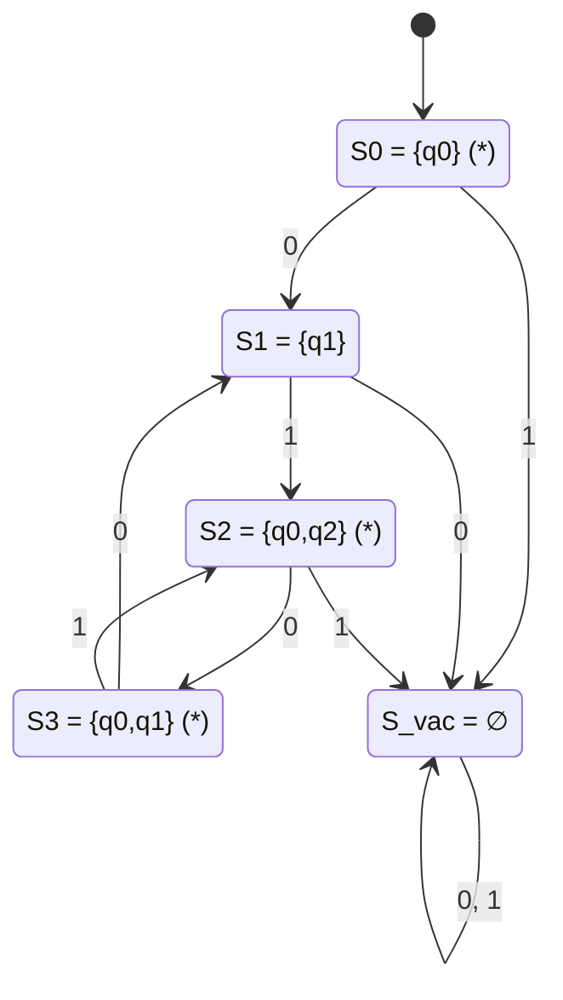
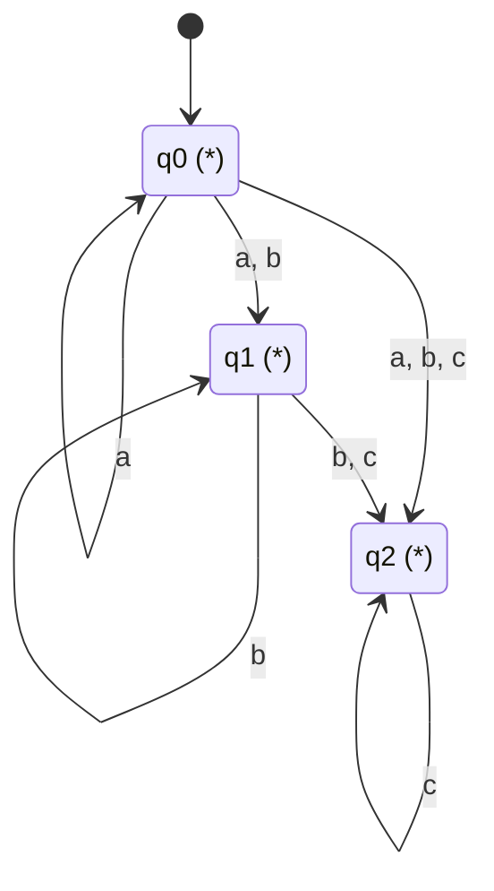

# 3.3 Equivalencia de máquinas de estado finito

## Introducción y motivación

Una misma tarea computacional o un mismo lenguaje puede implementarse mediante múltiples máquinas de estado finito de aspecto muy distinto: máquinas con diferente número de estados, transiciones etiquetadas de otra manera, o incluso con no determinismo y transiciones espontáneas. Para poder comparar modelos, optimizar diseños o demostrar que dos implementaciones se comportan de manera idéntica ante cualquier usuario externo, es indispensable formalizar qué significa que **dos máquinas sean equivalentes**.

En este subtema se aborda la noción de equivalencia desde sus dos vertientes complementarias:

1. **Equivalencia de comportamiento entrada-salida en máquinas con salida** (Mealy y Moore), extendiendo formalmente las funciones $\delta$ y $\omega$ a cadenas arbitrarias $w \in \Sigma^*$.
2. **Equivalencia computacional entre aceptadores** (AFD, AFN y AFN-$\lambda$), demostrando mediante la construcción de subconjuntos y la $\lambda$-clausura que el no determinismo y las transiciones $\lambda$ no aumentan el conjunto de lenguajes reconocibles (De Castro Korgi, 2004, Secc. 2.5–2.7; Acevedo Juárez, 2006, Secc. 2.2).

## Extensión de $\hat{\delta}$ y $\hat{\omega}$ a cadenas $w \in \Sigma^*$

Hasta ahora $\delta$ y $\omega$ se definieron para un único símbolo de entrada $a \in \Sigma$. Para describir el procesamiento completo de cualquier cadena $w \in \Sigma^*$, extendemos recursivamente ambas funciones (De Castro Korgi, 2004, Def. 2.5.2, donde la función extendida se denota $\dot{\delta}$).

### Función de transición extendida $\hat{\delta}$

Dada una máquina determinista con función de transición $\delta: Q \times \Sigma \to Q$, la **función de transición extendida** $\hat{\delta}: Q \times \Sigma^* \to Q$ se define recursivamente como:

$$\begin{cases}
\hat{\delta}(q, \lambda) = q & \forall q \in Q, \\
\hat{\delta}(q, wa) = \delta\bigl(\hat{\delta}(q, w),\, a\bigr) & \forall q \in Q,\; \forall w \in \Sigma^*,\; \forall a \in \Sigma.
\end{cases}$$

En particular, para un símbolo aislado $a = \lambda a \in \Sigma$, $\hat{\delta}(q, a) = \delta(\hat{\delta}(q, \lambda), a) = \delta(q, a)$. Además, por inducción sobre $|v|$, se cumple la propiedad de composición:

$$\hat{\delta}(q, uv) = \hat{\delta}\bigl(\hat{\delta}(q, u),\, v\bigr) \qquad \forall q \in Q,\; \forall u, v \in \Sigma^*.$$

### Función de respuesta extendida $\hat{\omega}$

La **función de respuesta extendida** $\hat{\omega}: Q \times \Sigma^* \to \Delta^*$ entrega la secuencia completa de símbolos de salida generada al procesar la cadena $w \in \Sigma^*$ partiendo desde el estado $q \in Q$:

- **Para máquinas de transición (Mealy):**
  $$\begin{cases}
  \hat{\omega}(q, \lambda) = \lambda & \forall q \in Q, \\
  \hat{\omega}(q, wa) = \hat{\omega}(q, w) \cdot \omega\bigl(\hat{\delta}(q, w),\, a\bigr) & \forall q \in Q,\; \forall w \in \Sigma^*,\; \forall a \in \Sigma.
  \end{cases}$$
  Por inducción sobre $|w|$, se cumple $|\hat{\omega}(q, w)| = |w|$ y $\hat{\omega}(q, uv) = \hat{\omega}(q, u) \cdot \hat{\omega}(\hat{\delta}(q, u), v)$.

- **Para máquinas de estado (Moore):**
  $$\begin{cases}
  \hat{\omega}(q, \lambda) = \omega(q) & \forall q \in Q, \\
  \hat{\omega}(q, wa) = \hat{\omega}(q, w) \cdot \omega\bigl(\hat{\delta}(q, wa)\bigr) & \forall q \in Q,\; \forall w \in \Sigma^*,\; \forall a \in \Sigma.
  \end{cases}$$
  Por inducción sobre $|w|$, se cumple $|\hat{\omega}(q, w)| = |w| + 1$.

## Equivalencia entre máquinas de estado finito con salida

### Definición formal ($M_1 \equiv M_2$)

Sean $M_1 = (Q_1, \Sigma, \Delta, \delta_1, \omega_1, q_{01})$ y $M_2 = (Q_2, \Sigma, \Delta, \delta_2, \omega_2, q_{02})$ dos máquinas deterministas del mismo tipo (ambas de Mealy o ambas de Moore) definidas sobre los mismos alfabetos de entrada $\Sigma$ y salida $\Delta$.

Se dice que $M_1$ y $M_2$ son **equivalentes**, lo cual se denota **$M_1 \equiv M_2$**, si y solo si para toda cadena de entrada $w \in \Sigma^*$ producen exactamente la misma cadena de respuesta desde sus respectivos estados iniciales:

$$M_1 \equiv M_2 \iff \forall w \in \Sigma^*,\quad \hat{\omega}_1(q_{01}, w) = \hat{\omega}_2(q_{02}, w).$$

Cuando $M_1$ es de Mealy y $M_2$ es de Moore, la equivalencia se entiende módulo el símbolo inicial $\omega_2(q_{02})$, conforme se estableció en el subtema 3.2: $\hat{\omega}_2(q_{02}, w) = \omega_2(q_{02}) \cdot \hat{\omega}_1(q_{01}, w)$ para todo $w \in \Sigma^*$.

En el caso particular de los **autómatas finitos aceptadores**, el lenguaje aceptado por un AFD $M = (\Sigma, Q, q_0, F, \delta)$ se expresa mediante la función extendida como (De Castro Korgi, 2004, p. 41):

$$L(M) = \{w \in \Sigma^* : \hat{\delta}(q_0, w) \in F\}$$

y dos aceptadores $M_1$ y $M_2$ son equivalentes si aceptan el mismo lenguaje, es decir, $L(M_1) = L(M_2)$ (Acevedo Juárez, 2006, p. 55). Si identificamos cada aceptador con su máquina de Moore binaria ($\omega(q) = 1 \iff q \in F$), entonces $L(M_1) = L(M_2)$ si y solo si $\hat{\omega}_1(q_{01}, w) = \hat{\omega}_2(q_{02}, w)$ para todo $w \in \Sigma^*$.

### Ejemplo 1: Equivalencia directa entre dos máquinas de Mealy de distinto tamaño

Considérense las dos máquinas de Mealy $M_1$ (con $3$ estados) y $M_2$ (con $2$ estados) sobre $\Sigma = \{0, 1\}$ y $\Delta = \{0, 1\}$:

**Máquina $M_1$ ($Q_1 = \{q_0, q_1, q_2\}$):**

| Estado | $\delta_1(q, 0)$ | $\omega_1(q, 0)$ | $\delta_1(q, 1)$ | $\omega_1(q, 1)$ |
| :--- | :---: | :---: | :---: | :---: |
| $\to q_0$ | $q_1$ | $0$ | $q_2$ | $0$ |
| $q_1$ | $q_1$ | $1$ | $q_2$ | $0$ |
| $q_2$ | $q_1$ | $0$ | $q_2$ | $0$ |

**Máquina $M_2$ ($Q_2 = \{p_0, p_1\}$):**

| Estado | $\delta_2(p, 0)$ | $\omega_2(p, 0)$ | $\delta_2(p, 1)$ | $\omega_2(p, 1)$ |
| :--- | :---: | :---: | :---: | :---: |
| $\to p_0$ | $p_1$ | $0$ | $p_0$ | $0$ |
| $p_1$ | $p_1$ | $1$ | $p_0$ | $0$ |

**Diagramas de transición de $M_1$ y $M_2$:**

**Demostración de que $M_1 \equiv M_2$:**
Establezcamos la relación de correspondencia $R = \{(q_0, p_0), (q_2, p_0), (q_1, p_1)\} \subseteq Q_1 \times Q_2$. Probaremos por inducción sobre $|w|$ que para todo $(q, p) \in R$ y toda $w \in \Sigma^*$ se cumple $\bigl(\hat{\delta}_1(q, w),\, \hat{\delta}_2(p, w)\bigr) \in R$ y $\hat{\omega}_1(q, w) = \hat{\omega}_2(p, w)$:
- *Caso base ($w = \lambda$):* $\hat{\omega}_1(q, \lambda) = \lambda = \hat{\omega}_2(p, \lambda)$ y $(q, p) \in R$.
- *Paso inductivo:* Si $w = ua$ con $a \in \{0, 1\}$, por hipótesis de inducción $(q', p') = (\hat{\delta}_1(q, u), \hat{\delta}_2(p, u)) \in R$ y $\hat{\omega}_1(q, u) = \hat{\omega}_2(p, u)$. Inspeccionando la tabla para cada par en $R$:
  - Para $(q_0, p_0)$ o $(q_2, p_0)$: con `0` ambos pasan a $(q_1, p_1) \in R$ y emiten `0`; con `1` ambos pasan a $(q_2, p_0) \in R$ y emiten `0`.
  - Para $(q_1, p_1)$: con `0` ambos pasan a $(q_1, p_1) \in R$ y emiten `1`; con `1` ambos pasan a $(q_2, p_0) \in R$ y emiten `0`.
Como $(q_0, p_0) \in R$, resulta $\hat{\omega}_1(q_0, w) = \hat{\omega}_2(p_0, w)$ para toda $w \in \Sigma^*$. Por ejemplo, para $w = 001001$, ambas máquinas generan la salida `010010` (emiten `1` exactamente al detectar dos ceros consecutivos `00`). Así, $M_1 \equiv M_2$.

## Equivalencia computacional entre AFD, AFN y AFN-$\lambda$

En el estudio de los autómatas aceptadores (De Castro Korgi, 2004, Secc. 2.4–2.7), se introducen dos extensiones del modelo determinista (AFD):

1. **Autómata finito no determinista (AFN):** $M = (\Sigma, Q, q_0, F, \Delta_{\text{AFN}})$, donde la función de transición toma valores en el conjunto potencia de estados:
   $$\Delta_{\text{AFN}}: Q \times \Sigma \to \mathcal{P}(Q).$$
   *(Nota: De Castro Korgi denota esta función con $\Delta$; añadimos el subíndice $\text{AFN}$ cuando conviene distinguirla del alfabeto de salida).* Para $S \subseteq Q$ y $a \in \Sigma$, $\Delta_{\text{AFN}}(S, a) := \bigcup_{q \in S} \Delta_{\text{AFN}}(q, a)$, y la función extendida $\hat{\Delta}_{\text{AFN}}: Q \times \Sigma^* \to \mathcal{P}(Q)$ define el lenguaje aceptado como $L(M) = \{w \in \Sigma^* : \hat{\Delta}_{\text{AFN}}(q_0, w) \cap F \neq \emptyset\}$.

2. **Autómata finito con transiciones $\lambda$ (AFN-$\lambda$):** $M = (\Sigma, Q, q_0, F, \Delta_{\text{AFN}})$ donde $\Delta_{\text{AFN}}: Q \times (\Sigma \cup \{\lambda\}) \to \mathcal{P}(Q)$, permitiendo cambios espontáneos de estado sin consumir símbolo de la cinta.

A pesar de su mayor flexibilidad de diseño, estas extensiones **no incrementan el poder computacional**: los modelos AFD, AFN y AFN-$\lambda$ aceptan exactamente la misma clase de lenguajes (los lenguajes regulares).

### Teorema 3.3.1 (Equivalencia entre AFD y AFN; De Castro Korgi, 2004, Teorema 2.5.1)

Dado un AFN $M = (\Sigma, Q, q_0, F, \Delta_{\text{AFN}})$, existe un AFD $M' = (\Sigma, Q', q_0', F', \delta')$ equivalente a $M$, es decir, tal que $L(M) = L(M')$.

**Construcción de subconjuntos (*subset construction*):**
- $Q' = \mathcal{P}(Q)$ (en la práctica, únicamente los subconjuntos alcanzables desde $\{q_0\}$).
- $q_0' = \{q_0\}$.
- $F' = \{S \subseteq Q : S \cap F \neq \emptyset\}$.
- $\delta'(S, a) = \Delta_{\text{AFN}}(S, a) = \bigcup_{q \in S} \Delta_{\text{AFN}}(q, a)$ para todo $S \subseteq Q$ y $a \in \Sigma$.

**Bosquejo de demostración:** Por inducción sobre $w \in \Sigma^*$ se prueba que $\hat{\delta}'(\{q_0\}, w) = \hat{\Delta}_{\text{AFN}}(q_0, w)$. En la base $w = \lambda$, $\hat{\delta}'(\{q_0\}, \lambda) = \{q_0\} = \hat{\Delta}_{\text{AFN}}(q_0, \lambda)$. En el paso inductivo:

$$\hat{\delta}'(\{q_0\}, wa) = \delta'\bigl(\hat{\delta}'(\{q_0\}, w),\, a\bigr) = \delta'\bigl(\hat{\Delta}_{\text{AFN}}(q_0, w),\, a\bigr) = \Delta_{\text{AFN}}\bigl(\hat{\Delta}_{\text{AFN}}(q_0, w),\, a\bigr) = \hat{\Delta}_{\text{AFN}}(q_0, wa).$$

Luego $w \in L(M') \iff \hat{\delta}'(\{q_0\}, w) \in F' \iff \hat{\Delta}_{\text{AFN}}(q_0, w) \cap F \neq \emptyset \iff w \in L(M)$. Recíprocamente, todo AFD es un AFN haciendo $\Delta_{\text{AFN}}(q, a) = \{\delta(q, a)\}$. $\blacksquare$

### Teorema 3.3.2 (Equivalencia entre AFN-$\lambda$ y AFN; De Castro Korgi, 2004, Teorema 2.7.1)

Dado un AFN-$\lambda$ $M = (\Sigma, Q, q_0, F, \Delta_{\text{AFN}})$, se puede construir un AFN equivalente $M' = (\Sigma, Q, q_0, F', \Delta'_{\text{AFN}})$ sin transiciones $\lambda$.

Para ello se define la **$\lambda$-clausura** de un estado $q \in Q$, denotada $\lambda[q]$, como el conjunto de todos los estados de $M$ alcanzables desde $q$ mediante $0, 1$ o más transiciones $\lambda$ (siempre $q \in \lambda[q]$). Para un conjunto $S \subseteq Q$, $\lambda[S] := \bigcup_{q \in S} \lambda[q]$ y $\lambda[\emptyset] := \emptyset$. Entonces:

- $\Delta'_{\text{AFN}}(q, a) := \lambda\bigl[\Delta_{\text{AFN}}(\lambda[q],\, a)\bigr]$ para todo $q \in Q$ y $a \in \Sigma$.
- $F' := \{q \in Q : \lambda[q] \cap F \neq \emptyset\}$.

Combinando ambos teoremas, un AFN-$\lambda$ también puede convertirse directamente en un AFD tomando como estado inicial $q_0' = \lambda[q_0]$ y definiendo $\delta'(S, a) = \lambda[\Delta_{\text{AFN}}(S, a)]$ para los subconjuntos cerrados bajo $\lambda$ alcanzables.

### Ejemplo 2: Conversión de un AFN a un AFD equivalente (construcción de subconjuntos)

Considérese el AFN $M$ sobre $\Sigma = \{0, 1\}$ (De Castro Korgi, 2004, Secc. 2.5, pp. 39–40) que acepta $L(M) = (01 \cup 010)^*$, con $Q = \{q_0, q_1, q_2\}$, estado inicial $q_0$ y conjunto de aceptación $F = \{q_0\}$:

| Estado | $\Delta_{\text{AFN}}(q, 0)$ | $\Delta_{\text{AFN}}(q, 1)$ |
| :--- | :---: | :---: |
| $\to * q_0$ | $\{q_1\}$ | $\emptyset$ |
| $q_1$ | $\emptyset$ | $\{q_0, q_2\}$ |
| $q_2$ | $\{q_0\}$ | $\emptyset$ |

**Paso 1. Exploración de subconjuntos alcanzables desde $S_0 = \{q_0\}$:**
1. Desde $S_0 = \{q_0\}$:
   - $\delta'(\{q_0\}, 0) = \{q_1\}$ (nuevo estado $S_1$).
   - $\delta'(\{q_0\}, 1) = \emptyset$ (nuevo estado pozo $S_{\emptyset} = \emptyset$).
2. Desde $S_1 = \{q_1\}$:
   - $\delta'(\{q_1\}, 0) = \emptyset = S_{\emptyset}$.
   - $\delta'(\{q_1\}, 1) = \{q_0, q_2\}$ (nuevo estado $S_2$).
3. Desde $S_2 = \{q_0, q_2\}$:
   - $\delta'(\{q_0, q_2\}, 0) = \Delta(q_0, 0) \cup \Delta(q_2, 0) = \{q_1\} \cup \{q_0\} = \{q_0, q_1\}$ (nuevo estado $S_3$).
   - $\delta'(\{q_0, q_2\}, 1) = \emptyset \cup \emptyset = \emptyset = S_{\emptyset}$.
4. Desde $S_3 = \{q_0, q_1\}$:
   - $\delta'(\{q_0, q_1\}, 0) = \{q_1\} \cup \emptyset = \{q_1\} = S_1$.
   - $\delta'(\{q_0, q_1\}, 1) = \emptyset \cup \{q_0, q_2\} = \{q_0, q_2\} = S_2$.
5. Desde $S_{\emptyset} = \emptyset$:
   - $\delta'(\emptyset, 0) = \emptyset$ y $\delta'(\emptyset, 1) = \emptyset$.

**Paso 2. Estados de aceptación de $M'$:**
Son los subconjuntos que contienen a $q_0 \in F$: $F' = \{S_0, S_2, S_3\} = \{\{q_0\}, \{q_0, q_2\}, \{q_0, q_1\}\}$.

**Paso 3. Tabla de transición del AFD $M'$ y diagrama comparativo:**

| Estado de $M'$ | Subconjunto | $\delta'(S, 0)$ | $\delta'(S, 1)$ | ¿Aceptación? |
| :--- | :---: | :---: | :---: | :---: |
| $\to * S_0$ | $\{q_0\}$ | $S_1$ | $S_{\emptyset}$ | Sí |
| $S_1$ | $\{q_1\}$ | $S_{\emptyset}$ | $S_2$ | No |
| $* S_2$ | $\{q_0, q_2\}$ | $S_3$ | $S_{\emptyset}$ | Sí |
| $* S_3$ | $\{q_0, q_1\}$ | $S_1$ | $S_2$ | Sí |
| $S_{\emptyset}$ | $\emptyset$ | $S_{\emptyset}$ | $S_{\emptyset}$ | No |

**Diagrama del AFN $M$:**

**Diagrama del AFD equivalente $M'$:**

*(Nota: En De Castro Korgi, 2004, p. 40, se omite el estado pozo $\emptyset$ en la tabla simplificada del diagrama).*

### Ejemplo 3: Eliminación de transiciones $\lambda$ (AFN-$\lambda \to$ AFN)

Considérese el AFN-$\lambda$ $M$ sobre $\Sigma = \{a, b, c\}$ que acepta $L(M) = a^* b^* c^*$ (De Castro Korgi, 2004, Secc. 2.7, pp. 47–48), con $Q = \{q_0, q_1, q_2\}$, estado inicial $q_0$, $F = \{q_2\}$ y transiciones:
- $\Delta(q_0, a) = \{q_0\}$, $\Delta(q_0, \lambda) = \{q_1\}$, resto $\emptyset$.
- $\Delta(q_1, b) = \{q_1\}$, $\Delta(q_1, \lambda) = \{q_2\}$, resto $\emptyset$.
- $\Delta(q_2, c) = \{q_2\}$, resto $\emptyset$.

**Paso 1. Cálculo de las $\lambda$-clausuras:**
- $\lambda[q_0] = \{q_0, q_1, q_2\}$ (desde $q_0$ se alcanza $q_1$ en un paso $\lambda$ y $q_2$ en dos pasos $\lambda$).
- $\lambda[q_1] = \{q_1, q_2\}$.
- $\lambda[q_2] = \{q_2\}$.

**Paso 2. Nuevos estados de aceptación $F'$:**
Dado que $q_2 \in F$ pertenece a $\lambda[q_0]$, $\lambda[q_1]$ y $\lambda[q_2]$, resulta $F' = \{q_0, q_1, q_2\}$. (Esto concuerda con el hecho de que $\lambda \in a^* b^* c^*$).

**Paso 3. Cálculo de $\Delta'_{\text{AFN}}(q, s) = \lambda[\Delta_{\text{AFN}}(\lambda[q], s)]$:**
- Para $q_0$ ($\lambda[q_0] = \{q_0, q_1, q_2\}$):
  - $\Delta'(q_0, a) = \lambda[\Delta(\{q_0, q_1, q_2\}, a)] = \lambda[\{q_0\}] = \{q_0, q_1, q_2\}$.
  - $\Delta'(q_0, b) = \lambda[\Delta(\{q_0, q_1, q_2\}, b)] = \lambda[\{q_1\}] = \{q_1, q_2\}$.
  - $\Delta'(q_0, c) = \lambda[\Delta(\{q_0, q_1, q_2\}, c)] = \lambda[\{q_2\}] = \{q_2\}$.
- Para $q_1$ ($\lambda[q_1] = \{q_1, q_2\}$):
  - $\Delta'(q_1, a) = \lambda[\Delta(\{q_1, q_2\}, a)] = \lambda[\emptyset] = \emptyset$.
  - $\Delta'(q_1, b) = \lambda[\Delta(\{q_1, q_2\}, b)] = \lambda[\{q_1\}] = \{q_1, q_2\}$.
  - $\Delta'(q_1, c) = \lambda[\Delta(\{q_1, q_2\}, c)] = \lambda[\{q_2\}] = \{q_2\}$.
- Para $q_2$ ($\lambda[q_2] = \{q_2\}$):
  - $\Delta'(q_2, a) = \lambda[\emptyset] = \emptyset$, $\Delta'(q_2, b) = \lambda[\emptyset] = \emptyset$, $\Delta'(q_2, c) = \lambda[\{q_2\}] = \{q_2\}$.

**Paso 4. Diagrama del AFN resultante $M'$ sin transiciones $\lambda$:**

Como se comprueba, $M'$ procesa cualquier cadena de $a^* b^* c^*$ sin requerir transiciones espontáneas $\lambda$, satisfaciendo $L(M') = L(M)$.

## Ejercicios propuestos

1. Para la máquina de Moore $M$ del Ejemplo 4 del subtema 3.1 (residuo módulo $3$), calcule paso a paso $\hat{\delta}(q_0, 10110)$ y $\hat{\omega}(q_0, 10110)$ aplicando la definición recursiva de $\hat{\delta}$ y $\hat{\omega}$.
2. Demuestre por inducción matemática sobre la longitud de $v \in \Sigma^*$ que, en toda máquina de Mealy, $\hat{\omega}(q, uv) = \hat{\omega}(q, u) \cdot \hat{\omega}(\hat{\delta}(q, u), v)$ para cualesquiera $q \in Q$ y $u, v \in \Sigma^*$.
3. Convierta el siguiente AFN sobre $\Sigma = \{a, b\}$ a un AFD equivalente utilizando la construcción de subconjuntos (De Castro Korgi, 2004, Secc. 2.5, Ej. 1): $Q = \{q_0, q_1, q_2, q_3\}$, $F = \{q_3\}$, con $\Delta(q_0, a) = \{q_1\}$, $\Delta(q_0, b) = \{q_0\}$, $\Delta(q_1, a) = \{q_1\}$, $\Delta(q_1, b) = \{q_2\}$, $\Delta(q_2, a) = \{q_3\}$, $\Delta(q_2, b) = \{q_2\}$, $\Delta(q_3, a) = \{q_3\}$, $\Delta(q_3, b) = \{q_3\}$.
4. Dado un AFN-$\lambda$ sobre $\Sigma = \{a, b, c\}$ con $Q = \{q_0, q_1, q_2, q_3\}$, $F = \{q_3\}$, $\Delta(q_0, a) = \{q_0\}$, $\Delta(q_0, \lambda) = \{q_1\}$, $\Delta(q_1, b) = \{q_2\}$, $\Delta(q_2, b) = \{q_2\}$, $\Delta(q_2, \lambda) = \{q_3\}$, $\Delta(q_3, c) = \{q_3\}$, calcule las $\lambda$-clausuras $\lambda[q_i]$, obtenga el AFN equivalente $M'$ sin transiciones $\lambda$ y posteriormente construya su AFD equivalente.

## Referencias

- Acevedo Juárez, A. (2006). *Teoría de la computación* [Tesis de licenciatura, Instituto Tecnológico de Celaya].
- De Castro Korgi, R. (2004). *Teoría de la computación: Lenguajes, autómatas, gramáticas*. Universidad Nacional de Colombia.
- Hopcroft, J. E., Motwani, R., & Ullman, J. D. (2002). *Introducción a la teoría de autómatas, lenguajes y computación* (2.ª ed.). Pearson Educación.
- Rabin, M. O., & Scott, D. (1959). Finite automata and their decision problems. *IBM Journal of Research and Development*, *3*(2), 114–125.
