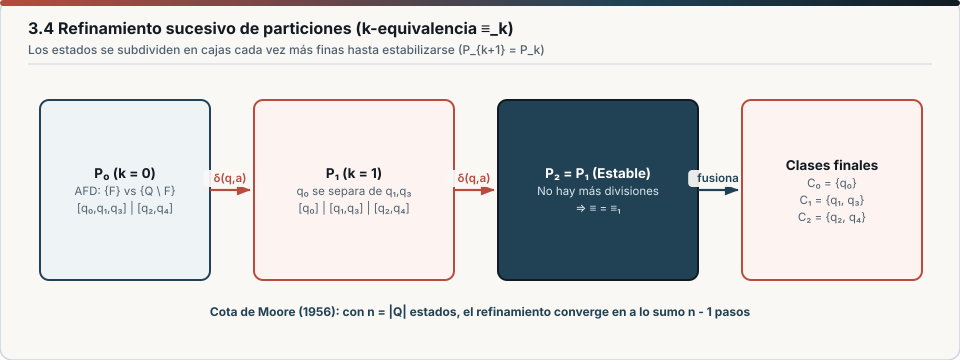
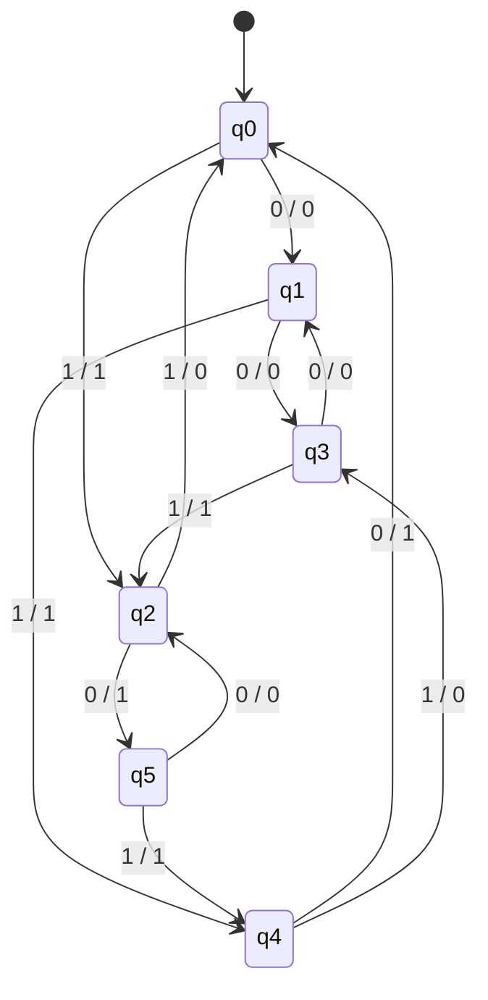
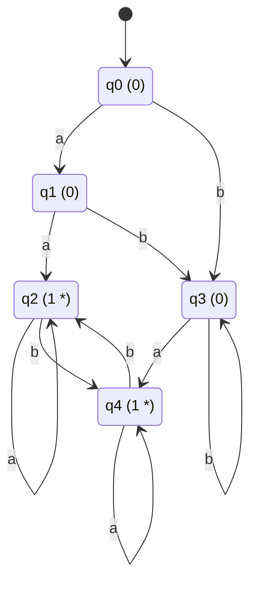

# 3.4 Estados equivalentes

## Introducción y motivación

En el subtema 3.3 se definió la equivalencia entre dos máquinas completas $M_1$ y $M_2$ atendiendo únicamente a su comportamiento observable desde el estado inicial. Sin embargo, para optimizar una máquina eliminando estados redundantes o para diseñar algoritmos generales de decisión, es necesario trasladar el concepto de equivalencia desde las máquinas completas hacia los **estados individuales**.

Intuitivamente, dos estados $p$ y $q$ de una máquina de estado finito son equivalentes si ningún usuario externo, mediante la aplicación de experimentos de entrada $w \in \Sigma^*$ y la observación de las salidas correspondientes, puede distinguir si la máquina comenzó operando en $p$ o en $q$. Cuando existen varios estados equivalentes entre sí, todos ellos condensan exactamente la misma información respecto al futuro computacional y pueden fusionarse en un único estado sin alterar el comportamiento de la máquina.

## Definiciones formales: equivalencia y distinguibilidad de estados

Sea $M = (Q, \Sigma, \Delta, \delta, \omega, q_0)$ una máquina de estado finito determinista y completamente especificada (de Mealy o de Moore; en el caso de un AFD, basta interpretarlo como una máquina de Moore con $\Delta = \{0, 1\}$ donde $\omega(q) = 1 \iff q \in F$).

### Estados equivalentes ($p \equiv q$)

Dos estados $p, q \in Q$ son **equivalentes**, lo cual se denota **$p \equiv q$**, si y solo si para toda cadena de entrada $w \in \Sigma^*$ la máquina produce exactamente la misma secuencia de salida al iniciar en $p$ que al iniciar en $q$:

$$p \equiv q \iff \forall w \in \Sigma^*,\quad \hat{\omega}(p, w) = \hat{\omega}(q, w).$$

Para un autómata finito determinista (AFD), donde la observación es la pertenencia al conjunto de aceptación $F$, esta condición adopta la forma equivalente:

$$p \equiv q \iff \forall w \in \Sigma^*,\quad \bigl(\hat{\delta}(p, w) \in F \iff \hat{\delta}(q, w) \in F\bigr).$$

*(Obsérvese que el concepto se extiende de inmediato a estados $p \in Q_1$ y $q \in Q_2$ de dos máquinas distintas sobre los mismos alfabetos $\Sigma$ y $\Delta$, exigiendo $\hat{\omega}_1(p, w) = \hat{\omega}_2(q, w)$ para toda $w \in \Sigma^*$).*

### Estados distinguibles ($p \not\equiv q$)

Dos estados $p, q \in Q$ son **distinguibles**, denotado **$p \not\equiv q$**, si no son equivalentes; es decir, si existe al menos una cadena de entrada $w \in \Sigma^*$ (llamada **cadena o secuencia de distinción**) tal que:

$$\hat{\omega}(p, w) \neq \hat{\omega}(q, w).$$

Si la cadena más corta que distingue a $p$ y $q$ tiene longitud $k$, se dice que $p$ y $q$ son **$k$-distinguibles**.

## Relación de $k$-equivalencia ($p \equiv_k q$)

Comprobar la igualdad $\hat{\omega}(p, w) = \hat{\omega}(q, w)$ sobre el conjunto infinito $\Sigma^*$ requiere acotar el problema por longitud de cadena.

**Definición ($k$-equivalencia):** Para todo entero $k \ge 0$, dos estados $p, q \in Q$ son **$k$-equivalentes**, denotado **$p \equiv_k q$**, si y solo si producen la misma respuesta para toda cadena de entrada de longitud **a lo sumo $k$**:

$$p \equiv_k q \iff \forall w \in \Sigma^*\text{ con } |w| \le k,\quad \hat{\omega}(p, w) = \hat{\omega}(q, w).$$

### Casos base y relación inductiva

Es crucial distinguir el caso base según el tipo de máquina:

- **Máquinas de estado (Moore) y AFD ($k = 0$):** Como la salida está asociada al estado y $\hat{\omega}(q, \lambda) = \omega(q)$, ya para longitud $0$ se obtiene una partición no trivial:
  $$p \equiv_0 q \iff \omega(p) = \omega(q) \qquad (\text{en un AFD: } p \in F \iff q \in F).$$
- **Máquinas de transición (Mealy) ($k = 0$ y $k = 1$):** Para $w = \lambda$, $\hat{\omega}(p, \lambda) = \lambda = \hat{\omega}(q, \lambda)$, por lo que $p \equiv_0 q$ se cumple trivialmente para todos los pares $(p, q) \in Q \times Q$ (la partición $P_0 = \{Q\}$ tiene un solo bloque). La primera distinción real se produce al leer entradas de longitud $1$:
  $$p \equiv_1 q \iff \forall a \in \Sigma,\quad \omega(p, a) = \omega(q, a).$$

### Teorema 3.4.1 (Caracterización inductiva de la $(k+1)$-equivalencia)

Para todo $k \ge 0$ en máquinas de Moore/AFD, y para todo $k \ge 1$ en máquinas de Mealy, dos estados $p, q \in Q$ son $(k+1)$-equivalentes si y solo si son $k$-equivalentes y, para todo símbolo de entrada $a \in \Sigma$, sus estados sucesores $\delta(p, a)$ y $\delta(q, a)$ son $k$-equivalentes:

$$p \equiv_{k+1} q \iff (p \equiv_k q) \;\land\; \bigl(\forall a \in \Sigma,\; \delta(p, a) \equiv_k \delta(q, a)\bigr).$$

**Demostración:**
Consideremos el caso de una máquina de Moore (el de Mealy para $k \ge 1$ es análogo, observando que $\hat{\omega}(p, aw) = \omega(p, a)\cdot\hat{\omega}(\delta(p, a), w)$ y que $|w| \le k$):
- ($\Rightarrow$) Supóngase $p \equiv_{k+1} q$. Como toda cadena de longitud $\le k$ tiene también longitud $\le k+1$, necesariamente $p \equiv_k q$. Además, para cualquier $a \in \Sigma$ y cualquier $w \in \Sigma^*$ con $|w| \le k$, la cadena $aw$ satisface $|aw| \le k + 1$, luego $\hat{\omega}(p, aw) = \hat{\omega}(q, aw)$. Como $\hat{\omega}(p, aw) = \omega(p) \cdot \hat{\omega}(\delta(p, a), w)$ y $\omega(p) = \omega(q)$ (pues $p \equiv_0 q$), al cancelar el primer símbolo resulta $\hat{\omega}(\delta(p, a), w) = \hat{\omega}(\delta(q, a), w)$ para toda $w$ con $|w| \le k$, es decir, $\delta(p, a) \equiv_k \delta(q, a)$.
- ($\Leftarrow$) Supóngase que $p \equiv_k q$ y $\delta(p, a) \equiv_k \delta(q, a)$ para todo $a \in \Sigma$. Sea $u \in \Sigma^*$ con $|u| \le k + 1$. Si $u = \lambda$, entonces $|u| = 0 \le k$ y $\hat{\omega}(p, \lambda) = \hat{\omega}(q, \lambda)$ porque $p \equiv_k q$. Si $|u| \ge 1$, escribimos $u = aw$ con $a \in \Sigma$ y $|w| \le k$. Como $p \equiv_k q$ implica $p \equiv_0 q$, se tiene $\omega(p) = \omega(q)$, y de $\delta(p, a) \equiv_k \delta(q, a)$ se sigue $\hat{\omega}(\delta(p, a), w) = \hat{\omega}(\delta(q, a), w)$. Por tanto:
  $$\hat{\omega}(p, aw) = \omega(p) \cdot \hat{\omega}(\delta(p, a), w) = \omega(q) \cdot \hat{\omega}(\delta(q, a), w) = \hat{\omega}(q, aw).$$
  En consecuencia, $p \equiv_{k+1} q$. $\blacksquare$

## Propiedades algebraicas: relaciones de equivalencia y particiones

### Teorema 3.4.2

Tanto la relación de equivalencia total $\equiv$ como cada relación $\equiv_k$ ($k \ge 0$) son **relaciones de equivalencia** sobre el conjunto $Q$; es decir, satisfacen las tres propiedades:

1. **Reflexiva:** $\forall p \in Q$, $p \equiv_k p$ y $p \equiv p$, ya que $\hat{\omega}(p, w) = \hat{\omega}(p, w)$ para toda $w \in \Sigma^*$.
2. **Simétrica:** $\forall p, q \in Q$, si $p \equiv_k q$ entonces $q \equiv_k p$ (y análogamente para $\equiv$), por simetría de la igualdad de cadenas $\hat{\omega}(p, w) = \hat{\omega}(q, w)$.
3. **Transitiva:** $\forall p, q, r \in Q$, si $p \equiv_k q$ y $q \equiv_k r$, entonces para toda $w$ con $|w| \le k$ se cumple $\hat{\omega}(p, w) = \hat{\omega}(q, w) = \hat{\omega}(r, w)$, de modo que $p \equiv_k r$ (y análogamente para $\equiv$).

Como toda relación de equivalencia sobre un conjunto finito $Q$, cada $\equiv_k$ induce una **partición** $P_k$ de $Q$. Intuitivamente, hacer una partición consiste simplemente en **agrupar los estados en "cajas" o bloques** no vacíos y sin elementos repetidos, de modo que cada estado pertenezca exactamente a un solo grupo (su **clase de equivalencia**) y dos estados en el mismo grupo se comporten de manera indistinguible hasta longitud $k$.

## Cálculo inductivo de particiones $P_0, P_1, \dots, P_k$ y convergencia

El Teorema 3.4.1 proporciona un procedimiento iterativo para calcular las particiones sucesivas:

- **Refinamiento monótono:** Como $p \equiv_{k+1} q \implies p \equiv_k q$, cada partición $P_{k+1}$ es un **refinamiento** de $P_k$: ningún par de estados separados en $P_k$ puede reunirse en $P_{k+1}$; a lo sumo, los bloques de $P_k$ se subdividen en bloques más pequeños. Dos estados $p, q$ que ya están en el mismo bloque de $P_k$ permanecen juntos en $P_{k+1}$ si y solo si para cada $a \in \Sigma$, los sucesores $\delta(p, a)$ y $\delta(q, a)$ pertenecen al **mismo bloque de $P_k$**.
- **Teorema de estabilización:** Si en algún paso ocurre que $P_{k+1} = P_k$, entonces la regla de transición del Teorema 3.4.1 garantiza que $P_m = P_k$ para todo $m \ge k$, y por lo tanto $\equiv\;=\;\equiv_k$.
- **Cota de Moore (1956):** Sea $n = |Q|$ el número de estados de la máquina. En cada refinamiento estricto ($P_{k+1} \neq P_k$), el número de bloques aumenta al menos en $1$. Como una partición de $n$ elementos no puede tener más de $n$ bloques:
  - En una máquina de Moore o AFD, si $P_0$ tiene al menos $2$ bloques (es decir, no todas las salidas son iguales), pueden ocurrir como máximo $n - 2$ refinamientos estrictos antes de estabilizarse, por lo que **$P_{n-2} = P_{n-1} = \;\equiv$** (y en general siempre basta llegar a $k \le n - 1$).
  - En una máquina de Mealy, tras construir $P_1$ (que tiene al menos $2$ bloques si las salidas no son todas idénticas), ocurren como máximo $n - 2$ refinamientos adicionales, luego **$P_{n-1} = \;\equiv$**.
  - **Corolario:** Si dos estados $p, q \in Q$ en una máquina de $n$ estados son distinguibles, existe al menos una cadena testigo $w$ de longitud $|w| \le n - 1$ que los distingue.

## Ejemplos desarrollados paso a paso

### Ejemplo 1: Cálculo de particiones $P_0, P_1, \dots, P_k$ en una máquina de Mealy

Considérese la máquina de transición (Mealy) $M_1$ con $Q = \{q_0, q_1, q_2, q_3, q_4, q_5\}$, $\Sigma = \{0, 1\}$, $\Delta = \{0, 1\}$:

| Estado | $\delta(q, 0)$ | $\omega(q, 0)$ | $\delta(q, 1)$ | $\omega(q, 1)$ |
| :--- | :---: | :---: | :---: | :---: |
| $\to q_0$ | $q_1$ | $0$ | $q_2$ | $1$ |
| $q_1$ | $q_3$ | $0$ | $q_4$ | $1$ |
| $q_2$ | $q_5$ | $1$ | $q_0$ | $0$ |
| $q_3$ | $q_1$ | $0$ | $q_2$ | $1$ |
| $q_4$ | $q_0$ | $1$ | $q_3$ | $0$ |
| $q_5$ | $q_2$ | $0$ | $q_4$ | $1$ |

**Paso 1. Partición $P_0$:**
Por definición, para longitud $0$ en Mealy todos los estados son $0$-equivalentes:

$$P_0 = \bigl\{\{q_0, q_1, q_2, q_3, q_4, q_5\}\bigr\}.$$

**Paso 2. Partición $P_1$ ($1$-equivalencia):**
Agrupamos los estados según su vector de salidas $(\omega(q, 0), \omega(q, 1))$:
- Salidas $(0, 1)$: $q_0, q_1, q_3, q_5$ $\to$ Bloque $A = \{q_0, q_1, q_3, q_5\}$.
- Salidas $(1, 0)$: $q_2, q_4$ $\to$ Bloque $B = \{q_2, q_4\}$.

$$P_1 = \bigl\{\underbrace{\{q_0, q_1, q_3, q_5\}}_{A},\; \underbrace{\{q_2, q_4\}}_{B}\bigr\}.$$

**Paso 3. Partición $P_2$ ($2$-equivalencia):**
Examinamos a qué bloque de $P_1$ transita cada estado con `0` y con `1`:
- En $A$:
  - $q_0 \mapsto (\delta(q_0, 0), \delta(q_0, 1)) = (q_1, q_2) \in (A, B)$
  - $q_1 \mapsto (q_3, q_4) \in (A, B)$
  - $q_3 \mapsto (q_1, q_2) \in (A, B)$
  - $q_5 \mapsto (q_2, q_4) \in (B, B)$ $\implies$ **$q_5$ se separa** de $\{q_0, q_1, q_3\}$.
- En $B$:
  - $q_2 \mapsto (q_5, q_0) \in (A, A)$
  - $q_4 \mapsto (q_0, q_3) \in (A, A)$ $\implies$ permanecen juntos.

$$P_2 = \bigl\{\underbrace{\{q_0, q_1, q_3\}}_{A_1},\; \underbrace{\{q_5\}}_{A_2},\; \underbrace{\{q_2, q_4\}}_{B}\bigr\}.$$

**Paso 4. Partición $P_3$ ($3$-equivalencia):**
Examinamos las transiciones hacia los bloques de $P_2$:
- En $A_1$:
  - $q_0 \mapsto (q_1 \in A_1,\, q_2 \in B) \to (A_1, B)$
  - $q_1 \mapsto (q_3 \in A_1,\, q_4 \in B) \to (A_1, B)$
  - $q_3 \mapsto (q_1 \in A_1,\, q_2 \in B) \to (A_1, B)$
- En $A_2$: $\{q_5\}$ es unitario, no puede refinarse más.
- En $B$:
  - $q_2 \mapsto (q_5 \in A_2,\, q_0 \in A_1) \to (A_2, A_1)$
  - $q_4 \mapsto (q_0 \in A_1,\, q_3 \in A_1) \to (A_1, A_1)$ $\implies$ **$q_2$ y $q_4$ se separan**.

$$P_3 = \bigl\{\underbrace{\{q_0, q_1, q_3\}}_{A_1},\; \underbrace{\{q_5\}}_{A_2},\; \underbrace{\{q_2\}}_{B_1},\; \underbrace{\{q_4\}}_{B_2}\bigr\}.$$

**Paso 5. Partición $P_4$ ($4$-equivalencia):**
Revisamos únicamente el bloque no unitario $A_1 = \{q_0, q_1, q_3\}$ respecto a $P_3$:
- $q_0 \mapsto (q_1 \in A_1,\, q_2 \in B_1) \to (A_1, B_1)$
- $q_1 \mapsto (q_3 \in A_1,\, q_4 \in B_2) \to (A_1, B_2)$ $\implies$ **$q_1$ se separa** de $\{q_0, q_3\}$.
- $q_3 \mapsto (q_1 \in A_1,\, q_2 \in B_1) \to (A_1, B_1)$

$$P_4 = \bigl\{\underbrace{\{q_0, q_3\}}_{A_{1a}},\; \underbrace{\{q_1\}}_{A_{1b}},\; \underbrace{\{q_5\}}_{A_2},\; \underbrace{\{q_2\}}_{B_1},\; \underbrace{\{q_4\}}_{B_2}\bigr\}.$$

**Paso 6. Partición $P_5$ ($5$-equivalencia) y estabilización:**
Revisamos $A_{1a} = \{q_0, q_3\}$ respecto a $P_4$:
- $q_0 \mapsto (q_1 \in A_{1b},\, q_2 \in B_1)$
- $q_3 \mapsto (q_1 \in A_{1b},\, q_2 \in B_1)$

Como no hay divisiones, **$P_5 = P_4$**. El algoritmo se estabiliza y concluimos que las únicas clases con más de un estado equivalente son $q_0 \equiv q_3$.

**Verificación de $q_0 \equiv_3 q_1$ pero $q_0 \not\equiv_4 q_1$:**
Al quedar en el mismo bloque hasta $P_3$ y separarse en $P_4$, $q_0$ y $q_1$ coinciden para toda cadena de longitud $\le 3$, pero existe una cadena de longitud $4$ que los distingue: $w = 1000$:
- Desde $q_0$: $q_0 \xrightarrow{1/1} q_2 \xrightarrow{0/1} q_5 \xrightarrow{0/0} q_2 \xrightarrow{0/1} q_5$ $\implies$ salida `1101`.
- Desde $q_1$: $q_1 \xrightarrow{1/1} q_4 \xrightarrow{0/1} q_0 \xrightarrow{0/0} q_1 \xrightarrow{0/0} q_3$ $\implies$ salida `1100`.

### Ejemplo 2: Cálculo de particiones en un AFD (máquina de Moore binaria)

Sea el AFD $M_2 = (\Sigma, Q, q_0, F, \delta)$ con $\Sigma = \{a, b\}$, $Q = \{q_0, q_1, q_2, q_3, q_4\}$, $F = \{q_2, q_4\}$:

| Estado | ¿Aceptación? ($\omega$) | $\delta(q, a)$ | $\delta(q, b)$ |
| :--- | :---: | :---: | :---: |
| $\to q_0$ | No ($0$) | $q_1$ | $q_3$ |
| $q_1$ | No ($0$) | $q_2$ | $q_3$ |
| $* q_2$ | Sí ($1$) | $q_2$ | $q_4$ |
| $q_3$ | No ($0$) | $q_4$ | $q_3$ |
| $* q_4$ | Sí ($1$) | $q_4$ | $q_2$ |

**Paso 1. Partición $P_0$ ($0$-equivalencia):**
Separamos los estados no finales ($Q \setminus F$) de los finales ($F$):

$$P_0 = \bigl\{\underbrace{\{q_0, q_1, q_3\}}_{A},\; \underbrace{\{q_2, q_4\}}_{B}\bigr\}.$$

**Paso 2. Partición $P_1$ ($1$-equivalencia):**
Evaluamos en qué bloque de $P_0$ caen las transiciones bajo `a` y `b`:
- Bloque $A = \{q_0, q_1, q_3\}$:
  - $q_0 \mapsto (\delta(q_0, a), \delta(q_0, b)) = (q_1, q_3) \in (A, A)$
  - $q_1 \mapsto (q_2, q_3) \in (B, A)$
  - $q_3 \mapsto (q_4, q_3) \in (B, A)$
  Así, $q_0$ se separa de $\{q_1, q_3\}$ (testigo de longitud $1$: $w = a$, pues $\delta(q_0, a) = q_1 \notin F$, mientras $\delta(q_1, a) = q_2 \in F$).
- Bloque $B = \{q_2, q_4\}$:
  - $q_2 \mapsto (q_2, q_4) \in (B, B)$
  - $q_4 \mapsto (q_4, q_2) \in (B, B)$
  Permanecen juntos.

$$P_1 = \bigl\{\underbrace{\{q_0\}}_{A_1},\; \underbrace{\{q_1, q_3\}}_{A_2},\; \underbrace{\{q_2, q_4\}}_{B}\bigr\}.$$

**Paso 3. Partición $P_2$ ($2$-equivalencia):**
Verificamos los bloques no unitarios respecto a $P_1$:
- En $A_2 = \{q_1, q_3\}$: $q_1 \mapsto (q_2 \in B,\, q_3 \in A_2)$ y $q_3 \mapsto (q_4 \in B,\, q_3 \in A_2)$. Ambos van a $(B, A_2)$.
- En $B = \{q_2, q_4\}$: $q_2 \mapsto (q_2 \in B,\, q_4 \in B)$ y $q_4 \mapsto (q_4 \in B,\, q_2 \in B)$. Ambos van a $(B, B)$.

Obtenemos **$P_2 = P_1$**. Por tanto, las clases de equivalencia finales son $\{q_0\}$, $\{q_1, q_3\}$ y $\{q_2, q_4\}$, es decir, $q_1 \equiv q_3$ y $q_2 \equiv q_4$.

## Ejercicios propuestos

1. Para la máquina de Moore del Ejemplo 2 ($M_2$), encuentre una cadena de distinción más corta posible entre los pares $(q_0, q_2)$, $(q_0, q_1)$ y $(q_0, q_4)$, y compruebe que para cualquier $w \in \{a, b\}^*$ se cumple $\hat{\delta}(q_1, w) \in F \iff \hat{\delta}(q_3, w) \in F$.
2. Calcule todas las particiones $P_0, P_1, \dots, P_k$ hasta la estabilización para la máquina de Moore obtenida en el Ejemplo 2 del subtema 3.2 (estados $A, B, C, D, E$). ¿Cuáles copias desdobladas permanecen distinguibles y por qué?
3. Dada la máquina de Mealy con $Q = \{s_0, s_1, s_2, s_3, s_4\}$, $\Sigma = \{a, b\}$, $\Delta = \{0, 1\}$ definida por:
   - $s_0$: $a \to (s_1, 0)$, $b \to (s_2, 1)$
   - $s_1$: $a \to (s_3, 1)$, $b \to (s_0, 0)$
   - $s_2$: $a \to (s_1, 0)$, $b \to (s_4, 1)$
   - $s_3$: $a \to (s_3, 1)$, $b \to (s_2, 0)$
   - $s_4$: $a \to (s_1, 0)$, $b \to (s_2, 1)$
   determine las particiones $P_0, P_1, \dots, P_k$, indique las clases de equivalencia finales y proporcione una cadena testigo para cada par de estados distinguibles.
4. **Demostración:** Demuestre formalmente que, si $p \equiv q$ en una máquina determinista $M$, entonces para todo símbolo $a \in \Sigma$ también se cumple $\delta(p, a) \equiv \delta(q, a)$ (es decir, si dos estados son equivalentes, al leer el mismo símbolo $a$ necesariamente llegan a estados que también son equivalentes; esta propiedad suele llamarse *congruencia*).

## Referencias

- De Castro Korgi, R. (2004). *Teoría de la computación: Lenguajes, autómatas, gramáticas*. Universidad Nacional de Colombia.
- Hopcroft, J. E., Motwani, R., & Ullman, J. D. (2002). *Introducción a la teoría de autómatas, lenguajes y computación* (2.ª ed.). Pearson Educación.
- Kohavi, Z., & Jha, N. K. (2010). *Switching and finite automata theory* (3.ª ed.). Cambridge University Press.
- Moore, E. F. (1956). Gedanken-experiments on sequential machines. En C. E. Shannon & J. McCarthy (Eds.), *Automata studies* (pp. 129–153). Princeton University Press.
