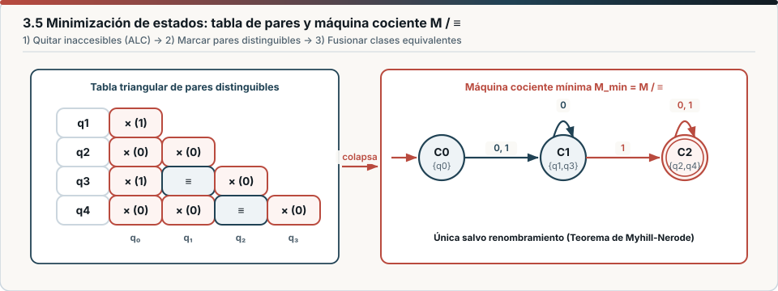
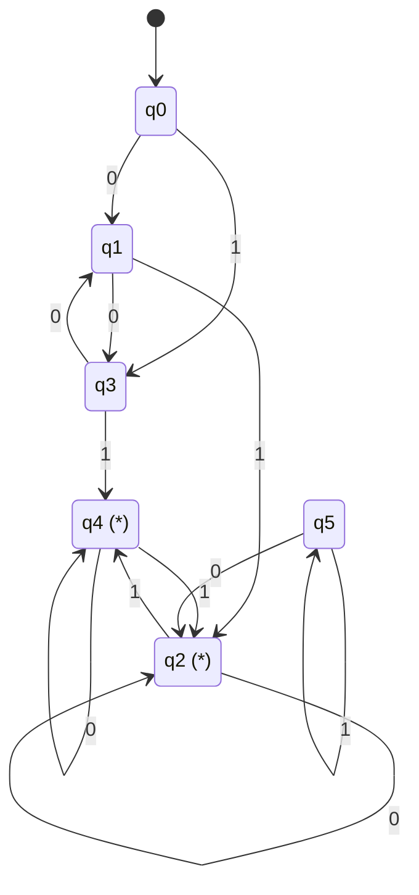
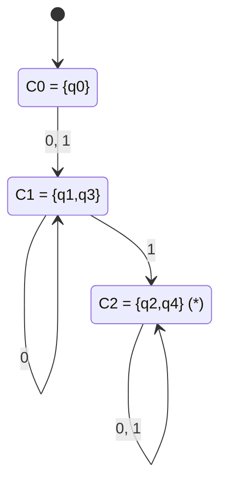

# 3.5 Reducción de estados y prueba de equivalencia

## Introducción y motivación

El diseño inicial de un autómata finito o de una máquina secuencial a partir de una especificación suele producir estados redundantes o incluso estados que nunca pueden alcanzarse desde el estado inicial. Reducir una máquina de estado finito a su versión con el **menor número posible de estados** resulta fundamental tanto en el plano práctico (menor cantidad de biestables o memoria en circuitos secuenciales, analizadores léxicos más compactos) como en el plano teórico, pues la máquina reducida es **única salvo renombramiento de estados** y constituye una forma canónica para decidir la equivalencia entre dos máquinas $M_1$ y $M_2$.

En este subtema se integran las herramientas desarrolladas en 3.3 y 3.4 junto con los algoritmos de decisión de De Castro Korgi (2004, Secc. 3.6) y el teorema de Myhill-Nerode para formular el procedimiento completo de **minimización de estados** y las pruebas algorítmicas de **equivalencia entre máquinas**.

## Paso previo: eliminación de estados inaccesibles

Un estado $q \in Q$ es **accesible** (o **alcanzable**) desde el estado inicial $q_0$ si existe al menos una cadena $w \in \Sigma^*$ tal que $\hat{\delta}(q_0, w) = q$. Todo estado $q \in Q$ que no sea accesible jamás interviene en ningún cómputo que comience en $q_0$, por lo que su eliminación no altera ni la función de respuesta $\hat{\omega}(q_0, w)$ ni el lenguaje aceptado $L(M)$.

### Algoritmo de alcanzabilidad `ALC` (De Castro Korgi, 2004, Secc. 3.6, p. 77)

Para calcular exactamente el conjunto $\text{ALC} \subseteq Q$ de estados alcanzables desde $q_0$:

1. **Inicializar:** $\text{ALC} := \{q_0\}$.
2. **Repetir:** Para cada estado $q \in \text{ALC}$ y cada símbolo $a \in \Sigma$ (o en un AFN-$\lambda$, para toda etiqueta en $\Sigma \cup \{\lambda\}$), añadir $\delta(q, a)$ al conjunto $\text{ALC}$.
3. **Hasta:** Que no se añadan nuevos estados a $\text{ALC}$ en una iteración completa.

Finalmente, se restringen $Q, \delta, \omega$ (o $F$) al subconjunto $\text{ALC}$, descartando $Q \setminus \text{ALC}$. (Dado que $\text{ALC}$ es cerrado bajo todas las transiciones, la máquina restringida sigue siendo completamente especificada).

## Algoritmos de minimización de estados

Una vez eliminados los estados inaccesibles, existen dos algoritmos clásicos equivalentes para hallar las clases de equivalencia de $\equiv$:

### Método 1: Refinamiento de particiones

Es exactamente el procedimiento inductivo $P_0, P_1, \dots, P_k$ estudiado en el subtema 3.4:
1. Construir $P_0$ (en Moore/AFD, agrupando por $\omega(q)$ o $F$ vs $Q \setminus F$) o $P_1$ (en Mealy, agrupando por el vector $\bigl(\omega(q, a)\bigr)_{a \in \Sigma}$).
2. Refinar iterativamente $P_{k+1}$ subdividiendo cada bloque según los bloques destino de $(\delta(q, a))_{a \in \Sigma}$ en $P_k$.
3. Detenerse cuando $P_{k+1} = P_k$. Cada bloque de $P_k$ es una clase de equivalencia $[q] = \{p \in Q : p \equiv q\}$.

### Método 2: Tabla de pares distinguibles (*table-filling algorithm*)

En lugar de trabajar por bloques de arriba hacia abajo, este algoritmo marca explícitamente todos los pares no ordenados $\{p, q\}$ de estados distintos ($p \neq q$) que son distinguibles:

1. **Inicialización (casos base):** Construir una tabla triangular con todos los pares $\{p, q\} \subseteq Q$ ($p \neq q$). Marcar como distinguibles los pares $\{p, q\}$ que satisfagan:
   - *En Moore / AFD:* $\omega(p) \neq \omega(q)$ (en AFD, exactamente uno de los dos pertenece a $F$).
   - *En Mealy:* $\exists a \in \Sigma$ tal que $\omega(p, a) \neq \omega(q, a)$.
2. **Propagación (paso inductivo):** Repetir hasta que en una pasada completa no se marque ningún par nuevo: para cada par $\{p, q\}$ aún **no marcado**, inspeccionar cada $a \in \Sigma$; si el par $\{\delta(p, a), \delta(q, a)\}$ (con $\delta(p, a) \neq \delta(q, a)$) ya está marcado en la tabla, entonces **marcar $\{p, q\}$** (opcionalmente anotando el símbolo $a$ y el número de iteración para reconstruir la cadena testigo).
3. **Agrupación:** Al finalizar la propagación, todos los pares $\{p, q\}$ que permanecen **sin marcar** cumplen $p \equiv q$. Por transitividad de $\equiv$, forman las clases de equivalencia de $Q$.

## Construcción de la máquina mínima (máquina cociente) y Teorema de Myhill-Nerode

Sea $M$ una máquina accesible (sin estados inaccesibles) y sea $\equiv$ la partición en grupos (clases de equivalencia) obtenida tras minimizar.

### Fusión de estados equivalentes: máquina cociente $M_{\min} = M / {\equiv}$

Construir la **máquina cociente** $M_{\min} = (Q_{\min}, \Sigma, \Delta, \delta_{\min}, \omega_{\min}, q_{0,\min})$ significa sencillamente **colapsar o fusionar cada grupo $[q]$ de estados equivalentes en un único estado representante**:
- **$Q_{\min} = Q / {\equiv} = \{[q] : q \in Q\}$**, el conjunto de los grupos (clases de equivalencia) resultantes.
- **$q_{0,\min} = [q_0]$** (el grupo que contiene al estado inicial original).
- **$\delta_{\min}([q], a) = [\delta(q, a)]$** para todo grupo $[q] \in Q_{\min}$ y $a \in \Sigma$ (la flecha va hacia el grupo del estado destino).
- **Función de salida:**
  - *En Mealy:* $\omega_{\min}([q], a) = \omega(q, a)$.
  - *En Moore:* $\omega_{\min}([q]) = \omega(q)$.
  - *En AFD:* $F_{\min} = \{[q] : q \in F\}$.

**¿Por qué no importa qué estado elijamos como representante del grupo?** Si $p$ y $q$ quedaron en el mismo grupo ($p \equiv q$), entonces producen las mismas salidas inmediatas ($\omega(p, a) = \omega(q, a)$ en Mealy, $\omega(p) = \omega(q)$ en Moore, o $p \in F \iff q \in F$ en AFD) y, al leer cualquier símbolo $a$, sus destinos $\delta(p, a)$ y $\delta(q, a)$ también son equivalentes ($\delta(p, a) \equiv \delta(q, a)$, por lo que caen en el mismo grupo destino $[\delta(p, a)] = [\delta(q, a)]$).

### Teorema 3.5.1 (Teorema de Myhill-Nerode y unicidad de la máquina mínima)

Para cualquier lenguaje $L \subseteq \Sigma^*$, podemos agrupar las cadenas de entrada según su comportamiento futuro respecto a $L$ mediante la **relación de equivalencia de Myhill-Nerode** $\sim_L$ (Nerode, 1958):

$$x \sim_L y \iff \forall z \in \Sigma^*,\quad (xz \in L \iff yz \in L).$$

*(Intuitivamente, $x \sim_L y$ significa que después de leer $x$ o leer $y$, cualquier continuación futura $z$ llevará a la misma decisión de aceptación o rechazo).*

El teorema establece tres resultados fundamentales (Hopcroft, Motwani & Ullman, 2002):
1. $L$ es aceptado por algún AFD (es decir, $L$ es un lenguaje regular) si y solo si $\sim_L$ divide a $\Sigma^*$ en un número **finito** de grupos o clases de equivalencia (a esa cantidad de grupos se le llama el **índice** de $\sim_L$).
2. El número mínimo de estados de todo AFD que reconoce a $L$ es **exactamente igual** a esa cantidad de grupos (el índice de $\sim_L$).
3. Si $M$ es un AFD accesible que reconoce a $L$, la máquina reducida $M_{\min} = M / {\equiv}$ tiene exactamente ese número mínimo de estados y es **única salvo renombramiento de estados** (en matemáticas, *única salvo isomorfismo*): es decir, cualquier otro AFD mínimo para $L$ tiene exactamente la misma forma y transiciones, cambiando únicamente las etiquetas de los estados.

El mismo principio de minimalidad y unicidad salvo renombramiento de estados se cumple para las máquinas secuenciales completamente especificadas de Moore y de Mealy reducidas y accesibles (Moore, 1956).

## Algoritmos de prueba de equivalencia entre dos máquinas $M_1$ y $M_2$

Dadas dos máquinas deterministas completamente especificadas $M_1 = (Q_1, \Sigma, \Delta, \delta_1, \omega_1, q_{01})$ y $M_2 = (Q_2, \Sigma, \Delta, \delta_2, \omega_2, q_{02})$ del mismo tipo, ¿cómo decidir algorítmicamente en tiempo finito si $M_1 \equiv M_2$?

### Algoritmo A: Unión disjunta y tabla de pares / partición

1. Asegurar que $Q_1 \cap Q_2 = \emptyset$ (renombrando estados si es necesario).
2. Construir la máquina unión $M_{\cup}$ sobre $Q_1 \cup Q_2$ conservando las transiciones y salidas propias de cada componente.
3. Aplicar sobre $Q_1 \cup Q_2$ el algoritmo de refinamiento de particiones o la tabla de pares distinguibles.
4. **Criterio de decisión:**
   $$M_1 \equiv M_2 \iff q_{01} \equiv q_{02}$$
   (es decir, $\{q_{01}, q_{02}\}$ queda sin marcar en la tabla, o $q_{01}$ y $q_{02}$ terminan en el mismo bloque de la partición estabilizada). En caso contrario, la marca de $\{q_{01}, q_{02}\}$ permite reconstruir directamente un contraejemplo $w$ de longitud $\le |Q_1| + |Q_2| - 1$.

### Algoritmo B: Autómata producto y búsqueda de alcanzabilidad `ALC` (De Castro Korgi, 2004, Secc. 3.6)

De Castro Korgi (2004, Teorema 3.3.2 y Corolario 3.6.2, pp. 70–77) formula la prueba de equivalencia entre dos AFD $M_1$ y $M_2$ comprobando que su diferencia simétrica sea vacía (es decir, que **no exista ninguna cadena aceptada por una máquina y rechazada por la otra**):

$$L(M_1) = L(M_2) \iff L(M_1) \oplus L(M_2) = \bigl(L(M_1) - L(M_2)\bigr) \cup \bigl(L(M_2) - L(M_1)\bigr) = \emptyset.$$

Para decidirlo:
1. Construir el **AFD producto** $M_{\oplus} = (\Sigma, Q_1 \times Q_2, (q_{01}, q_{02}), F_{\oplus}, \delta_{\times})$, donde $\delta_{\times}((p, q), a) = (\delta_1(p, a), \delta_2(q, a))$ y el conjunto de aceptación de la diferencia simétrica es:
   $$F_{\oplus} = \{(p, q) \in Q_1 \times Q_2 : (p \in F_1 \land q \notin F_2) \lor (p \notin F_1 \land q \in F_2)\}.$$
2. Ejecutar el algoritmo `ALC` (búsqueda desde $(q_{01}, q_{02})$).
3. **Criterio:** $L(M_1) = L(M_2) \iff \text{ALC} \cap F_{\oplus} = \emptyset$. Si algún par $(p, q) \in \text{ALC} \cap F_{\oplus}$ es alcanzado, la ruta de entrada desde $(q_{01}, q_{02})$ hasta $(p, q)$ es una cadena aceptada por exactamente uno de los dos autómatas.

*(Este mismo algoritmo se extiende inmediatamente a máquinas de Moore y Mealy: se exploran los pares alcanzables $(p, q) \in Q_1 \times Q_2$ desde $(q_{01}, q_{02})$; $M_1 \equiv M_2$ si y solo si ningún par alcanzable presenta discrepancia de salida $\omega_1(p) \neq \omega_2(q)$ en Moore, ni $\omega_1(p, a) \neq \omega_2(q, a)$ para algún $a \in \Sigma$ en Mealy).*

## Ejemplos desarrollados paso a paso

### Ejemplo 1: Minimización completa de un AFD (eliminación de inaccesibles, tabla de pares y máquina cociente)

Minimizar el AFD $M = (\Sigma, Q, q_0, F, \delta)$ con $\Sigma = \{0, 1\}$, $Q = \{q_0, q_1, q_2, q_3, q_4, q_5\}$ y $F = \{q_2, q_4\}$:

| Estado | ¿Aceptación? | $\delta(q, 0)$ | $\delta(q, 1)$ |
| :--- | :---: | :---: | :---: |
| $\to q_0$ | No | $q_1$ | $q_3$ |
| $q_1$ | No | $q_3$ | $q_2$ |
| $* q_2$ | Sí | $q_2$ | $q_4$ |
| $q_3$ | No | $q_1$ | $q_4$ |
| $* q_4$ | Sí | $q_4$ | $q_2$ |
| $q_5$ | No | $q_2$ | $q_5$ |

**Paso 1. Eliminación de estados inaccesibles mediante `ALC`:**
- Inicialización: $\text{ALC} = \{q_0\}$.
- Iteración 1: desde $q_0$ alcanzamos $q_1, q_3$ $\implies$ $\text{ALC} = \{q_0, q_1, q_3\}$.
- Iteración 2: desde $q_1$ alcanzamos $q_3, q_2$; desde $q_3$ alcanzamos $q_1, q_4$ $\implies$ $\text{ALC} = \{q_0, q_1, q_2, q_3, q_4\}$.
- Iteración 3: desde $q_2$ y $q_4$ solo se transita a $\{q_2, q_4\}$. No hay nuevos estados.

El estado **$q_5$ es inaccesible** y se elimina. Trabajamos sobre $Q' = \{q_0, q_1, q_2, q_3, q_4\}$.

**Paso 2. Tabla de pares distinguibles sobre $Q'$:**
1. *Base (paso 0):* Marcamos con `× (0)` todo par que mezcle un estado en $F = \{q_2, q_4\}$ con uno en $Q' \setminus F = \{q_0, q_1, q_3\}$:
   $\{q_0, q_2\}, \{q_0, q_4\}, \{q_1, q_2\}, \{q_1, q_4\}, \{q_3, q_2\}, \{q_3, q_4\}$.
   Quedan $4$ pares sin marcar: $\{q_0, q_1\}, \{q_0, q_3\}, \{q_1, q_3\}, \{q_2, q_4\}$.
2. *Propagación (iteración 1):*
   - $\{q_0, q_1\}$: bajo `1`, $(\delta(q_0, 1), \delta(q_1, 1)) = \{q_3, q_2\}$, que **está marcado**. Marcamos `{q0, q1}` con `× (1, testigo '1')`.
   - $\{q_0, q_3\}$: bajo `1`, $(\delta(q_0, 1), \delta(q_3, 1)) = \{q_3, q_4\}$, que **está marcado**. Marcamos `{q0, q3}` con `× (1, testigo '1')`.
   - $\{q_1, q_3\}$: bajo `0` $\to \{q_3, q_1\}$ (sin marcar); bajo `1` $\to \{q_2, q_4\}$ (sin marcar). Permanece sin marcar.
   - $\{q_2, q_4\}$: bajo `0` $\to \{q_2, q_4\}$ (sin marcar); bajo `1` $\to \{q_4, q_2\}$ (sin marcar). Permanece sin marcar.
3. *Propagación (iteración 2):* Al revisar $\{q_1, q_3\}$ y $\{q_2, q_4\}$, ninguno transita a un par marcado. El algoritmo termina.

| Estado | $q_0$ | $q_1$ | $q_2$ | $q_3$ |
| :--- | :---: | :---: | :---: | :---: |
| $q_1$ | $\times\; (1)$ | | | |
| $q_2$ | $\times\; (0)$ | $\times\; (0)$ | | |
| $q_3$ | $\times\; (1)$ | $\equiv$ | $\times\; (0)$ | |
| $q_4$ | $\times\; (0)$ | $\times\; (0)$ | $\equiv$ | $\times\; (0)$ |

**Paso 3. Clases de equivalencia y construcción de $M_{\min} = M' / {\equiv}$:**
Los pares sin marcar indican $q_1 \equiv q_3$ y $q_2 \equiv q_4$. Obtenemos $3$ clases:
- $C_0 = [q_0] = \{q_0\}$ (estado inicial).
- $C_1 = [q_1] = \{q_1, q_3\}$.
- $C_2 = [q_2] = \{q_2, q_4\}$ (estado de aceptación).

| Clase | $\delta_{\min}(C, 0)$ | $\delta_{\min}(C, 1)$ | ¿Aceptación? |
| :--- | :---: | :---: | :---: |
| $\to C_0 = \{q_0\}$ | $[q_1] = C_1$ | $[q_3] = C_1$ | No |
| $C_1 = \{q_1, q_3\}$ | $[q_3] = C_1$ | $[q_2] = C_2$ | No |
| $* C_2 = \{q_2, q_4\}$ | $[q_2] = C_2$ | $[q_4] = C_2$ | Sí |

La máquina mínima tiene $3$ estados (frente a los $6$ originales) y acepta exactamente el lenguaje $(0 \cup 1)0^* 1 (0 \cup 1)^*$.

### Ejemplo 2: Prueba de equivalencia entre dos máquinas ($M_1 \equiv M_2$ y $A_1 \not\equiv A_2$)

#### Parte A: Prueba positiva de equivalencia entre dos máquinas de Mealy (Algoritmo A)

Decidir si las siguientes máquinas de Mealy $M_1$ y $M_2$ sobre $\Sigma = \{a, b\}$ y $\Delta = \{0, 1\}$ son equivalentes:

- **$M_1$ ($q_0$ inicial):** $q_0: a \to (q_1, 0),\, b \to (q_2, 1)$; $\;q_1: a \to (q_0, 1),\, b \to (q_1, 0)$; $\;q_2: a \to (q_1, 0),\, b \to (q_2, 1)$.
- **$M_2$ ($p_0$ inicial):** $p_0: a \to (p_1, 0),\, b \to (p_0, 1)$; $\;p_1: a \to (p_0, 1),\, b \to (p_1, 0)$.

Aplicamos refinamiento de particiones sobre la unión disjunta $Q_1 \cup Q_2 = \{q_0, q_1, q_2, p_0, p_1\}$:
1. **$P_1$ (por pares de salida $(\omega(s, a), \omega(s, b))$):**
   - Salida $(0, 1)$: $X = \{q_0, q_2, p_0\}$.
   - Salida $(1, 0)$: $Y = \{q_1, p_1\}$.
   Luego $P_1 = \{X, Y\}$.
2. **$P_2$ (sucesores en $P_1$):**
   - En $X$: $q_0 \mapsto (q_1 \in Y, q_2 \in X)$, $q_2 \mapsto (q_1 \in Y, q_2 \in X)$, $p_0 \mapsto (p_1 \in Y, p_0 \in X)$. Todos van a $(Y, X)$.
   - En $Y$: $q_1 \mapsto (q_0 \in X, q_1 \in Y)$, $p_1 \mapsto (p_0 \in X, p_1 \in Y)$. Todos van a $(X, Y)$.
3. Como $P_2 = P_1$, la partición se estabiliza. Dado que **$q_0$ y $p_0$ pertenecen al mismo bloque $X$**, se demuestra que $q_0 \equiv p_0$, por lo que **$M_1 \equiv M_2$**.

#### Parte B: Prueba negativa de equivalencia en AFD mediante producto y `ALC` (Algoritmo B)

Considérense dos AFD sobre $\Sigma = \{0, 1\}$:
- **$A_1$** (paridad impar de unos): $Q_1 = \{q_0, q_1\}$, $F_1 = \{q_1\}$, $\delta_1(q_0, 0) = q_0$, $\delta_1(q_0, 1) = q_1$, $\delta_1(q_1, 0) = q_1$, $\delta_1(q_1, 1) = q_0$.
- **$A_2$** (cadenas terminadas en `1`): $Q_2 = \{r_0, r_1\}$, $F_2 = \{r_1\}$, $\delta_2(r_0, 0) = r_0$, $\delta_2(r_0, 1) = r_1$, $\delta_2(r_1, 0) = r_0$, $\delta_2(r_1, 1) = r_1$.

El conjunto de discrepancia es $F_{\oplus} = \{(q_0, r_1), (q_1, r_0)\}$. Ejecutamos `ALC` sobre el producto $Q_1 \times Q_2$ desde $(q_0, r_0)$:
1. Estado inicial $(q_0, r_0) \notin F_{\oplus}$ (ninguno es final).
2. Con `0`: $\delta_{\times}((q_0, r_0), 0) = (q_0, r_0)$ (ya visitado).
3. Con `1`: $\delta_{\times}((q_0, r_0), 1) = (q_1, r_1) \notin F_{\oplus}$ (ambos son finales).
4. Desde $(q_1, r_1)$ con `0`: $\delta_{\times}((q_1, r_1), 0) = (q_1, r_0) \in F_{\oplus}$ (pues $q_1 \in F_1$ y $r_0 \notin F_2$).

Como $\text{ALC} \cap F_{\oplus} \neq \emptyset$, concluimos que **$A_1 \not\equiv A_2$** ($L(A_1) \neq L(A_2)$), y la trayectoria recorrida entrega de inmediato el contraejemplo $w = 10$ ($A_1$ la acepta por tener un único `1`; $A_2$ la rechaza por terminar en `0`).

## Ejercicios propuestos

1. Aplique el algoritmo completo de minimización (eliminación de inaccesibles + tabla de pares distinguibles + máquina cociente) al siguiente AFD sobre $\Sigma = \{a, b\}$: $Q = \{q_0, q_1, q_2, q_3, q_4, q_5\}$, $F = \{q_2, q_3\}$, con $\delta(q_0, a) = q_1$, $\delta(q_0, b) = q_4$, $\delta(q_1, a) = q_2$, $\delta(q_1, b) = q_5$, $\delta(q_2, a) = q_2$, $\delta(q_2, b) = q_3$, $\delta(q_3, a) = q_3$, $\delta(q_3, b) = q_2$, $\delta(q_4, a) = q_1$, $\delta(q_4, b) = q_0$, $\delta(q_5, a) = q_2$, $\delta(q_5, b) = q_5$.
2. Reduzca la máquina de Moore obtenida en el Ejemplo 2 del subtema 3.2 (estados $A, B, C, D, E$) construyendo la máquina cociente mínima. ¿Cuántos estados tiene la máquina de Moore mínima?
3. Utilice el Algoritmo A (unión disjunta) para decidir si la máquina de Mealy del Ejemplo 1 del subtema 3.4 ($M_1$) es equivalente a su propia máquina cociente reducida de 5 estados, y compruebe que el estado inicial de la original y su clase en la cociente pertenecen al mismo bloque.
4. Utilice el Algoritmo B (producto cartesiano y `ALC`, De Castro Korgi, 2004, Secc. 3.6) para decidir si los siguientes dos AFD sobre $\Sigma = \{a, b\}$ aceptan el mismo lenguaje; si no son equivalentes, exhiba una cadena contraejemplo de longitud mínima:
   - $A_1$: $Q_1 = \{q_0, q_1\}$, $F_1 = \{q_0\}$, $\delta_1(q_0, a) = q_1$, $\delta_1(q_0, b) = q_0$, $\delta_1(q_1, a) = q_0$, $\delta_1(q_1, b) = q_1$.
   - $A_2$: $Q_2 = \{p_0, p_1, p_2\}$, $F_2 = \{p_0, p_2\}$, $\delta_2(p_0, a) = p_1$, $\delta_2(p_0, b) = p_0$, $\delta_2(p_1, a) = p_2$, $\delta_2(p_1, b) = p_1$, $\delta_2(p_2, a) = p_1$, $\delta_2(p_2, b) = p_2$.

## Referencias

- Acevedo Juárez, A. (2006). *Teoría de la computación* [Tesis de licenciatura, Instituto Tecnológico de Celaya].
- De Castro Korgi, R. (2004). *Teoría de la computación: Lenguajes, autómatas, gramáticas*. Universidad Nacional de Colombia.
- Hopcroft, J. E., Motwani, R., & Ullman, J. D. (2002). *Introducción a la teoría de autómatas, lenguajes y computación* (2.ª ed.). Pearson Educación.
- Kohavi, Z., & Jha, N. K. (2010). *Switching and finite automata theory* (3.ª ed.). Cambridge University Press.
- Moore, E. F. (1956). Gedanken-experiments on sequential machines. En C. E. Shannon & J. McCarthy (Eds.), *Automata studies* (pp. 129–153). Princeton University Press.
- Nerode, A. (1958). Linear automaton transformations. *Proceedings of the American Mathematical Society*, *9*(4), 541–544.
