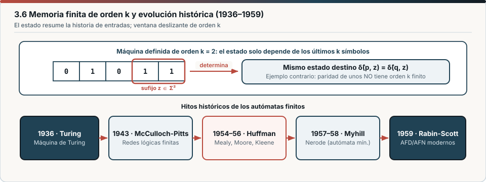
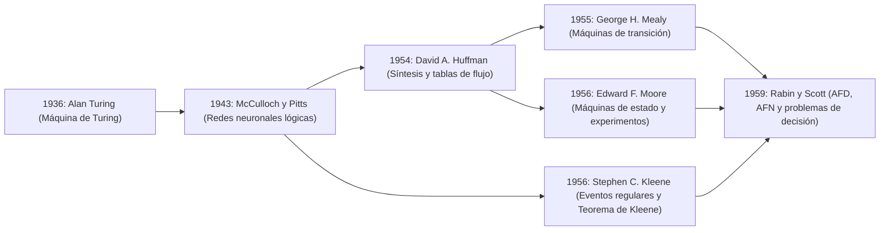

# 3.6 Historia de máquinas y memoria finita

## Introducción y motivación

El título de este subtema encierra una dualidad conceptual esencial en la teoría de la computación. Por una parte, alude a la **historia de entrada** (*input history*): la sucesión de símbolos que una máquina ha procesado hasta el instante actual y el modo en que el estado interno actúa como un **resumen finito de dicha historia**. Por otra parte, remite a la **evolución histórica** de las máquinas de estado finito durante las décadas de 1940 y 1950, cuando la neurofisiología lógica, el diseño de circuitos de conmutación y la teoría de la computabilidad convergieron en una disciplina matemática unificada.

Comprender cómo la memoria finita condensa historias arbitrariamente largas —y cuáles son sus límites teóricos infranqueables— prepara directamente el terreno para el estudio de los lenguajes regulares y sus propiedades de no regularidad (Unidad 4) y motiva la necesidad de memorias externas ilimitadas como las pilas (Unidad 5).

## El estado como resumen finito de la historia de entrada

Considérese una máquina de estado finito $M = (Q, \Sigma, \Delta, \delta, \omega, q_0)$ que ha leído una cadena (o *historia*) $w = a_1 a_2 \cdots a_m \in \Sigma^*$. En ese instante, la máquina se encuentra en el estado $q = \hat{\delta}(q_0, w) \in Q$.

La máquina no posee una cinta de memoria adicional donde releer los $m$ símbolos anteriores; su única referencia al pasado es estar en $q$. Dicho de manera formal, la máquina induce sobre el conjunto infinito $\Sigma^*$ una relación de equivalencia de historias:

$$u \sim_M v \iff \hat{\delta}(q_0, u) = \hat{\delta}(q_0, v) \qquad (u, v \in \Sigma^*).$$

Si dos historias $u$ y $v$ conducen al mismo estado $q$, entonces para cualquier continuación futura $z \in \Sigma^*$ se cumple $\hat{\delta}(q_0, uz) = \hat{\delta}(q, z) = \hat{\delta}(q_0, vz)$, por lo que ambas historias resultan indistinguibles en cuanto al comportamiento futuro de la máquina. Así:

- Aunque existen infinitas historias posibles en $\Sigma^*$, el conjunto $Q$ solo permite clasificar dichas historias en **a lo sumo $|Q|$ clases de equivalencia**.
- El estado actual es, por definición, la **información mínima suficiente** de toda la historia pasada que la máquina necesita preservar para determinar su respuesta presente y futura.

## Máquinas de memoria finita y eventos definidos de orden $k$

En la teoría clásica de circuitos secuenciales y autómatas (Kleene, 1956; Kohavi & Jha, 2010), se estudia un subconjunto particularmente importante de máquinas cuya memoria del pasado abarca únicamente una ventana fija de longitud $k$.

### Definición: Máquina de memoria de entrada finita (máquina definida de orden $k$)

Una máquina de estado finito $M = (Q, \Sigma, \Delta, \delta, \omega, q_0)$ es una **máquina definida (o de memoria de entrada finita) de orden $k$** ($k \ge 0$) si el estado alcanzado tras leer cualquier cadena $w$ de longitud $|w| \ge k$ depende **exclusivamente de los últimos $k$ símbolos** de $w$ (su sufijo de longitud $k$). Equivalentemente, para toda cadena $z \in \Sigma^k$ de longitud $k$ y cualesquiera dos estados $p, q \in Q$:

$$\hat{\delta}(p, z) = \hat{\delta}(q, z).$$

Cuando $k$ es el menor entero no negativo que satisface esta propiedad, se dice que $M$ tiene **orden definido $k$**. En el contexto de aceptadores, el lenguaje reconocido $L(M)$ se denomina un **evento definido de orden $k$** (*definite event*, Kleene, 1956), caracterizable por la forma $L = E_1 \cup \Sigma^* E_2$, donde $E_1$ contiene cadenas de longitud $< k$ y $E_2 \subseteq \Sigma^k$.

*(Nota: En diseño secuencial más amplio, Kohavi & Jha, 2010, definen también las **máquinas de memoria finita de orden $\mu$** respecto a entradas y salidas pasadas, donde el estado presente queda determinado por los últimos $\mu$ símbolos de entrada y los últimos $\mu$ símbolos de salida; toda máquina definida de orden $k$ pertenece a esta clase con independencia de las salidas pasadas).*

## Limitaciones fundamentales de la memoria finita

Aunque toda máquina con $|Q|$ estados finitos posee memoria finita en el sentido literal (requiere $\lceil \log_2 |Q| \rceil$ bits de almacenamiento), esta restricción impone un límite estricto sobre los problemas que puede resolver: **una máquina de estado finito no puede contar o comparar cantidades no acotadas**.

El argumento matemático que demuestra esta limitación se basa en el **principio del palomar** (*pigeonhole principle*), que constituye además la idea medular detrás del Lema de Bombeo de los lenguajes regulares (De Castro Korgi, 2004, Secc. 3.1, p. 59):

- Si una máquina $M$ tiene $n = |Q|$ estados y procesa una entrada de longitud $m \ge n$, la trayectoria de cómputo visita $m + 1 > n$ estados, por lo que **necesariamente repite al menos un estado** $q \in Q$.
- Dicha repetición forma un ciclo en el diagrama de transiciones: una vez que la máquina ha vuelto a $q$, ha olvidado cuántas veces recorrió el ciclo (no distingue si el prefijo tuvo $i$ iteraciones o $j$ iteraciones del ciclo).

En consecuencia, ninguna máquina de estado finito puede reconocer lenguajes que exijan memoria ilimitada como $L_1 = \{a^n b^n : n \ge 0\}$ (conteo exacto de $a$'s frente a $b$'s), ni evaluar expresiones aritméticas con paréntesis arbitrariamente anidados, ni multiplicar dos enteros binarios de longitud arbitraria presentados en serie.

## Evolución histórica del concepto de autómata finito

Como expone De Castro Korgi (2004, pp. 3–4, 25), la teoría de autómatas surgió en el marco de la formalización del concepto de algoritmo en la década de 1930, pero se consolidó como campo autónomo entre las décadas de 1940 y 1950 mediante aportaciones desde la neurociencia teórica, la lógica matemática y la ingeniería eléctrica:

| Año | Autores | Contribución fundamental |
| :---: | :--- | :--- |
| **1936** | Alan M. Turing | Propone la máquina de Turing; en las décadas siguientes, el análisis de variantes con cinta de solo lectura y memoria restringida originó la noción de autómata finito (De Castro Korgi, 2004, p. 25). |
| **1943** | Warren S. McCulloch y Walter Pitts | Formulan el primer modelo lógico-matemático de redes de neuronas artificiales binarias (*A logical calculus of the ideas immanent in nervous activity*), demostrando que una red finita con retardos discretos equivale a un dispositivo de estados finitos. |
| **1954** | David A. Huffman | Introduce las tablas de flujo y el método sistemático de síntesis y reducción de estados para circuitos secuenciales (*The synthesis of sequential switching circuits*). |
| **1955** | George H. Mealy | Formaliza el modelo de máquina secuencial cuya salida depende del estado presente y la entrada actual (*máquina de transición*). |
| **1956** | Edward F. Moore | Formaliza las máquinas cuya salida depende solo del estado (*máquina de estado*), plantea los *experimentos mentales* de identificación y demuestra la cota $n - 1$ para distinguir estados. |
| **1956** | Stephen C. Kleene | Demuestra la equivalencia entre redes nerviosas/autómatas finitos y expresiones regulares (Teorema de Kleene; De Castro Korgi, 2004, Secc. 2.8–2.11) e introduce la noción de *eventos definidos*. |
| **1957–1958** | John Myhill y Anil Nerode | Caracterizan los lenguajes regulares y el autómata mínimo único agrupando las historias de entrada que conducen al mismo comportamiento futuro ($\sim_L$, clases de equivalencia). |
| **1959** | Michael O. Rabin y Dana Scott | Establecen la formulación algebraica moderna del AFD y el AFN, prueban su equivalencia computacional y analizan problemas de decisión (*Finite automata and their decision problems*, trabajo galardonado con el Premio Turing en 1976). |

## Ejemplos desarrollados paso a paso

### Ejemplo 1: Verificación de una máquina definida de orden $k = 2$

Considérese la máquina de Moore $M_1$ sobre $\Sigma = \{0, 1\}$, $\Delta = \{0, 1\}$ que detecta si los últimos dos símbolos de la historia de entrada fueron `11`:
- $q_0$ ($\omega = 0$): inicio o el último símbolo leído fue `0`.
- $q_1$ ($\omega = 0$): los últimos símbolos terminaron en `01` (o solo se leyó `1` al inicio).
- $q_2$ ($\omega = 1$): los últimos dos símbolos leídos fueron `11`.

| Estado | $\delta(q, 0)$ | $\delta(q, 1)$ | $\omega(q)$ |
| :--- | :---: | :---: | :---: |
| $\to q_0$ | $q_0$ | $q_1$ | $0$ |
| $q_1$ | $q_0$ | $q_2$ | $0$ |
| $q_2$ | $q_0$ | $q_2$ | $1$ |

**Paso 1. Verificar que $k = 1$ NO es suficiente:**
Evaluamos la entrada $z = 1$ (de longitud $1$) desde cada estado:
- $\hat{\delta}(q_0, 1) = q_1$
- $\hat{\delta}(q_1, 1) = q_2$
Como $q_1 \neq q_2$, conocer únicamente el último símbolo (`1`) no basta para determinar el estado actual; luego $M_1$ no tiene orden $1$.

**Paso 2. Comprobar $\hat{\delta}(p, z)$ para todas las historias de longitud $k = 2$ ($z \in \{00, 01, 10, 11\}$):**

| Sufijo $z \in \{0, 1\}^2$ | $\hat{\delta}(q_0, z)$ | $\hat{\delta}(q_1, z)$ | $\hat{\delta}(q_2, z)$ | Estado único resultante |
| :--- | :---: | :---: | :---: | :---: |
| `00` | $q_0 \xrightarrow{0} q_0 \xrightarrow{0} q_0$ | $q_1 \xrightarrow{0} q_0 \xrightarrow{0} q_0$ | $q_2 \xrightarrow{0} q_0 \xrightarrow{0} q_0$ | $q_0$ ($\omega = 0$) |
| `01` | $q_0 \xrightarrow{0} q_0 \xrightarrow{1} q_1$ | $q_1 \xrightarrow{0} q_0 \xrightarrow{1} q_1$ | $q_2 \xrightarrow{0} q_0 \xrightarrow{1} q_1$ | $q_1$ ($\omega = 0$) |
| `10` | $q_0 \xrightarrow{1} q_1 \xrightarrow{0} q_0$ | $q_1 \xrightarrow{1} q_2 \xrightarrow{0} q_0$ | $q_2 \xrightarrow{1} q_2 \xrightarrow{0} q_0$ | $q_0$ ($\omega = 0$) |
| `11` | $q_0 \xrightarrow{1} q_1 \xrightarrow{1} q_2$ | $q_1 \xrightarrow{1} q_2 \xrightarrow{1} q_2$ | $q_2 \xrightarrow{1} q_2 \xrightarrow{1} q_2$ | $q_2$ ($\omega = 1$) |

Para las cuatro cadenas de longitud $2$, todos los estados iniciales convergen exactamente al mismo estado destino. Por lo tanto, $M_1$ es una **máquina definida (memoria de entrada finita) de orden $k = 2$**.

### Ejemplo 2: Contraste — máquina sin orden definido finito e imposibilidad de conteo ilimitado

#### Parte A: El detector de paridad de unos no tiene orden de memoria de entrada finito

Considérese la máquina de Moore $M_{\text{par}}$ con $Q = \{p_0, p_1\}$, $\Sigma = \{0, 1\}$, $\Delta = \{0, 1\}$, donde $p_0$ ($\omega = 0$) indica número par de unos y $p_1$ ($\omega = 1$) indica número impar de unos:
- $\delta(p_0, 0) = p_0$, $\delta(p_0, 1) = p_1$.
- $\delta(p_1, 0) = p_1$, $\delta(p_1, 1) = p_0$.

Supongamos por contradicción que $M_{\text{par}}$ fuera una máquina definida de algún orden finito $k \ge 1$. Tomemos la cadena $z = 0^k$ de longitud $k$. Al procesar $k$ ceros consecutivos desde ambos estados se obtiene:

$$\hat{\delta}(p_0, 0^k) = p_0 \neq p_1 = \hat{\delta}(p_1, 0^k).$$

Dado que el estado final tras leer $0^k$ sigue dependiendo de la paridad ocurrida **antes** de esa ventana de $k$ símbolos (hace $k+1, k+2, \dots$ pasos), ningún valor finito $k$ basta para determinar el estado a partir únicamente de las últimas $k$ entradas. Así, $M_{\text{par}}$ es una máquina de estado finito mínima de $2$ estados ($1$ bit de memoria), pero **no es una máquina definida de orden $k$**.

#### Parte B: Demostración por el principio del palomar de que ninguna MEF reconoce $L = \{0^m 1^m : m \ge 1\}$

Supóngase que existiera un AFD (o una máquina de Moore binaria) $M$ con $n = |Q|$ estados capaz de aceptar exactamente $L = \{0^m 1^m : m \ge 1\}$.
1. Considérense los $n + 1$ prefijos formados solo por ceros: $0^1, 0^2, \dots, 0^{n+1}$.
2. Al alimentar cada uno desde $q_0$, la máquina alcanza los $n + 1$ estados $s_1 = \hat{\delta}(q_0, 0^1),\, s_2 = \hat{\delta}(q_0, 0^2),\, \dots,\, s_{n+1} = \hat{\delta}(q_0, 0^{n+1})$.
3. Como solo existen $n$ estados en $Q$, por el **principio del palomar** debe haber al menos dos índices distintos $1 \le i < j \le n + 1$ tales que:
   $$\hat{\delta}(q_0, 0^i) = \hat{\delta}(q_0, 0^j).$$
4. Es decir, las historias $0^i$ y $0^j$ ($i \neq j$) quedan resumidas en el **mismo estado** ($0^i \sim_M 0^j$).
5. Si ahora alimentamos la misma continuación $z = 1^i$, la máquina alcanza exactamente el mismo estado para ambas entradas:
   $$\hat{\delta}(q_0, 0^i 1^i) = \hat{\delta}\bigl(\hat{\delta}(q_0, 0^i),\, 1^i\bigr) = \hat{\delta}\bigl(\hat{\delta}(q_0, 0^j),\, 1^i\bigr) = \hat{\delta}(q_0, 0^j 1^i).$$
6. Puesto que $0^i 1^i \in L$, dicho estado debe ser de aceptación, lo que fuerza a $M$ a aceptar también $0^j 1^i \notin L$ (ya que $j > i$). Contradicción.

Esta prueba evidencia de manera directa por qué la finitud de $Q$ impide almacenar contadores no acotados.

## Ejercicios propuestos

1. Para una máquina de Moore sobre $\Sigma = \{0, 1\}$ que emite `1` cada vez que los últimos tres símbolos de la entrada forman el patrón `101`, construya la máquina mínima (4 estados) y demuestre explícitamente mediante tabla que es una máquina definida de orden $k = 3$ (comprobando las $8$ cadenas de longitud $3$ y exhibiendo un contraejemplo para $k = 2$).
2. Considere el AFD que acepta todas las cadenas sobre $\Sigma = \{a, b\}$ que terminan en $b$ (De Castro Korgi, 2004, Secc. 2.3, p. 31). Determine las clases de equivalencia de historias $\sim_M$ sobre $\Sigma^*$ y verifique si es una máquina definida de orden $k = 1$.
3. Utilice el argumento del principio del palomar del Ejemplo 2 (Parte B) para demostrar que ninguna máquina de estado finito puede reconocer el lenguaje de palíndromos $L = \{w \in \{0, 1\}^* : w = w^R\}$.
4. **Investigación y síntesis histórica:** Compare brevemente las motivaciones originales de McCulloch y Pitts (1943), Mealy (1955), Moore (1956) y Rabin y Scott (1959), explicando qué problema concreto llevó a cada autor a proponer o refinar el modelo de máquina de estado finito.

## Referencias

- De Castro Korgi, R. (2004). *Teoría de la computación: Lenguajes, autómatas, gramáticas*. Universidad Nacional de Colombia.
- Huffman, D. A. (1954). The synthesis of sequential switching circuits. *Journal of the Franklin Institute*, *257*(3), 161–190; *257*(4), 275–303.
- Kleene, S. C. (1956). Representation of events in nerve nets and finite automata. En C. E. Shannon & J. McCarthy (Eds.), *Automata studies* (pp. 3–41). Princeton University Press.
- Kohavi, Z., & Jha, N. K. (2010). *Switching and finite automata theory* (3.ª ed.). Cambridge University Press.
- McCulloch, W. S., & Pitts, W. (1943). A logical calculus of the ideas immanent in nervous activity. *The Bulletin of Mathematical Biophysics*, *5*(4), 115–133.
- Mealy, G. H. (1955). A method for synthesizing sequential circuits. *The Bell System Technical Journal*, *34*(5), 1045–1079.
- Moore, E. F. (1956). Gedanken-experiments on sequential machines. En C. E. Shannon & J. McCarthy (Eds.), *Automata studies* (pp. 129–153). Princeton University Press.
- Rabin, M. O., & Scott, D. (1959). Finite automata and their decision problems. *IBM Journal of Research and Development*, *3*(2), 114–125.
