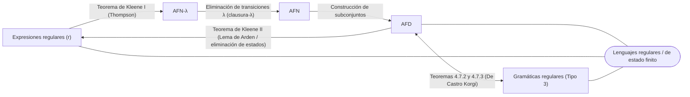

# Unidad 4: Lenguajes de Estado Finito

- **Duración:** 15 horas
- **Competencia(s) a desarrollar:** Diseña máquinas abstractas, lenguajes generados por gramáticas formales y expresiones regulares mediante la solución de ejercicios para analizar las relaciones que guardan entre ellos.

## Panorama de la unidad

Los **lenguajes de estado finito** —denominados también **lenguajes regulares**— conforman la familia más sencilla y mejor comprendida dentro de la jerarquía de Chomsky (lenguajes de tipo 3). Su importancia teórica radica en que admiten **tres caracterizaciones completamente equivalentes**:

1. **Enfoque operacional (reconocedores):** los lenguajes aceptados por los autómatas finitos deterministas (AFD), no deterministas (AFN) y con transiciones $\lambda$ ($\text{AFN-}\lambda$).
2. **Enfoque generativo (gramatical):** los lenguajes generados por las gramáticas regulares (lineales por la derecha o por la izquierda).
3. **Enfoque algebraico (declarativo):** los lenguajes descritos mediante expresiones regulares a partir de los lenguajes básicos y las operaciones de unión ($+$ o $\cup$), concatenación ($\cdot$) y estrella de Kleene ($*$).

En la ingeniería de software y la construcción de compiladores, esta unidad fundamenta el diseño del **analizador léxico** (*scanner* o *lexer*): las categorías léxicas de un lenguaje de programación (identificadores, palabras reservadas, constantes numéricas, operadores y delimitadores) se especifican declarativamente mediante expresiones regulares y se compilan sistemáticamente en autómatas finitos deterministas que procesan el código fuente en tiempo lineal respecto a su longitud. Asimismo, el estudio de sus propiedades algebraicas, de clausura y de bombeo delimita con exactitud matemática qué patrones pueden reconocerse con memoria finita y qué construcciones sintácticas requieren modelos más expresivos, como los autómatas de pila (Unidad 5).

## Subtemas

- [4.1 Aceptadores de estado finito](4-1-aceptadores-de-estado-finito.md) — Definición formal de AFD, AFN y $\text{AFN-}\lambda$, extensión de la función de transición $\hat{\delta}$, clausura-$\lambda$ y algoritmos constructivos de equivalencia ($\text{AFN-}\lambda \to \text{AFN} \to \text{AFD}$).
- [4.2 Aceptadores de estado finito y gramáticas regulares](4-2-aceptadores-de-estado-finito-y-gramaticas-regulares.md) — Equivalencia entre autómatas finitos y gramáticas regulares (gramáticas lineales por la derecha y por la izquierda), demostraciones constructivas en ambas direcciones y conversión bidireccional.
- [4.3 Expresiones regulares y aceptadores de estado finito](4-3-expresiones-regulares-y-aceptadores-de-estado-finito.md) — Definición recursiva de lenguajes y expresiones regulares, identidades algebraicas, Lema de Arden y las dos partes del Teorema de Kleene (síntesis vía Thompson y análisis vía ecuaciones de Arden y eliminación de estados).
- [4.4 Propiedades de los lenguajes de estado finito](4-4-propiedades-de-los-lenguajes-de-estado-finito.md) — Lema de bombeo y demostraciones de no regularidad, propiedades de clausura (operaciones booleanas, autómata producto, reflexión, homomorfismos y homomorfismo inverso) y algoritmos de decisión (pertenencia, vacío, finitud, inclusión y equivalencia).

## Referencias

- Acevedo Juárez, A. (2006). *Teoría de la computación* [Tesis de licenciatura, Instituto Tecnológico de Celaya].
- De Castro Korgi, R. (2004). *Teoría de la computación: Lenguajes, autómatas, gramáticas*. Universidad Nacional de Colombia.
