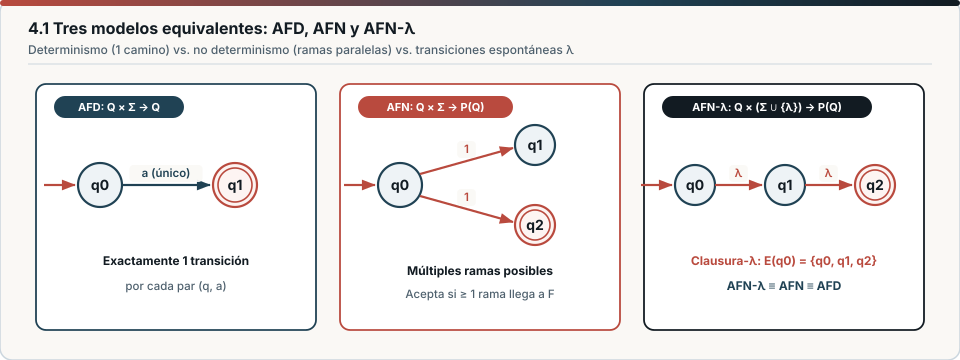
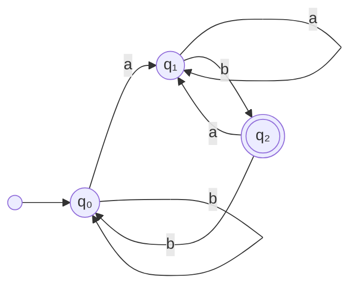
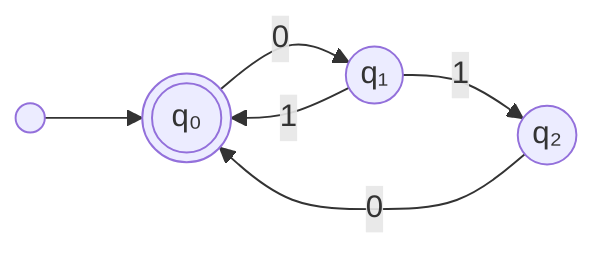
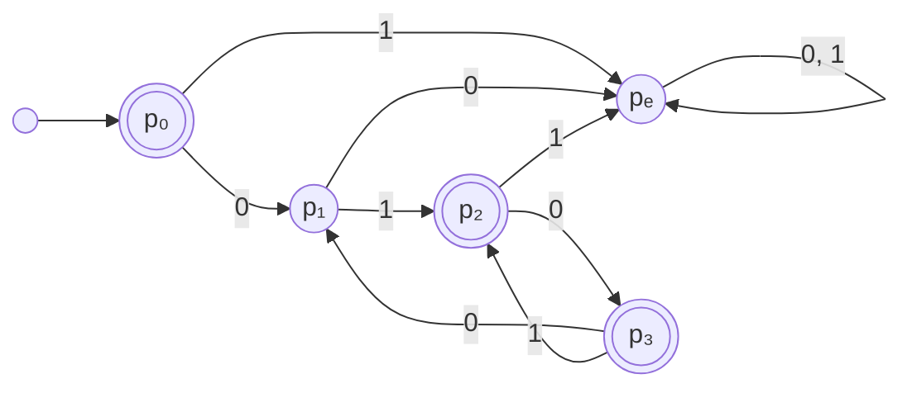
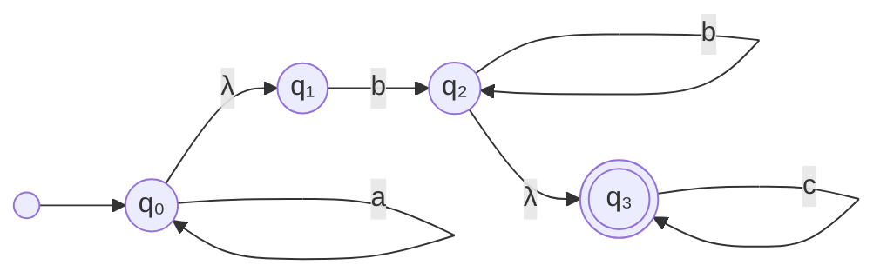
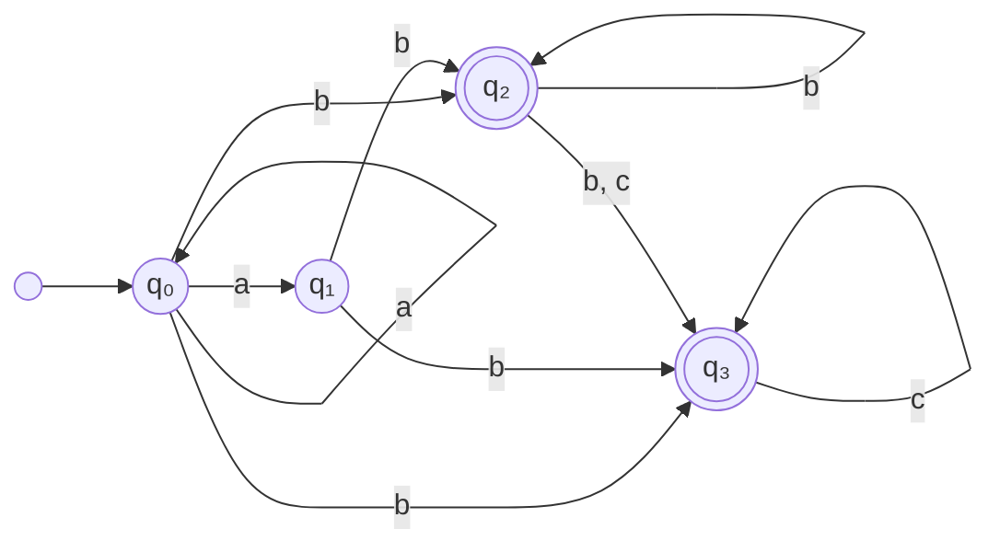
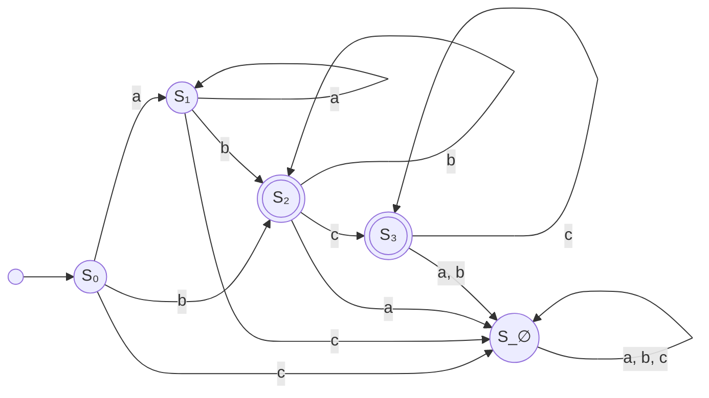

# 4.1 Aceptadores de estado finito

## Introducción y motivación

En la Unidad 3 se estudiaron las máquinas de estado finito como sistemas con entradas y salidas que transforman secuencias de símbolos (transductores de Mealy y Moore). En el estudio de los lenguajes formales, sin embargo, resulta fundamental analizar máquinas cuyo único propósito es **decidir si una cadena pertenece o no a un lenguaje**: los **aceptadores** o **reconocedores de estado finito**, comúnmente llamados **autómatas finitos**.

La motivación práctica más directa proviene de la primera fase de un compilador: el **análisis léxico**. Cuando un compilador lee un programa fuente como un flujo continuo de caracteres, el analizador léxico (*scanner*) debe agruparlos en unidades con significado (*tokens*), tales como identificadores, literales numéricos o palabras clave. Puesto que la memoria de control de un autómata finito es acotada y fija (su conjunto finito de estados) y su cabeza lectora avanza estrictamente de izquierda a derecha sin retroceder ni escribir sobre la cinta, el reconocimiento de cada cadena de longitud $|w|$ requiere exactamente $|w|$ pasos deterministas: es decir, el tiempo de revisión crece de forma directamente proporcional al tamaño de la cadena ($O(|w|)$), un paso por símbolo.

A lo largo de esta sección formalizaremos las tres variantes clásicas de aceptadores finitos —**deterministas** (AFD), **no deterministas** (AFN) y **con transiciones $\lambda$** ($\text{AFN-}\lambda$)— y demostraremos que, a pesar de la aparente mayor libertad del no determinismo y las transiciones espontáneas, los tres modelos poseen exactamente el mismo poder computacional.

---

## 4.1.1 Autómatas finitos deterministas (AFD)

Intuitivamente, un **autómata finito determinista** consta de una cinta de entrada semiinfinita dividida en casillas (donde se escribe la cadena $w \in \Sigma^*$), una cabeza lectora que se desplaza una casilla hacia la derecha tras leer cada símbolo, y una unidad de control con un número finito de estados internos. Al concluir la lectura completa de $w$, la cadena es **aceptada** si el autómata termina en un estado distinguido de aceptación, o **rechazada** en caso contrario.

### Definición formal

Un **autómata finito determinista (AFD)** es una 5-tupla

$$M = (Q, \Sigma, \delta, q_0, F)$$

donde:
1. $Q$ es un conjunto finito no vacío de **estados**.
2. $\Sigma$ es un conjunto finito no vacío llamado **alfabeto de entrada**.
3. $\delta : Q \times \Sigma \to Q$ es la **función de transición** (total), que asigna a cada par estado-símbolo $(q, a)$ un único estado siguiente $\delta(q, a) \in Q$.
4. $q_0 \in Q$ es el **estado inicial**.
5. $F \subseteq Q$ es el conjunto de **estados finales** o **de aceptación**.

> **Nota de notación:** De Castro Korgi (2004, Secc. 2.1, p. 26) ordena la 5-tupla como $M = (\Sigma, Q, q_0, F, \delta)$ y suele suponer $F \neq \emptyset$ (aunque permitir $F = \emptyset$ modela naturalmente el lenguaje vacío $\emptyset$). Ambas convenciones son matemáticamente equivalentes.

### Función de transición extendida y lenguaje aceptado

Para describir el estado en el que queda el autómata tras procesar una cadena completa $w \in \Sigma^*$, se extiende $\delta$ a $\hat{\delta} : Q \times \Sigma^* \to Q$ (denotada $\dot{\delta}$ en De Castro Korgi, 2004, Definición 2.5.2, p. 41) de manera recursiva:

$$\begin{aligned}
\hat{\delta}(q, \lambda) &= q, && \forall q \in Q, \\
\hat{\delta}(q, wa) &= \delta\big(\hat{\delta}(q, w), a\big), && \forall q \in Q,\; w \in \Sigma^*,\; a \in \Sigma.
\end{aligned}$$

De esta definición se desprende por inducción que $\hat{\delta}(q, a) = \delta(q, a)$ para todo $a \in \Sigma$, y en general $\hat{\delta}(q, uv) = \hat{\delta}(\hat{\delta}(q, u), v)$ para cualesquiera $u, v \in \Sigma^*$.

El **lenguaje aceptado** o **reconocido** por el AFD $M$, denotado $L(M)$, se define como:

$$L(M) = \{w \in \Sigma^* : \hat{\delta}(q_0, w) \in F\}.$$

En particular, la cadena vacía $\lambda$ pertenece a $L(M)$ si y solo si el estado inicial es de aceptación: $\lambda \in L(M) \iff q_0 \in F$.

### Representaciones: diagramas y tablas de transición

Un AFD suele representarse mediante dos herramientas equivalentes:
- **Diagrama de transiciones:** grafo dirigido y etiquetado cuyos vértices son los estados de $Q$; el estado inicial $q_0$ se señala con una flecha entrante sin origen, los estados de $F$ se dibujan con **doble círculo**, y cada transición $\delta(q, a) = p$ se representa con un arco dirigido de $q$ a $p$ etiquetado con $a$ (si varios símbolos comparten origen y destino, se separan por comas). Cuando se omiten arcos en un diagrama simplificado, se sobreentiende que conducen a un estado sumidero o **estado limbo** (*trap state*) de no aceptación.
- **Tabla de transición:** matriz cuyas filas corresponden a los estados de $Q$ y cuyas columnas corresponden a los símbolos de $\Sigma$. Se marca el estado inicial con `->` y cada estado de aceptación con `*`.

---

## 4.1.2 Autómatas finitos no deterministas (AFN)

Al diseñar reconocedores complejos, exigir en todo momento una transición única y definida para cada par $(q, a)$ resulta restrictivo. Un **autómata finito no determinista** relaja ambas condiciones: desde un estado dado y ante un mismo símbolo, el autómata puede elegir entre varios estados siguientes o no tener transición definida (caso en el que esa rama de cómputo se **aborta**).

### Definición formal

Un **autómata finito no determinista (AFN)** es una 5-tupla

$$M = (Q, \Sigma, \Delta, q_0, F)$$

donde $Q$, $\Sigma$, $q_0$ y $F$ tienen el mismo significado que en un AFD, y la **función de transición** tiene codominio en el conjunto potencia $\mathcal{P}(Q)$:

$$\Delta : Q \times \Sigma \to \mathcal{P}(Q).$$

(Algunos autores denotan también esta función con $\delta : Q \times \Sigma \to \mathcal{P}(Q)$; siguiendo a De Castro Korgi, 2004, Secc. 2.4, p. 33, usamos $\Delta$ para distinguir el caso no determinista del determinista.)

### Extensión de $\Delta$ y criterio de aceptación

Para definir formalmente el conjunto de estados alcanzables tras leer una cadena, primero se extiende $\Delta$ a subconjuntos de estados $S \subseteq Q$:

$$\Delta(S, a) = \bigcup_{q \in S} \Delta(q, a), \qquad \text{con } \Delta(\emptyset, a) = \emptyset.$$

Luego se define la función extendida $\hat{\Delta} : Q \times \Sigma^* \to \mathcal{P}(Q)$ recursivamente (De Castro Korgi, 2004, Definición 2.5.3, p. 41):

$$\begin{aligned}
\hat{\Delta}(q, \lambda) &= \{q\}, && \forall q \in Q, \\
\hat{\Delta}(q, wa) &= \Delta\big(\hat{\Delta}(q, w), a\big) = \bigcup_{p \in \hat{\Delta}(q, w)} \Delta(p, a), && \forall q \in Q,\; w \in \Sigma^*,\; a \in \Sigma.
\end{aligned}$$

El **criterio de aceptación** en un AFN es **existencial**: una cadena $w \in \Sigma^*$ es aceptada si existe **al menos un** cómputo completo desde $q_0$ etiquetado con $w$ que termine en algún estado de $F$. Formalmente:

$$L(M) = \{w \in \Sigma^* : \hat{\Delta}(q_0, w) \cap F \neq \emptyset\}.$$

Un AFD puede verse inmediatamente como un caso particular de AFN en el que $|\Delta(q, a)| = 1$ para todo $(q, a) \in Q \times \Sigma$.

---

## 4.1.3 Autómatas finitos con transiciones $\lambda$ ($\text{AFN-}\lambda$)

Un **autómata finito no determinista con transiciones $\lambda$** ($\text{AFN-}\lambda$) amplía el modelo AFN permitiendo que la máquina cambie de estado de manera espontánea, sin leer ni consumir ningún símbolo de la cinta de entrada y sin desplazar la cabeza lectora.

### Definición formal

Un $\text{AFN-}\lambda$ es una 5-tupla $M = (Q, \Sigma, \Delta, q_0, F)$ donde la función de transición es:

$$\Delta : Q \times (\Sigma \cup \{\lambda\}) \to \mathcal{P}(Q).$$

Las transiciones de la forma $p \in \Delta(q, \lambda)$ se denominan **transiciones $\lambda$** (o transiciones nulas). Como consecuencia, un $\text{AFN-}\lambda$ facilita la composición modular de autómatas (unión, concatenación y clausura), que será la base de la Parte I del Teorema de Kleene en la sección 4.3.

### La clausura-$\lambda$

Para capturar todos los estados a los que el autómata puede desplazarse espontáneamente sin consumir entrada, se define la **clausura-$\lambda$** de un estado $q \in Q$, denotada $\Lambda(q)$ o $E(q)$ (en De Castro Korgi, 2004, Secc. 2.7, p. 47, se escribe $\lambda[q]$):

$$E(q) = \big\{p \in Q : \text{existe una trayectoria de } 0, 1 \text{ o más transiciones } \lambda \text{ desde } q \text{ hasta } p\big\}.$$

De forma inductiva, $E(q)$ es el menor subconjunto de $Q$ tal que:
1. $q \in E(q)$ (trayectoria de longitud $0$).
2. Si $p \in E(q)$ y $r \in \Delta(p, \lambda)$, entonces $r \in E(q)$.

Para cualquier subconjunto $S \subseteq Q$, la clausura-$\lambda$ de $S$ se extiende mediante la unión:

$$E(S) = \bigcup_{q \in S} E(q), \qquad \text{con } E(\emptyset) = \emptyset.$$

### Extensión de $\Delta$ en un $\text{AFN-}\lambda$

Empleando la clausura-$\lambda$, la función de transición extendida $\hat{\Delta}_\lambda : Q \times \Sigma^* \to \mathcal{P}(Q)$ se define recursivamente como:

$$\begin{aligned}
\hat{\Delta}_\lambda(q, \lambda) &= E(q), \\
\hat{\Delta}_\lambda(q, wa) &= E\left(\bigcup_{p \in \hat{\Delta}_\lambda(q, w)} \Delta(p, a)\right) = E\big(\Delta(\hat{\Delta}_\lambda(q, w), a)\big), \qquad w \in \Sigma^*,\; a \in \Sigma.
\end{aligned}$$

El lenguaje aceptado por el $\text{AFN-}\lambda$ $M$ es:

$$L(M) = \{w \in \Sigma^* : \hat{\Delta}_\lambda(q_0, w) \cap F \neq \emptyset\}.$$

---

## 4.1.4 Equivalencia computacional: $\text{AFN-}\lambda \equiv \text{AFN} \equiv \text{AFD}$

Dos autómatas $M_1$ y $M_2$ sobre un mismo alfabeto $\Sigma$ son **equivalentes** si aceptan exactamente el mismo lenguaje, es decir, si $L(M_1) = L(M_2)$. Puesto que todo AFD es un AFN particular y todo AFN es un $\text{AFN-}\lambda$ sin transiciones $\lambda$, la inclusión $\mathcal{L}(\text{AFD}) \subseteq \mathcal{L}(\text{AFN}) \subseteq \mathcal{L}(\text{AFN-}\lambda)$ es inmediata. Los dos teoremas siguientes demuestran las inclusiones recíprocas de manera constructiva.

### Teorema 4.1.1 (Eliminación de transiciones $\lambda$: $\text{AFN-}\lambda \to \text{AFN}$)

*(Teorema 2.7.1 de De Castro Korgi, 2004, p. 47).* Dado un $\text{AFN-}\lambda$ $M = (Q, \Sigma, \Delta, q_0, F)$, existe un AFN $M' = (Q, \Sigma, \Delta', q_0, F')$ sin transiciones $\lambda$ tal que $L(M') = L(M)$, definido por:

1. $\Delta'(q, a) = E\big(\Delta(E(q), a)\big) = E\left(\bigcup_{p \in E(q)} \Delta(p, a)\right)$ para todo $q \in Q$ y $a \in \Sigma$.
2. $F' = \{q \in Q : E(q) \cap F \neq \emptyset\}$.

**Demostración (bosquejo por inducción).** Probaremos que para toda cadena no vacía $w \in \Sigma^+$ se cumple $\hat{\Delta}'(q_0, w) = \hat{\Delta}_\lambda(q_0, w)$:
- *Caso $|w| = 1$ ($w = a \in \Sigma$):* por definición de $\hat{\Delta}_\lambda$ y de $\Delta'$,
  $$\hat{\Delta}_\lambda(q_0, a) = E\big(\Delta(\hat{\Delta}_\lambda(q_0, \lambda), a)\big) = E\big(\Delta(E(q_0), a)\big) = \Delta'(q_0, a) = \hat{\Delta}'(q_0, a).$$
- *Paso inductivo ($w = ua$, con $u \in \Sigma^+$ y $a \in \Sigma$):* suponiendo por hipótesis inductiva que $\hat{\Delta}'(q_0, u) = \hat{\Delta}_\lambda(q_0, u) = S$, nótese primero que $E(S) = S$ pues todo estado en $S = \hat{\Delta}_\lambda(q_0, u)$ es ya cerrado bajo $E$. Entonces:
  $$\hat{\Delta}'(q_0, ua) = \bigcup_{p \in S} \Delta'(p, a) = \bigcup_{p \in S} E\big(\Delta(E(p), a)\big) = E\big(\Delta(E(S), a)\big) = E\big(\Delta(S, a)\big) = \hat{\Delta}_\lambda(q_0, ua).$$

Para $w = \lambda$, se tiene $\lambda \in L(M') \iff q_0 \in F' \iff E(q_0) \cap F \neq \emptyset \iff \hat{\Delta}_\lambda(q_0, \lambda) \cap F \neq \emptyset \iff \lambda \in L(M)$. Para $w \in \Sigma^+$, si $p \in \hat{\Delta}'(q_0, w) = \hat{\Delta}_\lambda(q_0, w)$, entonces $E(p) \subseteq \hat{\Delta}_\lambda(q_0, w)$; luego $\hat{\Delta}'(q_0, w) \cap F' \neq \emptyset \iff \hat{\Delta}_\lambda(q_0, w) \cap F \neq \emptyset$. Así, $L(M') = L(M)$. $\blacksquare$

### Teorema 4.1.2 (Construcción de subconjuntos: $\text{AFN} \to \text{AFD}$)

*(Teorema 2.5.1 de De Castro Korgi, 2004, pp. 38 y 42).* Dado un AFN $M' = (Q, \Sigma, \Delta', q_0, F')$, existe un AFD $M'' = (Q'', \Sigma, \delta, q''_0, F'')$ tal que $L(M'') = L(M')$, definido mediante la **construcción de subconjuntos** (*powerset construction*):

1. $Q'' = \mathcal{P}(Q)$ (en la práctica, basta restringirse al subconjunto de estados alcanzables desde $\{q_0\}$).
2. $q''_0 = \{q_0\}$.
3. $\delta(S, a) = \Delta'(S, a) = \bigcup_{q \in S} \Delta'(q, a)$ para todo $S \in Q''$ y $a \in \Sigma$.
4. $F'' = \{S \in Q'' : S \cap F' \neq \emptyset\}$.

**Demostración.** Probaremos por inducción sobre la longitud de la cadena $w \in \Sigma^*$ (probando primero para la cadena vacía $\lambda$ y luego viendo qué ocurre al añadir un símbolo $a$ al final) que $\hat{\delta}(\{q_0\}, w) = \hat{\Delta}'(q_0, w)$:
- *Base ($w = \lambda$):* $\hat{\delta}(\{q_0\}, \lambda) = \{q_0\} = \hat{\Delta}'(q_0, \lambda)$.
- *Paso inductivo ($w = ua$, con $u \in \Sigma^*$ y $a \in \Sigma$):* suponiendo $\hat{\delta}(\{q_0\}, u) = \hat{\Delta}'(q_0, u)$,
  $$\begin{aligned}
  \hat{\delta}(\{q_0\}, ua) &= \delta\big(\hat{\delta}(\{q_0\}, u), a\big) && \text{(definición de } \hat{\delta}\text{)} \\
  &= \delta\big(\hat{\Delta}'(q_0, u), a\big) && \text{(hipótesis de inducción)} \\
  &= \Delta'\big(\hat{\Delta}'(q_0, u), a\big) && \text{(definición de } \delta\text{)} \\
  &= \hat{\Delta}'(q_0, ua) && \text{(definición de } \hat{\Delta}'\text{)}.
  \end{aligned}$$

Finalmente, para toda $w \in \Sigma^*$:

$$w \in L(M'') \iff \hat{\delta}(\{q_0\}, w) \in F'' \iff \hat{\Delta}'(q_0, w) \cap F' \neq \emptyset \iff w \in L(M'). \qquad \blacksquare$$

> **Atajo directo $\text{AFN-}\lambda \to \text{AFD}$:** Combinando ambos teoremas en un solo algoritmo, puede construirse directamente un AFD a partir de un $\text{AFN-}\lambda$ tomando como estado inicial $q''_0 = E(q_0)$, transición $\delta(S, a) = E\big(\Delta(S, a)\big)$ y aceptación $F'' = \{S : S \cap F \neq \emptyset\}$. En el peor caso, si $|Q| = n$, el AFD resultante puede llegar a tener $2^n$ estados, aunque normalmente solo una fracción de estos son alcanzables desde el estado inicial.

---

## Ejemplos desarrollados paso a paso

### Ejemplo 1: Diseño formal y traza de un AFD

Diseñar un AFD $M_1$ sobre $\Sigma = \{a, b\}$ que reconozca el lenguaje de todas las cadenas que terminan con el sufijo $ab$:

$$L_1 = \{w \in \{a, b\}^* : w = uab \text{ para algún } u \in \{a, b\}^*\}.$$

**Paso 1. Definición intuitiva de los estados.** El autómata solo necesita recordar qué tanto del sufijo objetivo $ab$ ha observado hasta el momento:
- $q_0$: estado inicial; no se ha visto avance hacia $ab$ (o el último símbolo visto fue $b$ sin estar precedido de $a$).
- $q_1$: el último símbolo leído fue $a$ (primer símbolo de $ab$).
- $q_2$: los dos últimos símbolos leídos fueron $ab$ (estado de aceptación).

**Paso 2. Especificación formal como 5-tupla.** $M_1 = (Q, \Sigma, \delta, q_0, F)$ con $Q = \{q_0, q_1, q_2\}$, $\Sigma = \{a, b\}$, $F = \{q_2\}$ y tabla de transición:

| Estado | $a$ | $b$ |
| :--- | :---: | :---: |
| $\to q_0$ | $q_1$ | $q_0$ |
| $q_1$ | $q_1$ | $q_2$ |
| $* q_2$ | $q_1$ | $q_0$ |

**Paso 3. Diagrama de transiciones.**

**Paso 4. Verificación paso a paso con $\hat{\delta}$.**
- Cadena $u = aab$:
  $$\hat{\delta}(q_0, aab) = \delta(\delta(\delta(q_0, a), a), b) = \delta(\delta(q_1, a), b) = \delta(q_1, b) = q_2 \in F \implies aab \in L(M_1).$$
- Cadena $v = aba$:
  $$\hat{\delta}(q_0, aba) = \delta(\delta(\delta(q_0, a), b), a) = \delta(\delta(q_1, b), a) = \delta(q_2, a) = q_1 \notin F \implies aba \notin L(M_1).$$

---

### Ejemplo 2: Conversión de AFN a AFD mediante construcción de subconjuntos

*(Adaptado de De Castro Korgi, 2004, Secc. 2.5, pp. 39–41).* Considérese el AFN $M = (Q, \Sigma, \Delta, q_0, F)$ sobre $\Sigma = \{0, 1\}$ que acepta el lenguaje $(01 \cup 010)^*$, dado por $Q = \{q_0, q_1, q_2\}$, $F = \{q_0\}$ y las transiciones:

| Estado | $0$ | $1$ |
| :--- | :---: | :---: |
| $\to * q_0$ | $\{q_1\}$ | $\emptyset$ |
| $q_1$ | $\emptyset$ | $\{q_0, q_2\}$ |
| $q_2$ | $\{q_0\}$ | $\emptyset$ |

**Paso 1. Exploración de subconjuntos alcanzables desde $\{q_0\}$.**
1. Estado inicial $S_0 = \{q_0\}$:
   - $\delta(\{q_0\}, 0) = \Delta(q_0, 0) = \{q_1\}$ (nuevo estado $S_1$).
   - $\delta(\{q_0\}, 1) = \Delta(q_0, 1) = \emptyset$ (nuevo estado sumidero $S_\emptyset$).
2. Para $S_1 = \{q_1\}$:
   - $\delta(\{q_1\}, 0) = \Delta(q_1, 0) = \emptyset = S_\emptyset$.
   - $\delta(\{q_1\}, 1) = \Delta(q_1, 1) = \{q_0, q_2\}$ (nuevo estado $S_2$).
3. Para $S_2 = \{q_0, q_2\}$:
   - $\delta(\{q_0, q_2\}, 0) = \Delta(q_0, 0) \cup \Delta(q_2, 0) = \{q_1\} \cup \{q_0\} = \{q_0, q_1\}$ (nuevo estado $S_3$).
   - $\delta(\{q_0, q_2\}, 1) = \Delta(q_0, 1) \cup \Delta(q_2, 1) = \emptyset \cup \emptyset = \emptyset = S_\emptyset$.
4. Para $S_3 = \{q_0, q_1\}$:
   - $\delta(\{q_0, q_1\}, 0) = \Delta(q_0, 0) \cup \Delta(q_1, 0) = \{q_1\} \cup \emptyset = \{q_1\} = S_1$.
   - $\delta(\{q_0, q_1\}, 1) = \Delta(q_0, 1) \cup \Delta(q_1, 1) = \emptyset \cup \{q_0, q_2\} = \{q_0, q_2\} = S_2$.
5. Para $S_\emptyset = \emptyset$: $\delta(\emptyset, 0) = \emptyset$ y $\delta(\emptyset, 1) = \emptyset$.

**Paso 2. Estados finales y tabla del AFD equivalente $M''$.** Un subconjunto $S$ pertenece a $F''$ si y solo si $S \cap \{q_0\} \neq \emptyset$, por lo que $F'' = \{\{q_0\}, \{q_0, q_2\}, \{q_0, q_1\}\}$. Renombrando $p_0 = \{q_0\}$, $p_1 = \{q_1\}$, $p_2 = \{q_0, q_2\}$, $p_3 = \{q_0, q_1\}$ y $p_e = \emptyset$:

| Subconjunto | Estado | $0$ | $1$ |
| :--- | :--- | :---: | :---: |
| $\{q_0\}$ | $\to * p_0$ | $p_1$ | $p_e$ |
| $\{q_1\}$ | $p_1$ | $p_e$ | $p_2$ |
| $\{q_0, q_2\}$ | $* p_2$ | $p_3$ | $p_e$ |
| $\{q_0, q_1\}$ | $* p_3$ | $p_1$ | $p_2$ |
| $\emptyset$ | $p_e$ | $p_e$ | $p_e$ |

**Paso 3. Diagrama del AFD resultante.**

Nótese cómo el subconjunto $\{q_2\}$ por separado nunca es alcanzable desde $\{q_0\}$, por lo que $M''$ queda totalmente determinizado con cinco estados (cuatro activos y el estado trampa $p_e$). Comprobemos la cadena $01001$: $p_0 \xrightarrow{0} p_1 \xrightarrow{1} p_2 \xrightarrow{0} p_3 \xrightarrow{0} p_1 \xrightarrow{1} p_2 \in F''$ (aceptada).

---

### Ejemplo 3: Cadena completa $\text{AFN-}\lambda \to \text{AFN} \to \text{AFD}$

Considérese el siguiente $\text{AFN-}\lambda$ $M = (Q, \Sigma, \Delta, q_0, F)$ sobre $\Sigma = \{a, b, c\}$ que acepta el lenguaje $L = \{a^i b^j c^k : i \ge 0,\; j \ge 1,\; k \ge 0\}$ (es decir, $a^* b^+ c^*$):

- $Q = \{q_0, q_1, q_2, q_3\}$, $F = \{q_3\}$.
- Tabla de transición $\Delta$:

| Estado | $a$ | $b$ | $c$ | $\lambda$ |
| :--- | :---: | :---: | :---: | :---: |
| $\to q_0$ | $\{q_0\}$ | $\emptyset$ | $\emptyset$ | $\{q_1\}$ |
| $q_1$ | $\emptyset$ | $\{q_2\}$ | $\emptyset$ | $\emptyset$ |
| $q_2$ | $\emptyset$ | $\{q_2\}$ | $\emptyset$ | $\{q_3\}$ |
| $* q_3$ | $\emptyset$ | $\emptyset$ | $\{q_3\}$ | $\emptyset$ |

#### Fase A: Eliminación de transiciones $\lambda$ ($\text{AFN-}\lambda \to \text{AFN}$)

1. **Cálculo de las clausuras-$\lambda$:**
   $$E(q_0) = \{q_0, q_1\}, \qquad E(q_1) = \{q_1\}, \qquad E(q_2) = \{q_2, q_3\}, \qquad E(q_3) = \{q_3\}.$$
2. **Nuevo conjunto de estados finales $F'$:** contiene a los estados cuya clausura interseca a $F = \{q_3\}$:
   $$F' = \{q_2, q_3\}.$$
3. **Cálculo de $\Delta'(q, x) = E(\Delta(E(q), x))$:**
   - Para $q_0$ ($E(q_0) = \{q_0, q_1\}$):
     - $\Delta'(q_0, a) = E(\Delta(\{q_0, q_1\}, a)) = E(\{q_0\}) = \{q_0, q_1\}$.
     - $\Delta'(q_0, b) = E(\Delta(\{q_0, q_1\}, b)) = E(\{q_2\}) = \{q_2, q_3\}$.
     - $\Delta'(q_0, c) = E(\Delta(\{q_0, q_1\}, c)) = E(\emptyset) = \emptyset$.
   - Para $q_1$ ($E(q_1) = \{q_1\}$): $\Delta'(q_1, a) = \emptyset$, $\Delta'(q_1, b) = E(\{q_2\}) = \{q_2, q_3\}$, $\Delta'(q_1, c) = \emptyset$.
   - Para $q_2$ ($E(q_2) = \{q_2, q_3\}$): $\Delta'(q_2, a) = \emptyset$, $\Delta'(q_2, b) = E(\{q_2\}) = \{q_2, q_3\}$, $\Delta'(q_2, c) = E(\{q_3\}) = \{q_3\}$.
   - Para $q_3$ ($E(q_3) = \{q_3\}$): $\Delta'(q_3, a) = \emptyset$, $\Delta'(q_3, b) = \emptyset$, $\Delta'(q_3, c) = \{q_3\}$.

El AFN equivalente $M'$ queda dado por:

| Estado | $a$ | $b$ | $c$ |
| :--- | :---: | :---: | :---: |
| $\to q_0$ | $\{q_0, q_1\}$ | $\{q_2, q_3\}$ | $\emptyset$ |
| $q_1$ | $\emptyset$ | $\{q_2, q_3\}$ | $\emptyset$ |
| $* q_2$ | $\emptyset$ | $\{q_2, q_3\}$ | $\{q_3\}$ |
| $* q_3$ | $\emptyset$ | $\emptyset$ | $\{q_3\}$ |

#### Fase B: Determinización por subconjuntos ($\text{AFN} \to \text{AFD}$)

Partiendo de $\{q_0\}$, calculamos las transiciones de los subconjuntos alcanzables con $F'' = \{S : S \cap \{q_2, q_3\} \neq \emptyset\}$:

| Subconjunto | Etiqueta | $a$ | $b$ | $c$ |
| :--- | :--- | :---: | :---: | :---: |
| $\{q_0\}$ | $\to S_0$ | $\{q_0, q_1\}$ | $\{q_2, q_3\}$ | $\emptyset$ |
| $\{q_0, q_1\}$ | $S_1$ | $\{q_0, q_1\}$ | $\{q_2, q_3\}$ | $\emptyset$ |
| $\{q_2, q_3\}$ | $* S_2$ | $\emptyset$ | $\{q_2, q_3\}$ | $\{q_3\}$ |
| $\{q_3\}$ | $* S_3$ | $\emptyset$ | $\emptyset$ | $\{q_3\}$ |
| $\emptyset$ | $S_\emptyset$ | $\emptyset$ | $\emptyset$ | $\emptyset$ |

Se observa que $S_0$ y $S_1$ tienen exactamente las mismas transiciones y ambos no son de aceptación, por lo que pueden fusionarse (según los métodos de reducción de la Unidad 3) para obtener un AFD mínimo de cuatro estados (tres activos más el estado trampa). Verificación: la cadena $aabbcc$ sigue $S_0 \xrightarrow{a} S_1 \xrightarrow{a} S_1 \xrightarrow{b} S_2 \xrightarrow{b} S_2 \xrightarrow{c} S_3 \xrightarrow{c} S_3 \in F''$ (aceptada), mientras que $ac$ sigue $S_0 \xrightarrow{a} S_1 \xrightarrow{c} S_\emptyset \notin F''$ (rechazada).

---

## Ejercicios propuestos

1. **Diseño de AFD y análisis léxico:** Construya un AFD completo (especificando la 5-tupla $M = (Q, \Sigma, \delta, q_0, F)$, la tabla de transición y el diagrama) sobre el alfabeto $\Sigma = \{d, ., +, -\}$ que reconozca literales numéricos decimales con signo opcional y parte fraccionaria obligatoria (por ejemplo `+3.14` o `0.5`, representados abstractamente por $\{+, -, \lambda\} d^+ . d^+$). Evalúe $\hat{\delta}(q_0, w)$ para $w_1 = -d.dd$ y $w_2 = d.$.
2. **AFD de paridad y sufijos:** Diseñe un AFD sobre $\Sigma = \{0, 1\}$ que acepte todas las cadenas con un número impar de ceros que además no contengan la subcadena `11`. Verifique su funcionamiento con tres cadenas aceptadas y tres rechazadas.
3. **Conversión $\text{AFN} \to \text{AFD}$:** Considere el AFN $M = (\{q_0, q_1, q_2, q_3\}, \{a, b\}, \Delta, q_0, \{q_3\})$ con $\Delta(q_0, a) = \{q_0, q_1\}$, $\Delta(q_0, b) = \{q_0\}$, $\Delta(q_1, b) = \{q_2\}$, $\Delta(q_2, a) = \{q_3\}$, $\Delta(q_2, b) = \{q_3\}$ y $\Delta(q_3, x) = \emptyset$ para $x \in \{a, b\}$. Describa qué lenguaje acepta $M$ y construya el AFD equivalente usando el algoritmo de subconjuntos.
4. **Conversión $\text{AFN-}\lambda \to \text{AFN} \to \text{AFD}$:** Sea $M = (\{q_0, q_1, q_2, q_3\}, \{a, b\}, \Delta, q_0, \{q_3\})$ el $\text{AFN-}\lambda$ definido por $\Delta(q_0, a) = \{q_0\}$, $\Delta(q_0, \lambda) = \{q_1, q_2\}$, $\Delta(q_1, b) = \{q_3\}$, $\Delta(q_2, a) = \{q_2\}$, $\Delta(q_2, b) = \{q_2\}$, $\Delta(q_2, \lambda) = \{q_3\}$ y $\Delta(q_3, a) = \{q_3\}$.
   - Calcule las clausuras-$\lambda$ de todos los estados.
   - Construya el AFN equivalente $M'$ eliminando las transiciones $\lambda$.
   - Construya el AFD equivalente $M''$ por subconjuntos.
5. **Demostración:** Demuestre por inducción sobre la longitud de $w \in \Sigma^*$ que en cualquier AFD $M = (Q, \Sigma, \delta, q_0, F)$ la función extendida satisface $\hat{\delta}(q, uv) = \hat{\delta}(\hat{\delta}(q, u), v)$ para todo $q \in Q$ y cualesquiera $u, v \in \Sigma^*$.

## Referencias

- Acevedo Juárez, A. (2006). *Teoría de la computación* [Tesis de licenciatura, Instituto Tecnológico de Celaya]. (Unidad 2: Lenguajes regulares, pp. 44–81).
- De Castro Korgi, R. (2004). *Teoría de la computación: Lenguajes, autómatas, gramáticas*. Universidad Nacional de Colombia. (Capítulo 2, secciones 2.1–2.7, pp. 25–49).
