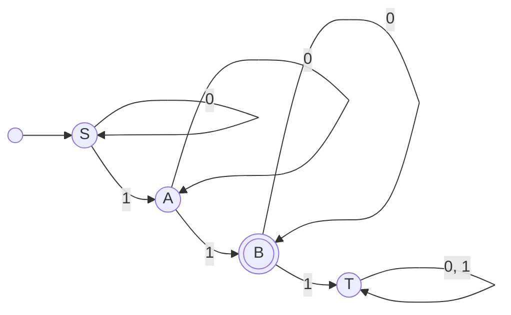
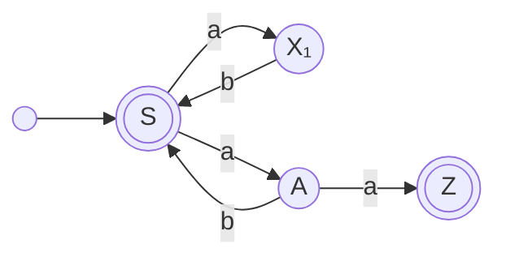
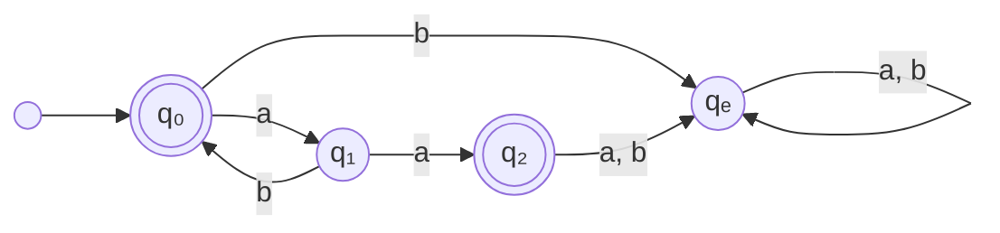

# 4.2 Aceptadores de estado finito y gramáticas regulares

## Introducción y motivación

En las unidades precedentes se abordaron dos perspectivas aparentemente distintas para caracterizar lenguajes formales: las **gramáticas generativas** (Unidad 2), que producen cadenas aplicando reglas de reescritura desde un símbolo inicial, y los **aceptadores de estado finito** (sección 4.1), que consumen cadenas de entrada símbolo a símbolo para decidir si pertenecen al lenguaje. En el diseño de compiladores, esta dualidad es de gran utilidad: permite describir la estructura de un *token* de forma declarativa mediante reglas de producción lineales y traducir dichas reglas directamente en la tabla de transiciones de un autómata finito, o bien recuperar una gramática generativa a partir de un autómata ya diseñado.

En esta sección demostraremos que las **gramáticas regulares** (tipo 3 en la jerarquía de Chomsky) generan exactamente la misma familia de lenguajes que aceptan los autómatas finitos.

---

## 4.2.1 Gramáticas regulares y variantes lineales

Recordemos de la Unidad 2 que una gramática generativa es una 4-tupla $G = (V, \Sigma, S, P)$, donde $V$ es un alfabeto finito de variables o no terminales, $\Sigma$ es el alfabeto de terminales ($V \cap \Sigma = \emptyset$), $S \in V$ es el símbolo inicial y $P$ es un conjunto finito de producciones. La derivación directa $\alpha \Rightarrow \beta$ representa la aplicación de una producción de $P$, y $\alpha \Rightarrow^* \beta$ su clausura reflexiva y transitiva. El lenguaje generado por $G$ es $L(G) = \{w \in \Sigma^* : S \Rightarrow^* w\}$.

### Definición formal (gramática regular estricta)

*(Definición 4.7.1 de De Castro Korgi, 2004, p. 98).* Una gramática independiente del contexto $G = (V, \Sigma, S, P)$ se denomina **gramática regular** (en forma normal estricta) si todas sus producciones tienen una de las dos formas siguientes:

$$A \to aB \qquad \text{o} \qquad A \to \lambda$$

donde $A, B \in V$ y $a \in \Sigma$.

> **Nota sobre convenciones equivalentes:** En algunos textos (como Acevedo Juárez, 2006, p. 48) se exige que las producciones sean $A \to aB$ o $A \to a$ (con $S \to \lambda$ permitido solo si $S$ no aparece en el lado derecho de ninguna producción). Ambas definiciones son equivalentes: cualquier regla $A \to a$ puede escribirse como $A \to aZ$ introduciendo un no terminal nuevo $Z \to \lambda$; inversamente, una regla $A \to \lambda$ puede eliminarse sustituyendo las ocurrencias de $A$ en los lados derechos (excepto si $\lambda \in L(G)$, caso en el que se mantiene $S \to \lambda$).

### Gramáticas regulares por la derecha y por la izquierda

En la práctica es habitual permitir cadenas arbitrarias de terminales acompañando a la variable no terminal:

1. **Gramática regular por la derecha** *(Definición 4.7.5 de De Castro Korgi, 2004, p. 100)*: sus producciones son de la forma
   $$A \to wB \quad (w \in \Sigma^*,\; B \in V) \qquad \text{o} \qquad A \to \lambda.$$
   *(Equivalentemente, permitiendo también $A \to w$ con $w \in \Sigma^*$, lo que equivale a escribir $A \to wZ$ con $Z \to \lambda$.)*
2. **Gramática regular por la izquierda**: sus producciones son de la forma
   $$A \to Bw \quad (w \in \Sigma^*,\; B \in V) \qquad \text{o} \qquad A \to \lambda.$$

> **Precaución importante:** Una gramática **lineal** que combine producciones por la derecha y por la izquierda dentro del mismo conjunto $P$ *no es necesariamente regular*. Por ejemplo, la gramática $S \to aA \mid \lambda$, $A \to Sb$ alterna terminales a izquierda y derecha y genera el lenguaje $\{a^n b^n : n \ge 0\}$, que como demostraremos en la sección 4.4 **no es regular**.

---

## 4.2.2 Teorema de equivalencia entre autómatas finitos y gramáticas regulares

La correspondencia exacta entre aceptadores de estado finito y gramáticas regulares se establece en dos direcciones constructivas (Teoremas 4.7.2, 4.7.3 y Corolario 4.7.4 de De Castro Korgi, 2004, pp. 98–100).

### Teorema 4.2.1 (Equivalencia entre autómatas finitos y gramáticas regulares)

Un lenguaje $L \subseteq \Sigma^*$ es aceptado por un autómata finito (AFD, AFN o $\text{AFN-}\lambda$) si y solo si existe una gramática regular $G$ tal que $L = L(G)$. En particular, todo lenguaje regular es un lenguaje independiente del contexto (LIC), aunque el recíproco es falso.

---

### Dirección 1: De AFD a gramática regular (Teorema 4.7.2 de De Castro Korgi)

#### Algoritmo constructivo ($\text{AFD} \to G$)

Dado un AFD $M = (Q, \Sigma, \delta, q_0, F)$, se construye la gramática regular $G = (V, \Sigma, S, P)$ haciendo:
1. $V = Q$ (cada estado se convierte en una variable no terminal).
2. $S = q_0$ (el símbolo inicial es el estado inicial).
3. El conjunto $P$ consta exactamente de las producciones:
   - $q \to ap$ para cada transición $\delta(q, a) = p$, con $q, p \in Q$ y $a \in \Sigma$;
   - $q \to \lambda$ para cada estado de aceptación $q \in F$.

*(Observación: la misma construcción funciona directamente si se parte de un AFN $M = (Q, \Sigma, \Delta, q_0, F)$, añadiendo $q \to ap$ por cada $p \in \Delta(q, a)$.)*

#### Demostración de corrección ($L(M) = L(G)$)

Demostraremos primero dos afirmaciones auxiliares para toda cadena no vacía $w \in \Sigma^+$ y todo par de estados $q, p \in Q$:

1. **Afirmación (1): Si $\hat{\delta}(q, w) = p$, entonces $q \Rightarrow^* wp$.**  
   Procedemos por inducción sobre $|w| \ge 1$.
   - *Base ($|w| = 1$, $w = a \in \Sigma$):* si $\hat{\delta}(q, a) = \delta(q, a) = p$, entonces $q \to ap$ pertenece a $P$ por construcción, luego $q \Rightarrow ap$.
   - *Paso inductivo ($w = ua$ con $u \in \Sigma^+$, $a \in \Sigma$):* sea $p' = \hat{\delta}(q, u)$, de modo que $p = \hat{\delta}(q, ua) = \delta(p', a)$. Por hipótesis de inducción, $q \Rightarrow^* up'$, y como $\delta(p', a) = p$, la regla $p' \to ap$ está en $P$. Por tanto:
     $$q \Rightarrow^* up' \Rightarrow uap = wp.$$

2. **Afirmación (2): Si $q \Rightarrow^* wp$, entonces $\hat{\delta}(q, w) = p$.**  
   Procedemos por inducción sobre el número de pasos $k \ge 1$ de la derivación $q \Rightarrow^k wp$.
   - *Base ($k = 1$):* una derivación de un solo paso con $w \in \Sigma^+$ necesariamente usa una producción de la forma $q \to ap$, por lo que $w = a$ y $\delta(q, a) = p$.
   - *Paso inductivo ($k = m + 1$, con $m \ge 1$):* puesto que toda producción no terminal genera un símbolo terminal a la izquierda y exactamente un no terminal a la derecha, la derivación tiene la forma
     $$q \Rightarrow^m u p' \Rightarrow uap = wp$$
     donde $w = ua$ ($u \in \Sigma^+$, $a \in \Sigma$) y el último paso aplica $p' \to ap \in P$. Por hipótesis de inducción aplicada a los $m$ primeros pasos, $\hat{\delta}(q, u) = p'$. Además $p' \to ap \in P$ implica $\delta(p', a) = p$. Luego:
     $$\hat{\delta}(q, w) = \hat{\delta}(q, ua) = \delta(\hat{\delta}(q, u), a) = \delta(p', a) = p.$$

3. **Conclusión ($w \in L(M) \iff w \in L(G)$):**
   - Si $w = \lambda$: $\lambda \in L(M) \iff q_0 \in F \iff (q_0 \to \lambda) \in P \iff S \Rightarrow^* \lambda$ (pues ninguna producción de la forma $A \to aB$ reduce la cantidad de terminales).
   - Si $w \in \Sigma^+$: si $w \in L(M)$, entonces $\hat{\delta}(q_0, w) = p \in F$; por (1), $S = q_0 \Rightarrow^* wp$, y como $p \to \lambda \in P$, se obtiene $S \Rightarrow^* wp \Rightarrow w \in L(G)$. Recíprocamente, si $S \Rightarrow^* w$, el último paso que elimina la variable no terminal debe usar $p \to \lambda$ para algún $p \in F$, luego $q_0 \Rightarrow^* wp \Rightarrow w$; por (2), $\hat{\delta}(q_0, w) = p \in F$, es decir, $w \in L(M)$. $\blacksquare$

---

### Dirección 2: De gramática regular a AFN (Teorema 4.7.3 de De Castro Korgi)

#### Algoritmo constructivo ($G \to \text{AFN}$)

Dada una gramática regular $G = (V, \Sigma, S, P)$ (con producciones $A \to aB$ y $A \to \lambda$), se construye el AFN $M = (Q, \Sigma, \Delta, q_0, F)$ definiendo:
1. $Q = V$.
2. $q_0 = S$.
3. $\Delta(A, a) = \{B \in V : (A \to aB) \in P\}$ para todo $A \in V$ y $a \in \Sigma$.
4. $F = \{A \in V : (A \to \lambda) \in P\}$.

*(Variante con producciones $A \to a$):* Si la gramática incluye reglas puramente terminales $A \to a$ ($a \in \Sigma$), se añade un único estado nuevo de aceptación $q_f \notin V$ al conjunto $Q$, se agrega $q_f$ a $\Delta(A, a)$ por cada regla $A \to a$, y se define $F = \{q_f\} \cup \{A \in V : (A \to \lambda) \in P\}$.

#### Demostración de corrección ($L(G) = L(M)$)

Análogamente a la Dirección 1, se verifica por inducción que para toda cadena $w \in \Sigma^+$ y cualesquiera $A, B \in V$:

$$A \Rightarrow^* wB \quad \Longleftrightarrow \quad B \in \hat{\Delta}(A, w).$$

Para $w = \lambda$, $\lambda \in L(G) \iff (S \to \lambda) \in P \iff q_0 \in F \iff \lambda \in L(M)$. Para $w \in \Sigma^+$, se tiene $w \in L(G) \iff \exists B \in V$ tal que $S \Rightarrow^* wB \text{ y } (B \to \lambda) \in P \iff \exists B \in F$ tal que $B \in \hat{\Delta}(q_0, w) \iff w \in L(M)$. Aplicando el Teorema 4.1.2 (construcción de subconjuntos), se obtiene además un AFD equivalente a $M$. $\blacksquare$

---

## 4.2.3 Equivalencia con gramáticas regulares por la derecha y por la izquierda

*(Teorema 4.7.6 de De Castro Korgi, 2004, pp. 100–101).*

### Caso 1: Gramáticas regulares por la derecha ($A \to wB \mid \lambda$)

Toda gramática regular estricta es regular por la derecha. Recíprocamente, en una gramática regular por la derecha $G = (V, \Sigma, S, P)$, cada producción general se transforma preservando el lenguaje generado:
- Si $A \to a_1 a_2 \cdots a_k B$ con $k \ge 2$ y $a_i \in \Sigma$, se introducen $k - 1$ variables nuevas $X_1, \dots, X_{k-1}$ y se reemplaza por la cadena:
  $$A \to a_1 X_1,\quad X_1 \to a_2 X_2,\quad \dots,\quad X_{k-1} \to a_k B.$$
- Si aparece una producción unitaria $A \to B$ (caso $w = \lambda$), se introduce una transición $\lambda$ en el autómata equivalente ($B \in \Delta(A, \lambda)$), convirtiendo $G$ en un $\text{AFN-}\lambda$ y este en un AFD/AFN (o eliminando producciones unitarias en $G$).
- Si aparece $A \to w$ ($w \in \Sigma^*$), equivale a $A \to wZ$ con $Z \to \lambda$.

### Caso 2: Gramáticas regulares por la izquierda ($A \to Bw \mid \lambda$)

Las gramáticas regulares por la izquierda también generan exactamente los lenguajes regulares. Para convertir una gramática regular por la izquierda $G$ en un autómata finito (o en una gramática regular por la derecha equivalente), puede aplicarse el siguiente procedimiento de **reflexión**:
1. Se invierte el lado derecho de todas las producciones de $G$: cada regla $A \to Bw$ se sustituye por $A \to w^R B$ (y $A \to w$ por $A \to w^R$), obteniéndose una gramática regular por la derecha $G^R$ que genera el lenguaje reflejado $L(G^R) = (L(G))^R$.
2. Se construye el autómata finito $M^R$ tal que $L(M^R) = L(G^R)$.
3. Se invierten todas las transiciones de $M^R$ intercambiando el papel de los estados inicial y finales (conectando un nuevo estado inicial con $\lambda$-transiciones a todos los antiguos estados finales, y haciendo de $q_0$ el único estado de aceptación). El $\text{AFN-}\lambda$ resultante $M$ satisface $L(M) = (L(M^R))^R = L(G)$, y por el Teorema 4.2.1 induce una gramática regular estricta equivalente a $G$.

---

## Ejemplos desarrollados paso a paso

### Ejemplo 1: De AFD a gramática regular

*(Basado en De Castro Korgi, 2004, Secc. 4.7, pp. 99–100).* Considérese el lenguaje sobre $\Sigma = \{0, 1\}$ de todas las cadenas con **exactamente dos unos**, denotado por $0^* 1 0^* 1 0^*$. Su AFD completo es $M = (Q, \Sigma, \delta, S, F)$ con $Q = \{S, A, B, T\}$, estado inicial $S$, $F = \{B\}$ y la siguiente tabla de transición (donde $T$ es el estado trampa tras leer un tercer $1$):

| Estado | $0$ | $1$ |
| :--- | :---: | :---: |
| $\to S$ | $S$ | $A$ |
| $A$ | $A$ | $B$ |
| $* B$ | $B$ | $T$ |
| $T$ | $T$ | $T$ |

**Paso 1. Traducción directa mediante el algoritmo del Teorema 4.7.2.**
- Variables: $V = \{S, A, B, T\}$, símbolo inicial $S$.
- Producciones por cada transición $\delta(q, a) = p$:
  $$\begin{aligned}
  S &\to 0S \mid 1A \\
  A &\to 0A \mid 1B \\
  B &\to 0B \mid 1T \\
  T &\to 0T \mid 1T
  \end{aligned}$$
- Producciones $\lambda$ para $q \in F = \{B\}$:
  $$B \to \lambda.$$

**Paso 2. Simplificación de variables no terminables.** Nótese que desde la variable $T$ nunca se puede derivar una cadena de terminales ($T$ no tiene producción $T \to \lambda$ ni camino hacia $B$). Por tanto, $T$ es una variable inútil no terminable y las producciones que la contienen pueden eliminarse sin alterar $L(G)$, obteniendo la gramática regular simplificada:

$$G: \quad S \to 0S \mid 1A, \qquad A \to 0A \mid 1B, \qquad B \to 0B \mid \lambda.$$

**Paso 3. Comprobación mediante derivación y cómputo en $M$.** Para la cadena $w = 01010$:
- En $G$: $S \Rightarrow 0S \Rightarrow 01A \Rightarrow 010A \Rightarrow 0101B \Rightarrow 01010B \Rightarrow 01010$.
- En $M$: $S \xrightarrow{0} S \xrightarrow{1} A \xrightarrow{0} A \xrightarrow{1} B \xrightarrow{0} B \in F$.

---

### Ejemplo 2: De gramática regular por la derecha a AFN y AFD

Considérese la gramática regular por la derecha $G = (\{S, A\}, \{a, b\}, S, P)$ cuyas producciones son:

$$S \to abS \mid aA \mid \lambda, \qquad A \to bS \mid a.$$

**Paso 1. Normalización a gramática regular estricta.**
- La regla $S \to abS$ tiene dos terminales antes del no terminal; introducimos una variable auxiliar $X_1$:
  $$S \to aX_1, \qquad X_1 \to bS.$$
- La regla $A \to a$ no tiene variable a la derecha; introducimos una variable auxiliar final $Z$ con $Z \to \lambda$:
  $$A \to aZ, \qquad Z \to \lambda.$$

La gramática regular estricta equivalente $G' = (\{S, X_1, A, Z\}, \{a, b\}, S, P')$ es:

$$\begin{aligned}
S &\to aX_1 \mid aA \mid \lambda \\
X_1 &\to bS \\
A &\to bS \mid aZ \\
Z &\to \lambda
\end{aligned}$$

**Paso 2. Construcción del AFN $M$ (algoritmo del Teorema 4.7.3).**
- $Q = \{S, X_1, A, Z\}$, $q_0 = S$, $F = \{S, Z\}$ (por $S \to \lambda$ y $Z \to \lambda$).
- Tabla de transición $\Delta$:

| Estado | $a$ | $b$ |
| :--- | :---: | :---: |
| $\to * S$ | $\{X_1, A\}$ | $\emptyset$ |
| $X_1$ | $\emptyset$ | $\{S\}$ |
| $A$ | $\{Z\}$ | $\{S\}$ |
| $* Z$ | $\emptyset$ | $\emptyset$ |

**Paso 3. Determinización a AFD equivalente $M'$ (construcción de subconjuntos).** Partiendo de $\{S\}$:

| Subconjunto | Estado | $a$ | $b$ |
| :--- | :--- | :---: | :---: |
| $\{S\}$ | $\to * q_0$ | $\{X_1, A\}$ | $\emptyset$ |
| $\{X_1, A\}$ | $q_1$ | $\{Z\}$ | $\{S\}$ |
| $\{Z\}$ | $* q_2$ | $\emptyset$ | $\emptyset$ |
| $\emptyset$ | $q_e$ | $\emptyset$ | $\emptyset$ |

**Paso 4. Verificación cruzada.**
- Para $w = abaa$: en $G$, $S \Rightarrow abS \Rightarrow abaA \Rightarrow abaa$; en $M'$, $q_0 \xrightarrow{a} q_1 \xrightarrow{b} q_0 \xrightarrow{a} q_1 \xrightarrow{a} q_2 \in F'$ (aceptada).
- Para $w = aba$: no existe derivación en $G$ (tras $S \Rightarrow abS$ o $S \Rightarrow aA \Rightarrow abS$ la siguiente $a$ deja una variable viva sin poder terminar en $a$ sola); en $M'$, $q_0 \xrightarrow{a} q_1 \xrightarrow{b} q_0 \xrightarrow{a} q_1 \notin F'$ (rechazada). De hecho, tanto $L(G)$ como $L(M')$ describen exactamente el lenguaje $(ab)^*(\lambda + aa)$.

---

## Ejercicios propuestos

1. **De AFD a gramática regular:** Obtenga una gramática regular estricta (simplificada eliminando variables inútiles si existen) que genere el lenguaje aceptado por el AFD $M = (\{q_0, q_1, q_2\}, \{a, b\}, \delta, q_0, \{q_2\})$ con $\delta(q_0, a) = q_1$, $\delta(q_0, b) = q_0$, $\delta(q_1, a) = q_1$, $\delta(q_1, b) = q_2$, $\delta(q_2, a) = q_1$ y $\delta(q_2, b) = q_0$. Derive la cadena `aabab` y verifique su traza en el AFD.
2. **De gramática regular por la derecha a AFD:** Dada la gramática $G$ sobre $\Sigma = \{0, 1\}$ con producciones $S \to 01S \mid 1A \mid 0$, $A \to 00A \mid 1S \mid \lambda$:
   - Convierta $G$ a forma regular estricta.
   - Construya el AFN correspondiente y luego el AFD equivalente por subconjuntos.
3. **Gramáticas regulares para lenguajes específicos:** Construya gramáticas regulares (en forma estricta) que generen los siguientes lenguajes (De Castro Korgi, 2004, Secc. 4.7, p. 101):
   - $L_1 = L((ab \cup ba)^*)$ sobre $\{a, b\}$.
   - $L_2 = L(a^+ b \cup b^+ a^* b)$ sobre $\{a, b\}$.
   - $L_3 = L(0^*(10^* \cup 01^*))$ sobre $\{0, 1\}$.
4. **Gramáticas regulares por la izquierda:** Considere la gramática regular por la izquierda $G$ con producciones $S \to Sa \mid Ab$, $A \to Aa \mid \lambda$. Mediante el método de reflexión (o razonamiento directo), encuentre un AFD equivalente y una gramática regular por la derecha que genere el mismo lenguaje.
5. **Demostración:** Complete los detalles formales de la demostración del Teorema 4.7.3 probando por inducción que $A \Rightarrow^* wB \iff B \in \hat{\Delta}(A, w)$ para toda $w \in \Sigma^+$ y $A, B \in V$.

## Referencias

- Acevedo Juárez, A. (2006). *Teoría de la computación* [Tesis de licenciatura, Instituto Tecnológico de Celaya]. (Unidad 2, sección 2.2.1 Jerarquía de Chomsky, pp. 47–51).
- De Castro Korgi, R. (2004). *Teoría de la computación: Lenguajes, autómatas, gramáticas*. Universidad Nacional de Colombia. (Capítulo 4, sección 4.7 Gramáticas regulares, pp. 98–101).
