# 4.3 Expresiones regulares y aceptadores de estado finito

## Introducción y motivación

En el desarrollo de compiladores, editores de código, motores de búsqueda y validadores de entrada, rara vez se diseña directamente la tabla de transición de un autómata finito a mano. En su lugar, los ingenieros especifican los patrones léxicos mediante **expresiones regulares** (como `[a-zA-Z_][a-zA-Z0-9_]*` para identificadores o `[0-9]+(\.[0-9]+)?` para números), porque constituyen una notación algebraica compacta y declarativa. Sin embargo, para ejecutar dicho reconocimiento en tiempo $O(|w|)$, herramientas generadoras de analizadores léxicos como `lex` o `flex` compilan automáticamente esas expresiones regulares en autómatas finitos.

El vínculo matemático bidireccional que garantiza que **toda expresión regular puede compilarse en un autómata finito** y, recíprocamente, **todo autómata finito describe una expresión regular** es el célebre **Teorema de Kleene**, pieza central de la teoría de lenguajes regulares.

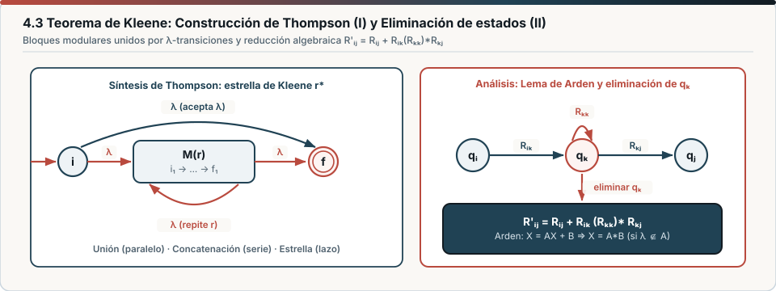

---

## 4.3.1 Lenguajes regulares y expresiones regulares

### Definición recursiva de los lenguajes regulares

*(De Castro Korgi, 2004, Secc. 1.13, p. 18).* Sea $\Sigma$ un alfabeto. La familia de los **lenguajes regulares** sobre $\Sigma$ se define recursivamente como sigue:
1. **Lenguajes regulares básicos:** $\emptyset$, $\{\lambda\}$ y $\{a\}$ (para cada $a \in \Sigma$) son lenguajes regulares sobre $\Sigma$.
2. **Clausura bajo operaciones regulares:** si $A$ y $B$ son lenguajes regulares sobre $\Sigma$, también lo son su **unión** ($A \cup B$), su **concatenación** ($A \cdot B$) y su **estrella o clausura de Kleene** ($A^* = \bigcup_{n \ge 0} A^n$).
3. Ningún otro lenguaje es regular salvo los obtenidos aplicando un número finito de veces las reglas 1 y 2.

Como consecuencia directa, todo **lenguaje finito** $L = \{w_1, w_2, \dots, w_k\}$ es regular, ya que cada palabra $w_i = a_{i,1}\cdots a_{i,m}$ se construye por concatenación finita de lenguajes unitarios y $L = \bigcup_{i=1}^k \{w_i\}$.

### Definición recursiva de las expresiones regulares y su semántica

Para denotar cómodamente los lenguajes regulares, se introduce el formalismo sintáctico de las **expresiones regulares (ER)**. Dada una expresión regular $r$ sobre $\Sigma$, denotaremos por $L(r) \subseteq \Sigma^*$ al **lenguaje denotado** por $r$:

1. **Expresiones regulares básicas:**
   - $\emptyset$ es una ER y $L(\emptyset) = \emptyset$.
   - $\lambda$ es una ER y $L(\lambda) = \{\lambda\}$.
   - $a$ es una ER para cada $a \in \Sigma$ y $L(a) = \{a\}$.
2. **Paso inductivo:** si $r$ y $s$ son ER sobre $\Sigma$, también lo son:
   - $(r + s)$ (unión), con $L(r + s) = L(r) \cup L(s)$;
   - $(r \cdot s)$ o simplemente $(rs)$ (concatenación), con $L(rs) = L(r) \cdot L(s)$;
   - $(r)^*$ (estrella de Kleene), con $L(r^*) = (L(r))^*$.

> **Nota sobre notación:** En textos de teoría de autómatas y en el temario de la asignatura se emplea $+$ para la unión y minúsculas $r, s$ para expresiones regulares; De Castro Korgi (2004, Secc. 1.14, pp. 19–20) emplea el símbolo conjuntista $\cup$ en lugar de $+$ y letras mayúsculas $R, S$ (por ejemplo, $(a \cup b)^*$ equivale a $(a + b)^*$). Asimismo, la **clausura positiva** se abrevia como $r^+ = r \cdot r^*$ (donde $L(r^+) = (L(r))^+$).

Para omitir paréntesis sin ambigüedad se adopta la **precedencia estándar de operadores**:
1. **Estrella de Kleene** ($*$ y $^+$): máxima precedencia (asocia sobre el operando inmediato a su izquierda).
2. **Concatenación** ($\cdot$): precedencia intermedia (asociativa).
3. **Unión** ($+$ o $\cup$): menor precedencia (asociativa).

Así, $a + b c^*$ se interpreta como $(a + (b \cdot (c^*)))$.

### Identidades algebraicas de las expresiones regulares

Dos expresiones regulares $r$ y $s$ son **equivalentes** (se escribe $r = s$ o $r \equiv s$) cuando denotan exactamente el mismo lenguaje, es decir, $L(r) = L(s)$. A partir de las propiedades de las operaciones sobre lenguajes (De Castro Korgi, 2004, Secc. 1.11 y 1.14; Acevedo Juárez, 2006, Secc. 2.3.1, pp. 63–64), se cumplen las siguientes identidades algebraicas para cualesquiera ER $r, s, t$:

| Propiedad | Identidad |
| :--- | :--- |
| Conmutatividad de $+$ | $r + s = s + r$ |
| Asociatividad de $+$ | $(r + s) + t = r + (s + t)$ |
| Idempotencia de $+$ | $r + r = r$ |
| Neutro aditivo ($\emptyset$) | $r + \emptyset = \emptyset + r = r$ |
| Asociatividad de $\cdot$ | $(rs)t = r(st)$ |
| Neutro multiplicativo ($\lambda$) | $r\lambda = \lambda r = r$ |
| Absorbente multiplicativo ($\emptyset$) | $r\emptyset = \emptyset r = \emptyset$ |
| Distributividad izquierda y derecha | $r(s + t) = rs + rt$, $\quad (s + t)r = sr + tr$ |
| Identidades de la estrella ($*$) | $\emptyset^* = \lambda$, $\quad \lambda^* = \lambda$, $\quad r^* = r^* r^* = (r^*)^* = (\lambda + r)^* = \lambda + r r^* = \lambda + r^* r$ |
| Desplazamiento | $r(sr)^* = (rs)^*r$ |
| Regla de suma con estrella | $(r + s)^* = (r^* s^*)^* = (r^* s)^* r^* = r^* (s r^*)^*$ |

Nótese que, en general, $(r + s)^* \neq r^* + s^*$ (por ejemplo, $ab \in L((a+b)^*)$ pero $ab \notin L(a^* + b^*)$).

---

## 4.3.2 Teorema de Kleene

### Enunciado (Teorema 2.8.1 de De Castro Korgi, 2004, p. 49)

> **Teorema de Kleene:** Un lenguaje $L \subseteq \Sigma^*$ es **regular** (es decir, existe una expresión regular $r$ tal que $L = L(r)$) si y solo si existe un **autómata finito** $M$ (AFD, AFN o $\text{AFN-}\lambda$) tal que $L = L(M)$.

La demostración se divide en dos partes constructivas complementarias:
- **Parte I (Síntesis: $\text{ER} \to \text{AFN-}\lambda$):** dada una expresión regular $r$, construir algorítmicamente un $\text{AFN-}\lambda$ tal que $L(M) = L(r)$. Combinado con la sección 4.1 ($\text{AFN-}\lambda \to \text{AFN} \to \text{AFD}$), todo lenguaje regular es aceptado por un AFD.
- **Parte II (Análisis: $\text{AFD/AFN} \to \text{ER}$):** dado un AFD o AFN $M$, obtener una expresión regular $r$ tal que $L(r) = L(M)$.

---

## 4.3.3 Teorema de Kleene — Parte I (Síntesis: Construcción inductiva / Thompson)

*(De Castro Korgi, 2004, Secc. 2.8–2.9, pp. 49–55).*

### Algoritmo de construcción de McNaughton–Yamada–Thompson

Procedemos construyendo el autómata paso a paso a partir de la estructura de la expresión regular $r$ (inducción sobre la complejidad de $r$): primero armamos mini-autómatas para los bloques básicos ($\emptyset$, $\lambda$ y $a$) y luego los conectamos con "cables" $\lambda$ para formar uniones, concatenaciones y estrellas. Para mantener una invariante limpia al componer subautómatas en serie, paralelo o lazo (evitando transiciones espurias cuando se anidan estrellas de Kleene), cada subautómata construido $M(r)$ posee:
- Un **único estado inicial** sin transiciones entrantes.
- Un **único estado final** sin transiciones salientes (distinto del inicial).

*(Nota: en De Castro Korgi, Secc. 2.8, pp. 50–52, se permite que $M(\lambda)$ tenga un solo estado inicial-final, pero para evitar conflictos de ciclos al iterar o concatenar, la convención de Thompson con estado inicial y final separados y conectados mediante $\lambda$-transiciones resulta enteramente segura en cualquier nivel de anidamiento).*

#### Casos base ($\emptyset$, $\lambda$ y $a \in \Sigma$)

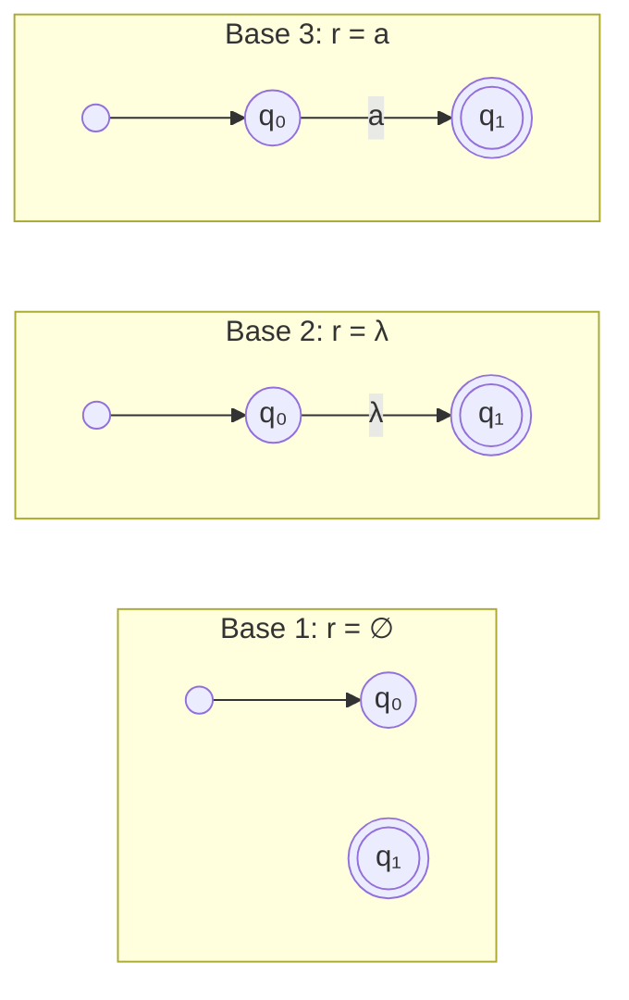

#### Paso inductivo ($r + s$, $r \cdot s$ y $r^*$)

Supongamos construidos $M_1$ para $r$ (con estado inicial $i_1$ y único final $f_1$) y $M_2$ para $s$ (con estado inicial $i_2$ y único final $f_2$), con conjuntos de estados disjuntos:

1. **Unión ($r + s$):** Se crean un nuevo estado inicial $i$ y un nuevo estado final $f$. Se añaden transiciones $\lambda$ desde $i$ hacia $i_1$ e $i_2$, y desde $f_1$ y $f_2$ hacia $f$. Los estados $f_1$ y $f_2$ dejan de ser finales.
2. **Concatenación ($r \cdot s$):** El estado inicial es $i_1$, el único estado final es $f_2$, y se añade una transición $\lambda$ desde $f_1$ hasta $i_2$ (equivalentemente, en la variante compacta de Thompson se fusionan $f_1$ e $i_2$ en un solo estado).
3. **Estrella de Kleene ($r^*$):** Se crean un nuevo estado inicial $i$ y un nuevo estado final $f$. Se añaden cuatro transiciones $\lambda$: $i \xrightarrow{\lambda} i_1$, $i \xrightarrow{\lambda} f$ (para aceptar $\lambda$), $f_1 \xrightarrow{\lambda} i_1$ (para repetir $r$), y $f_1 \xrightarrow{\lambda} f$ (para terminar).

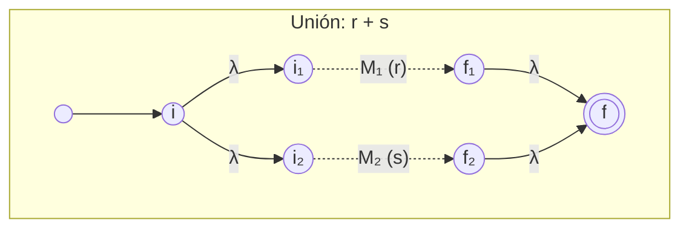

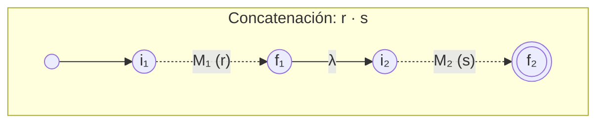

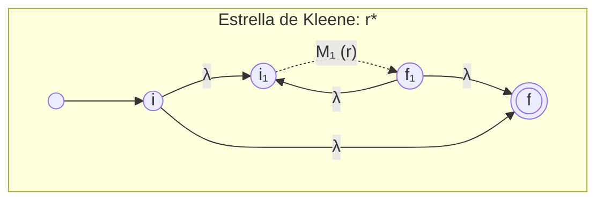

Así, siguiendo paso a paso la construcción de los bloques básicos hacia las expresiones compuestas, en cada caso una trayectoria desde el estado inicial hasta el único estado final consume exactamente una cadena perteneciente a $L(r) \cup L(s)$, $L(r)L(s)$ o $(L(r))^*$, respectivamente. $\blacksquare$

---

## 4.3.4 Lema de Arden y Teorema de Kleene — Parte II (Análisis: $\text{AFD/AFN} \to \text{ER}$)

Para obtener una expresión regular a partir de un autómata finito dado existen dos métodos constructivos clásicos, ambos equivalentes: el método algebraico de **sistemas de ecuaciones lineales con el Lema de Arden** (De Castro Korgi, 2004, Secc. 2.10–2.12, pp. 55–62) y el método gráfico de **eliminación de estados**.

### Lema de Arden

*(Lema 2.10.1 de De Castro Korgi, 2004, pp. 55–56).*

> **Enunciado (Lema de Arden):** Sean $A$ y $B$ dos lenguajes sobre un alfabeto $\Sigma$ tales que $\lambda \notin A$. Entonces la ecuación de lenguajes
> $$X = AX + B \quad (\text{es decir, } X = AX \cup B)$$
> tiene una **única solución** $X \subseteq \Sigma^*$, dada por:
> $$X = A^* B.$$

*(Si $\lambda \in A$, la ecuación deja de tener solución única: toda expresión de la forma $X = A^*(B \cup D)$ con $D \subseteq \Sigma^*$ es solución).*

#### Idea intuitiva y demostración del Lema de Arden

Antes de la prueba formal, resulta muy útil sustituir la ecuación $X = AX + B$ dentro de sí misma varias veces:
$$X = AX + B = A(AX + B) + B = A^2 X + AB + B = A^3 X + A^2 B + AB + B = \dots$$
Al repetir este reemplazo indefinidamente, aparecen todas las potencias $(\lambda + A + A^2 + A^3 + \dots)B = A^* B$. La condición $\lambda \notin A$ garantiza que cada $A$ adicional aporte al menos un símbolo más de longitud, de modo que no puedan colarse cadenas "fantasma" en $X$ que no provengan de $A^* B$.

1. **Verificación de que $A^* B$ es solución:** Usando las propiedades de la estrella de Kleene,
   $$A(A^* B) \cup B = A^+ B \cup B = (A^+ \cup \{\lambda\}) B = A^* B.$$
2. **Toda solución $X$ contiene a $A^* B$:** Si $X = AX \cup B$, entonces $B \subseteq X$ y $AX \subseteq X$. Por inducción sobre $n \ge 0$, si $A^n X \subseteq X$, entonces $A^{n+1} X = A(A^n X) \subseteq AX \subseteq X$. Luego $A^n B \subseteq A^n X \subseteq X$ para todo $n \ge 0$, de donde:
   $$A^* B = \bigcup_{n \ge 0} A^n B \subseteq X.$$
3. **Unicidad:** Sea $X$ cualquier solución de $X = AX \cup B$. Por el punto 2, podemos escribir $X = A^* B \cup C$ para un conjunto $C = X - A^* B$ tal que $C \cap A^* B = \emptyset$. Sustituyendo en la ecuación:
   $$A^* B \cup C = A(A^* B \cup C) \cup B = A^+ B \cup AC \cup B = A^* B \cup AC.$$
   Intersecando ambos miembros con $C$ y utilizando que $(A^* B \cap C) = \emptyset$:
   $$C = (A^* B \cap C) \cup (C \cap C) = (A^* B \cap C) \cup (AC \cap C) = AC \cap C \implies C \subseteq AC.$$
   Supongamos por contradicción que $C \neq \emptyset$ y elijamos una cadena $u \in C$ de **longitud mínima**. Como $C \subseteq AC$, existen $v \in A$ y $w \in C$ tales que $u = vw$. Dado que $\lambda \notin A$, necesariamente $|v| \ge 1$, lo cual implica $|w| = |u| - |v| < |u|$. Esto contradice la minimalidad de $|u|$ en $C$. Concluimos que $C = \emptyset$, y por tanto $X = A^* B$ es única. $\blacksquare$

---

### Método 1: Sistemas de ecuaciones lineales (Teorema de Kleene, Parte II)

*(De Castro Korgi, 2004, Secc. 2.11, pp. 57–58).*

Dado un AFD o AFN sin transiciones $\lambda$ $M = (Q, \Sigma, \Delta, q_0, F)$ con $Q = \{q_0, q_1, \dots, q_n\}$:

1. Para cada estado $q_i \in Q$, definimos $A_i = L(M_i)$ como el lenguaje aceptado por el autómata $M_i = (Q, \Sigma, \Delta, q_i, F)$ (es decir, tomando a $q_i$ como estado inicial). El lenguaje buscado es precisamente $A_0 = L(M)$.
2. Cada $A_i$ satisface la ecuación lineal derecha:
   $$A_i = \bigcup_{a \in \Sigma,\; q_j \in \Delta(q_i, a)} a A_j \; \cup \; \begin{cases} \{\lambda\} & \text{si } q_i \in F, \\ \emptyset & \text{si } q_i \notin F. \end{cases}$$
   Escrita en notación de expresiones regulares (con $+$ para $\cup$), resulta un sistema de $n + 1$ ecuaciones en las incógnitas $A_0, A_1, \dots, A_n$.
3. **Resolución por eliminación hacia atrás:** Puesto que todo coeficiente de transición es un símbolo de $\Sigma$ (longitud $1$), ninguna expresión que multiplique por la izquierda a $A_k$ durante las sustituciones contendrá a $\lambda$. Se comienza despejando $A_n$ mediante factorización y el **Lema de Arden** ($A_n = \alpha A_n + \beta \implies A_n = \alpha^* \beta$), y se sustituye en las ecuaciones restantes. Repitiendo el proceso hasta llegar a $A_0$ y aplicando Arden una última vez, se obtiene una expresión regular $r$ tal que $L(r) = A_0 = L(M)$. $\blacksquare$

---

### Método 2: Eliminación de estados (autómata finito generalizado)

De manera equivalente, puede obtenerse la expresión regular eliminando gráficamente los estados uno a uno tras convertir el autómata en un **autómata finito no determinista generalizado** (cuyos arcos llevan expresiones regulares):

1. **Normalización inicial:** Se crea un nuevo estado inicial $q_{\text{ini}}$ con transición $\lambda$ hacia $q_0$, y un único nuevo estado final $q_{\text{fin}}$ al que llegan transiciones $\lambda$ desde todo estado $q \in F$ (los estados antiguos de $F$ dejan de ser finales). Se fusionan arcos paralelos $q_i \to q_j$ con etiquetas $r_1, r_2, \dots$ en un solo arco etiquetado con $r_1 + r_2 + \dots$ (si no hay arco entre $q_i$ y $q_j$, su etiqueta implícita es $\emptyset$).
2. **Eliminación iterativa:** Para eliminar un estado interno $q_k \notin \{q_{\text{ini}}, q_{\text{fin}}\}$, para cada par de estados supervivientes $(q_i, q_j)$ que tengan trayectorias $q_i \xrightarrow{R_{ik}} q_k$ y $q_k \xrightarrow{R_{kj}} q_j$ (con posible lazo $q_k \xrightarrow{R_{kk}} q_k$), se actualiza la etiqueta directa $R_{ij}$ de $q_i$ a $q_j$ mediante:
   $$R'_{ij} = R_{ij} + R_{ik} \, (R_{kk})^* \, R_{kj}.$$
3. Cuando solo quedan $q_{\text{ini}}$ y $q_{\text{fin}}$, la etiqueta del único arco $q_{\text{ini}} \to q_{\text{fin}}$ es la expresión regular deseada.

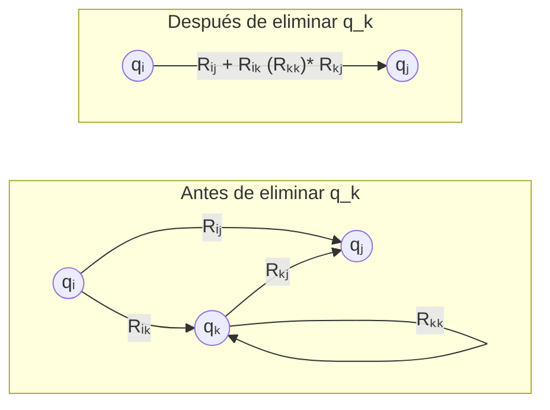

---

## Ejemplos desarrollados paso a paso

### Ejemplo 1: Teorema de Kleene Parte I — De ER a $\text{AFN-}\lambda$ (Thompson)

Construir un $\text{AFN-}\lambda$ equivalente a la expresión regular $r = (a + b)^* a b$ sobre $\Sigma = \{a, b\}$.

**Paso 1. Subautómatas para los símbolos $a$ y $b$, y su unión $a + b$.**
- $M(a)$: $q_1 \xrightarrow{a} q_2$.
- $M(b)$: $q_3 \xrightarrow{b} q_4$.
- $M(a + b)$: nuevo inicio $q_0$ con $\lambda$ a $q_1$ y $q_3$; nuevo fin $q_5$ que recibe $\lambda$ desde $q_2$ y $q_4$.

**Paso 2. Aplicación de la estrella de Kleene para $(a + b)^*$.**
Añadimos el inicio $q_6$ y el fin $q_7$ con las cuatro transiciones $\lambda$: $q_6 \xrightarrow{\lambda} q_0$, $q_6 \xrightarrow{\lambda} q_7$, $q_5 \xrightarrow{\lambda} q_0$ y $q_5 \xrightarrow{\lambda} q_7$.

**Paso 3. Concatenación en serie con $a$ y $b$.**
Añadimos $M(a)$ ($q_8 \xrightarrow{a} q_9$) y $M(b)$ ($q_{10} \xrightarrow{b} q_{11}$) conectados mediante $q_7 \xrightarrow{\lambda} q_8$ y $q_9 \xrightarrow{\lambda} q_{10}$. El estado inicial global es $q_6$ y el único estado de aceptación es $q_{11}$.

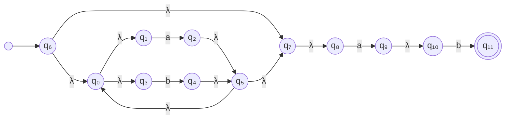

**Verificación:** La cadena $w = bab \in L(r)$ es aceptada mediante la trayectoria:

$$q_6 \xrightarrow{\lambda} q_0 \xrightarrow{\lambda} q_3 \xrightarrow{b} q_4 \xrightarrow{\lambda} q_5 \xrightarrow{\lambda} q_7 \xrightarrow{\lambda} q_8 \xrightarrow{a} q_9 \xrightarrow{\lambda} q_{10} \xrightarrow{b} q_{11} \in F.$$

---

### Ejemplo 2: Teorema de Kleene Parte II — De AFD a ER por Lema de Arden

Considérese el AFD $M = (\{q_0, q_1, q_2\}, \{0, 1\}, \delta, q_0, \{q_0\})$ que acepta las cadenas binarias cuyo valor numérico (interpretado en base 2, asignando el valor $0$ a $\lambda$) es **múltiplo de 3**:

| Estado | Significado (residuo mod 3) | $0$ | $1$ |
| :--- | :--- | :---: | :---: |
| $\to * q_0$ | $n \equiv 0 \pmod 3$ | $q_0$ | $q_1$ |
| $q_1$ | $n \equiv 1 \pmod 3$ | $q_2$ | $q_0$ |
| $q_2$ | $n \equiv 2 \pmod 3$ | $q_1$ | $q_2$ |

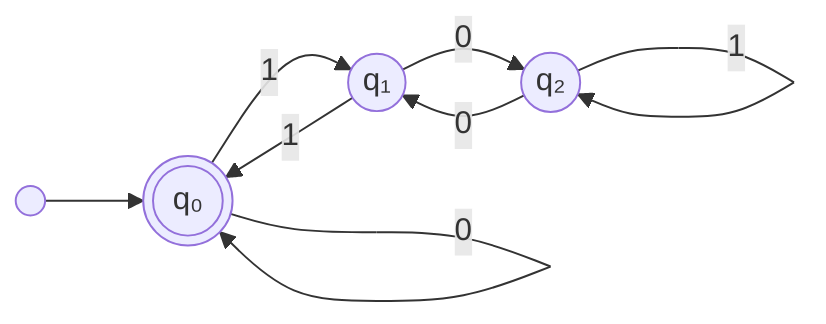

**Paso 1. Planteamiento del sistema de ecuaciones.**

$$\begin{aligned}
(1) \quad A_0 &= 0 A_0 + 1 A_1 + \lambda \\
(2) \quad A_1 &= 1 A_0 + 0 A_2 \\
(3) \quad A_2 &= 0 A_1 + 1 A_2
\end{aligned}$$

**Paso 2. Resolución de $(3)$ por Lema de Arden.** En $A_2 = 1 A_2 + 0 A_1$, tenemos $A = \{1\}$ ($\lambda \notin A$) y $B = 0 A_1$, por lo que:

$$(4) \quad A_2 = 1^* 0 A_1.$$

**Paso 3. Sustitución de $(4)$ en $(2)$ y aplicación del Lema de Arden.**

$$A_1 = 1 A_0 + 0 (1^* 0 A_1) = (0 1^* 0) A_1 + 1 A_0.$$

Como $\lambda \notin L(0 1^* 0)$, el Lema de Arden produce:

$$(5) \quad A_1 = (0 1^* 0)^* 1 A_0.$$

**Paso 4. Sustitución de $(5)$ en $(1)$ y aplicación final de Arden.**

$$A_0 = 0 A_0 + 1 (0 1^* 0)^* 1 A_0 + \lambda = \big(0 + 1 (0 1^* 0)^* 1\big) A_0 + \lambda.$$

Dado que $\lambda$ tampoco pertenece al coeficiente de $A_0$, aplicamos el Lema de Arden una vez más:

$$L(M) = A_0 = \big(0 + 1 (0 1^* 0)^* 1\big)^*.$$

**Comprobación:** Cadenas aceptadas como `0` ($0$), `11` ($3$), `110` ($6 = 11 \cdot 0$), `1001` ($9 = 1 \cdot 00 \cdot 1$, donde $00 \in (01^*0)^*$ con cero unos internos) y `10101` ($21 = 1 \cdot 010 \cdot 1$) pertenecen a $L\big((0 + 1(01^*0)^*1)^*\big)$, mientras que `10` ($2$), `101` ($5$) y `111` ($7$) no coinciden.

---

### Ejemplo 3: Teorema de Kleene Parte II — Eliminación de estados sobre el mismo AFD

Apliquemos ahora el **método de eliminación de estados** al mismo AFD de múltiplos de 3 del Ejemplo 2 para contrastar ambos procedimientos.

**Paso 1. Normalización.** Añadimos $q_{\text{ini}} \xrightarrow{\lambda} q_0$ y $q_0 \xrightarrow{\lambda} q_{\text{fin}}$.

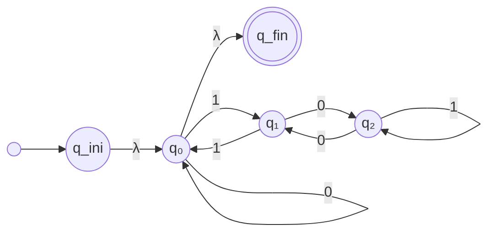

**Paso 2. Eliminación de $q_2$.** Los únicos arcos que entran o salen de $q_2$ conectan con $q_1$ (además del lazo $1$ sobre $q_2$). Aplicando la fórmula $R'_{11} = R_{11} + R_{12}(R_{22})^* R_{21}$:

$$R'_{11} = \emptyset + 0 (1)^* 0 = 0 1^* 0.$$

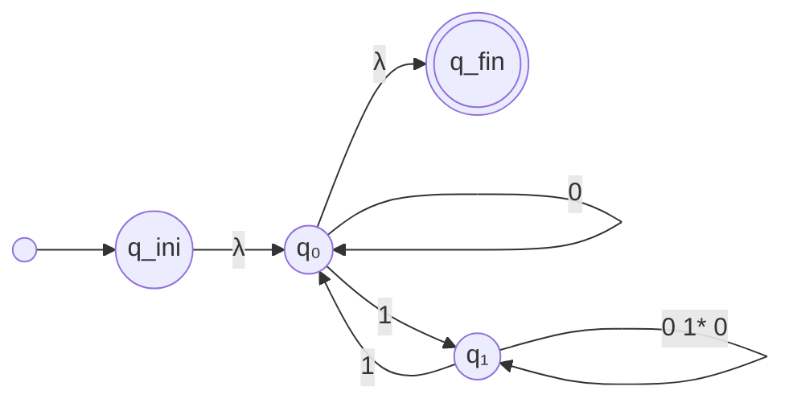

**Paso 3. Eliminación de $q_1$.** Eliminando $q_1$, la trayectoria $q_0 \xrightarrow{1} q_1 \xrightarrow{0 1^* 0} q_1 \xrightarrow{1} q_0$ actualiza el lazo sobre $q_0$:

$$R'_{00} = R_{00} + R_{01}(R_{11})^* R_{10} = 0 + 1 (0 1^* 0)^* 1.$$

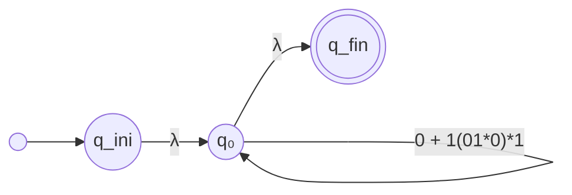

**Paso 4. Eliminación de $q_0$.** Finalmente, eliminando $q_0$ entre $q_{\text{ini}}$ y $q_{\text{fin}}$:

$$R'_{\text{ini, fin}} = \emptyset + \lambda \big(0 + 1 (0 1^* 0)^* 1\big)^* \lambda = \big(0 + 1 (0 1^* 0)^* 1\big)^*.$$

Ambos métodos producen exactamente la misma expresión regular.

---

## Ejercicios propuestos

1. **Simplificación algebraica de ER:** Demuestre mediante identidades algebraicas (sin construir autómatas) que:
   - $(\lambda + aa)^* = (aa)^*$,
   - $(a + b)^* = (a^* b)^* a^*$,
   - $a(ba)^* + (ab)^* a = (ab)^* a$.
2. **Teorema de Kleene Parte I (Thompson):** Construya sistemáticamente un $\text{AFN-}\lambda$ utilizando el algoritmo de Thompson para las expresiones regulares:
   - $r_1 = a^* b + (ab)^+$,
   - $r_2 = (0 + 10)^* (1 + \lambda)$.
3. **Teorema de Kleene Parte II (Lema de Arden):** Resuelva mediante un sistema de ecuaciones y el Lema de Arden la expresión regular aceptada por el AFN de tres estados $M = (\{q_0, q_1, q_2\}, \{a, b\}, \Delta, q_0, \{q_2\})$ dado por $\Delta(q_0, a) = \{q_0, q_1\}$, $\Delta(q_0, b) = \{q_0\}$, $\Delta(q_1, b) = \{q_2\}$, $\Delta(q_2, a) = \{q_2\}$, $\Delta(q_2, b) = \{q_2\}$ (y $\Delta(q_1, a) = \emptyset$). *(Sugerencia: describa primero intuitivamente qué lenguaje acepta $M$ y compárelo con su expresión final).*
4. **Teorema de Kleene Parte II (Comparación Arden vs. Eliminación de estados):** Dado el AFD sobre $\Sigma = \{a, b\}$ que acepta las cadenas con un número par de $a$'s y un número impar de $b$'s (De Castro Korgi, 2004, Secc. 2.12, p. 62), obtenga su expresión regular tanto por el Lema de Arden como por eliminación de estados y verifique con tres cadenas de ejemplo.
5. **Análisis de hipótesis en el Lema de Arden:** Demuestre que si $\lambda \in A$, entonces $Y \subseteq \Sigma^*$ es solución de $X = AX \cup B$ si y solo si existe algún lenguaje $D \subseteq \Sigma^*$ tal que $Y = A^*(B \cup D)$ (De Castro Korgi, 2004, Secc. 2.10, p. 57).

## Referencias

- Acevedo Juárez, A. (2006). *Teoría de la computación* [Tesis de licenciatura, Instituto Tecnológico de Celaya]. (Unidad 2, sección 2.3 Expresiones regulares, pp. 62–64).
- De Castro Korgi, R. (2004). *Teoría de la computación: Lenguajes, autómatas, gramáticas*. Universidad Nacional de Colombia. (Capítulo 1, secciones 1.13–1.14, pp. 18–24; Capítulo 2, secciones 2.8–2.12, pp. 49–62).
