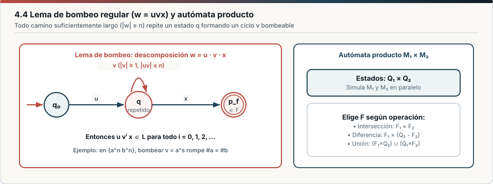
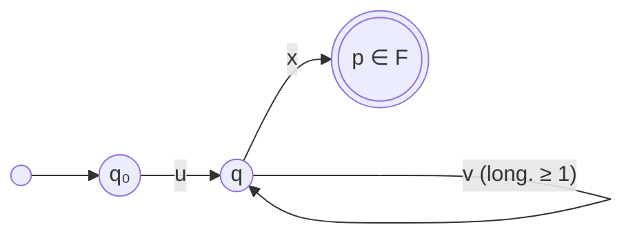
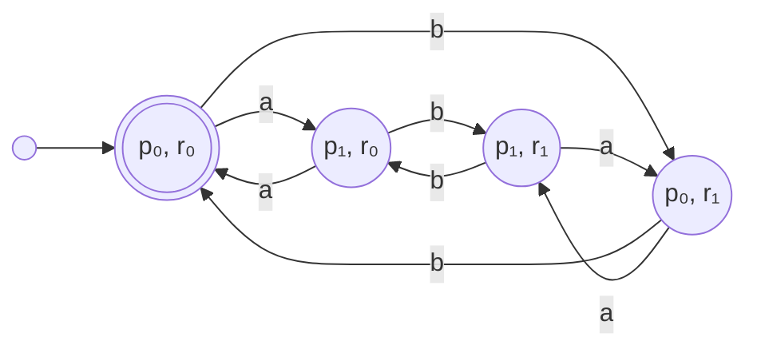

# 4.4 Propiedades de los lenguajes de estado finito

## Introducción y motivación

En las secciones 4.1 a 4.3 se estableció que los lenguajes regulares coinciden exactamente con los lenguajes aceptados por autómatas finitos y generados por gramáticas regulares. Sin embargo, al diseñar analizadores léxicos y sintácticos surgen de inmediato dos preguntas fundamentales:

1. **¿Qué límites tiene la memoria finita?** Si intentamos escribir una expresión regular para verificar expresiones con paréntesis equilibrados arbitrariamente profundos —o cadenas de la forma $\{a^k b^k : k \ge 0\}$—, intuimos que ningún autómata de $n$ estados puede "contar" más allá de $n$ sin repetir estados. El **Lema de bombeo** formaliza esta intuición y proporciona una herramienta rigurosa para demostrar que un lenguaje **no** es regular.
2. **¿Cómo se comportan y deciden los lenguajes regulares?** Las **propiedades de clausura** muestran qué operaciones preservan la regularidad (lo cual permite construir nuevos analizadores a partir de otros más simples, o probar no regularidad por reducción), mientras que los **algoritmos de decisión** garantizan que preguntas clave de verificación —¿acepta un autómata alguna cadena?, ¿son equivalentes dos expresiones regulares?— pueden resolverse de manera automática y exacta.

---

## 4.4.1 El Lema de bombeo para lenguajes regulares

*(De Castro Korgi, 2004, Secc. 3.1, pp. 63–66).*

### Enunciado (Lema 3.1.1 de De Castro Korgi)

> **Lema de bombeo:** Sea $L \subseteq \Sigma^*$ un lenguaje regular. Entonces existe una constante entera $n \ge 1$ (llamada **constante de bombeo** para $L$) tal que toda cadena $w \in L$ con $|w| \ge n$ puede descomponerse como $w = uvx$ satisfaciendo las tres condiciones siguientes:
> 1. $|uv| \le n$,
> 2. $v \neq \lambda$ (es decir, $|v| \ge 1$),
> 3. $u v^i x \in L$ para todo entero $i \ge 0$.

### Demostración

Por el Teorema de Kleene y la equivalencia $\text{AFN-}\lambda \equiv \text{AFN} \equiv \text{AFD}$, existe un AFD $M = (Q, \Sigma, \delta, q_0, F)$ tal que $L(M) = L$. Sea $n = |Q| \ge 1$ el número de estados de $M$.

Consideremos cualquier cadena $w = a_1 a_2 \cdots a_m \in L$ con longitud $m = |w| \ge n$. Al procesar los primeros $n$ símbolos de $w$ ($a_1 a_2 \cdots a_n$), $M$ recorre una secuencia de $n + 1$ estados:

$$p_0 = q_0, \quad p_1 = \delta(p_0, a_1), \quad p_2 = \delta(p_1, a_2), \quad \dots, \quad p_n = \delta(p_{n-1}, a_n).$$

Puesto que hay $n + 1$ posiciones en la secuencia y solo $n$ estados distintos en $Q$, por el **principio del palomar** al menos un estado aparece repetido. Sean $0 \le j < k \le n$ los índices de la primera repetición (o cualquier par con $p_j = p_k = q$). Dividimos $w$ en tres subcadenas:
- $u = a_1 \cdots a_j$ (posiblemente $\lambda$ si $j = 0$),
- $v = a_{j+1} \cdots a_k$,
- $x = a_{k+1} \cdots a_m$ (posiblemente $\lambda$ si $k = m$).

Verificamos las tres propiedades:
1. $|uv| = k \le n$.
2. $|v| = k - j \ge 1$ porque $j < k$, luego $v \neq \lambda$.
3. Como $\hat{\delta}(q_0, u) = q$, $\hat{\delta}(q, v) = q$ y $\hat{\delta}(q, x) = p_m \in F$, repetir el ciclo $v$ exactamente $i$ veces ($i \ge 0$) conduce siempre desde $q$ al mismo estado $q$:
   $$\hat{\delta}(q_0, u v^i x) = \hat{\delta}\big(\hat{\delta}(\hat{\delta}(q_0, u), v^i), x\big) = \hat{\delta}\big(\hat{\delta}(q, v^i), x\big) = \hat{\delta}(q, x) = p_m \in F.$$
   Por tanto, $u v^i x \in L(M) = L$ para todo $i \ge 0$. $\blacksquare$

### Uso correcto del Lema de bombeo (prueba por contradicción)

> **Advertencia lógica:** El Lema de bombeo establece una **condición necesaria**, pero **no suficiente**, para que un lenguaje sea regular (existen lenguajes no regulares que también satisfacen las condiciones del bombeo). Además, todo **lenguaje finito** cumple automáticamente el lema (por vacuidad) tomando $n = 1 + \max_{w \in L} |w|$, ya que no existe ninguna cadena $w \in L$ tan larga como $n$ que pueda contradecir la condición.

Para demostrar que un lenguaje $L$ **no es regular** mediante reducción al absurdo se procede así:
1. **Suposición:** Supóngase que $L$ es regular. Entonces existe una constante de bombeo $n \ge 1$ dada por el lema (fija, pero desconocida; no podemos elegir el valor de $n$).
2. **Elección estratégica de $w$:** Construimos *una* cadena específica $w \in L$ dependiente de $n$ que cumpla $|w| \ge n$.
3. **Análisis universal de $(u, v, x)$:** El lema afirma que *existe* al menos una descomposición $w = uvx$ con $|uv| \le n$ y $|v| \ge 1$. Debemos probar que **todas** las descomposiciones compatibles con estas restricciones fallan al bombear algún $i \ge 0$ (habitualmente $i = 0$ o $i = 2$), es decir, $u v^i x \notin L$.
4. **Contradicción:** Como la conclusión contradice $u v^i x \in L$ para todo $i \ge 0$, la hipótesis inicial es falsa y $L$ no es regular.

---

## 4.4.2 Propiedades de clausura de los lenguajes regulares

*(De Castro Korgi, 2004, Secc. 3.2–3.5, pp. 67–75).*

Se dice que la familia $\mathcal{R}$ de todos los lenguajes regulares sobre $\Sigma$ es **cerrada** bajo una operación si, al aplicarla sobre lenguajes de $\mathcal{R}$, el resultado pertenece nuevamente a $\mathcal{R}$.

### Teorema 4.4.1 (Clausura bajo operaciones regulares y booleanas)

*(Teorema 3.2.1 y Corolario 3.2.2 de De Castro Korgi, 2004, pp. 67–68).* Si $L, L_1, L_2 \subseteq \Sigma^*$ son lenguajes regulares sobre $\Sigma$, también son regulares:

1. **Unión:** $L_1 \cup L_2$ (por definición de ER/lenguaje regular).
2. **Concatenación:** $L_1 \cdot L_2$ (por definición de ER/lenguaje regular).
3. **Estrella de Kleene y clausura positiva:** $L^*$ y $L^+ = L^* L$.
4. **Complemento:** $\overline{L} = \Sigma^* - L$.  
   *Construcción:* Sea $M = (Q, \Sigma, \delta, q_0, F)$ un **AFD completo** tal que $L(M) = L$. El AFD $M^c = (Q, \Sigma, \delta, q_0, Q - F)$, obtenido simplemente intercambiando estados de aceptación y no aceptación, satisface $\hat{\delta}(q_0, w) \in Q - F \iff w \notin L(M)$, es decir, $L(M^c) = \overline{L}$.  
   *(Precaución: invertir $F$ en un AFN no produce $\overline{L}$, ya que en un AFN basta que un solo cómputo acepte aunque otro termine fuera de $F$; es obligatorio determinizar y completar el autómata primero).*
5. **Intersección:** $L_1 \cap L_2$.  
   *Prueba booleana:* Por leyes de De Morgan, $L_1 \cap L_2 = \overline{\overline{L_1} \cup \overline{L_2}}$, que es regular por (1) y (4).
6. **Diferencia y diferencia simétrica:** $L_1 - L_2 = L_1 \cap \overline{L_2}$ y $L_1 \triangle L_2 = (L_1 - L_2) \cup (L_2 - L_1)$.

En particular, la familia $\mathcal{R}$ es cerrada bajo las operaciones básicas de conjuntos —unión, intersección y complemento— y contiene al lenguaje vacío $\emptyset$ y al universo $\Sigma^*$ (en matemáticas, a una colección con estas propiedades se le denomina **álgebra booleana de conjuntos**).

> **Límites de la clausura:** La familia $\mathcal{R}$ **no** es cerrada bajo uniones o intersecciones infinitas (por ejemplo, $\bigcup_{k \ge 1} \{a^k b^k\}$ es unión infinita de lenguajes unitarios regulares cuyo resultado no es regular) ni bajo subconjuntos (todo lenguaje $L \subseteq \Sigma^*$ es subconjunto del lenguaje regular $\Sigma^*$).

### Construcción directa para intersección: Autómata producto

*(Teorema 3.3.2 de De Castro Korgi, 2004, p. 70).* En lugar de complementar dos veces y determinizar una unión, dados dos AFD completos $M_1 = (Q_1, \Sigma, \delta_1, q_{0,1}, F_1)$ y $M_2 = (Q_2, \Sigma, \delta_2, q_{0,2}, F_2)$, el **autómata producto** que los simula en paralelo es el AFD:

$$M_{\times} = (Q_1 \times Q_2,\; \Sigma,\; \delta,\; (q_{0,1}, q_{0,2}),\; F_{\times})$$

donde la transición sincronizada es:

$$\delta\big((p, q), a\big) = \big(\delta_1(p, a),\; \delta_2(q, a)\big), \qquad \forall p \in Q_1,\; q \in Q_2,\; a \in \Sigma.$$

Por inducción sobre $w \in \Sigma^*$ se demuestra inmediatamente que $\hat{\delta}((q_{0,1}, q_{0,2}), w) = (\hat{\delta}_1(q_{0,1}, w), \hat{\delta}_2(q_{0,2}, w))$. Dependiendo del conjunto de aceptación $F_{\times}$, el mismo autómata producto decide múltiples operaciones booleanas:
- **Intersección ($L_1 \cap L_2$):** $F_{\times} = F_1 \times F_2$.
- **Unión ($L_1 \cup L_2$):** $F_{\times} = (F_1 \times Q_2) \cup (Q_1 \times F_2)$.
- **Diferencia ($L_1 - L_2$):** $F_{\times} = F_1 \times (Q_2 - F_2)$.
- **Diferencia simétrica ($L_1 \triangle L_2$):** $F_{\times} = \big(F_1 \times (Q_2 - F_2)\big) \cup \big((Q_1 - F_1) \times F_2\big)$.

### Reflexión, homomorfismos e imagen inversa de homomorfismo

1. **Reflexión o inverso ($L^R = \{w^R : w \in L\}$):** Si $L$ es regular, $L^R$ también lo es. Por inducción sobre una expresión regular $r$ que denota $L$ (De Castro Korgi, 2004, Secc. 1.12, p. 17):
   $$\emptyset^R = \emptyset,\quad \lambda^R = \lambda,\quad a^R = a,\quad (r + s)^R = r^R + s^R,\quad (rs)^R = s^R r^R,\quad (r^*)^R = (r^R)^*.$$
   *(Operacionalmente, equivale a invertir la dirección de todas las transiciones de un AFN para $L$ y cambiar entre estados iniciales y finales).*

2. **Homomorfismos (sustitución uniforme de símbolos; Teorema 3.4.1 de De Castro Korgi, pp. 72–73):** Intuitivamente, un **homomorfismo** es una regla de traducción o reemplazo que sustituye cada símbolo $a \in \Sigma$ por una cadena fija $h(a) \in \Gamma^*$ (como un diccionario símbolo a cadena). Formalmente, es una función $h : \Sigma^* \to \Gamma^*$ que cumple $h(\lambda) = \lambda$ y $h(uv) = h(u)h(v)$ para todo $u, v \in \Sigma^*$.
   **Clausura:** Si $L \subseteq \Sigma^*$ es regular, entonces su lenguaje traducido $h(L) = \{h(w) : w \in L\} \subseteq \Gamma^*$ (llamado *imagen homomorfa*) también es regular sobre $\Gamma$.
   *Demostración:* Dada una expresión regular $r$ para $L$, basta reemplazar cada aparición de cada símbolo $a \in \Sigma$ en $r$ por la expresión regular correspondiente a la cadena $h(a)$; por las identidades $h(A \cup B) = h(A) \cup h(B)$, $h(AB) = h(A)h(B)$ y $h(A^*) = (h(A))^*$, la nueva expresión regular sobre $\Gamma$ denota exactamente $h(L)$. $\blacksquare$

3. **Homomorfismo inverso (Teorema 3.5.1 de De Castro Korgi, pp. 74–75):** Dado $h : \Sigma^* \to \Gamma^*$ y un lenguaje $B \subseteq \Gamma^*$, la **imagen inversa** de $B$ por $h$ es:
   $$h^{-1}(B) = \{u \in \Sigma^* : h(u) \in B\}.$$
   **Clausura:** Si $B \subseteq \Gamma^*$ es regular, entonces $h^{-1}(B) \subseteq \Sigma^*$ es regular.  
   *Demostración:* Sea $M = (Q, \Gamma, \delta, q_0, F)$ un AFD que acepta $B$. Construimos el AFD $M' = (Q, \Sigma, \delta', q_0, F)$ con los mismos estados, estado inicial y finales, pero con función de transición sobre $\Sigma$:
   $$\delta'(q, a) = \hat{\delta}\big(q, h(a)\big), \qquad \forall q \in Q,\; a \in \Sigma.$$
   Por inducción sobre $u \in \Sigma^*$ se verifica que $\hat{\delta}'(q_0, u) = \hat{\delta}(q_0, h(u))$, de modo que $u \in L(M') \iff h(u) \in L(M) = B \iff u \in h^{-1}(B)$. $\blacksquare$

---

## 4.4.3 Algoritmos de decisión sobre lenguajes de estado finito

*(De Castro Korgi, 2004, Secc. 3.6, pp. 75–79).*

Un **problema de decisión** plantea una pregunta de respuesta `SÍ` o `NO` para cualquier instancia válida de entrada (un autómata finito, una expresión regular o una gramática regular). Puesto que disponemos de algoritmos efectivos de conversión entre AFD, AFN, $\text{AFN-}\lambda$, expresiones regulares y gramáticas regulares, cualquier propiedad decidible en uno de estos formalismos lo es automáticamente en todos los demás.

| Problema de decisión | Pregunta | Algoritmo de solución |
| :--- | :--- | :--- |
| **Pertenencia** | Dados $M$ y $w \in \Sigma^*$, ¿$w \in L(M)$? | Convertir $M$ en un AFD $M'$ (o simular subconjuntos al vuelo) y ejecutar $\hat{\delta}(q_0, w)$ en $|w|$ pasos; responder `SÍ` si y solo si el estado alcanzado pertenece a $F$. |
| **Vacío** *(Teorema 3.6.1)* | Dado $M$, ¿$L(M) = \emptyset$? | Calcular el conjunto `ALC` de estados alcanzables desde $q_0$ mediante búsqueda en anchura o profundidad (siguiendo también transiciones $\lambda$). Responder `SÍ` ($L(M) = \emptyset$) si y solo si $\text{ALC} \cap F = \emptyset$. |
| **Finitud / Infinitud** *(Teorema 3.6.3 y Corolario 3.6.4)* | Dado $M$, ¿es $L(M)$ infinito? | **Criterio del rango:** si el AFD equivalente $M'$ tiene $n$ estados, $L(M)$ es infinito si y solo si $M'$ acepta alguna cadena $w$ con $n \le |w| < 2n$ (hay un número finito de cadenas que probar). **Criterio gráfico equivalente:** eliminar estados no alcanzables desde $q_0$ y estados desde los cuales no se alcanza $F$; $L(M')$ es infinito si y solo si el subgrafo restante contiene algún ciclo dirigido. |
| **Inclusión** *(Corolario 3.6.2)* | Dados $M_1$ y $M_2$, ¿$L(M_1) \subseteq L(M_2)$? | Usar el hecho $L_1 \subseteq L_2 \iff L_1 - L_2 = \emptyset$: construir el autómata producto para $L(M_1) \cap \overline{L(M_2)}$ y aplicar el algoritmo de **vacío**. |
| **Equivalencia** *(Corolario 3.6.2)* | Dados $M_1$ y $M_2$, ¿$L(M_1) = L(M_2)$? | Aplicar el algoritmo de vacío a la diferencia simétrica $L(M_1) \triangle L(M_2) = (L_1 - L_2) \cup (L_2 - L_1)$ (o verificar inclusión mutua $L_1 \subseteq L_2$ y $L_2 \subseteq L_1$, o bien minimizar ambos AFD e inspeccionar isomorfismo). |

### Demostración del criterio de infinitud (Teorema 3.6.3 de De Castro Korgi, p. 77)

Sea $M$ un AFD de $n$ estados con $L = L(M)$.
- $(\Leftarrow)$ Si existe $w \in L$ con $n \le |w| < 2n$, entonces por la demostración del Lema de bombeo $w = uvx$ con $v \neq \lambda$ y $u v^i x \in L$ para todo $i \ge 0$; dado que todas las cadenas $u v^i x$ tienen longitudes estrictamente crecientes, $L$ es infinito.
- $(\Rightarrow)$ Si $L$ es infinito, contiene cadenas arbitrariamente largas; en particular, existe al menos una cadena $w \in L$ con $|w| \ge n$. Escojamos una cadena $w \in L$ de **longitud mínima** entre aquellas que satisfacen $|w| \ge n$. Afirmamos que $|w| < 2n$: en efecto, si fuera $|w| \ge 2n$, por el Lema de bombeo existiría una descomposición $w = uvx$ con $1 \le |v| \le |uv| \le n$ tal que la cadena más corta $w' = ux$ (caso $i = 0$) pertenecería a $L$. Pero entonces $|w'| = |w| - |v| \ge 2n - n = n$ y $|w'| < |w|$, contradiciendo la elección minimal de $w$. Así, $n \le |w| < 2n$. $\blacksquare$

---

## Ejemplos desarrollados paso a paso

### Ejemplo 1: Tres aplicaciones clásicas del Lema de bombeo

*(De Castro Korgi, 2004, Secc. 3.1, pp. 65–66).*

#### 1(a). $L_1 = \{a^k b^k : k \ge 0\}$ sobre $\Sigma = \{a, b\}$ no es regular

1. Supóngase por contradicción que $L_1$ es regular, con constante de bombeo $n \ge 1$.
2. Elegimos $w = a^n b^n \in L_1$. Nótese que $|w| = 2n \ge n$.
3. Por el Lema de bombeo, $w = uvx$ con $|uv| \le n$ y $|v| \ge 1$. Como los primeros $n$ símbolos de $w$ son únicamente letras $a$, tanto $u$ como $v$ constan exclusivamente de aes:
   $$u = a^r \quad (r \ge 0), \qquad v = a^s \quad (s \ge 1, \; r + s \le n), \qquad x = a^{n - r - s} b^n.$$
4. Tomando $i = 0$ (o $i = 2$), el lema obliga a que $ux \in L_1$. Sin embargo:
   $$ux = a^r a^{n - r - s} b^n = a^{n - s} b^n.$$
   Como $s \ge 1$, se tiene $n - s < n$, luego el número de aes es estrictamente menor que el de bes y $ux \notin L_1$. Contradicción. Por lo tanto, $L_1$ no es regular.

#### 1(b). El lenguaje de los palíndromos $L_2 = \{w \in \{a, b\}^* : w = w^R\}$ no es regular

1. Supóngase por contradicción que $L_2$ es regular, con constante de bombeo $n \ge 1$.
2. Elegimos el palíndromo $w = a^n b a^n \in L_2$, que tiene longitud $|w| = 2n + 1 \ge n$.
3. En toda descomposición $w = uvx$ con $|uv| \le n$ y $|v| \ge 1$, los primeros $n$ símbolos de $w$ son únicamente $a$, de modo que $u = a^r$ ($r \ge 0$), $v = a^s$ ($s \ge 1$) y $x = a^{n - r - s} b a^n$.
4. Tomando $i = 0$, debe cumplirse $ux \in L_2$. Pero:
   $$ux = a^{n - s} b a^n.$$
   Dado que $s \ge 1$, hay $n - s$ aes antes de la única $b$ y $n$ aes después de ella, por lo que $(ux)^R = a^n b a^{n - s} \neq ux$ y $ux \notin L_2$. Contradicción; $L_2$ no es regular.

#### 1(c). $L_3 = \{a^{k^2} : k \ge 0\}$ sobre $\Sigma = \{a\}$ no es regular

1. Supóngase que $L_3$ es regular, con constante de bombeo $n \ge 1$.
2. Elegimos $w = a^{n^2} \in L_3$, cuya longitud satisface $|w| = n^2 \ge n$.
3. Descomponemos $w = uvx$ con $1 \le |v| \le |uv| \le n$.
4. Tomando $i = 2$, debe cumplirse $u v^2 x \in L_3$. Calculemos su longitud:
   $$n^2 < n^2 + 1 \le n^2 + |v| = |uvx| + |v| = |u v^2 x| \le n^2 + n < n^2 + 2n + 1 = (n + 1)^2.$$
   Es decir, la longitud de $u v^2 x$ queda estrictamente comprendida entre dos cuadrados perfectos consecutivos ($n^2$ y $(n + 1)^2$), por lo que $|u v^2 x|$ no es un cuadrado perfecto y $u v^2 x \notin L_3$. Contradicción; $L_3$ no es regular.

---

### Ejemplo 2: Autómata producto y algoritmos de decisión

*(Basado en De Castro Korgi, 2004, Secc. 3.3, pp. 70–71).* Considérense sobre $\Sigma = \{a, b\}$ los lenguajes:
- $L_1 = \{w \in \{a, b\}^* : w \text{ tiene un número par de } a\text{'s}\}$, aceptado por $M_1 = (\{p_0, p_1\}, \{a, b\}, \delta_1, p_0, \{p_0\})$.
- $L_2 = \{w \in \{a, b\}^* : w \text{ tiene un número par de } b\text{'s}\}$, aceptado por $M_2 = (\{r_0, r_1\}, \{a, b\}, \delta_2, r_0, \{r_0\})$.

**Paso 1. Construcción del autómata producto $M_\times$ para $L_1 \cap L_2$.**
Los estados de $Q_1 \times Q_2$ son $(p_0, r_0)$, $(p_0, r_1)$, $(p_1, r_0)$ y $(p_1, r_1)$, con estado inicial $(p_0, r_0)$ y único estado de aceptación $F_\cap = F_1 \times F_2 = \{(p_0, r_0)\}$.

| Estado producto | $a$ | $b$ |
| :--- | :---: | :---: |
| $\to * (p_0, r_0)$ | $(p_1, r_0)$ | $(p_0, r_1)$ |
| $(p_0, r_1)$ | $(p_1, r_1)$ | $(p_0, r_0)$ |
| $(p_1, r_0)$ | $(p_0, r_0)$ | $(p_1, r_1)$ |
| $(p_1, r_1)$ | $(p_0, r_1)$ | $(p_1, r_0)$ |

**Paso 2. Reutilización para la diferencia $L_1 - L_2$ y algoritmo de decisión de inclusión ($L_1 \subseteq L_2$?).**
Para construir el AFD $M_-$ que acepta $L_1 - L_2$, basta conservar exactamente la misma tabla de transición y cambiar el conjunto de aceptación a $F_- = F_1 \times (Q_2 - F_2) = \{(p_0, r_1)\}$. Ahora aplicamos los algoritmos de decisión sobre $M_-$:
- **¿Es $L_1 \subseteq L_2$?** Equivale a decidir si $L(M_-) = \emptyset$. Calculando `ALC`:
  $$\text{ALC}_0 = \{(p_0, r_0)\} \xrightarrow{a, b} \text{ALC}_1 = \{(p_0, r_0), (p_1, r_0), (p_0, r_1)\} \implies (p_0, r_1) \in \text{ALC} \cap F_-.$$
  Como $\text{ALC} \cap F_- \neq \emptyset$, concluimos que $L_1 - L_2 \neq \emptyset$ (por ejemplo, $b \in L_1 - L_2$), y la respuesta a $L_1 \subseteq L_2$ es `NO`.
- **¿Es $L_1 - L_2$ infinito?** $M_-$ tiene $n = 4$ estados. Examinando cadenas de longitud entre $4$ y $7$, la cadena $aaaab$ (longitud $5$, $4 \le 5 < 8$) conduce de $(p_0, r_0)$ a $(p_0, r_0)$ tras cuatro $a$'s y luego por $b$ a $(p_0, r_1) \in F_-$, luego $L_1 - L_2$ es infinito.
- **Pertenencia en $M_\times$:** Para $w_1 = aabb$, la traza es $(p_0, r_0) \xrightarrow{a} (p_1, r_0) \xrightarrow{a} (p_0, r_0) \xrightarrow{b} (p_0, r_1) \xrightarrow{b} (p_0, r_0) \in F_\cap$ (`SÍ`); para $w_2 = aab$, termina en $(p_0, r_1) \notin F_\cap$ (`NO`).

---

### Ejemplo 3: Prueba de no regularidad usando propiedades de clausura y homomorfismos

*(Basado en De Castro Korgi, 2004, Secc. 3.2 y 3.5, pp. 68 y 74–75).*

1. **Demostrar que $L = \{w \in \{a, b\}^* : |w|_a = |w|_b\}$ no es regular (vía intersección):**
   Si $L$ fuera regular, como $a^* b^*$ es regular, por clausura bajo intersección el lenguaje $L \cap a^* b^*$ también sería regular. Pero la intersección de las cadenas con igual número de $a$'s y de $b$'s con aquellas donde todas las $a$'s preceden a todas las $b$'s es exactamente:
   $$L \cap a^* b^* = \{a^k b^k : k \ge 0\},$$
   lo cual contradice el Ejemplo 1(a). Luego $L$ no es regular.

2. **Demostrar que $L' = \{0^k 1 0^k : k \ge 1\}$ no es regular (vía homomorfismo inverso y directo):**
   Supóngase que $L'$ es regular sobre $\Gamma = \{0, 1\}$. Considérese el alfabeto $\Sigma = \{0, 1, 2\}$ y el homomorfismo $h : \Sigma^* \to \Gamma^*$ dado por $h(0) = 0$, $h(1) = 0$ y $h(2) = 1$. Por el Teorema 3.5.1, sería regular:
   $$h^{-1}(L') = \{u 2 v : u, v \in \{0, 1\}^*,\; |u| = |v| \ge 1\}.$$
   Intersectando con el lenguaje regular $0^* 2 1^*$, también sería regular:
   $$h^{-1}(L') \cap 0^* 2 1^* = \{0^k 2 1^k : k \ge 1\}.$$
   Finalmente, aplicando el homomorfismo $g : \{0, 1, 2\}^* \to \{0, 1\}^*$ definido por $g(0) = 0$, $g(1) = 1$ y $g(2) = \lambda$, por el Teorema 3.4.1 resultaría regular el lenguaje $g(\{0^k 2 1^k : k \ge 1\}) = \{0^k 1^k : k \ge 1\}$. Como $\{0^k 1^k : k \ge 1\}$ tiene exactamente la misma estructura que $\{a^k b^k : k \ge 1\}$ (cambiando únicamente $0, 1$ por $a, b$, y sabemos que no es regular por el Lema de bombeo), se llega a una contradicción. Por tanto, $L'$ no es regular.

---

## Ejercicios propuestos

1. **Lema de bombeo:** Demuestre utilizando el Lema de bombeo que los siguientes lenguajes no son regulares:
   - $L_a = \{0^i 1^{2i} : i \ge 0\}$ sobre $\Sigma = \{0, 1\}$.
   - $L_b = \{ww : w \in \{a, b\}^*\}$. *(Sugerencia: escoja $w = a^n b a^n b$).*
   - $L_c = \{a^p : p \text{ es un número primo}\}$ sobre $\Sigma = \{a\}$. *(Sugerencia: tome $w = a^p$ con $p \ge n + 2$ y bombee con $i = p + 1$).*
2. **Propiedades de clausura:** Demuestre o refute las siguientes afirmaciones (De Castro Korgi, 2004, Secc. 3.2, p. 69):
   - Si $L_1 \cup L_2$ es regular, entonces $L_1$ y $L_2$ son necesariamente regulares.
   - Si $L^*$ es regular, entonces $L$ es necesariamente regular.
   - Si $L$ es regular y $N \subseteq L$ es finito, entonces $L - N$ es regular.
3. **Autómata producto:** Utilizando el autómata producto, construya un AFD sobre $\Sigma = \{a, b, c\}$ que acepte todas las cadenas de longitud par que contengan un número impar de $b$'s.
4. **Uso combinado de clausura y homomorfismos:** A partir de que $\{a^k b^k : k \ge 1\}$ y $\{0^k 1^k : k \ge 1\}$ no son regulares, demuestre sin usar el Lema de bombeo directamente que tampoco lo son:
   - $L_1 = \{a^i b^j c^i : i, j \ge 1\}$,
   - $L_2 = \{0^i 1^j 2^{i+j} : i, j \ge 0\}$.
5. **Algoritmos de decisión:** Diseñe algoritmos de decisión generales para resolver los siguientes problemas sobre autómatas finitos $M, M_1, M_2$ con alfabeto $\Sigma$ (De Castro Korgi, 2004, Secc. 3.6, pp. 78–79):
   - Dado $M$, ¿es $L(M) = \Sigma^*$?
   - Dado $M$, ¿es $L(M)$ cofinito (es decir, $\overline{L(M)}$ es finito)?
   - Dados $M_1$ y $M_2$, ¿existe alguna cadena de $\Sigma^*$ que no sea aceptada por ninguno de los dos autómatas?

## Referencias

- Acevedo Juárez, A. (2006). *Teoría de la computación* [Tesis de licenciatura, Instituto Tecnológico de Celaya]. (Unidad 2, sección 2.4 Lenguajes no regulares, pp. 64–65).
- De Castro Korgi, R. (2004). *Teoría de la computación: Lenguajes, autómatas, gramáticas*. Universidad Nacional de Colombia. (Capítulo 3, secciones 3.1–3.6, pp. 63–79).
