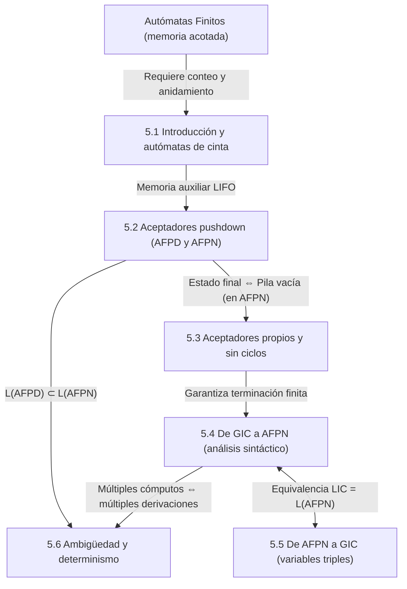
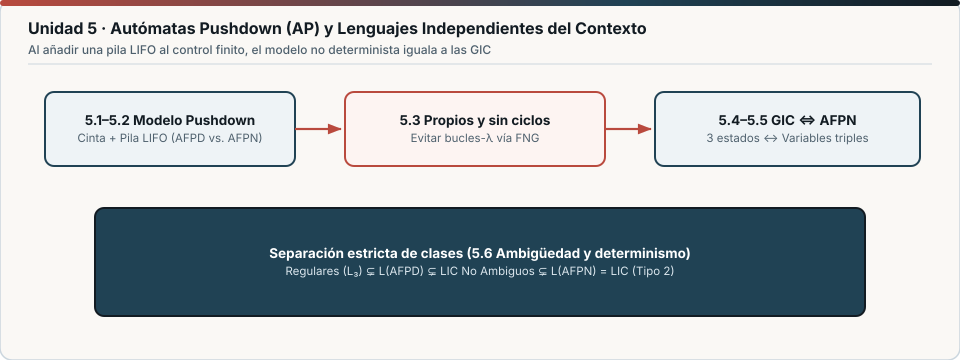

# Unidad 5: Autómatas Pushdown

- **Duración:** 20 horas
- **Competencia(s) a desarrollar:** Analiza el alcance de los autómatas de cinta con relación a los lenguajes independientes al contexto.

## Panorama general

En las unidades previas se estableció que los autómatas finitos —tanto deterministas (AFD) como no deterministas (AFN)— poseen exactamente el mismo poder de reconocimiento que las gramáticas regulares (Tipo 3 de la jerarquía de Chomsky). Sin embargo, debido a que su memoria se limita a un conjunto finito de estados internos, estos modelos son incapaces de verificar relaciones de conteo ilimitado o estructuras sintácticas anidadas, como $\{a^n b^n : n \ge 0\}$ o las expresiones con paréntesis balanceados presentes en los lenguajes de programación.

Para reconocer los **lenguajes independientes del contexto (LIC)** es necesario dotar al autómata finito de una memoria auxiliar potencialmente infinita organizada bajo la disciplina de pila **LIFO** (*Last-In, First-Out*). Este modelo recibe el nombre de **autómata con pila** o **autómata *pushdown*** (**AP**). A diferencia de lo que ocurre con los autómatas finitos, la versión determinista (**AFPD**) y la no determinista (**AFPN**) **no son equivalentes**: la clase de lenguajes aceptados por los AFPD es un subconjunto propio de los lenguajes aceptados por los AFPN, siendo estos últimos exactamente los lenguajes independientes del contexto.

## Subtemas

- [5.1 Introducción](5-1-introduccion.md)
  - 5.1.1 Autómatas de cinta: Limitaciones de la memoria finita y arquitectura general de los autómatas con cinta auxiliar según el modo de acceso (solo lectura unidireccional, pila LIFO y cinta bidireccional de lectura/escritura).
- [5.2 Aceptadores "pushdown"](5-2-aceptadores-pushdown.md): Definición formal de los AFPD y AFPN, configuraciones instantáneas $(q, w, \alpha)$, relación de paso $\vdash_M$, aceptación por estado final $L(M)$ y por pila vacía $N(M)$, equivalencia en el caso no determinista y separación estricta $\mathcal{L}(\text{AFPD}) \subsetneq \mathcal{L}(\text{AFPN})$.
- [5.3 Aceptadores propios y sin ciclos](5-3-aceptadores-propios-y-sin-ciclos.md): Depuración de estados inalcanzables o muertos, detección y eliminación de ciclos de transiciones-$\lambda$ mediante gramáticas bien formadas y Forma Normal de Greibach, y garantía de terminación en tiempo finito.
- [5.4 Aceptadores "pushdown" para lenguajes independientes al contexto](5-4-aceptadores-pushdown-para-lenguajes-independientes-al-contexto.md): Construcción de analizadores sintácticos que simulan derivaciones de una GIC mediante una pila.
  - 5.4.1 Análisis de sintaxis
  - 5.4.2 Construcción de analizadores de sintaxis "pushdown"
  - 5.4.3 Prueba de la construcción
- [5.5 Gramáticas independientes al contexto para aceptadores "pushdown"](5-5-gramaticas-independientes-al-contexto-para-aceptadores-pushdown.md): Conversión inversa de un AFPN que acepta por pila vacía a una GIC equivalente mediante variables triples $[q, A, p]$, demostración por inducción y cierre de la equivalencia $\text{LIC} = \mathcal{L}(\text{AFPN})$.
- [5.6 Ambigüedad](5-6-ambiguedad.md): Correspondencia entre ambigüedad gramatical y múltiples cómputos de aceptación en AFPN, conflictos en analizadores sintácticos deterministas y lenguajes inherentemente ambiguos.

## Referencias

- Acevedo Juárez, A. (2006). *Teoría de la computación* [Tesis de licenciatura, Instituto Tecnológico de Celaya].
- De Castro Korgi, R. (2004). *Teoría de la computación: Lenguajes, autómatas, gramáticas*. Universidad Nacional de Colombia.
- Hopcroft, J. E., Motwani, R., & Ullman, J. D. (2007). *Introducción a la teoría de autómatas, lenguajes y computación* (3.ª ed.). Pearson Educación.
