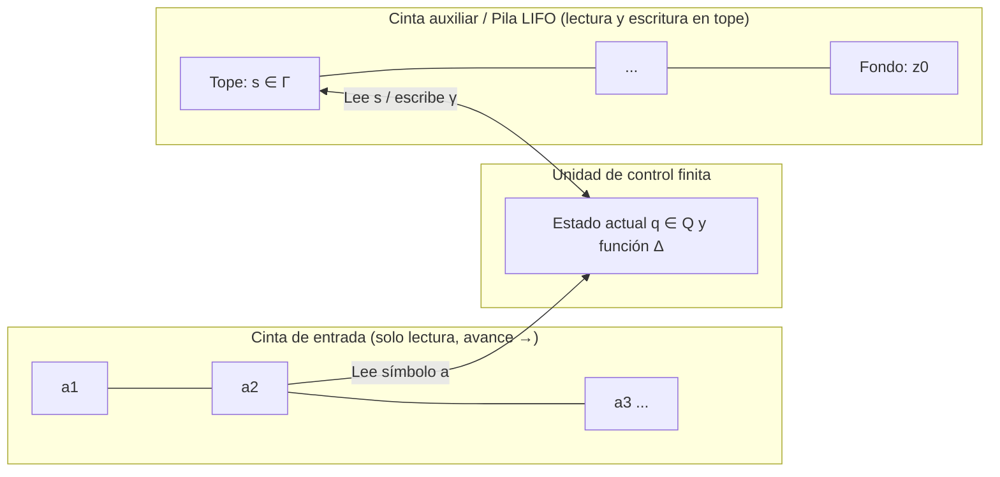
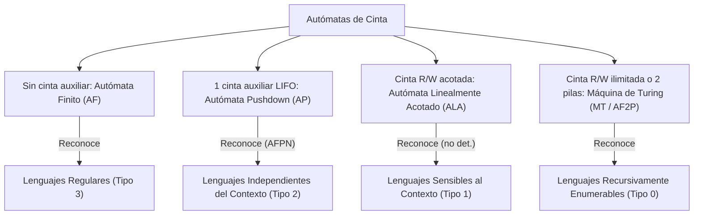
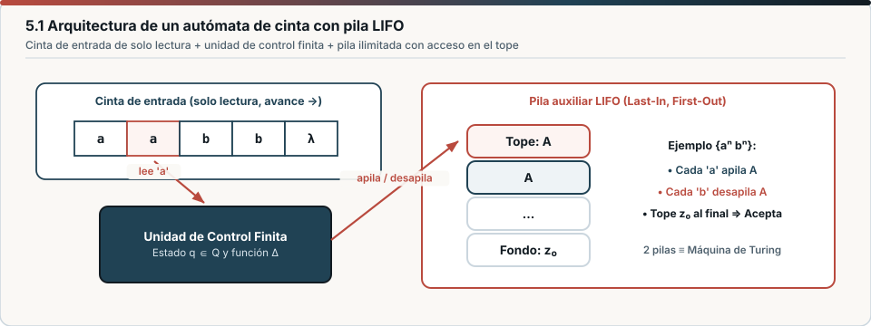

# 5.1 Introducción

Los autómatas finitos deterministas (AFD) y no deterministas (AFN) constituyen un modelo elegante y eficiente para el análisis léxico en compiladores —es decir, la identificación de palabras reservadas, identificadores y constantes numéricas definidas mediante expresiones regulares—. No obstante, en la etapa siguiente de la compilación, el **análisis sintáctico**, los lenguajes de programación exhiben estructuras recursivas y anidadas arbitrariamente profundas (bloques `begin ... end` o `{ ... }`, llamadas a subrutinas, sentencias condicionales y expresiones aritméticas con paréntesis balanceados).

El **Lema de Bombeo** para lenguajes regulares demuestra que ningún autómata finito puede reconocer el lenguaje:

$$L_0 = \{a^n b^n : n \ge 0\}.$$

La razón es estructural: un autómata finito con $k$ estados únicamente dispone de $k$ configuraciones posibles de memoria al terminar de leer el prefijo $a^n$. Por el principio del palomar, si $n \ge k$, existen al menos dos exponentes distintos $i \neq j$ tales que las cadenas $a^i$ y $a^j$ conducen al autómata exactamente al mismo estado $q$. A partir de ese instante, la máquina no puede distinguir cuántas letras $a$ ha visto y aceptará $a^j b^i$ si acepta $a^i b^i$, violando la definición de $L_0$.

Para superar esta barrera sin otorgar inmediatamente el poder completo de una computadora universal, se añade al control finito una **memoria auxiliar ilimitada** sujeta a una disciplina estricta de acceso: la **pila** (*stack* o *pushdown*). En una pila, únicamente es visible y modificable el símbolo situado en la cima o **tope**, operando bajo el principio **LIFO** (*Last-In, First-Out*: el último elemento en apilarse es el primero en desapilarse). Esta restricción resulta sorprendentemente exacta: coincide de forma precisa con la naturaleza recursiva de las **gramáticas independientes del contexto (GIC)** (De Castro Korgi, 2004; Acevedo Juárez, 2006).

## 5.1.1 Autómatas de cinta

Desde una perspectiva arquitectónica unificada, las distintas máquinas abstractas de la teoría de la computación pueden estudiarse como **autómatas de cinta** (*tape automata*): dispositivos gobernados por una unidad de control con un número finito de estados que interactúa con una o más cintas divididas en celdas discretas capaces de almacenar un símbolo de un alfabeto finito por casilla.

### Arquitectura de un autómata de cinta

Un autómata de cinta con memoria tipo pila se compone de cuatro elementos físicos o lógicos fundamentales (De Castro Korgi, 2004, pp. 143–144):

1. **Cinta de entrada (*input tape*):** Cinta semi-infinita hacia la derecha dividida en celdas que contiene la cadena de entrada $w = a_1 a_2 \cdots a_n \in \Sigma^*$. Es de **solo lectura**: el autómata no puede sobrescribirla.
2. **Cabezal de lectura de entrada:** Apunta a una celda de la cinta de entrada y, en los modelos básicos (AF y AP), avanza **unidireccionalmente** de izquierda a derecha (o permanece estacionario durante una transición espontánea $\lambda$).
3. **Unidad de control finita:** Contiene el conjunto finito de estados internos $Q$ y la lógica de transición $\Delta$. En cada paso computacional decide el nuevo estado y las acciones sobre las cintas en función del estado actual, el símbolo bajo el cabezal de entrada y el símbolo accesible en la memoria auxiliar.
4. **Cinta de almacenamiento auxiliar (pila):** Cinta potencialmente infinita (o extensible dinámicamente) que almacena símbolos de un alfabeto de pila $\Gamma$. Su cabezal de lectura/escritura solo accede al extremo activo (**tope** de la pila): para leer o modificar un elemento enterrado en el interior, primero deben extraerse todos los elementos situados por encima de él.

### Clasificación según el acceso a las cintas

La capacidad computacional de un autómata de cinta no depende del tamaño de su unidad de control finita (siempre constante), sino de **cuántas cintas posee y qué operaciones de movimiento y escritura se permiten en ellas**. De acuerdo con las restricciones sobre sus cintas, las máquinas abstractas clásicas se clasifican en los siguientes niveles:

| Modelo de autómata de cinta | Cinta de entrada | Memoria / cinta auxiliar | Movimiento del cabezal auxiliar | Clase de lenguajes reconocida | Ejemplo representativo |
| :--- | :--- | :--- | :--- | :--- | :--- |
| **Autómata Finito (AFD / AFN)** | Solo lectura, unidireccional ($\rightarrow$) | Ninguna (solo estado interno finito) | No aplica | Regulares (Tipo 3) | $(a \cup b)^* abb$ |
| **Autómata Pushdown Determinista (AFPD)** | Solo lectura, unidireccional ($\rightarrow$) | 1 pila LIFO ilimitada ($\Gamma^*$) | Acceso restringido al tope (*push/pop*) | LIC deterministas ($\mathcal{L}(\text{AFPD})$) | $\{w c w^R : w \in \{a,b\}^*\}$ |
| **Autómata Pushdown No Determinista (AFPN)** | Solo lectura, unidireccional ($\rightarrow$) | 1 pila LIFO ilimitada ($\Gamma^*$) | Acceso restringido al tope (*push/pop*) | Independientes del Contexto (Tipo 2) | $\{w w^R : w \in \{a,b\}^*\}$ |
| **Autómata Linealmente Acotado (ALA)** | Lectura/escritura bidireccional | Misma cinta acotada a $O(\lvert w \rvert)$ celdas | Bidireccional ($\leftarrow, \rightarrow, -$) dentro de límites | Sensibles al Contexto (Tipo 1) | $\{a^n b^n c^n : n \ge 1\}$ |
| **Máquina de Turing (MT) / Autómata de 2 Pilas (AF2P)** | Lectura/escritura bidireccional (o entrada + 2 pilas) | Cinta ilimitada (o 2 pilas LIFO) | Bidireccional libre ($\leftarrow, \rightarrow, -$) | Recursivamente Enumerables (Tipo 0) | Lenguajes decidibles y semidecidibles |

Como demuestra De Castro Korgi (2004, Secc. 6.7, pp. 188–193), agregar una **segunda pila** a un autómata *pushdown* (modelo **AF2P**) permite simular una cinta bidireccional de lectura/escritura: la primera pila almacena la porción de cinta a la izquierda del cabezal y la segunda pila almacena la porción bajo el cabezal y a su derecha. En consecuencia, un autómata con dos pilas alcanza ya el poder computacional máximo de una Máquina de Turing. Con **una sola pila**, en cambio, el autómata permanece estrictamente confinado al ámbito de los lenguajes independientes del contexto: puede verificar correspondencias anidadas (LIFO), pero no puede comparar de manera independiente tres conteos cruzados como $\{a^n b^n c^n : n \ge 1\}$ ni copias directas $\{w w : w \in \{a,b\}^*\}$.

---

## Ejemplos paso a paso

### Ejemplo 1: Conteo ilimitado para $L = \{a^n b^n : n \ge 1\}$ mediante cinta auxiliar LIFO

Considere el lenguaje no regular $L = \{a^n b^n : n \ge 1\}$ sobre $\Sigma = \{a, b\}$. Para reconocerlo, un autómata de cinta con pila utiliza el marcador inicial de fondo $z_0$ y un símbolo auxiliar $A \in \Gamma$:

- Mientras lee símbolos $a$ en el estado inicial $q_0$, apila una $A$ por cada $a$ leída.
- Al leer la primera $b$, cambia al estado $q_1$ y desapila una $A$.
- En $q_1$, por cada $b$ adicional desapila una $A$.
- Al terminar la entrada, si el tope es el marcador de fondo $z_0$, pasa mediante una transición espontánea al estado de aceptación $q_2$.

**Traza para la cadena válida $w = aabb$:**

| Paso | Estado actual | Entrada por leer | Símbolo leído | Acción sobre la pila LIFO | Contenido de la pila (tope a la izq.) | Siguiente estado |
| :---: | :---: | :--- | :---: | :--- | :--- | :---: |
| 0 | $q_0$ | `aabb` | — | Estado inicial | $z_0$ | $q_0$ |
| 1 | $q_0$ | `abb` | `a` | Apilar $A$ sobre $z_0$ | $A z_0$ | $q_0$ |
| 2 | $q_0$ | `bb` | `a` | Apilar $A$ sobre $A$ | $A A z_0$ | $q_0$ |
| 3 | $q_0$ | `b` | `b` | Desapilar $A$ | $A z_0$ | $q_1$ |
| 4 | $q_1$ | $\lambda$ | `b` | Desapilar $A$ | $z_0$ | $q_1$ |
| 5 | $q_1$ | $\lambda$ | $\lambda$ | Detectar fondo $z_0$ (sin alterar) | $z_0$ | $q_2 \in F$ (Acepta) |

Si la entrada fuera $w' = aab$, tras los pasos 1–3 el autómata quedaría en $(q_1, \lambda, Az_0)$: la cinta de entrada se agotó, pero en la pila permanece una $A$ sin emparejar, por lo que no puede pasar a $q_2$ y la cadena es **rechazada**.

---

### Ejemplo 2: Validación de delimitadores anidados en compiladores

En un compilador, las expresiones deben equilibrar paréntesis `()` y corchetes `[]` respetando su **anidamiento LIFO**. Considere el lenguaje de delimitadores equilibrados sobre $\Sigma = \{\text{(}, \text{)}, \text{[}, \text{]}\}$:

- Cada apertura `(` apila un marcador `P` y cada `[` apila un marcador `C`.
- Un cierre `)` solo puede consumirse si el tope de la pila es `P` (y lo desapila); análogamente, `]` exige `C` en el tope.
- Si al final de la cadena la pila solo contiene $z_0$, la estructura es válida.

**Comparación entre una entrada válida `([()])` y una entrada con cruce inválido `([)]`:**

1. **Cómputo sobre $w_1 = \text{([()])}$:**

| Paso | Entrada restante | Símbolo leído | Tope antes | Operación en pila | Pila resultante |
| :---: | :--- | :---: | :---: | :--- | :--- |
| 0 | `([()])` | — | $z_0$ | Inicio | $z_0$ |
| 1 | `[()])` | `(` | $z_0$ | Apilar `P` | $P z_0$ |
| 2 | `()])` | `[` | $P$ | Apilar `C` | $C P z_0$ |
| 3 | `())` | `(` | $C$ | Apilar `P` | $P C P z_0$ |
| 4 | `])` | `)` | $P$ | Coincide `P` $\rightarrow$ desapilar | $C P z_0$ |
| 5 | `)` | `]` | $C$ | Coincide `C` $\rightarrow$ desapilar | $P z_0$ |
| 6 | $\lambda$ | `)` | $P$ | Coincide `P` $\rightarrow$ desapilar | $z_0$ (Acepta) |

2. **Cómputo sobre $w_2 = \text{([)]}$:**

| Paso | Entrada restante | Símbolo leído | Tope antes | Operación en pila | Pila resultante |
| :---: | :--- | :---: | :---: | :--- | :--- |
| 0 | `([)]` | — | $z_0$ | Inicio | $z_0$ |
| 1 | `[)]` | `(` | $z_0$ | Apilar `P` | $P z_0$ |
| 2 | `)]` | `[` | $P$ | Apilar `C` | $C P z_0$ |
| 3 | `)]` | `)` | $C$ | Se requiere `P` en el tope, pero hay `C` | **Cómputo abortado (Rechaza)** |

Aunque `([)]` tiene el mismo número de paréntesis y corchetes abiertos y cerrados, el acceso LIFO de la pila detecta de inmediato la violación del orden de anidamiento en el paso 3.

---

## Ejercicios propuestos

1. **Comprensión arquitectónica:** Explique por qué un autómata finito con $k$ estados no puede reconocer el lenguaje $L = \{0^n 1^{2n} : n \ge 1\}$ empleando únicamente su cinta de entrada de solo lectura, y describa qué estrategia sobre una pila LIFO permite resolverlo en un solo recorrido de izquierda a derecha.
2. **Clasificación de modelos de cinta:** Para cada uno de los siguientes lenguajes, determine cuál es el modelo más débil de autómata de cinta capaz de reconocerlo (AF, AP o MT/AF2P) y justifique su respuesta:
   - $L_1 = \{w \in \{a, b\}^* : w \text{ contiene un número par de } a\text{'s}\}$.
   - $L_2 = \{a^n b^m c^n : n, m \ge 1\}$.
   - $L_3 = \{a^n b^n c^n : n \ge 1\}$.
   - $L_4 = \{w w : w \in \{a, b\}^*\}$.
3. **Traza manual con pila LIFO:** Diseñe informalmente las reglas de apilado y desapilado de un autómata con pila para el lenguaje $L = \{a^i b^j c^{i+j} : i, j \ge 1\}$ y construya la tabla de evolución de la pila para la cadena `aabccc` y para la cadena `abbcc` (rechazada).
4. **Limitación del modelo con una sola pila:** Argumente por qué el mecanismo LIFO de una única pila permite verificar $L = \{w c w^R : w \in \{a, b\}^*\}$, pero falla al intentar verificar $L' = \{w c w : w \in \{a, b\}^*\}$, y explique cómo una segunda pila resolvería este último problema.

## Referencias

- Acevedo Juárez, A. (2006). *Teoría de la computación* [Tesis de licenciatura, Instituto Tecnológico de Celaya].
- De Castro Korgi, R. (2004). *Teoría de la computación: Lenguajes, autómatas, gramáticas* (Cap. 5, pp. 143–149; Cap. 6, pp. 188–193). Universidad Nacional de Colombia.
- Hopcroft, J. E., Motwani, R., & Ullman, J. D. (2007). *Introducción a la teoría de autómatas, lenguajes y computación* (3.ª ed., Cap. 6). Pearson Educación.
- Martin, J. C. (2011). *Introduction to languages and the theory of computation* (4.ª ed.). McGraw-Hill.
