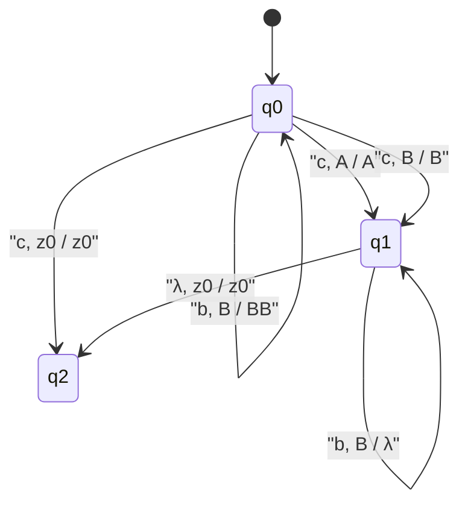
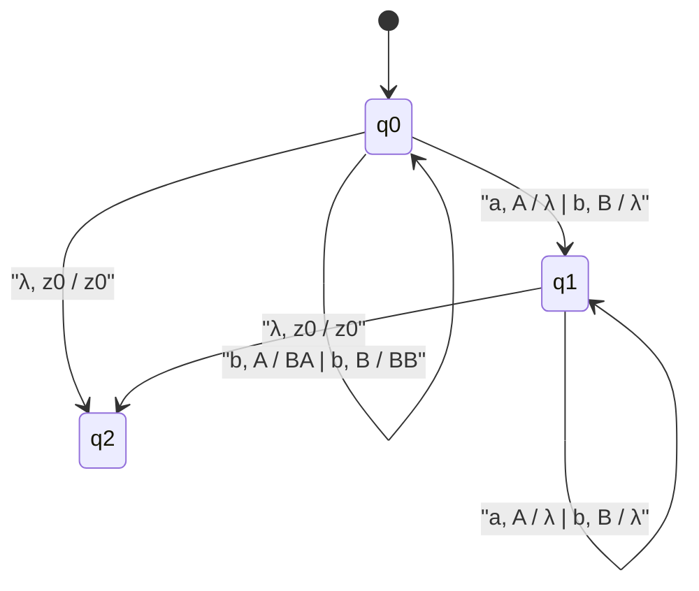

# 5.2 Aceptadores "pushdown"

En el análisis sintáctico de compiladores y en la caracterización operacional de los lenguajes independientes del contexto, resulta indispensable formalizar el comportamiento de los autómatas con pila (*pushdown automata*, AP). A diferencia de los autómatas finitos, la presencia de la pila obliga a distinguir desde el principio dos variantes: el modelo **determinista (AFPD)** y el modelo **no determinista (AFPN)**, ya que su poder computacional **no coincide**.

> **Nota sobre notación:** En la literatura clásica (p. ej., Hopcroft et al., 2007; Acevedo Juárez, 2006) la 7-tupla de un autómata con pila suele ordenarse como $M = (Q, \Sigma, \Gamma, \delta, q_0, Z_0, F)$ (o $(Q, \Sigma, Z, s, z, F, \delta)$ usando $\#$ para el fondo y $e$ o $\varepsilon$ para la cadena vacía). En estas notas adoptamos de manera consistente la notación del texto principal de De Castro Korgi (2004, Secc. 5.1–5.3, pp. 143–156): $M = (Q, q_0, F, \Sigma, \Gamma, z_0, \Delta)$, $\lambda$ para la cadena vacía y $z_0$ para el marcador de fondo de pila.

---

## Definición formal: AFPD y AFPN

### Autómata Finito con Pila Determinista (AFPD)

Un **Autómata Finito con Pila Determinista (AFPD)** se define formalmente como una 7-tupla (De Castro Korgi, 2004, p. 143):

$$M = (Q, q_0, F, \Sigma, \Gamma, z_0, \Delta)$$

donde:
1. $Q$ es el conjunto finito y no vacío de **estados internos** de la unidad de control.
2. $q_0 \in Q$ es el **estado inicial**.
3. $F \subseteq Q$ es el conjunto de **estados finales o de aceptación** ($\emptyset \neq F \subseteq Q$).
4. $\Sigma$ es el **alfabeto de entrada** (o alfabeto de la cinta de entrada).
5. $\Gamma$ es el **alfabeto de pila** (finito).
6. $z_0 \in \Gamma$ es el **marcador de fondo** o símbolo inicial de pila ($z_0 \notin \Sigma$).
7. $\Delta$ es la **función parcial de transición**:

$$\Delta : Q \times (\Sigma \cup \{\lambda\}) \times \Gamma \longrightarrow Q \times \Gamma^*.$$

Una transición $\Delta(q, a, A) = (p, \gamma)$ (también escrita $(q, a, A) \to (p, \gamma)$) indica que, encontrándose en el estado $q$, leyendo el símbolo $a \in \Sigma$ en la cinta de entrada y con el símbolo $A \in \Gamma$ en el tope de la pila, el autómata:
1. Cambia al estado $p$.
2. Avanza el cabezal de la cinta de entrada una posición hacia la derecha (si $a \in \Sigma$); si $a = \lambda$ (**transición espontánea** o **transición-$\lambda$**), el cabezal de entrada no se mueve y no consume símbolo alguno.
3. Extrae $A$ del tope de la pila y escribe en su lugar la cadena $\gamma \in \Gamma^*$, de modo que si $\gamma = X_1 X_2 \cdots X_m$, el símbolo más a la izquierda $X_1$ queda situado en el **nuevo tope** de la pila.

#### Casos especiales de manipulación del tope
- **Preservar el tope:** $\Delta(q, a, A) = (p, A)$ — el contenido de la pila no cambia.
- **Desapilar (*pop*):** $\Delta(q, a, A) = (p, \lambda)$ — se borra $A$ y queda expuesto el símbolo inmediatamente inferior.
- **Apilar (*push*):** $\Delta(q, a, A) = (p, BA)$ — se coloca $B$ encima de $A$.
- **Transición espontánea ($\lambda$):** $\Delta(q, \lambda, A) = (p, \gamma)$ — modifica estado y pila sin consumir entrada.

#### Condiciones de determinismo

Para garantizar que un AFPD posea como máximo un movimiento posible en cada situación, la función parcial $\Delta$ debe satisfacer (De Castro Korgi, 2004, p. 145):
1. Para cada terna $(q, a, A) \in Q \times (\Sigma \cup \{\lambda\}) \times \Gamma$, existe **a lo sumo un** par $(p, \gamma)$ asignado por $\Delta(q, a, A)$.
2. Para todo $q \in Q$ y $A \in \Gamma$, si $\Delta(q, \lambda, A)$ está definida, entonces $\Delta(q, a, A)$ **no está definida** para ningún $a \in \Sigma$ (es decir, una transición-$\lambda$ y una transición que consume un símbolo de entrada no pueden habilitarse simultáneamente para el mismo estado y el mismo tope).

### Autómata Finito con Pila No Determinista (AFPN)

Un **Autómata Finito con Pila No Determinista (AFPN)** comparte los mismos siete componentes $M = (Q, q_0, F, \Sigma, \Gamma, z_0, \Delta)$, excepto que la función de transición devuelve un conjunto finito de opciones (De Castro Korgi, 2004, p. 149):

$$\Delta : Q \times (\Sigma \cup \{\lambda\}) \times \Gamma \longrightarrow \mathcal{P}_f(Q \times \Gamma^*)$$

donde $\mathcal{P}_f(Q \times \Gamma^*)$ denota el conjunto de subconjuntos finitos de $Q \times \Gamma^*$. Así, para $q \in Q$, $a \in \Sigma \cup \{\lambda\}$ y $A \in \Gamma$:

$$\Delta(q, a, A) = \{(p_1, \gamma_1), (p_2, \gamma_2), \dots, (p_k, \gamma_k)\}.$$

En un AFPN, tanto la multiplicidad de destinos como la presencia simultánea de $\Delta(q, a, A)$ y $\Delta(q, \lambda, A)$ están completamente permitidas. Si $\Delta(q, a, A) = \emptyset$, no existe transición aplicable desde esa terna y la rama computacional correspondiente se aborta.

En diagramas de transición (`stateDiagram-v2`), toda transición $(p, \gamma) \in \Delta(q, a, A)$ se representa mediante una arista dirigida de $q$ a $p$ con la etiqueta **`a, A / γ`** (por ejemplo, `a, z0 / Az0` o `b, A / λ`).

---

## Configuraciones instantáneas y relación de paso

Para describir formalmente la ejecución paso a paso de un autómata con pila $M$, se define una **configuración** o **descripción instantánea (DI)** como una terna:

$$(q, w, \alpha) \in Q \times \Sigma^* \times \Gamma^*$$

donde:
- $q \in Q$ es el estado actual de la unidad de control,
- $w \in \Sigma^*$ es el sufijo de la cadena de entrada aún no procesado,
- $\alpha \in \Gamma^*$ es el contenido completo de la pila, leído desde el **tope** (extremo izquierdo) hasta el **fondo** (extremo derecho).

La **relación de paso computacional** $\vdash_M$ sobre configuraciones se define como sigue: si $(p, \gamma) \in \Delta(q, a, A)$ con $a \in \Sigma \cup \{\lambda\}$, entonces para cualesquiera $u \in \Sigma^*$ y $\beta \in \Gamma^*$:

$$(q, au, A\beta) \vdash_M (p, u, \gamma\beta).$$

Cuando el autómata es claro por el contexto, se escribe simplemente $\vdash$. Denotamos mediante:
- $\vdash_M^k$ la aplicación de exactamente $k \ge 0$ pasos computacionales,
- $\vdash_M^+$ uno o más pasos computacionales, y
- $\vdash_M^*$ cero, uno o más pasos (clausura reflexiva y transitiva de $\vdash_M$).

> **Restricción fundamental del tope:** Según la definición de $\Delta$, toda transición exige leer al menos un símbolo $A \in \Gamma$ en el tope de la pila. En cuanto la pila queda completamente vacía ($\alpha = \lambda$), ninguna transición adicional es posible y el cómputo se detiene.

---

## Criterios de aceptación y su equivalencia en AFPN

Existen dos modos clásicos para definir cuándo una cadena $w \in \Sigma^*$ es aceptada por un autómata con pila:

### 1. Aceptación por estado final: $L(M)$

Para una cadena $w \in \Sigma^*$, la configuración inicial es $(q_0, w, z_0)$. Se dice que $w$ es **aceptada por estado final** si existe algún cómputo que consume por completo $w$ y alcanza un estado $p \in F$ (sin importar el contenido restante $\beta$ en la pila):

$$L(M) := \left\{ w \in \Sigma^* : (q_0, w, z_0) \vdash_M^* (p, \lambda, \beta),\ \text{con } p \in F \text{ y } \beta \in \Gamma^* \right\}.$$

### 2. Aceptación por pila vacía: $N(M)$

Cuando se adopta el criterio de **pila vacía** (o pila nula, de donde proviene la letra $N$), el conjunto de estados finales $F$ resulta prescindible, por lo que el autómata se especifica como una 6-tupla $M = (Q, q_0, \Sigma, \Gamma, z_0, \Delta)$ (De Castro Korgi, 2004, Def. 5.3.1, p. 154). El lenguaje aceptado por pila vacía es:

$$N(M) := \left\{ w \in \Sigma^* : (q_0, w, z_0) \vdash_M^* (p, \lambda, \lambda),\ \text{para algún } p \in Q \right\}.$$

En este criterio, la cadena $w$ debe consumirse en su totalidad y la pila debe quedar completamente vacía ($\lambda$) al mismo tiempo.

### Equivalencia entre $L(M)$ y $N(M)$ para AFPN

Para los autómatas con pila **no deterministas**, ambos criterios definen exactamente la misma clase de lenguajes.

#### Teorema 1 (De estado final a pila vacía — De Castro Korgi, Teorema 5.3.2)
Si $L = L(M)$ para algún AFPN $M = (Q, q_0, F, \Sigma, \Gamma, z_0, \Delta)$, entonces existe un AFPN $M'$ tal que $L = N(M')$.

**Demostración.** Construimos $M' = (Q \cup \{p_0, p\}, p_0, \Sigma, \Gamma \cup \{r_0\}, r_0, \Delta')$ agregando dos estados nuevos $p_0, p \notin Q$ y un nuevo marcador de fondo $r_0 \notin \Gamma$ (para evitar que $M'$ acepte prematuramente si $M$ llegase a vaciar $z_0$ en un estado no final). Definimos $\Delta'$ mediante:
1. $\Delta'(p_0, \lambda, r_0) = \{(q_0, z_0 r_0)\}$ (coloca el fondo protegido $r_0$ debajo de $z_0$ e inicia la simulación en $q_0$).
2. $\Delta(q, a, A) \subseteq \Delta'(q, a, A)$ para todo $q \in Q$, $a \in \Sigma \cup \{\lambda\}$ y $A \in \Gamma$ ($M'$ simula todas las transiciones de $M$).
3. $(p, A) \in \Delta'(q, \lambda, A)$ para todo $q \in F$ y $A \in \Gamma \cup \{r_0\}$ (al alcanzar cualquier estado de aceptación de $M$, $M'$ puede saltar de forma no determinista al estado vaciador $p$).
4. $\Delta'(p, \lambda, A) = \{(p, \lambda)\}$ para todo $A \in \Gamma \cup \{r_0\}$ (en $p$, vacía por completo la pila sin consumir entrada).

*Corrección:* Si $w \in L(M)$, entonces $(q_0, w, z_0) \vdash_M^* (q, \lambda, \beta)$ con $q \in F$ y $\beta \in \Gamma^*$. En $M'$ se tiene:

$$(p_0, w, r_0) \vdash_{M'} (q_0, w, z_0 r_0) \vdash_{M'}^* (q, \lambda, \beta r_0) \vdash_{M'} (p, \lambda, \beta r_0) \vdash_{M'}^* (p, \lambda, \lambda),$$

luego $w \in N(M')$. Recíprocamente, si $w \in N(M')$, como $r_0$ nunca se borra durante la simulación de $M$ en $Q$, la única manera de eliminar $r_0$ es ingresando al estado $p$ desde algún $q \in F$ mediante la regla 3. Como en $p$ ya no se lee ningún símbolo de entrada, toda la cadena $w$ tuvo que consumirse antes de abandonar $Q$, por lo que $(q_0, w, z_0) \vdash_M^* (q, \lambda, \beta)$ con $q \in F$, es decir, $w \in L(M)$. $\blacksquare$

#### Teorema 2 (De pila vacía a estado final — De Castro Korgi, Teorema 5.3.3)
Si $L = N(M)$ para algún AFPN $M = (Q, q_0, \Sigma, \Gamma, z_0, \Delta)$, entonces existe un AFPN $M'$ tal que $L = L(M')$.

**Demostración.** Definimos $M' = (Q \cup \{p_0, p_f\}, p_0, \{p_f\}, \Sigma, \Gamma \cup \{r_0\}, r_0, \Delta')$ con nuevos estados $p_0, p_f \notin Q$ y nuevo marcador $r_0 \notin \Gamma$, donde $\Delta'$ cumple:
1. $\Delta'(p_0, \lambda, r_0) = \{(q_0, z_0 r_0)\}$.
2. $\Delta(q, a, A) \subseteq \Delta'(q, a, A)$ para todo $q \in Q$, $a \in \Sigma \cup \{\lambda\}$ y $A \in \Gamma$.
3. $(p_f, r_0) \in \Delta'(q, \lambda, r_0)$ para todo $q \in Q$ (cuando $M$ ha vaciado su propia pila dejando expuesto a $r_0$, $M'$ salta al único estado de aceptación $p_f$).

Si $w \in N(M)$, entonces $(q_0, w, z_0) \vdash_M^* (q, \lambda, \lambda)$, por lo que $(p_0, w, r_0) \vdash_{M'} (q_0, w, z_0 r_0) \vdash_{M'}^* (q, \lambda, r_0) \vdash_{M'} (p_f, \lambda, r_0)$, luego $w \in L(M')$. Recíprocamente, $p_f$ solo es accesible al exponer $r_0$ (cuando la pila simulada de $M$ queda vacía) y no tiene transiciones salientes, lo que garantiza que $w$ fue consumida por completo dentro de $Q$ vaciando $z_0$, implicando $w \in N(M)$. $\blacksquare$

> **¡Atención al caso determinista!** Ninguno de los dos teoremas anteriores es válido para los **AFPD**. En la prueba del Teorema 1, las transiciones-$\lambda$ de la regla 3 entrarían en conflicto determinista si desde $q \in F$ aún existen transiciones que leen entrada $\Sigma$ (por ejemplo, si tanto $w$ como $wu$ pertenecen al lenguaje). De hecho, todo lenguaje aceptado por un **AFPD por pila vacía** debe tener la **propiedad libre de prefijos** (*prefix-free*: ninguna cadena del lenguaje es prefijo propio de otra del lenguaje, pues al vaciarse la pila el cómputo se detiene irremediablemente). En contraste, un AFPD por estado final acepta lenguajes como $a^*$ que no son libres de prefijos. Por ello, para AFPD el criterio de aceptación por pila vacía es estrictamente más débil que el criterio por estado final.

---

## Diferencia de poder expresivo: $\mathcal{L}(\text{AFPD}) \subsetneq \mathcal{L}(\text{AFPN})$

Como establece el Teorema 5.1.1 de De Castro Korgi (2004, p. 147), todo lenguaje regular $L$ es aceptado por un AFPD: basta tomar el AFD $M = (Q, q_0, F, \Sigma, \delta)$ que acepta $L$ y definir $\Gamma = \{z_0\}$ con $\Delta(q, a, z_0) = (\delta(q, a), z_0)$ para todo $q \in Q, a \in \Sigma$, ignorando efectivamente la pila. Además, usando la pila, un AFPD acepta lenguajes no regulares como $\{a^i b^i : i \ge 1\}$ o $L_1 = \{w c w^R : w \in \{a, b\}^*\}$.

Sin embargo, a diferencia de la equivalencia $\mathcal{L}(\text{AFD}) = \mathcal{L}(\text{AFN})$, en autómatas con pila se cumple una inclusión **estricta**:

$$\mathcal{L}(\text{Regulares}) \subsetneq \mathcal{L}(\text{AFPD}) \subsetneq \mathcal{L}(\text{AFPN}) = \text{LIC}.$$

La razón intuitiva radica en que, cuando aparece un delimitador central explícito (como $c$ en $L_1 = \{w c w^R : w \in \{a, b\}^*\}$), el autómata sabe de manera **determinista** en qué instante exacto termina la primera mitad $w$ y comienza la fase de desapilado y comparación con $w^R$. Si eliminamos ese marcador central, obtenemos el lenguaje de los palíndromos de longitud par:

$$L_2 = \{w w^R : w \in \{a, b\}^*\}.$$

Un **AFPN** acepta fácilmente $L_2$ usando el no determinismo para "adivinar" en cualquier símbolo cuándo ha alcanzado el centro de la cadena. En cambio, ningún **AFPD** puede aceptar $L_2$: al leer $a$, un autómata determinista debe decidir irrevocablemente si ese símbolo sigue perteneciendo a la mitad izquierda $w$ (por ejemplo, en `aa`) o si ya inició la mitad derecha $w^R$ (como en `aaaa` frente a `aabbaa`). Por ello, aunque todo AFPD es trivialmente un AFPN, la clase de los **lenguajes independientes del contexto deterministas** ($\mathcal{L}(\text{AFPD})$) es estrictamente menor que la clase completa de los **lenguajes independientes del contexto** ($\mathcal{L}(\text{AFPN})$).

---

## Ejemplos paso a paso

### Ejemplo 1: AFPD para $L_1 = \{w c w^R : w \in \{a, b\}^*\}$

Diseñemos el AFPD $M_1 = (Q, q_0, F, \Sigma, \Gamma, z_0, \Delta)$ sobre $\Sigma = \{a, b, c\}$ (De Castro Korgi, 2004, pp. 148–149):
- $Q = \{q_0, q_1, q_2\}$, $F = \{q_2\}$, $\Gamma = \{z_0, A, B\}$.
- **Fase 1 ($q_0$):** Mientras lee $a$ o $b$, apila $A$ o $B$ respectivamente. Al leer $c$ con $z_0$ en el tope, salta directamente a $q_2$ (acepta $c$, caso $w = \lambda$); si en el tope hay $A$ o $B$, pasa a $q_1$ conservando el tope.
- **Fase 2 ($q_1$):** Empareja cada $a$ con $A$ y cada $b$ con $B$, desapilando. Al quedar únicamente $z_0$ en el tope, la transición espontánea $\Delta(q_1, \lambda, z_0) = (q_2, z_0)$ conduce al estado de aceptación.

Nótese que $M_1$ es **determinista**: en $q_0$ las transiciones consumen $a$, $b$ o $c$ (ninguna transición-$\lambda$); en $q_1$, la transición-$\lambda$ solo se define cuando el tope es $z_0$, mientras que las transiciones con $a$ y $b$ solo se definen cuando el tope es $A$ o $B$.

**Traza 1 (aceptación de `abcba`):**

$$(q_0, abcba, z_0) \vdash (q_0, bcba, Az_0) \vdash (q_0, cba, BAz_0) \vdash (q_1, ba, BAz_0) \vdash (q_1, a, Az_0) \vdash (q_1, \lambda, z_0) \vdash (q_2, \lambda, z_0).$$

Como $q_2 \in F$ y la entrada restante es $\lambda$, la cadena `abcba` es **aceptada**.

**Traza 2 (rechazo de `abca` y `abbcb`):**
- Para `abca`: $(q_0, abca, z_0) \vdash^* (q_1, a, BAz_0)$ — en $q_1$ leyendo $a$ con tope $B$, $\Delta(q_1, a, B)$ no está definida; el cómputo **se aborta** y se rechaza.
- Para `abbcb`: $(q_0, abbcb, z_0) \vdash^* (q_1, b, BBAz_0) \vdash (q_1, \lambda, BAz_0)$ — aunque se consumió la entrada, $q_1 \notin F$; se **rechaza**.

---

### Ejemplo 2: AFPN para $L_2 = \{w w^R : w \in \{a, b\}^*\}$

Construyamos el AFPN $M_2 = (Q, q_0, F, \Sigma, \Gamma, z_0, \Delta)$ sobre $\Sigma = \{a, b\}$ (De Castro Korgi, 2004, pp. 151–153):
- $Q = \{q_0, q_1, q_2\}$, $F = \{q_2\}$, $\Gamma = \{z_0, A, B\}$.
- Transiciones:
  - $\Delta(q_0, \lambda, z_0) = \{(q_2, z_0)\}$ (acepta $\lambda$).
  - $\Delta(q_0, a, z_0) = \{(q_0, Az_0)\}$, $\Delta(q_0, b, z_0) = \{(q_0, Bz_0)\}$.
  - $\Delta(q_0, a, A) = \{(q_0, AA), (q_1, \lambda)\}$ *(no determinismo: sigue apilando o adivina que alcanzó la segunda mitad consumiendo la segunda $a$)*,
  - $\Delta(q_0, b, B) = \{(q_0, BB), (q_1, \lambda)\}$ *(misma bifurcación no determinista para $b$)*,
  - $\Delta(q_0, a, B) = \{(q_0, AB)\}$, $\Delta(q_0, b, A) = \{(q_0, BA)\}$.
  - $\Delta(q_1, a, A) = \{(q_1, \lambda)\}$, $\Delta(q_1, b, B) = \{(q_1, \lambda)\}$, $\Delta(q_1, \lambda, z_0) = \{(q_2, z_0)\}$.

**Trazas de cómputo para la cadena válida $w = abba$:**

Desde $(q_0, abba, z_0)$ se exploran las ramas del árbol no determinista:

| Rama | Secuencia de configuraciones instantáneas | Resultado |
| :---: | :--- | :--- |
| **Rama 1 (no adivina mitad)** | $(q_0, abba, z_0) \vdash (q_0, bba, Az_0) \vdash (q_0, ba, BAz_0) \vdash (q_0, a, BBAz_0) \vdash (q_0, \lambda, ABBAz_0)$ | Queda en $q_0 \notin F$ (**Rechaza**) |
| **Rama 2 (adivina en la 2.ª `b`)** | $(q_0, abba, z_0) \vdash (q_0, bba, Az_0) \vdash (q_0, ba, BAz_0) \vdash (q_1, a, Az_0) \vdash (q_1, \lambda, z_0) \vdash (q_2, \lambda, z_0)$ | Alcanza $q_2 \in F$ con entrada $\lambda$ (**Acepta**) |

Basta con que **exista al menos una rama exitosa** (la Rama 2) para que el AFPN acepte la cadena `abba`.

---

### Ejemplo 3: Conversión de aceptación por estado final a pila vacía

Considere el AFPN $M$ que acepta $L = \{a^i b^i : i \ge 0\}$ por estado final (De Castro Korgi, 2004, p. 150), con $Q = \{q_0, q_1, q_2\}$, $F = \{q_2\}$, $\Sigma = \{a, b\}$, $\Gamma = \{z_0, A\}$ y transiciones:
- $\Delta(q_0, \lambda, z_0) = \{(q_2, z_0)\}$
- $\Delta(q_0, a, z_0) = \{(q_0, Az_0)\}$, $\Delta(q_0, a, A) = \{(q_0, AA)\}$
- $\Delta(q_0, b, A) = \{(q_1, \lambda)\}$, $\Delta(q_1, b, A) = \{(q_1, \lambda)\}$
- $\Delta(q_1, \lambda, z_0) = \{(q_2, z_0)\}$

Aplicando el **Teorema 1 (5.3.2)**, construimos $M' = (Q', p_0, \Sigma, \Gamma', r_0, \Delta')$ con $Q' = \{p_0, q_0, q_1, q_2, p\}$, $\Gamma' = \{r_0, z_0, A\}$ y las transiciones:
1. $\Delta'(p_0, \lambda, r_0) = \{(q_0, z_0 r_0)\}$.
2. Todas las transiciones originales de $M$.
3. Desde $q_2 \in F$: $\Delta'(q_2, \lambda, z_0) = \{(p, z_0)\}$, $\Delta'(q_2, \lambda, A) = \{(p, A)\}$, $\Delta'(q_2, \lambda, r_0) = \{(p, r_0)\}$.
4. En el estado vaciador $p$: $\Delta'(p, \lambda, z_0) = \Delta'(p, \lambda, A) = \Delta'(p, \lambda, r_0) = \{(p, \lambda)\}$.

**Traza por pila vacía para $w = aabb$ en $M'$:**

$$(p_0, aabb, r_0) \vdash (q_0, aabb, z_0 r_0) \vdash (q_0, abb, Az_0 r_0) \vdash (q_0, bb, AAz_0 r_0) \vdash (q_1, b, Az_0 r_0) \vdash (q_1, \lambda, z_0 r_0) \vdash (q_2, \lambda, z_0 r_0) \vdash (p, \lambda, z_0 r_0) \vdash (p, \lambda, r_0) \vdash (p, \lambda, \lambda).$$

**Traza por pila vacía para $w = \lambda$ en $M'$:**

$$(p_0, \lambda, r_0) \vdash (q_0, \lambda, z_0 r_0) \vdash (q_2, \lambda, z_0 r_0) \vdash (p, \lambda, z_0 r_0) \vdash (p, \lambda, r_0) \vdash (p, \lambda, \lambda).$$

En ambos casos, el cómputo alcanza la pila completamente vacía $\lambda$ tras consumir toda la entrada.

---

## Ejercicios propuestos

1. **Diseño de AFPD:** Construya un AFPD (especificando la 7-tupla formal y el diagrama de transiciones) que acepte el lenguaje $L = \{a^i b^{2i} : i \ge 1\}$ sobre $\Sigma = \{a, b\}$. Realice la traza completa de configuraciones instantáneas para `aabbbb` (aceptada) y `aabbb` (rechazada).
2. **Diseño de AFPN:** Diseñe un AFPN que acepte por estado final el lenguaje $L = \{0^i 1^j : i, j \ge 0,\ i \neq j\}$ sobre $\Sigma = \{0, 1\}$. Explique dónde interviene el no determinismo al comparar el caso $i > j$ frente al caso $i < j$.
3. **Conversión entre criterios de aceptación:** Aplique el Teorema 2 (De Castro Korgi, Teorema 5.3.3) para transformar el AFPN que acepta por pila vacía $L = \{w \in \{a, b\}^* : |w|_a = |w|_b\}$ (con $Q = \{q_0, q_1\}$, $\Gamma = \{z_0, A, B\}$) en un AFPN equivalente que acepte por estado final. Trace la ejecución sobre `abba`.
4. **Análisis determinista vs. pila vacía:** Explique con un contraejemplo concreto por qué el lenguaje regular $L = \{a^n : n \ge 0\} = a^*$ puede ser aceptado por un AFPD por estado final, pero **no** puede ser aceptado por ningún AFPD por pila vacía. ¿Qué marcador auxiliar debería añadirse al final de la cinta de entrada para hacerlo posible?
5. **Análisis de un AFPN dado:** Considere el AFPN $M$ con $Q = \{q_0, q_1, q_2, q_3, q_4\}$, $F = \{q_4\}$, $\Sigma = \{a, b, c\}$, $\Gamma = \{z_0, A\}$ y transiciones: $\Delta(q_0, \lambda, z_0) = \{(q_4, z_0)\}$, $\Delta(q_0, a, z_0) = \{(q_1, AAz_0)\}$, $\Delta(q_1, a, A) = \{(q_1, AAA)\}$, $\Delta(q_1, b, A) = \{(q_2, \lambda)\}$, $\Delta(q_2, b, A) = \{(q_2, \lambda)\}$, $\Delta(q_2, c, A) = \{(q_3, \lambda)\}$, $\Delta(q_3, c, A) = \{(q_3, \lambda)\}$, $\Delta(q_3, \lambda, z_0) = \{(q_4, z_0)\}$ (De Castro Korgi, 2004, p. 153). ¿Acepta $M$ el lenguaje $\{a^i b^i c^i : i \ge 0\}$? Si no es así, determine exactamente qué lenguaje acepta $L(M)$.

## Referencias

- Acevedo Juárez, A. (2006). *Teoría de la computación* [Tesis de licenciatura, Instituto Tecnológico de Celaya].
- De Castro Korgi, R. (2004). *Teoría de la computación: Lenguajes, autómatas, gramáticas* (Cap. 5, Secc. 5.1–5.3, pp. 143–156). Universidad Nacional de Colombia.
- Hopcroft, J. E., Motwani, R., & Ullman, J. D. (2007). *Introducción a la teoría de autómatas, lenguajes y computación* (3.ª ed., Cap. 6, pp. 193–215). Pearson Educación.
- Sipser, M. (2012). *Introduction to the theory of computation* (3.ª ed., Cap. 2). Cengage Learning.
