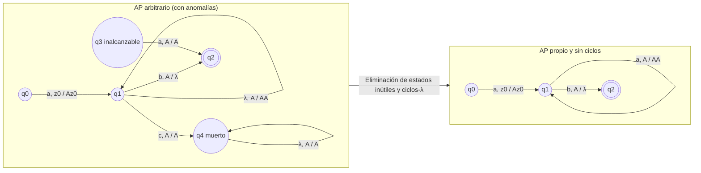
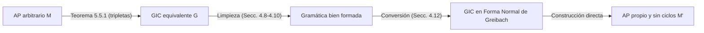

# 5.3 Aceptadores propios y sin ciclos

En la definición general de un autómata con pila no determinista (AFPN) no existe ninguna restricción sobre la estructura de los estados o el uso de transiciones espontáneas ($\lambda$-transiciones). Sin embargo, en aplicaciones prácticas —como el análisis sintáctico en compiladores— y en resultados teóricos fundamentales —como demostrar que todo lenguaje independiente del contexto es **recursivo** (decidible en tiempo finito al simular el AFPN en una Máquina de Turing; véase De Castro Korgi, 2004, Secc. 6.6.2, pp. 187–188)—, un autómata arbitrario puede presentar anomalías graves: configuraciones inútiles y **ciclos infinitos sin consumo de entrada**.

Para garantizar un comportamiento limpio, eficiente y de **terminación asegurada**, es necesario estudiar las condiciones bajo las cuales un aceptador *pushdown* es **propio** y **sin ciclos** (*loop-free*).

---

## Configuraciones improductivas y anomalías estructurales

Dado un AFPN $M = (Q, q_0, F, \Sigma, \Gamma, z_0, \Delta)$ (o su variante por pila vacía $M = (Q, q_0, \Sigma, \Gamma, z_0, \Delta)$), distinguimos las siguientes anomalías:

1. **Estados inalcanzables:** Un estado $q \in Q$ es *inalcanzable* si no existe ninguna cadena $w \in \Sigma^*$ ni contenido de pila $\alpha \in \Gamma^*$ tales que:

$$(q_0, w, z_0) \vdash_M^* (q, \lambda, \alpha).$$

2. **Estados muertos (no co-alcanzables):** Un estado $q \in Q$ es *muerto* (o improductivo) si desde ninguna configuración de la forma $(q, u, \alpha)$ —con $u \in \Sigma^*$ y $\alpha \in \Gamma^+$— es posible alcanzar una configuración de aceptación (esto es, $(p, \lambda, \beta)$ con $p \in F$ en aceptación por estado final, o $(p, \lambda, \lambda)$ en aceptación por pila vacía). Un caso típico es un **estado trampa** sin salida hacia $F$.
3. **Símbolos y transiciones inútiles:** Un símbolo de pila $X \in \Gamma$ o una transición $(p, \gamma) \in \Delta(q, a, A)$ es *inútil* si nunca interviene en ningún cómputo exitoso que conduzca desde $(q_0, w, z_0)$ hasta una configuración de aceptación.
4. **Ciclos de transiciones-$\lambda$ (bucles-$\lambda$):** Ocurren cuando el autómata puede encadenar una sucesión no vacía de pasos espontáneos (sin leer símbolos de la cinta) regresando al mismo estado de control de forma indefinida. Formalmente, existe un **ciclo-$\lambda$** si para algún $q \in Q$ y $\alpha, \beta \in \Gamma^+$ se verifica:

$$(q, \lambda, \alpha) \vdash_M^+ (q, \lambda, \beta)$$

de tal manera que dicha secuencia pueda reiterarse arbitrariamente (por ejemplo, si $\beta$ comienza nuevamente con el prefijo activo $\alpha$, o si tras un ciclo completo la configuración de pila permite repetir la misma sucesión de $\lambda$-transiciones).

Entre los ciclos-$\lambda$ sobresalen dos variantes patológicas:
- **Ciclo-$\lambda$ estacionario (de pila constante):** $(q, \lambda, A) \vdash_M^+ (q, \lambda, A)$. El autómata transita por un ciclo de estados manteniendo el mismo tope $A$ y sin avanzar sobre la cinta de entrada.
- **Ciclo-$\lambda$ creciente (explosión de pila):** $(q, \lambda, A) \vdash_M^+ (q, \lambda, \gamma A)$ con $\lvert \gamma \rvert \ge 1$ (o mediante una sucesión de inserciones y extracciones que aumenta periódicamente la altura de la pila). Esto ocurre de manera natural al simular sin cuidado una gramática con **recursividad por la izquierda** ($A \to A\alpha$).

---

## Definición de aceptadores propios y sin ciclos

Aunque la terminología varía ligeramente entre autores de teoría de lenguajes y análisis sintáctico (Hopcroft et al., 2007; Harrison, 1978; Lewis & Papadimitriou, 1998), las propiedades de buena formación de un aceptador *pushdown* se formalizan como sigue:

### Aceptador pushdown propio (reducido)
Un aceptador *pushdown* $M$ se denomina **propio** (o *reducido*) si satisface las siguientes condiciones de limpieza estructural:
1. **Alcanzabilidad:** Todo estado $q \in Q$ es alcanzable desde la configuración inicial $(q_0, w, z_0)$ para alguna entrada $w \in \Sigma^*$.
2. **Co-alcanzabilidad (productividad):** Todo estado $q \in Q$ y todo símbolo de pila $X \in \Gamma$ participan en al menos un cómputo de aceptación (no existen estados muertos ni símbolos de pila inútiles).
3. **Comportamiento bien acotado de pila:** En cada paso computacional, $\Delta$ reemplaza el tope por una cadena de longitud finita acotada, y no existen configuraciones improductivas ni ciclos triviales que impidan el progreso hacia el vaciado o la aceptación.

### Aceptador pushdown sin ciclos (*loop-free*)
Un aceptador *pushdown* $M$ se denomina **sin ciclos** (*loop-free* o *cycle-free*) si **no admite cómputos infinitos** sobre ninguna cadena de entrada $w \in \Sigma^*$. Equivalentemente, existe una función computable (de hecho, acotada linealmente en $\lvert w \rvert$ tras normalización) tal que toda rama de cómputo desde $(q_0, w, z_0)$ ejecuta **como máximo un número finito de pasos** antes de aceptar o abortar; en particular, no existe ninguna cadena infinita de transiciones-$\lambda$:

$$(q_1, \lambda, \alpha_1) \vdash_M (q_2, \lambda, \alpha_2) \vdash_M (q_3, \lambda, \alpha_3) \vdash_M \cdots$$

Un caso especialmente deseable de aceptador sin ciclos es el **AP en tiempo real (o libre de $\lambda$-transiciones)**, en el que toda transición consume exactamente un símbolo de la cinta de entrada ($\Delta(q, \lambda, A) = \emptyset$ para todo $q \in Q, A \in \Gamma$, excepto eventualmente una transición inicial para aceptar $\lambda$). En un autómata de este tipo, toda rama de cómputo sobre una cadena $w \in \Sigma^+$ tiene una longitud **exactamente acotada por $\lvert w \rvert$**.

---

## Eliminación de bucles-$\lambda$ y garantía de terminación

Una pregunta natural es si restringir los autómatas con pila a modelos **propios y sin ciclos** reduce la clase de lenguajes que pueden reconocer. La respuesta es **negativa**: todo lenguaje independiente del contexto posee un aceptador *pushdown* propio, sin ciclos e incluso libre de transiciones-$\lambda$ (salvo eventualmente para reconocer la cadena vacía $\lambda$).

### Método constructivo mediante gramáticas bien formadas y Forma Normal de Greibach

La demostración constructiva aprovecha el puente entre autómatas con pila y gramáticas independientes del contexto desarrollado en el texto principal (De Castro Korgi, 2004, Secc. 4.8–4.12 y Secc. 6.6.2):

Los pasos del procedimiento son:

1. **Conversión a GIC (Teorema 5.5.1):** A partir de un AFPN arbitrario $M$ (llevado primero a aceptación por pila vacía), se construye una GIC equivalente $G$ tal que $L(G) = L(M)$.
2. **Construcción de una gramática bien formada (De Castro Korgi, Secc. 4.8–4.10):**
   - Se eliminan las **variables no terminables** (que no derivan ninguna cadena de terminales) y después las **variables no alcanzables** desde $S$, en ese estricto orden.
   - Se eliminan las **producciones-$\lambda$** ($A \to \lambda$), salvo posiblemente $S \to \lambda$ cuando $\lambda \in L(G)$ (en cuyo caso se garantiza que $S$ no aparezca en el lado derecho de ninguna producción).
   - Se eliminan las **producciones unitarias** ($A \to B$), que son la fuente directa de ciclos improductivos en las derivaciones.
3. **Transformación a Forma Normal de Greibach (FNG) (De Castro Korgi, Secc. 4.12):** Se convierte la gramática bien formada en una gramática equivalente $G'$ cuyas producciones (salvo posiblemente $S \to \lambda$) tienen todas la forma:

$$A \longrightarrow a B_1 B_2 \cdots B_k \qquad (a \in \Sigma,\ k \ge 0,\ B_i \in V).$$

4. **Construcción del AFPN sin ciclos $M'$:** Definimos $M' = (\{q_0, q_1\}, q_0, \Sigma, V \cup \{z_0\}, z_0, \Delta')$ que acepta por pila vacía (o con un estado adicional $q_2$ si se desea aceptación por estado final):
   - Si $\lambda \in L(G')$, añadimos $(q_1, \lambda) \in \Delta'(q_0, \lambda, z_0)$.
   - Si $S \to a\alpha$ es una producción de $G'$ ($\alpha \in V^*$), añadimos $(q_1, \alpha) \in \Delta'(q_0, a, z_0)$.
   - Para cada producción $A \to a\alpha$ de $G'$ ($A \in V, a \in \Sigma, \alpha \in V^*$), añadimos:

$$(q_1, \alpha) \in \Delta'(q_1, a, A).$$

   - Finalmente, se depuran los estados o símbolos que no participen en ningún cómputo exitoso.

#### Alternativa mediante Forma Normal de Chomsky (FNC)
Como señala De Castro Korgi (2004, Teorema 6.6.2, pp. 187–188), también es posible evitar los bucles infinitos convirtiendo $G$ a **Forma Normal de Chomsky** ($A \to BC$ o $A \to a$, sin producciones-$\lambda$ salvo $S \to \lambda$ y con $S$ no recursiva) y aplicando la construcción estándar de la Sección 5.4. En ese autómata sí existen transiciones-$\lambda$ ($A \to BC$ expande la pila), pero como en FNC las derivaciones de una cadena de longitud $n \ge 1$ tienen exactamente $2n - 1$ pasos y cada símbolo en pila produce al menos un terminal, es imposible que la altura de la pila crezca más allá de $n$ símbolos útiles sin leer entrada, por lo que **ninguna rama entra jamás en un bucle infinito**.

### Teorema (Terminación garantizada en tiempo finito)
Todo lenguaje independiente del contexto $L$ es aceptado por un AFPN $M'$ propio y sin ciclos cuya ejecución sobre cualquier cadena $w \in \Sigma^*$ de longitud $n = \lvert w \rvert$ termina en un número finito de pasos por rama (exactamente $n$ pasos cuando $M'$ proviene de FNG y $n \ge 1$).

**Justificación.** En el autómata $M'$ obtenido desde FNG, toda transición desde $q_1$ (y desde $q_0$ para $n \ge 1$) lee **obligatoriamente** un símbolo terminal $a \in \Sigma$ sobre la cinta de entrada y reduce la longitud restante de la entrada en $1$. En consecuencia, tras a lo sumo $n$ pasos computacionales, la cinta de entrada queda completamente leída, no quedan $\lambda$-transiciones aplicables y cada rama del árbol de cómputo necesariamente ha aceptado o se ha detenido. Esto garantiza que la pertenencia $w \in L(M')$ sea **decidible en tiempo finito**.

---

## Ejemplos paso a paso

### Ejemplo 1: Diagnóstico y depuración de un AFPN con estados inútiles y bucles-$\lambda$

Considere el siguiente AFPN defectuoso $M = (\{q_0, q_1, q_2, q_3, q_4\}, q_0, \{q_2\}, \{a, b\}, \{z_0, A, X\}, z_0, \Delta)$ diseñado defectuosamente para $L = \{a^n b^n : n \ge 1\}$:
1. $\Delta(q_0, a, z_0) = \{(q_0, Az_0)\}$
2. $\Delta(q_0, a, A) = \{(q_0, AA)\}$
3. $\Delta(q_0, \lambda, A) = \{(q_0, AA), (q_0, A)\}$ *(bucle-$\lambda$ creciente y estacionario)*
4. $\Delta(q_0, b, A) = \{(q_1, \lambda)\}$, $\Delta(q_1, b, A) = \{(q_1, \lambda)\}$
5. $\Delta(q_1, \lambda, z_0) = \{(q_2, z_0)\}$
6. $\Delta(q_0, b, z_0) = \{(q_4, Xz_0)\}$, $\Delta(q_4, a, X) = \{(q_4, X)\}$, $\Delta(q_4, b, X) = \{(q_4, X)\}$ *(estado trampa muerto)*
7. $\Delta(q_3, a, z_0) = \{(q_2, z_0)\}$ *(estado inalcanzable)*

**Análisis de anomalías sobre la entrada $w = ab$:**
- **Bucle infinito en una rama:** Al leer la primera `a`, se entra a $(q_0, b, Az_0)$. La regla 3 habilita el cómputo infinito:

$$(q_0, b, Az_0) \vdash (q_0, b, AAz_0) \vdash (q_0, b, AAAz_0) \vdash \cdots$$

  Si un simulador explora esa rama sin acotar la profundidad, nunca terminará. Además, la regla 3 rompe la corrección del lenguaje al permitir generar $A$ arbitrarias sin leer $a$'s, haciendo que acepte `abb`.
- **Estado inalcanzable:** $q_3$ no aparece como destino de ninguna transición alcanzable desde $q_0$.
- **Estado muerto y símbolo inútil:** Una vez en $q_4$, ninguna transición conduce a $q_2 \in F$; por tanto, $q_4$ y el símbolo $X \in \Gamma$ son improductivos.

**Depuración a un aceptador propio y sin ciclos $M'$:**
Suprimimos la transición espuria 3 (el bucle-$\lambda$), el estado inalcanzable $q_3$, el estado muerto $q_4$ y el símbolo $X$. Obtenemos $M' = (\{q_0, q_1, q_2\}, q_0, \{q_2\}, \{a, b\}, \{z_0, A\}, z_0, \Delta')$ con las reglas 1, 2, 4 y 5 únicamente.

Verificación de propiedades en $M'$:
- Todos los estados $\{q_0, q_1, q_2\}$ son alcanzables y co-alcanzables (por ejemplo, $(q_0, ab, z_0) \vdash (q_0, b, Az_0) \vdash (q_1, \lambda, z_0) \vdash (q_2, \lambda, z_0)$).
- La única transición-$\lambda$ es $\Delta'(q_1, \lambda, z_0) = \{(q_2, z_0)\}$, y como $q_2$ carece de transiciones salientes, no puede formar ningún ciclo-$\lambda$.
- Toda entrada $w$ de longitud $n$ termina en a lo sumo $n + 1$ pasos.

---

### Ejemplo 2: Eliminación de bucles-$\lambda$ por recursividad izquierda vía Forma Normal de Greibach

Considere la gramática independiente del contexto:

$$G : S \longrightarrow Sa \mid b$$

que genera el lenguaje regular $b a^*$. Si construimos directamente el analizador *pushdown* descendente estándar (Secc. 5.4), obtenemos el estado $q_1$ con las reglas de expansión:

$$\Delta(q_1, \lambda, S) = \{(q_1, Sa), (q_1, b)\}, \qquad \Delta(q_1, a, a) = \{(q_1, \lambda)\}, \qquad \Delta(q_1, b, b) = \{(q_1, \lambda)\}.$$

**Problema (bucle-$\lambda$ creciente):** Al procesar cualquier cadena —por ejemplo $w = baa$— existe una rama infinita sin consumo de entrada:

$$(q_1, baa, S) \vdash (q_1, baa, Sa) \vdash (q_1, baa, Saa) \vdash (q_1, baa, Saaa) \vdash \cdots$$

**Solución paso a paso (eliminación de recursividad izquierda y FNG):**
1. Aplicamos el Teorema de eliminación de la recursividad por la izquierda (De Castro Korgi, Teorema 4.12.2, p. 120) con $\beta_1 = b$ y $\alpha_1 = a$, introduciendo la nueva variable $Z$:

$$S \longrightarrow b \mid bZ$$
$$Z \longrightarrow a \mid aZ$$

2. Observamos que $G'$ ya se encuentra en **Forma Normal de Greibach**: no tiene variables inútiles, no tiene producciones-$\lambda$ y toda producción comienza por un terminal seguido únicamente de variables.
3. Construimos el aceptador por pila vacía $M' = (\{q_0, q_1\}, q_0, \{a, b\}, \{S, Z, z_0\}, z_0, \Delta')$ sin ninguna transición-$\lambda$:
   - De $S \to b \mid bZ$: $\Delta'(q_0, b, z_0) = \{(q_1, \lambda), (q_1, Z)\}$.
   - De $Z \to a \mid aZ$: $\Delta'(q_1, a, Z) = \{(q_1, \lambda), (q_1, Z)\}$.

**Tabla de traza exitosa de $w = baa$ en $M'$ (exactamente $\lvert w \rvert = 3$ pasos, sin ciclos-$\lambda$):**

| Paso | Estado actual | Entrada restante | Tope de pila | Transición aplicada | Nueva pila | Siguiente estado |
| :---: | :---: | :--- | :---: | :--- | :--- | :---: |
| 0 | $q_0$ | `baa` | $z_0$ | Inicial | $z_0$ | $q_0$ |
| 1 | $q_0$ | `aa` | $z_0$ | $(q_1, Z) \in \Delta'(q_0, b, z_0)$ | $Z$ | $q_1$ |
| 2 | $q_1$ | `a` | $Z$ | $(q_1, Z) \in \Delta'(q_1, a, Z)$ | $Z$ | $q_1$ |
| 3 | $q_1$ | $\lambda$ | $Z$ | $(q_1, \lambda) \in \Delta'(q_1, a, Z)$ | $\lambda$ (pila vacía) | $q_1$ (**Acepta**) |

La alternativa fallida del paso 1 habría llevado a $(q_1, aa, \lambda)$, deteniéndose en el paso 1 sin ciclos infinitos.

---

## Ejercicios propuestos

1. **Detección de anomalías:** Sea $M = (\{q_0, q_1, q_2, q_3\}, q_0, \{q_2\}, \{0, 1\}, \{z_0, A, B\}, z_0, \Delta)$ con:
   $\Delta(q_0, 0, z_0) = \{(q_0, Az_0)\}$, $\Delta(q_0, 0, A) = \{(q_0, AA)\}$, $\Delta(q_0, \lambda, A) = \{(q_1, A)\}$, $\Delta(q_1, \lambda, A) = \{(q_0, A)\}$, $\Delta(q_1, 1, A) = \{(q_1, \lambda)\}$, $\Delta(q_1, \lambda, z_0) = \{(q_2, z_0)\}$ y $\Delta(q_3, 0, B) = \{(q_2, B)\}$.
   Identifique los estados inalcanzables, los símbolos de pila inútiles y el ciclo-$\lambda$, y construya un aceptador equivalente propio y sin ciclos.
2. **Eliminación de bucles en gramáticas con ciclos unitarios:** Considere la gramática $G : S \to A \mid aSb,\ A \to S \mid \lambda$. Explique qué ciclo-$\lambda$ produce su analizador *pushdown* ingenuo sobre la cadena `ab`. Transforme $G$ a una gramática bien formada (eliminando producciones-$\lambda$ y producciones unitarias) y luego a FNG, y construya el AFPN sin ciclos resultante.
3. **Cota de pasos en FNC vs. FNG:** Suponga que $G$ es una GIC en Forma Normal de Chomsky (sin $S \to \lambda$) y que $M$ es su AFPN descendente de 3 estados (Secc. 5.4). Demuestre que para cualquier cadena $w \in \Sigma^*$ de longitud $n \ge 1$, todo cómputo válido que consuma $w$ ejecuta exactamente $n$ emparejamientos de terminales y a lo sumo $n - 1$ expansiones de variables (si la pila no supera $n$ símbolos), por lo que $M$ es libre de ciclos.
4. **Propiedad propia:** Dé un ejemplo de un AFPN $M$ que sea **sin ciclos**, pero **no sea propio** (contenga al menos un estado muerto que sí sea alcanzable desde $q_0$), y muestre cómo suprimir dicho estado sin alterar $L(M)$.

## Referencias

- De Castro Korgi, R. (2004). *Teoría de la computación: Lenguajes, autómatas, gramáticas* (Cap. 4, Secc. 4.8–4.12, pp. 102–124; Cap. 6, Secc. 6.6.2, pp. 186–188). Universidad Nacional de Colombia.
- Harrison, M. A. (1978). *Introduction to formal language theory*. Addison-Wesley.
- Hopcroft, J. E., Motwani, R., & Ullman, J. D. (2007). *Introducción a la teoría de autómatas, lenguajes y computación* (3.ª ed., Cap. 6 y Cap. 7). Pearson Educación.
- Lewis, H. R., & Papadimitriou, C. H. (1998). *Elements of the theory of computation* (2.ª ed.). Prentice Hall.
