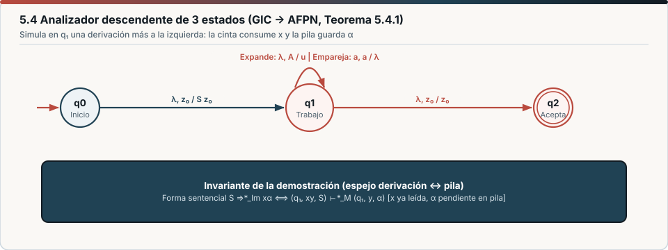
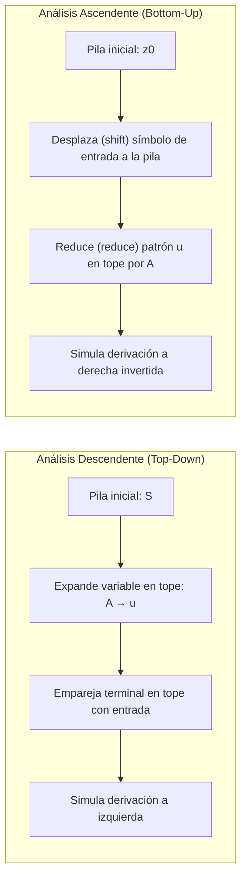
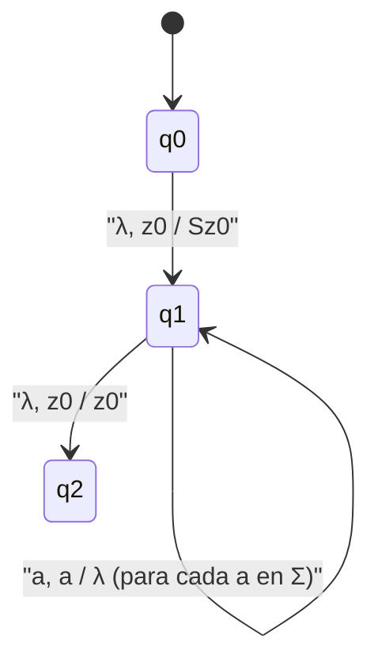
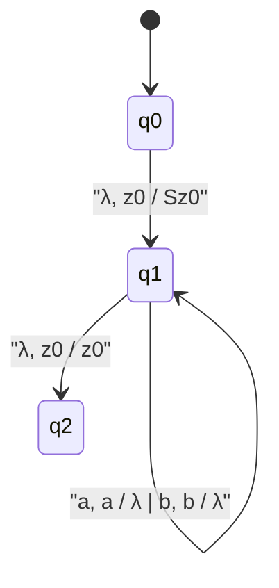
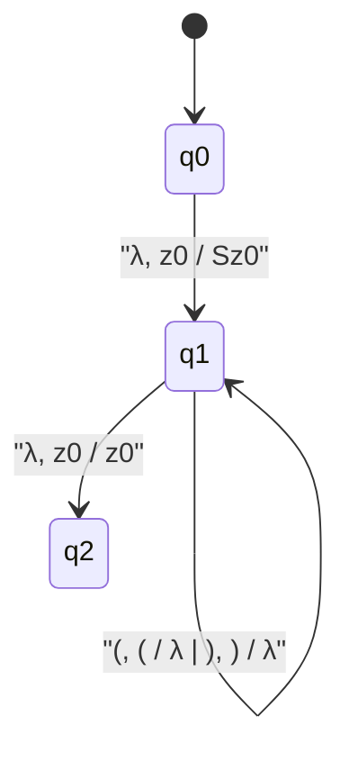

# 5.4 Aceptadores "pushdown" para lenguajes independientes al contexto

Uno de los pilares fundamentales de la teoría de la computación afirma que la clase de los **lenguajes independientes del contexto (LIC)** coincide exactamente con la clase de los lenguajes aceptados por **autómatas con pila no deterministas (AFPN)**:

$$\text{LIC} = \mathcal{L}(\text{AFPN}).$$

Este resultado desempeña para los lenguajes de Tipo 2 el mismo papel unificador que el Teorema de Kleene desempeña para los lenguajes regulares (Tipo 3). En esta sección demostramos la primera dirección de la equivalencia: dada cualquier gramática independiente del contexto $G$, siempre es posible construir sistemáticamente un AFPN $M$ tal que $L(M) = L(G)$. Más allá de su valor teórico, esta construcción constituye el fundamento algorítmico de los **analizadores sintácticos** en compiladores e intérpretes (De Castro Korgi, 2004, Secc. 5.4, pp. 157–160; Acevedo Juárez, 2006, Secc. 3.9.1, pp. 113–117).

---

## 5.4.1 Análisis de sintaxis

En el diseño de compiladores, el **análisis sintáctico** (*parsing*) tiene como objetivo verificar si una secuencia de componentes léxicos (*tokens*) $w \in \Sigma^*$ generada por el analizador léxico pertenece al lenguaje $L(G)$ definido por una gramática independiente del contexto $G$ y, en caso afirmativo, reconstruir implícita o explícitamente su árbol de derivación.

Debido a que una derivación posee una estructura jerárquica y anidada, el analizador requiere una pila para recordar las metas sintácticas pendientes o los fragmentos ya reconocidos. Existen dos grandes paradigmas de análisis sintáctico con pila:

1. **Análisis descendente (*top-down* o predictivo):**
   - Parte de la raíz del árbol sintáctico (el símbolo inicial $S$) y trata de construir una **derivación más a la izquierda** hacia las hojas (los terminales de $w$).
   - La pila almacena la parte aún pendiente de la forma sentencial: inicialmente contiene $S$; cuando el tope de la pila es un no terminal $A$, el autómata lo **expande** sustituyéndolo por el cuerpo $u$ de alguna producción $A \to u$; cuando el tope es un terminal $a$, lo **empareja** con el símbolo actual de la cinta de entrada y avanza sobre la entrada.
   - Es la base de los analizadores predictivos conocidos en cursos posteriores de compiladores como **LL($k$)** y de descenso recursivo (que leen de izquierda a derecha eligiendo la regla adecuada).

2. **Análisis ascendente (*bottom-up* o desplazamiento-reducción / *shift-reduce*):**
   - Parte de la cadena de entrada $w$ (las hojas del árbol) y trata de reconstruir en sentido inverso una **derivación más a la derecha** hasta llegar a $S$.
   - Alterna dos acciones principales sobre la pila: **desplazar (*shift*)**, que consiste en leer el siguiente símbolo de la entrada y apilarlo; y **reducir (*reduce*)**, que consiste en reconocer en el tope de la pila el lado derecho $u$ de una producción $A \to u$ y sustituirlo por la variable cabeza $A$.
   - La aceptación ocurre cuando se ha consumido toda la entrada y en la pila únicamente queda el símbolo inicial $S$ (sobre el marcador de fondo $z_0$).
   - Es la base de familias industriales de analizadores (como **LR($k$)**, **SLR** y **LALR**, que estudiarás a fondo en la materia de Compiladores).

| Criterio | Análisis descendente (*top-down*) | Análisis ascendente (*bottom-up*) |
| :--- | :--- | :--- |
| **Dirección de construcción del árbol** | De la raíz $S$ hacia las hojas $w$ | De las hojas $w$ hacia la raíz $S$ |
| **Derivación simulada** | Derivación más a la izquierda | Derivación más a la derecha (en reverso) |
| **Operación típica de pila** | Expansión ($\lambda, A / u$) y emparejamiento ($a, a / \lambda$) | Desplazamiento ($a, \text{tope} / a\text{tope}$) y reducción ($\lambda, u^R / A$) |
| **Número de estados (versión AFPN)** | Constante ($3$ estados en De Castro Korgi) | Variable según patrones de reducción |
| **Familias deterministas (en Compiladores)** | Analizadores tipo LL | Analizadores tipo LR / SLR / LALR |

---

## 5.4.2 Construcción de analizadores de sintaxis "pushdown"

Presentamos ahora la construcción clásica de tipo **descendente** expuesta por De Castro Korgi (2004, Teorema 5.4.1, pp. 157–158), la cual produce un AFPN con únicamente **tres estados**, sin importar cuántas variables o producciones tenga la gramática.

### Teorema (De Castro Korgi, Teorema 5.4.1)
Dada una gramática independiente del contexto $G = (V, \Sigma, P, S)$ (denotada $(\Sigma, V, S, P)$ en De Castro Korgi, 2004), existe un autómata finito con pila no determinista $M$ tal que $L(M) = L(G)$.

### Algoritmo de construcción (AFPN de 3 estados por estado final)

A partir de $G = (V, \Sigma, P, S)$ construimos $M = (Q, q_0, F, \Sigma, \Gamma, z_0, \Delta)$ de la siguiente manera:
- **Estados:** $Q = \{q_0, q_1, q_2\}$.
- **Estado inicial:** $q_0$.
- **Conjunto de estados de aceptación:** $F = \{q_2\}$.
- **Alfabeto de entrada:** $\Sigma$ (los terminales de $G$).
- **Alfabeto de pila:** $\Gamma = \Sigma \cup V \cup \{z_0\}$, donde $z_0 \notin \Sigma \cup V$ es el marcador de fondo.
- **Función de transición $\Delta$:**
  1. **Inicialización:** Colocar el símbolo inicial $S$ en el tope de la pila mediante una transición espontánea:
     $$\Delta(q_0, \lambda, z_0) = \{(q_1, S z_0)\}.$$
  2. **Expansión (simulación de derivaciones):** Para cada variable $A \in V$, sin consumir símbolos de la cinta de entrada:
     $$\Delta(q_1, \lambda, A) = \{(q_1, u) : (A \to u) \in P\}.$$
     *(Si $A \to \lambda \in P$, se incluye $(q_1, \lambda) \in \Delta(q_1, \lambda, A)$, lo cual simplemente desapila $A$.)*
  3. **Emparejamiento (consumo de terminales):** Para cada símbolo terminal $a \in \Sigma$:
     $$\Delta(q_1, a, a) = \{(q_1, \lambda)\}.$$
  4. **Aceptación:** Al descubrir nuevamente el marcador de fondo $z_0$ en $q_1$:
     $$\Delta(q_1, \lambda, z_0) = \{(q_2, z_0)\}.$$

> **Convención de orden en la pila:** Cuando una transición $(q_1, u) \in \Delta(q_1, \lambda, A)$ sustituye el tope $A$ por $u = X_1 X_2 \cdots X_m$, los símbolos se apilan de modo que $X_1$ (el símbolo más a la izquierda de $u$) quede en el **tope superior** de la pila. De este modo, $M$ inspecciona siempre los símbolos de izquierda a derecha, garantizando que toda variable en el tope corresponda a la **variable más a la izquierda** de la forma sentencial actual.

*Observación:* Si se prefiere la variante de **aceptación por pila vacía** con un único estado $q_1$ (como en Hopcroft et al., 2007, Teorema 6.13), basta tomar $M_{\text{vac}} = (\{q_1\}, q_1, \Sigma, \Sigma \cup V, S, \Delta_{\text{vac}})$ usando $S$ como símbolo inicial de pila y conservando únicamente las reglas 2 y 3. En tal caso, el procesamiento en $q_1$ coincide exactamente con la fase intermedia del modelo de 3 estados de De Castro Korgi.

---

## 5.4.3 Prueba de la construcción

Demostramos rigurosamente que el AFPN $M$ construido en la Sección 5.4.2 satisface $L(M) = L(G)$.

### Reducción a la fase de trabajo en $q_1$

Examinando la estructura de $M$:
- Desde $q_0$ solo existe la transición $\Delta(q_0, \lambda, z_0) = \{(q_1, S z_0)\}$.
- Desde $q_2 \in F$ no existe ninguna transición saliente.
- En $q_1$, ninguna transición sobre $\Sigma \cup V$ accede ni modifica $z_0$, y la única transición que consulta $z_0$ es $\Delta(q_1, \lambda, z_0) = \{(q_2, z_0)\}$.

Por tanto, $w \in L(M)$ si y solo si existe un cómputo completo:

$$(q_0, w, z_0) \vdash_M (q_1, w, S z_0) \vdash_M^* (q_1, \lambda, z_0) \vdash_M (q_2, \lambda, z_0),$$

lo cual es equivalente a que en la fase intermedia en $q_1$ (ignorando el marcador pasivo $z_0$ del fondo) se cumpla $(q_1, w, S) \vdash_M^* (q_1, \lambda, \lambda)$.

En consecuencia, el Teorema 5.4.1 se deduce directamente de la siguiente equivalencia fundamental:

### Teorema de equivalencia en $q_1$
Para toda cadena $w \in \Sigma^*$:

$$S \Rightarrow_{lm}^* w \iff (q_1, w, S) \vdash_M^* (q_1, \lambda, \lambda),$$

donde $\Rightarrow_{lm}^*$ denota una **derivación más a la izquierda** en $G$.

### Demostración por inducción

> **Guía de lectura (idea intuitiva antes de la prueba formal):** En cada momento de una derivación más a la izquierda, la cadena tiene una parte ya terminada a la izquierda (puros terminales $x$) y una parte aún por expandir a la derecha ($\alpha$, que empieza con una variable $A$). El autómata $M$ hace exactamente un espejo de este proceso: la parte $x$ ya fue leída y consumida de la cinta de entrada, mientras que la parte pendiente $\alpha$ es precisamente lo que está guardado en la pila. Cada regla $A \to u$ reemplaza el tope $A$ por $u$, y cada terminal al frente de la pila se empareja con la cinta.

#### Dirección 1 ($\implies$): Si $S \Rightarrow_{lm}^* w$, entonces $(q_1, w, S) \vdash_M^* (q_1, \lambda, \lambda)$.

Demostraremos un lema más fuerte por inducción sobre el número de pasos $k \ge 0$ de una derivación a izquierda $S \Rightarrow_{lm}^k \gamma$. Toda forma sentencial $\gamma \in (V \cup \Sigma)^*$ se descompone de manera única como $\gamma = x\alpha$, donde $x \in \Sigma^*$ es el **prefijo maximal de terminales** de $\gamma$ y $\alpha$ es el resto (de modo que $\alpha = \lambda$ si $\gamma \in \Sigma^*$, o bien el primer símbolo de $\alpha$ es una variable $A \in V$).

**Lema 1:** Si $S \Rightarrow_{lm}^k x\alpha$ con $x \in \Sigma^*$ y $\alpha \in \{\lambda\} \cup V(V \cup \Sigma)^*$, entonces para toda cadena $y \in \Sigma^*$ se verifica:

$$(q_1, xy, S) \vdash_M^* (q_1, y, \alpha).$$

- **Caso base ($k = 0$):** $\gamma = S$. Aquí $x = \lambda$ y $\alpha = S$. Para todo $y \in \Sigma^*$, se cumple trivialmente en cero pasos $(q_1, y, S) \vdash_M^0 (q_1, y, S)$.
- **Paso inductivo ($k \ge 1$):** Supongamos el lema cierto para $k - 1$ pasos y sea $S \Rightarrow_{lm}^{k-1} \gamma' \Rightarrow_{lm} \gamma = x\alpha$. Como $\gamma'$ sufre una derivación, contiene al menos una variable; descomponiendo $\gamma'$ en su prefijo maximal de terminales $x' \in \Sigma^*$ y su sufijo que inicia con su variable más a la izquierda $A \in V$, escribimos $\gamma' = x' A \beta$.
  Por hipótesis de inducción aplicada a $\gamma'$ con la cadena auxiliar $vy$ (a determinar), se tiene:

  $$(q_1, x'vy, S) \vdash_M^* (q_1, vy, A\beta).$$

  En el paso $k$-ésimo se aplica alguna producción $A \to u \in P$, de modo que $\gamma = x' u \beta$. Descomponemos $u\beta = v\alpha$, donde $v \in \Sigma^*$ es el prefijo maximal de terminales de $u\beta$ y $\alpha \in \{\lambda\} \cup V(V \cup \Sigma)^*$. Así, $x = x'v$ es el prefijo maximal de terminales de $\gamma$.
  Partiendo de la configuración obtenida por la hipótesis de inducción, aplicamos primero la transición de expansión $(q_1, u) \in \Delta(q_1, \lambda, A)$ y luego $\lvert v \rvert$ transiciones de emparejamiento $\Delta(q_1, a, a) = \{(q_1, \lambda)\}$ para consumir cada terminal de $v$:

  $$(q_1, xy, S) = (q_1, x'vy, S) \vdash_M^* (q_1, vy, A\beta) \vdash_M (q_1, vy, u\beta) = (q_1, vy, v\alpha) \vdash_M^{\lvert v \rvert} (q_1, y, \alpha).$$

  Esto completa la inducción.

Tomando finalmente $\gamma = w \in \Sigma^*$ (por lo que $x = w$, $\alpha = \lambda$) y $y = \lambda$ en el Lema 1, concluimos que $S \Rightarrow_{lm}^* w$ implica $(q_1, w, S) \vdash_M^* (q_1, \lambda, \lambda)$.

---

#### Dirección 2 ($\Longleftarrow$): Si $(q_1, w, S) \vdash_M^* (q_1, \lambda, \lambda)$, entonces $S \Rightarrow_{lm}^* w$.

Probaremos por inducción sobre el número de pasos computacionales $n \ge 0$ (sin tocar $z_0$) la siguiente afirmación general:

**Lema 2:** Para cualesquiera $w \in \Sigma^*$ y $\alpha \in (V \cup \Sigma)^*$, si $(q_1, w, S) \vdash_M^n (q_1, \lambda, \alpha)$, entonces $S \Rightarrow_{lm}^* w\alpha$.

- **Caso base ($n = 0$):** En cero pasos debe cumplirse $w = \lambda$ y $\alpha = S$. Por tanto, $w\alpha = S$, y $S \Rightarrow_{lm}^0 S$ es inmediato.
- **Paso inductivo ($n \ge 1$):** Supongamos cierto el lema para $n - 1$ pasos y consideremos un cómputo de longitud $n$, aislando su último paso:

  $$(q_1, w, S) \vdash_M^{n-1} (q_1, u, \beta) \vdash_M (q_1, \lambda, \alpha).$$

  Analizamos los dos tipos posibles de transición ejecutados en el paso $n$-ésimo:
  - **Caso A (Emparejamiento de un terminal):** En el último paso se aplica $\Delta(q_1, a, a) = \{(q_1, \lambda)\}$ para algún $a \in \Sigma$. Esto exige que $u = a$ y $\beta = a\alpha$, de modo que $w = w'a$ para algún $w' \in \Sigma^*$. Como la porción final $a$ de la entrada no ha sido leída durante los primeros $n - 1$ pasos, al suprimir dicha $a$ pendiente obtenemos un cómputo válido de $n - 1$ pasos:
    $$(q_1, w', S) \vdash_M^{n-1} (q_1, \lambda, a\alpha).$$
    Por hipótesis de inducción, $S \Rightarrow_{lm}^* w'(a\alpha) = (w'a)\alpha = w\alpha$.
  - **Caso B (Expansión de una variable):** En el último paso se aplica $(q_1, \delta) \in \Delta(q_1, \lambda, A)$ para alguna producción $A \to \delta \in P$. Esto exige que $u = \lambda$, $\beta = A\gamma$ y $\alpha = \delta\gamma$ para cierto $\gamma \in (V \cup \Sigma)^*$. Los primeros $n - 1$ pasos forman entonces:
    $$(q_1, w, S) \vdash_M^{n-1} (q_1, \lambda, A\gamma).$$
    Por hipótesis de inducción, $S \Rightarrow_{lm}^* w A \gamma$. Como $w \in \Sigma^*$ está compuesta exclusivamente por símbolos terminales, la ocurrencia exhibida de $A$ es **necesariamente la variable más a la izquierda** en la forma sentencial $w A \gamma$. Aplicando la producción $A \to \delta$, resulta una derivación a izquierda válida:
    $$S \Rightarrow_{lm}^* w A \gamma \Rightarrow_{lm} w \delta \gamma = w \alpha.$$

Esto completa la inducción. Tomando $\alpha = \lambda$ en el Lema 2, se obtiene que $(q_1, w, S) \vdash_M^* (q_1, \lambda, \lambda)$ implica $S \Rightarrow_{lm}^* w$.

Finalmente, recordando que en toda GIC una cadena $w \in \Sigma^*$ pertenece a $L(G)$ si y solo si admite al menos una derivación más a la izquierda $S \Rightarrow_{lm}^* w$, concluimos:

$$w \in L(G) \iff S \Rightarrow_{lm}^* w \iff (q_1, w, S) \vdash_M^* (q_1, \lambda, \lambda) \iff (q_0, w, z_0) \vdash_M^* (q_2, \lambda, z_0) \iff w \in L(M). \quad \blacksquare$$

---

## Ejemplos paso a paso

### Ejemplo 1: Analizador *pushdown* completo (De Castro Korgi, 2004, p. 158)

Considere la gramática independiente del contexto $G = (\{S, A, B\}, \{a, b\}, P, S)$ con producciones:

$$S \longrightarrow aAbS \mid bBa \mid \lambda, \qquad A \longrightarrow aA \mid a, \qquad B \longrightarrow bB \mid b.$$

Aplicando el algoritmo de la Sección 5.4.2, el AFPN $M = (\{q_0, q_1, q_2\}, q_0, \{q_2\}, \{a, b\}, \{a, b, S, A, B, z_0\}, z_0, \Delta)$ tiene las siguientes transiciones:
- $\Delta(q_0, \lambda, z_0) = \{(q_1, S z_0)\}$
- $\Delta(q_1, \lambda, S) = \{(q_1, aAbS), (q_1, bBa), (q_1, \lambda)\}$
- $\Delta(q_1, \lambda, A) = \{(q_1, aA), (q_1, a)\}$
- $\Delta(q_1, \lambda, B) = \{(q_1, bB), (q_1, b)\}$
- $\Delta(q_1, a, a) = \{(q_1, \lambda)\}$, $\Delta(q_1, b, b) = \{(q_1, \lambda)\}$
- $\Delta(q_1, \lambda, z_0) = \{(q_2, z_0)\}$

Consideremos la cadena $w = aabbba \in L(G)$, cuya derivación más a la izquierda es:

$$S \Rightarrow_{lm} aAbS \Rightarrow_{lm} aabS \Rightarrow_{lm} aabbBa \Rightarrow_{lm} aabbba.$$

**Tabla de traza paso a paso de $w = aabbba$ en $M$:**

| Paso | Estado | Entrada restante | Pila (tope a la izq.) | Transición aplicada | Forma sentencial ($x\alpha$) |
| :---: | :---: | :--- | :--- | :--- | :--- |
| 0 | $q_0$ | `aabbba` | $z_0$ | Config. inicial | — |
| 1 | $q_1$ | `aabbba` | $S z_0$ | $\Delta(q_0, \lambda, z_0) = \{(q_1, Sz_0)\}$ | $S$ |
| 2 | $q_1$ | `aabbba` | $aAbS z_0$ | Expansión $S \to aAbS$ | $aAbS$ |
| 3 | $q_1$ | `abbba` | $AbS z_0$ | Empareja $a$ | $aAbS$ |
| 4 | $q_1$ | `abbba` | $abS z_0$ | Expansión $A \to a$ | $aabS$ |
| 5 | $q_1$ | `bbba` | $bS z_0$ | Empareja $a$ | $aabS$ |
| 6 | $q_1$ | `bba` | $S z_0$ | Empareja $b$ | $aabS$ |
| 7 | $q_1$ | `bba` | $bBa z_0$ | Expansión $S \to bBa$ | $aabbBa$ |
| 8 | $q_1$ | `ba` | $Ba z_0$ | Empareja $b$ | $aabbBa$ |
| 9 | $q_1$ | `ba` | $ba z_0$ | Expansión $B \to b$ | $aabbba$ |
| 10 | $q_1$ | `a` | $a z_0$ | Empareja $b$ | $aabbba$ |
| 11 | $q_1$ | $\lambda$ | $z_0$ | Empareja $a$ | $aabbba$ |
| 12 | $q_2$ | $\lambda$ | $z_0$ | $\Delta(q_1, \lambda, z_0) = \{(q_2, z_0)\}$ | **Acepta** ($q_2 \in F$) |

Obsérvese cómo en todo paso $k$ dentro de $q_1$, la concatenación del prefijo ya consumido $x$ de la entrada con el contenido de la pila (sin $z_0$) reproduce exactamente la forma sentencial de la derivación más a la izquierda.

---

### Ejemplo 2: Analizador *pushdown* para paréntesis balanceados $S \to (S)S \mid \lambda$

Sea $G = (\{S\}, \{\text{(}, \text{)}\}, P, S)$ con $P = \{S \to (S)S,\ S \to \lambda\}$ (De Castro Korgi, 2004, p. 86). Construimos el AFPN $M = (\{q_0, q_1, q_2\}, q_0, \{q_2\}, \{\text{(}, \text{)}\}, \{\text{(}, \text{)}, S, z_0\}, z_0, \Delta)$ con:
- $\Delta(q_0, \lambda, z_0) = \{(q_1, Sz_0)\}$
- $\Delta(q_1, \lambda, S) = \{(q_1, \text{(}S\text{)}S),\ (q_1, \lambda)\}$
- $\Delta(q_1, \text{(}, \text{(}) = \{(q_1, \lambda)\}$, $\Delta(q_1, \text{)}, \text{)}) = \{(q_1, \lambda)\}$
- $\Delta(q_1, \lambda, z_0) = \{(q_2, z_0)\}$

**Tabla de traza de aceptación para $w = \text{(())}$:**

| Paso | Estado | Entrada restante | Pila (tope a la izq.) | Acción / Transición | Forma sentencial equivalente |
| :---: | :---: | :--- | :--- | :--- | :--- |
| 0 | $q_0$ | `(())` | $z_0$ | Config. inicial | — |
| 1 | $q_1$ | `(())` | $S z_0$ | Inicialización | $S$ |
| 2 | $q_1$ | `(())` | `(S)S z_0` | Expansión $S \to (S)S$ | `(S)S` |
| 3 | $q_1$ | `())` | `S)S z_0` | Empareja `(` | `(S)S` |
| 4 | $q_1$ | `())` | `(S)S)S z_0` | Expansión $S \to (S)S$ | `((S)S)S` |
| 5 | $q_1$ | `))` | `S)S)S z_0` | Empareja `(` | `((S)S)S` |
| 6 | $q_1$ | `))` | `)S)S z_0` | Expansión $S \to \lambda$ | `(()S)S` |
| 7 | $q_1$ | `)` | `S)S z_0` | Empareja `)` | `(()S)S` |
| 8 | $q_1$ | `)` | `)S z_0` | Expansión $S \to \lambda$ | `(())S` |
| 9 | $q_1$ | $\lambda$ | `S z_0` | Empareja `)` | `(())S` |
| 10 | $q_1$ | $\lambda$ | $z_0$ | Expansión $S \to \lambda$ | `(())` |
| 11 | $q_2$ | $\lambda$ | $z_0$ | Aceptación sobre $z_0$ | **Acepta** |

Si en cambio se evalúa $w' = \text{(()}$, ninguna secuencia de elecciones no deterministas logra empatar el segundo `)` requerido en la pila tras consumir el primer `(`, por lo que toda rama termina atascada con entrada $\lambda$ y al menos `)S z_0` en la pila, sin poder alcanzar $q_2$ (**rechaza**).

---

## Ejercicios propuestos

1. **Construcción directa y traza:** Construya el AFPN de 3 estados (De Castro Korgi, Teorema 5.4.1) asociado a la gramática $G$:
   $$S \longrightarrow Aba \mid AB \mid \lambda, \qquad A \longrightarrow aAS \mid a, \qquad B \longrightarrow bBA \mid \lambda.$$
   Encuentre una derivación más a la izquierda para $w = aaababa$ y construya la tabla de traza completa en el autómata simulando exactamente dicha derivación.
2. **Comparación con un diseño manual:** Diseñe una GIC con una sola variable para el lenguaje $L = \{a^{2i} b^{3i} : i \ge 0\}$, construya su AFPN mediante el método de la Sección 5.4.2 y compare el número de estados, transiciones y cómputos frente a un AFPD o AFPN diseñado directamente.
3. **Variante de pila vacía con 1 estado:** Reestructure el autómata del Ejemplo 1 para que utilice un único estado $q_1$ y acepte por pila vacía empezando en $(q_1, w, S)$. Verifique su funcionamiento sobre $w = bbaa$ realizando la traza completa.
4. **Ramas de rechazo y bucles potenciales:** Para la gramática $G : S \to aS \mid Sa \mid b$, muestre qué ocurre en su AFPN descendente al evaluar la cadena $w = aba$: exhiba una rama que acepta en un número finito de pasos y una rama que diverge en un bucle-$\lambda$ infinito por culpa de la producción recursiva izquierda $S \to Sa$. ¿Cómo se evita ese bucle usando la Secc. 5.3?

## Referencias

- Acevedo Juárez, A. (2006). *Teoría de la computación* [Tesis de licenciatura, Instituto Tecnológico de Celaya].
- Aho, A. V., Lam, M. S., Sethi, R., & Ullman, J. D. (2008). *Compiladores: Principios, técnicas y herramientas* (2.ª ed.). Pearson Educación.
- De Castro Korgi, R. (2004). *Teoría de la computación: Lenguajes, autómatas, gramáticas* (Cap. 5, Secc. 5.4, pp. 157–159). Universidad Nacional de Colombia.
- Hopcroft, J. E., Motwani, R., & Ullman, J. D. (2007). *Introducción a la teoría de autómatas, lenguajes y computación* (3.ª ed., Cap. 6, Secc. 6.3, pp. 215–218). Pearson Educación.
