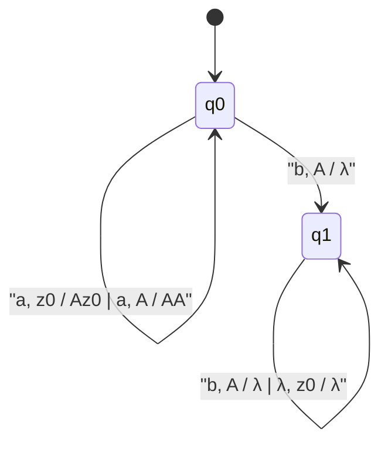

# 5.5 Gramáticas independientes al contexto para aceptadores "pushdown"

En la sección anterior se probó que todo lenguaje generado por una gramática independiente del contexto es aceptado por algún autómata con pila no determinista ($\text{LIC} \subseteq \mathcal{L}(\text{AFPN})$). Para completar la caracterización algebraico-computacional de los lenguajes de Tipo 2, debemos demostrar la afirmación recíproca: **todo lenguaje aceptado por un AFPN es generado por alguna gramática independiente del contexto** ($\mathcal{L}(\text{AFPN}) \subseteq \text{LIC}$).

Por el Teorema de equivalencia entre criterios de aceptación (Secc. 5.2 / De Castro Korgi, Teorema 5.3.2), cualquier lenguaje aceptado por un AFPN por estado final es también aceptado por algún AFPN que **acepta por pila vacía**, es decir, $L = N(M)$. Esta formulación simplifica notablemente la traducción a una gramática, pues el momento de aceptación coincide exactamente con el instante en que la pila queda vacía tras extraer su último símbolo.

---

## Construcción inversa: método de variables triples

### Teorema (De Castro Korgi, Teorema 5.5.1, p. 160)
Dado un AFPN $M = (Q, q_0, \Sigma, \Gamma, z_0, \Delta)$ que acepta por pila vacía, existe una gramática independiente del contexto $G = (V, \Sigma, P, S)$ tal que $L(G) = N(M)$.

### Definición de $G$ mediante variables triples $[q, A, p]$

Para capturar cómo el autómata vacía un símbolo de la pila mientras transita entre estados de control, se introducen **variables triples** de la forma $[q, A, p]$ (abreviadas simplemente como $[qAp]$ en De Castro Korgi, 2004, p. 160), donde $q, p \in Q$ y $A \in \Gamma$.

> **Significado intuitivo de $[q, A, p]$:** La variable $[q, A, p]$ genera exactamente aquellas cadenas terminales $w \in \Sigma^*$ que permiten a $M$ pasar del estado $q$ al estado $p$ **vaciando por completo** el símbolo $A$ inicialmente situado en el tope de la pila (sin consultar nada por debajo de $A$):
>
> $$[q, A, p] \Rightarrow_G^* w \iff (q, w, A) \vdash_M^* (p, \lambda, \lambda).$$

Formalmente, la gramática $G = (V, \Sigma, P, S)$ se construye así:
- **Terminales:** $\Sigma$ (el alfabeto de entrada de $M$).
- **Variables:** $V = \{S\} \cup \{[q, A, p] : q, p \in Q,\ A \in \Gamma\}$, donde $S$ es un símbolo inicial nuevo. Total: $1 + \lvert Q \rvert^2 \lvert \Gamma \rvert$ variables.
- **Producciones $P$:**
  1. **Regla inicial:** Para todo estado $p \in Q$, agregar la producción:
     $$S \longrightarrow [q_0, z_0, p].$$
     *(Aceptar $w$ por pila vacía significa consumir $w$ partiendo del estado $q_0$ con $z_0$ en la pila hasta dejar la pila vacía en algún estado $p \in Q$.)*
  2. **Transiciones que desapilan inmediatamente ($k = 0$):** Para cada $q, p \in Q$, $A \in \Gamma$ y $a \in \Sigma \cup \{\lambda\}$ tales que $(p, \lambda) \in \Delta(q, a, A)$, agregar la producción:
     $$[q, A, p] \longrightarrow a.$$
     *(En particular, si $(p, \lambda) \in \Delta(q, \lambda, A)$, se añade $[q, A, p] \to \lambda$.)*
  3. **Transiciones que sustituyen el tope por una cadena ($k \ge 1$):** Para cada transición $(r_0, Y_1 Y_2 \cdots Y_k) \in \Delta(q, a, A)$ con $a \in \Sigma \cup \{\lambda\}$ y $k \ge 1$, y para **todas** las secuencias posibles de $k$ estados $(r_1, r_2, \dots, r_k) \in Q^k$, agregar la producción:
     $$[q, A, r_k] \longrightarrow a\,[r_0, Y_1, r_1]\,[r_1, Y_2, r_2]\,\cdots\,[r_{k-1}, Y_k, r_k].$$

La regla 3 refleja que, tras consumir $a$ y reemplazar $A$ por $Y_1 Y_2 \cdots Y_k$ cambiando del estado $q$ al estado $r_0$, el autómata deberá vaciar primero $Y_1$ (pasando de $r_0$ a algún $r_1$), luego vaciar $Y_2$ (pasando de $r_1$ a algún $r_2$), y así sucesivamente hasta vaciar $Y_k$ terminando en $r_k$.

*Observación práctica:* Como esta construcción recorre combinatoriamente todas las secuencias de estados en $Q^k$, la gramática resultante suele contener numerosas **variables inútiles** (no terminables o inalcanzables) que pueden depurarse posteriormente mediante los algoritmos de limpieza (De Castro Korgi, Secc. 4.8).

---

## Demostración de corrección: $L(G) = N(M)$

Para probar que $L(G) = N(M)$, demostraremos el siguiente lema central (De Castro Korgi, 2004, pp. 160–162):

### Lema de equivalencia por tripla
Para cualesquiera estados $q, p \in Q$, cualquier símbolo de pila $X \in \Gamma$ y cualquier cadena $w \in \Sigma^*$:

$$(q, w, X) \vdash_M^+ (p, \lambda, \lambda) \iff [q, X, p] \Rightarrow_G^+ w.$$

*(Nótese que un cómputo con $0$ pasos no puede vaciar una pila que contiene $X$, ni una derivación de $0$ pasos desde $[q, X, p]$ produce una cadena en $\Sigma^*$; por ello ambas relaciones emplean el cierre transitivo $+$.)*

#### Parte 1 ($\implies$): Si $(q, w, X) \vdash_M^n (p, \lambda, \lambda)$, entonces $[q, X, p] \Rightarrow_G^+ w$.

Procedemos por inducción fuerte sobre el número $n \ge 1$ de pasos del cómputo.

- **Caso base ($n = 1$):** El cómputo consiste en un único paso $(q, w, X) \vdash_M (p, \lambda, \lambda)$. Esto implica necesariamente que $w = a \in \Sigma \cup \{\lambda\}$ y que $(p, \lambda) \in \Delta(q, a, X)$. Por la regla 2 de la construcción, $[q, X, p] \to a$ es una producción de $G$, de donde $[q, X, p] \Rightarrow_G a = w$.
- **Paso inductivo ($n > 1$):** Supongamos válida la implicación para todo cómputo de estrictamente menos de $n$ pasos. Consideremos el primer paso de $(q, w, X) \vdash_M^n (p, \lambda, \lambda)$:

  $$(q, ax, X) \vdash_M (r_0, x, Y_1 Y_2 \cdots Y_k) \vdash_M^{n-1} (p, \lambda, \lambda),$$

  donde $w = ax$ con $a \in \Sigma \cup \{\lambda\}$ y $k \ge 1$ (si fuera $k = 0$, la pila quedaría vacía en el primer paso y no habría $n > 1$ pasos). Así, $(r_0, Y_1 Y_2 \cdots Y_k) \in \Delta(q, a, X)$.

  Puesto que a partir de $(r_0, x, Y_1 \cdots Y_k)$ el autómata logra vaciar por completo la pila en $n - 1$ pasos, necesariamente existe un instante intermedio en que $Y_1$ se elimina por completo dejando expuesta a $Y_2 \cdots Y_k$ (siendo $r_1$ el estado en ese primer instante); posteriormente se vacía $Y_2$ hasta alcanzar $r_2$, y así hasta vaciar $Y_k$ en el estado final $r_k = p$. De este modo, $x$ se factoriza como $x = w_1 w_2 \cdots w_k$ donde cada subcómputo satisface:

  $$(r_{i-1}, w_i, Y_i) \vdash_M^{n_i} (r_i, \lambda, \lambda) \qquad (1 \le i \le k)$$

  con $1 \le n_i \le n - 1 < n$ (porque $n_1 + \cdots + n_k = n - 1$). Por hipótesis de inducción, $[r_{i-1}, Y_i, r_i] \Rightarrow_G^+ w_i$ para todo $i = 1, \dots, k$.

  Como por la regla 3 de la construcción $[q, X, r_k] \to a[r_0, Y_1, r_1]\cdots[r_{k-1}, Y_k, r_k]$ es una producción de $G$ (con $r_k = p$), se obtiene:

  $$[q, X, p] = [q, X, r_k] \Rightarrow_G a[r_0, Y_1, r_1]\cdots[r_{k-1}, Y_k, r_k] \Rightarrow_G^+ a w_1 w_2 \cdots w_k = ax = w.$$

Así, $w \in N(M) \implies (q_0, w, z_0) \vdash_M^+ (p, \lambda, \lambda)$ para algún $p \in Q \implies S \Rightarrow_G [q_0, z_0, p] \Rightarrow_G^+ w$, probando $N(M) \subseteq L(G)$.

---

#### Parte 2 ($\Longleftarrow$): Si $[q, X, p] \Rightarrow_G^n w$, entonces $(q, w, X) \vdash_M^+ (p, \lambda, \lambda)$.

Procedemos por inducción fuerte sobre el número de pasos $n \ge 1$ de la derivación en $G$ (completando la demostración indicada como ejercicio en De Castro Korgi, 2004, p. 162).

- **Caso base ($n = 1$):** Una derivación en un paso desde $[q, X, p]$ hacia $w \in \Sigma^*$ usa una producción $[q, X, p] \to a$ con $w = a \in \Sigma \cup \{\lambda\}$. Por la construcción (regla 2), necesariamente $(p, \lambda) \in \Delta(q, a, X)$, lo que da $(q, a, X) \vdash_M (p, \lambda, \lambda)$.
- **Paso inductivo ($n > 1$):** Supongamos cierta la afirmación para toda derivación de menos de $n$ pasos. El primer paso de $[q, X, p] \Rightarrow_G^n w$ debe aplicar necesariamente una producción de la regla 3 (con $r_k = p$):

  $$[q, X, r_k] \Rightarrow_G a\,[r_0, Y_1, r_1]\,[r_1, Y_2, r_2]\,\cdots\,[r_{k-1}, Y_k, r_k] \Rightarrow_G^{n-1} w,$$

  donde $(r_0, Y_1 \cdots Y_k) \in \Delta(q, a, X)$ y $k \ge 1$. Como cada variable $[r_{i-1}, Y_i, r_i]$ deriva independientemente una porción terminal $w_i \in \Sigma^*$ en $n_i < n$ pasos tales que $w = a w_1 w_2 \cdots w_k$, la hipótesis de inducción asegura para todo $i \in \{1, \dots, k\}$:

  $$(r_{i-1}, w_i, Y_i) \vdash_M^+ (r_i, \lambda, \lambda).$$

  Recordando una propiedad básica de los autómatas con pila —si $(r, u, \alpha) \vdash_M^* (s, \lambda, \lambda)$, entonces para cualquier entrada restante $v \in \Sigma^*$ y cualquier fondo de pila $\beta \in \Gamma^*$ se cumple $(r, uv, \alpha\beta) \vdash_M^* (s, v, \beta)$—, encadenamos los $k$ subcómputos tras ejecutar el paso inicial:

  $$\begin{aligned}
  (q, a w_1 \cdots w_k, X) &\vdash_M (r_0, w_1 w_2 \cdots w_k, Y_1 Y_2 \cdots Y_k) \\
  &\vdash_M^+ (r_1, w_2 \cdots w_k, Y_2 \cdots Y_k) \\
  &\ \ \vdots \\
  &\vdash_M^+ (r_{k-1}, w_k, Y_k) \\
  &\vdash_M^+ (r_k, \lambda, \lambda) = (p, \lambda, \lambda).
  \end{aligned}$$

Por tanto, si $w \in L(G)$, toda derivación $S \Rightarrow_G^+ w$ comienza con $S \to [q_0, z_0, p]$ para algún $p \in Q$, de donde $[q_0, z_0, p] \Rightarrow_G^+ w$ y, por el Lema, $(q_0, w, z_0) \vdash_M^+ (p, \lambda, \lambda)$, es decir, $w \in N(M)$. Así $L(G) \subseteq N(M)$.

Combinando ambas inclusiones, $L(G) = N(M)$. $\blacksquare$

### Corolario (Teorema fundamental de equivalencia LIC–AFPN)
Un lenguaje $L \subseteq \Sigma^*$ es independiente del contexto (Tipo 2) si y solo si existe un autómata finito con pila no determinista $M$ tal que $L = L(M)$ (o equivalentemente $L = N(M)$).

---

## Ejemplos paso a paso

### Ejemplo 1: Lenguaje con igual número de $a$'s y $b$'s (De Castro Korgi, 2004, pp. 162–164)

Considere el AFPN $M = (\{q_0, q_1\}, q_0, \{a, b\}, \{z_0, A, B\}, z_0, \Delta)$ que acepta por pila vacía el lenguaje $L = \{w \in \{a, b\}^* : \lvert w \rvert_a = \lvert w \rvert_b\}$:

- $\Delta(q_0, a, z_0) = \{(q_0, A z_0)\}$, $\Delta(q_0, b, z_0) = \{(q_0, B z_0)\}$
- $\Delta(q_0, a, A) = \{(q_0, AA)\}$, $\Delta(q_0, b, B) = \{(q_0, BB)\}$
- $\Delta(q_0, a, B) = \{(q_0, \lambda)\}$, $\Delta(q_0, b, A) = \{(q_0, \lambda)\}$
- $\Delta(q_0, \lambda, z_0) = \{(q_1, \lambda)\}$

**Paso 1: Variables de $G$.** Además de $S$, tenemos $\lvert Q \rvert^2 \lvert \Gamma \rvert = 2^2 \cdot 3 = 12$ tripletas $[q, X, p]$ ($13$ variables en total).

**Paso 2: Generación sistemática de producciones.**
- **Regla 1 (desde $S$):** $S \to [q_0, z_0, q_0] \mid [q_0, z_0, q_1]$.
- **Regla 2 ($k = 0$):**
  - De $(q_1, \lambda) \in \Delta(q_0, \lambda, z_0)$: $[q_0, z_0, q_1] \to \lambda$.
  - De $(q_0, \lambda) \in \Delta(q_0, a, B)$: $[q_0, B, q_0] \to a$.
  - De $(q_0, \lambda) \in \Delta(q_0, b, A)$: $[q_0, A, q_0] \to b$.
- **Regla 3 ($k = 2$, combinando $r_1, r_2 \in \{q_0, q_1\}$):**
  - De $(q_0, Az_0) \in \Delta(q_0, a, z_0)$:
    - $[q_0, z_0, q_0] \to a[q_0, A, q_0][q_0, z_0, q_0] \mid a[q_0, A, q_1][q_1, z_0, q_0]$
    - $[q_0, z_0, q_1] \to a[q_0, A, q_0][q_0, z_0, q_1] \mid a[q_0, A, q_1][q_1, z_0, q_1]$
  - De $(q_0, Bz_0) \in \Delta(q_0, b, z_0)$:
    - $[q_0, z_0, q_0] \to b[q_0, B, q_0][q_0, z_0, q_0] \mid b[q_0, B, q_1][q_1, z_0, q_0]$
    - $[q_0, z_0, q_1] \to b[q_0, B, q_0][q_0, z_0, q_1] \mid b[q_0, B, q_1][q_1, z_0, q_1]$
  - De $(q_0, AA) \in \Delta(q_0, a, A)$:
    - $[q_0, A, q_0] \to a[q_0, A, q_0][q_0, A, q_0] \mid a[q_0, A, q_1][q_1, A, q_0]$
    - $[q_0, A, q_1] \to a[q_0, A, q_0][q_0, A, q_1] \mid a[q_0, A, q_1][q_1, A, q_1]$
  - De $(q_0, BB) \in \Delta(q_0, b, B)$:
    - $[q_0, B, q_0] \to b[q_0, B, q_0][q_0, B, q_0] \mid b[q_0, B, q_1][q_1, B, q_0]$
    - $[q_0, B, q_1] \to b[q_0, B, q_0][q_0, B, q_1] \mid b[q_0, B, q_1][q_1, B, q_1]$

**Paso 3: Depuración de variables inútiles.**
- Las seis variables $[q_1, X, q]$ ($X \in \Gamma, q \in Q$) no tienen ninguna producción (pues $q_1$ no tiene transiciones salientes), luego son **no terminables**.
- Eliminándolas, las variables $[q_0, z_0, q_0]$, $[q_0, A, q_1]$ y $[q_0, B, q_1]$ tampoco pueden derivar cadenas de terminales (en todas sus reglas supervivientes aparecen ellas mismas o alguna $[q_1, X, q]$), por lo que también son **no terminables**.
- Únicamente sobreviven como terminables (y alcanzables desde $S$) las variables $S$, $[q_0, z_0, q_1]$, $[q_0, A, q_0]$ y $[q_0, B, q_0]$:

$$S \longrightarrow [q_0, z_0, q_1]$$
$$[q_0, z_0, q_1] \longrightarrow a\,[q_0, A, q_0]\,[q_0, z_0, q_1] \mid b\,[q_0, B, q_0]\,[q_0, z_0, q_1] \mid \lambda$$
$$[q_0, A, q_0] \longrightarrow a\,[q_0, A, q_0]\,[q_0, A, q_0] \mid b$$
$$[q_0, B, q_0] \longrightarrow b\,[q_0, B, q_0]\,[q_0, B, q_0] \mid a$$

Renombrando $C = [q_0, z_0, q_1]$, $D = [q_0, A, q_0]$ y $E = [q_0, B, q_0]$, e identificando $S$ con $C$, resulta la gramática simplificada:

$$S \longrightarrow aDS \mid bES \mid \lambda, \qquad D \longrightarrow aDD \mid b, \qquad E \longrightarrow bEE \mid a.$$

**Correspondencia cómputo–derivación para $w = bbabaa$:**

| Paso | Cómputo de aceptación en $M$ | Derivación más a la izquierda correspondiente en $G$ |
| :---: | :--- | :--- |
| 0 | $(q_0, bbabaa, z_0)$ | $S \Rightarrow [q_0, z_0, q_1]$ |
| 1 | $\vdash (q_0, babaa, B z_0)$ | $\Rightarrow b[q_0, B, q_0][q_0, z_0, q_1]$ |
| 2 | $\vdash (q_0, abaa, BB z_0)$ | $\Rightarrow bb[q_0, B, q_0][q_0, B, q_0][q_0, z_0, q_1]$ |
| 3 | $\vdash (q_0, baa, B z_0)$ | $\Rightarrow bba[q_0, B, q_0][q_0, z_0, q_1]$ |
| 4 | $\vdash (q_0, aa, BB z_0)$ | $\Rightarrow bbab[q_0, B, q_0][q_0, B, q_0][q_0, z_0, q_1]$ |
| 5 | $\vdash (q_0, a, B z_0)$ | $\Rightarrow bbaba[q_0, B, q_0][q_0, z_0, q_1]$ |
| 6 | $\vdash (q_0, \lambda, z_0)$ | $\Rightarrow bbabaa[q_0, z_0, q_1]$ |
| 7 | $\vdash (q_1, \lambda, \lambda)$ | $\Rightarrow bbabaa$ |

Nótese que en cada paso, al leer las segundas componentes de las tripletas aún pendientes en la forma sentencial, se lee exactamente el contenido de la pila en $M$.

---

### Ejemplo 2: Conversión del AFPN para $L = \{a^n b^n : n \ge 1\}$

Considere el AFPN por pila vacía $M = (\{q_0, q_1\}, q_0, \{a, b\}, \{z_0, A\}, z_0, \Delta)$ definido por:
- $\Delta(q_0, a, z_0) = \{(q_0, Az_0)\}$
- $\Delta(q_0, a, A) = \{(q_0, AA)\}$
- $\Delta(q_0, b, A) = \{(q_1, \lambda)\}$
- $\Delta(q_1, b, A) = \{(q_1, \lambda)\}$
- $\Delta(q_1, \lambda, z_0) = \{(q_1, \lambda)\}$

**Paso 1: Producción inicial y producciones directas ($k = 0$).**
- $S \to [q_0, z_0, q_0] \mid [q_0, z_0, q_1]$
- $[q_0, A, q_1] \to b$, $\quad [q_1, A, q_1] \to b$, $\quad [q_1, z_0, q_1] \to \lambda$

**Paso 2: Producciones por sustituciones de pila ($k = 2$).**
- De $(q_0, Az_0) \in \Delta(q_0, a, z_0)$:
  - $[q_0, z_0, q_0] \to a[q_0, A, q_0][q_0, z_0, q_0] \mid a[q_0, A, q_1][q_1, z_0, q_0]$
  - $[q_0, z_0, q_1] \to a[q_0, A, q_0][q_0, z_0, q_1] \mid a[q_0, A, q_1][q_1, z_0, q_1]$
- De $(q_0, AA) \in \Delta(q_0, a, A)$:
  - $[q_0, A, q_0] \to a[q_0, A, q_0][q_0, A, q_0] \mid a[q_0, A, q_1][q_1, A, q_0]$
  - $[q_0, A, q_1] \to a[q_0, A, q_0][q_0, A, q_1] \mid a[q_0, A, q_1][q_1, A, q_1]$

**Paso 3: Eliminación de variables inútiles.**
En $q_1$ no existen transiciones que vacíen $A$ ni $z_0$ llegando a $q_0$, por lo que $[q_1, A, q_0]$ y $[q_1, z_0, q_0]$ carecen de producciones. Esto hace que $[q_0, A, q_0]$ tampoco sea terminable (todas sus reglas contienen a $[q_0, A, q_0]$ o a $[q_1, A, q_0]$), lo que a su vez vuelve no terminable a $[q_0, z_0, q_0]$.

Al suprimir $[q_1, A, q_0]$, $[q_1, z_0, q_0]$, $[q_0, A, q_0]$ y $[q_0, z_0, q_0]$, la gramática depurada queda:

$$S \longrightarrow [q_0, z_0, q_1]$$
$$[q_0, z_0, q_1] \longrightarrow a\,[q_0, A, q_1]\,[q_1, z_0, q_1]$$
$$[q_0, A, q_1] \longrightarrow a\,[q_0, A, q_1]\,[q_1, A, q_1] \mid b$$
$$[q_1, A, q_1] \longrightarrow b$$
$$[q_1, z_0, q_1] \longrightarrow \lambda$$

Si simplificamos renombrando $X = [q_0, A, q_1]$ y sustituyendo $[q_1, A, q_1] \Rightarrow b$ y $[q_1, z_0, q_1] \Rightarrow \lambda$, obtenemos $S \to aX$ con $X \to aXb \mid b$, que genera exactamente $\{a^n b^n : n \ge 1\}$.

**Verificación de correspondencia sobre $w = aabb$:**
- Cómputo en $M$: $(q_0, aabb, z_0) \vdash (q_0, abb, Az_0) \vdash (q_0, bb, AAz_0) \vdash (q_1, b, Az_0) \vdash (q_1, \lambda, z_0) \vdash (q_1, \lambda, \lambda)$.
- Derivación a izquierda en $G$:
  $$S \Rightarrow [q_0, z_0, q_1] \Rightarrow a[q_0, A, q_1][q_1, z_0, q_1] \Rightarrow aa[q_0, A, q_1][q_1, A, q_1][q_1, z_0, q_1] \Rightarrow aab[q_1, A, q_1][q_1, z_0, q_1] \Rightarrow aabb[q_1, z_0, q_1] \Rightarrow aabb.$$

---

## Ejercicios propuestos

1. **Traza sobre el Ejemplo 1:** Utilizando el AFPN $M$ y la gramática $G$ (con tripletas) del Ejemplo 1, procese la cadena $w = baabbbaa$ en $M$ y construya la derivación más a la izquierda correspondiente paso a paso en $G$.
2. **Construcción completa de AFPN a GIC:** Considere el AFPN de 2 estados que acepta por pila vacía el lenguaje $L = \{w \in \{a, b\}^* : \lvert w \rvert_a = 2\lvert w \rvert_b\}$ (sugerencia: apile $AA$ por cada $b$ o use un símbolo auxiliar para descontar dos $a$'s por cada $b$). Aplique el Teorema 5.5.1 para obtener la GIC asociada y elimine las variables no terminables e inalcanzables.
3. **Caso de palíndromos impares con separador:** Considere el AFPN $M = (\{q_0, q_1\}, q_0, \{a, b, c\}, \{z_0, A, B\}, z_0, \Delta)$ que acepta por pila vacía $\{wcw^R : w \in \{a, b\}^*\}$ con $\Delta(q_0, a, X) = \{(q_0, AX)\}$ y $\Delta(q_0, b, X) = \{(q_0, BX)\}$ ($X \in \{z_0, A, B\}$), $\Delta(q_0, c, X) = \{(q_1, X)\}$, $\Delta(q_1, a, A) = \{(q_1, \lambda)\}$, $\Delta(q_1, b, B) = \{(q_1, \lambda)\}$ y $\Delta(q_1, \lambda, z_0) = \{(q_1, \lambda)\}$. Obtenga las producciones de la GIC mediante variables triples, simplifíquela y derive la cadena `abcba`.
4. **Pregunta conceptual:** ¿Por qué en el Teorema 5.5.1 es fundamental que $M$ acepte por pila vacía y no por estado final? ¿Qué ocurriría con las cadenas aceptadas dejando símbolos remanentes $\beta \neq \lambda$ en la pila si intentáramos aplicar directamente la regla de tripletas sin vaciar primero la pila?

## Referencias

- De Castro Korgi, R. (2004). *Teoría de la computación: Lenguajes, autómatas, gramáticas* (Cap. 5, Secc. 5.5, pp. 160–165). Universidad Nacional de Colombia.
- Hopcroft, J. E., Motwani, R., & Ullman, J. D. (2007). *Introducción a la teoría de autómatas, lenguajes y computación* (3.ª ed., Cap. 6, Secc. 6.3, pp. 218–222). Pearson Educación.
- Sipser, M. (2012). *Introduction to the theory of computation* (3.ª ed., Cap. 2, Lema 2.27). Cengage Learning.
