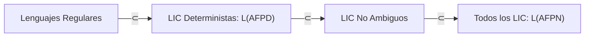
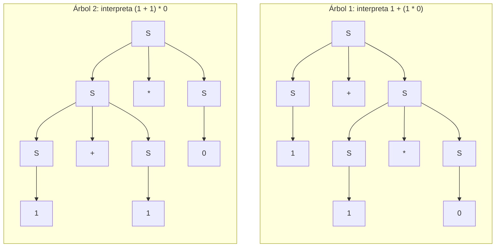

# 5.6 Ambigüedad

En la Unidad 2 se estudió la ambigüedad como una propiedad estructural de las gramáticas independientes del contexto (De Castro Korgi, 2004, Secc. 4.4, pp. 91–94). Al incorporar el modelo operacional de los autómatas con pila, dicha propiedad adquiere un significado computacional preciso: la ambigüedad gramatical se traduce directamente en la existencia de **múltiples cómputos de aceptación** dentro del autómata *pushdown* correspondiente, lo cual impone límites fundamentales al análisis sintáctico determinista en compiladores.

---

## Ambigüedad en GIC y múltiples cómputos de aceptación en AFPN

Recordemos la definición formal (De Castro Korgi, 2004, Def. 4.4.2, p. 91): una GIC $G$ es **ambigua** si existe al menos una cadena $w \in L(G)$ que admite **dos o más árboles de derivación diferentes** —o, de manera equivalente, **dos o más derivaciones más a la izquierda distintas** ($S \Rightarrow_{lm}^* w$).

Consideremos ahora el AFPN descendente $M_G = (\{q_0, q_1, q_2\}, q_0, \{q_2\}, \Sigma, \Sigma \cup V \cup \{z_0\}, z_0, \Delta)$ construido a partir de $G$ según la Sección 5.4.2. Como se probó en la Sección 5.4.3, existe una correspondencia biunívoca paso a paso entre las derivaciones más a la izquierda en $G$ y los cómputos exitosos en $M_G$:

- Cada aplicación de una producción $A \to u$ sobre la variable más a la izquierda en la derivación corresponde exactamente a la elección no determinista de la transición $(q_1, u) \in \Delta(q_1, \lambda, A)$ cuando $A$ se encuentra en el tope de la pila.
- Por consiguiente, **dos derivaciones más a la izquierda distintas producen dos secuencias diferentes de configuraciones instantáneas en $M_G$**.

Esto permite formular la caracterización operacional de la ambigüedad:

> **Correspondencia operacional:** Una GIC $G$ es ambigua si y solo si su analizador *pushdown* descendente $M_G$ admite **al menos dos cómputos de aceptación distintos** para alguna cadena $w \in L(G)$.

*(De forma análoga, en la construcción inversa de la Secc. 5.5, si un AFPN $M$ posee dos trayectorias de aceptación distintas para una misma cadena $w$, la gramática de tripletas $G_M$ hereda dicha multiplicidad generando dos derivaciones más a la izquierda distintas para $w$, resultando ambigua.)*

---

## Determinismo vs. no determinismo y jerarquía de lenguajes

Es importante no confundir **no determinismo** (propiedad de una máquina o gramática) con **ambigüedad** (existencia de varias estructuras sintácticas exitosas para una misma entrada):

1. Un **AFPN** puede tener varias rutas posibles (no determinismo) y aun así aceptar cada cadena por **a lo sumo un cómputo exitoso** (si las ramas alternativas se abortan); en ese caso el AFPN es no determinista pero **no ambiguo**.
2. En un **AFPD** (autómata con pila determinista), la transición aplicable en cada configuración es **única**; por ello, el análisis de cualquier cadena $w$ sigue una trayectoria computacional determinista única hasta agotar la entrada (y, normalizando las posibles $\lambda$-transiciones finales para evitar múltiples pasos tras consumir la cadena, todo lenguaje en $\mathcal{L}(\text{AFPD})$ puede ser reconocido con un único cómputo de aceptación por cadena).
3. Aplicando la construcción de tripletas de la Sección 5.5 sobre un AFPD normalizado (convertido primero a aceptación por pila vacía con marca de fin de entrada $\$$ para garantizar la propiedad libre de prefijos), se demuestra un teorema clásico:

> **Teorema (Determinismo implica no ambigüedad):** Todo lenguaje aceptado por un AFPD posee al menos una gramática independiente del contexto **no ambigua**.

Sin embargo, el recíproco es **falso**: existen lenguajes independientes del contexto **no ambiguos** que **no** pueden ser reconocidos por ningún AFPD. El ejemplo emblemático es el lenguaje de palíndromos de longitud par:

$$L_{\text{pal}} = \{w w^R : w \in \{a, b\}^*\}.$$

- $L_{\text{pal}}$ es **no ambiguo**: la gramática $G : S \to aSa \mid bSb \mid \lambda$ asigna un único árbol de derivación a cada palíndromo par (en cada paso los símbolos de los extremos fijan de forma unívoca la regla a aplicar).
- Sin embargo, como se vio en la Sección 5.2, $L_{\text{pal}} \notin \mathcal{L}(\text{AFPD})$, pues ningún autómata determinista puede adivinar sin retroceso la mitad de la cadena.

Así queda establecida la cadena de inclusiones estrictas dentro de los lenguajes independientes del contexto:

*(Los lenguajes que pertenecen a $\text{LIC} \setminus \text{LIC no ambiguos}$ son precisamente los lenguajes **inherentemente ambiguos**.)*

---

## Conflictos en analizadores sintácticos deterministas

En la construcción de compiladores resulta deseable implementar el analizador sintáctico como un **AFPD** (en tiempo lineal $O(\lvert w \rvert)$ sin retrocesos ni exploración exponencial de ramas). Cuando una gramática es ambigua —o simplemente no apta para análisis determinista con preanálisis acotado ($k$ *tokens* de *lookahead*)—, el intento de construir una tabla de transición determinista genera **conflictos**:

1. **En analizadores descendentes (LL):**
   - **Conflicto de predicción:** Ante la variable $A$ en el tope de la pila y un mismo símbolo de entrada $a$, existen dos producciones distintas $A \to u_1$ y $A \to u_2$ que pueden comenzar derivando $a$. Las causas más frecuentes son la ambigüedad, los factores comunes por la izquierda ($A \to aB \mid aC$) y la recursividad izquierda ($A \to A\alpha \mid \beta$).
2. **En analizadores ascendentes (LR / *shift-reduce*):**
   - **Conflicto desplazamiento–reducción (*shift/reduce*):** El autómata no puede decidir determinísticamente entre apilar el siguiente terminal de la entrada o reducir el tope actual de la pila mediante $A \to u$. Ocurre clásicamente en gramáticas de expresiones sin precedencia y en la sentencia condicional opcional (*dangling else*).
   - **Conflicto reducción–reducción (*reduce/reduce*):** Dos producciones distintas $A \to u$ y $B \to u$ (o con sufijos coincidentes) compiten simultáneamente para reducir el tope de la pila.

### Estrategias de resolución en la práctica
- **Reescritura gramatical:** Eliminar la ambigüedad estratificando variables por niveles de precedencia y fijando asociatividad (por ejemplo, separar expresiones, términos y factores), o aplicando factorización izquierda y eliminación de recursividad izquierda.
- **Reglas externas de desambiguación:** Como señala De Castro Korgi (2004, p. 92), en compiladores reales es frecuente conservar una gramática compacta pero ambigua (como $S \to S + S \mid S * S \mid \dots$) e imponer **reglas explícitas de precedencia y asociatividad** (por ejemplo, que `*` preceda a `+` y ambos asocien a la izquierda), lo que resuelve de forma determinista los conflictos en las tablas del analizador.

---

## Lenguajes inherentemente ambiguos e indecidibilidad

Mientras que muchas gramáticas ambiguas pueden reescribirse como gramáticas equivalentes no ambiguas, existen lenguajes independientes del contexto cuya ambigüedad es imposible de eliminar.

### Definición
Un lenguaje independiente del contexto $L$ es **inherentemente ambiguo** si **toda** GIC $G$ tal que $L(G) = L$ es ambigua. En consecuencia, ningún lenguaje inherentemente ambiguo puede ser reconocido por un AFPD.

El ejemplo clásico presentado por De Castro Korgi (2004, p. 93) es la unión de dos lenguajes con restricciones cruzadas sobre $\Sigma = \{a, b, c, d\}$:

$$L = \{a^i b^i c^j d^j : i, j \ge 1\} \cup \{a^i b^j c^j d^i : i, j \ge 1\}.$$

$L$ es un LIC (basta tomar la unión de la GIC que empareja $(a,b)$ y $(c,d)$ con la GIC que empareja $(a,d)$ y $(b,c)$). No obstante, las cadenas de la intersección $\{a^k b^k c^k d^k : k \ge 1\}$ satisfacen ambas restricciones simultáneamente. Mediante el Lema de Ogden puede demostrarse que cualquier GIC que genere $L$ requiere subestructuras de derivación separadas para forzar $i = \lvert a \rvert = \lvert b \rvert$ (junto a $\lvert c \rvert = \lvert d \rvert$) y para forzar $\lvert a \rvert = \lvert d \rvert$ (junto a $\lvert b \rvert = \lvert c \rvert$), por lo que para valores suficientemente grandes de $k$, toda cadena $a^k b^k c^k d^k$ poseerá al menos dos árboles de derivación distintos en cualquier gramática para $L$.

### Resultados negativos de indecidibilidad

Tanto para gramáticas como para autómatas con pila existen problemas algorítmicamente **indecidibles** (De Castro Korgi, 2004, pp. 93, 140; Hopcroft et al., 2007):
1. **Ambigüedad de una GIC:** No existe ningún algoritmo capaz de decidir, dada una GIC arbitraria $G$, si $G$ es ambigua o no ambigua.
2. **Ambigüedad inherente:** Tampoco es decidible si un LIC dado por una GIC o un AFPN es inherentemente ambiguo.
3. **Determinizabilidad de un AFPN:** No existe algoritmo para decidir si el lenguaje aceptado por un AFPN arbitrario $M$ pertenece a $\mathcal{L}(\text{AFPD})$.

---

## Ejemplos paso a paso

### Ejemplo 1: Expresiones aritméticas binarias y duplicación de cómputos en $M_G$

Considere la gramática de expresiones binarias de De Castro Korgi (2004, pp. 91–92) sobre $\Sigma = \{0, 1, +, *, \text{(}, \text{)}\}$:

$$S \longrightarrow S + S \mid S * S \mid (S) \mid 0S \mid 1S \mid 0 \mid 1.$$

Para la cadena $w = 1 + 1 * 0$, existen **dos derivaciones más a la izquierda diferentes**:
- **Derivación 1 (prioriza `*` en la parte inferior):** $S \Rightarrow_{lm} S + S \Rightarrow_{lm} 1 + S \Rightarrow_{lm} 1 + S * S \Rightarrow_{lm} 1 + 1 * S \Rightarrow_{lm} 1 + 1 * 0$.
- **Derivación 2 (agrupa `1 + 1` bajo `*`):** $S \Rightarrow_{lm} S * S \Rightarrow_{lm} S + S * S \Rightarrow_{lm} 1 + S * S \Rightarrow_{lm} 1 + 1 * S \Rightarrow_{lm} 1 + 1 * 0$.

Al construir el AFPN descendente $M_G$ (Secc. 5.4.2), la transición espontánea $\Delta(q_1, \lambda, S)$ contiene simultáneamente $(q_1, S + S)$ y $(q_1, S * S)$, generando **dos cómputos de aceptación diferentes** sobre $w = 1 + 1 * 0$:

| Paso | Cómputo 1 (corresponde al Árbol 1) | Cómputo 2 (corresponde al Árbol 2) |
| :---: | :--- | :--- |
| 0 | $(q_0, 1+1*0, z_0) \vdash (q_1, 1+1*0, S z_0)$ | $(q_0, 1+1*0, z_0) \vdash (q_1, 1+1*0, S z_0)$ |
| 1 | $\vdash (q_1, 1+1*0, \mathbf{S+S} z_0)$ *(elige $S \to S+S$)* | $\vdash (q_1, 1+1*0, \mathbf{S*S} z_0)$ *(elige $S \to S*S$)* |
| 2 | $\vdash (q_1, 1+1*0, 1+S z_0) \vdash (q_1, +1*0, +S z_0)$ | $\vdash (q_1, 1+1*0, S+S*S z_0) \vdash (q_1, 1+1*0, 1+S*S z_0)$ |
| 3 | $\vdash (q_1, 1*0, S z_0) \vdash (q_1, 1*0, S*S z_0)$ | $\vdash (q_1, +1*0, +S*S z_0) \vdash (q_1, 1*0, S*S z_0)$ |
| 4 | $\vdash (q_1, 1*0, 1*S z_0) \vdash^* (q_1, 0, S z_0)$ | $\vdash (q_1, 1*0, 1*S z_0) \vdash^* (q_1, 0, S z_0)$ |
| 5 | $\vdash (q_1, 0, 0 z_0) \vdash (q_1, \lambda, z_0) \vdash (q_2, \lambda, z_0)$ | $\vdash (q_1, 0, 0 z_0) \vdash (q_1, \lambda, z_0) \vdash (q_2, \lambda, z_0)$ |

**Eliminación de la ambigüedad (jerarquía de precedencia y asociatividad):**

$$E \longrightarrow E + T \mid T, \qquad T \longrightarrow T * F \mid F, \qquad F \longrightarrow (E) \mid N, \qquad N \longrightarrow 0N \mid 1N \mid 0 \mid 1.$$

En esta gramática estratificada, la multiplicación queda ligada a nivel de término $T$ y la suma a nivel de expresión $E$: la cadena $1 + 1 * 0$ admite únicamente la interpretación $1 + (1 * 0)$ y un análisis determinista LR(1) (o LL(1) tras eliminar la recursividad izquierda).

---

### Ejemplo 2: El conflicto *dangling else* y la gramática ambigua $S \to aSA \mid \lambda$

Considere dos casos clásicos donde la ambigüedad provoca bifurcaciones en un AFPN y conflictos en analizadores deterministas:

**Parte A — Análisis en el AFPN de $G : S \to aSA \mid \lambda,\ A \to bA \mid \lambda$ (De Castro Korgi, 2004, pp. 92–93):**

La cadena $w = aab$ posee dos derivaciones a izquierda distintas:
1. $S \Rightarrow_{lm} aSA \Rightarrow_{lm} aaSAA \Rightarrow_{lm} aaAA \Rightarrow_{lm} aa\mathbf{A} \Rightarrow_{lm} aabA \Rightarrow_{lm} aab$ *(la primera $A$ se anula con $A \to \lambda$ y la segunda produce $b$)*.
2. $S \Rightarrow_{lm} aSA \Rightarrow_{lm} aaSAA \Rightarrow_{lm} aaAA \Rightarrow_{lm} aabAA \Rightarrow_{lm} aabA \Rightarrow_{lm} aab$ *(la primera $A$ produce $b$ y la segunda se anula)*.

En el AFPN $M_G$, tras leer `aa` y vaciar $S$, la pila contiene $AAz_0$ en $(q_1, b, AAz_0)$. En ese instante existen **dos cómputos exitosos distintos**:
- **Cómputo 1:** aplica $(q_1, \lambda) \in \Delta(q_1, \lambda, A)$ para descartar la primera $A$ y luego expande la segunda $A \to bA \to b$, llegando a $(q_2, \lambda, z_0)$.
- **Cómputo 2:** expande inmediatamente la primera $A \to bA$, consume $b$, anula esa $A$ y luego anula la segunda $A$, llegando también a $(q_2, \lambda, z_0)$.

Esta ambigüedad se elimina completamente reescribiendo $L(G) = a^+ b^* \cup \{\lambda\}$ con una gramática no ambigua (de hecho LL(1) determinista):

$$S \longrightarrow AB \mid \lambda, \qquad A \longrightarrow aA \mid a, \qquad B \longrightarrow bB \mid \lambda.$$

**Parte B — El conflicto *shift/reduce* en el *dangling else*:**

En muchos lenguajes imperativos (C, Pascal, Java), la sintaxis de condicionales permite omitir el bloque `else`:

$$S \longrightarrow \mathbf{i}\,S \mid \mathbf{i}\,S\,\mathbf{e}\,S \mid \mathbf{o}$$

*(donde $\mathbf{i}$ representa `if c then`, $\mathbf{e}$ representa `else`, y $\mathbf{o}$ representa otra instrucción simple).*

La cadena `iioeo` (`if c1 then if c2 then o else o`) admite dos árboles de derivación:
1. Asociar el `else` al `if` interior: `if c1 then (if c2 then o else o)`.
2. Asociar el `else` al `if` exterior: `if c1 then (if c2 then o) else o`.

Al intentar diseñar un analizador ascendente determinista, cuando el analizador ha leído `iio` (dejando `i S` en la pila tras reducir `o` a `S`) y observa en la entrada el símbolo `e` (`else`), enfrenta un **conflicto desplazamiento–reducción (*shift/reduce*)**:
- **Desplazar (`shift`):** apilar `e` para esperar el segundo `S` y completar `i S e S` (asociación al `if` interior).
- **Reducir (`reduce`):** reducir `i S` a `S` inmediatamente y dejar el `else` para el `if` exterior.

En la práctica, los compiladores resuelven este conflicto mediante la regla determinista de **asociar cada `else` al `if` sin emparejar más cercano** (es decir, prefiriendo *shift* sobre *reduce*), o reescribiendo la gramática en sentencias *emparejadas* y *no emparejadas* (Aho et al., 2008).

---

## Ejercicios propuestos

1. **Dos cómputos en AFPN:** Considere la gramática ambigua $G : S \to aSbS \mid bSaS \mid \lambda$ (De Castro Korgi, 2004, p. 94). Construya su AFPN descendente $M_G$ y exhiba explícitamente **dos cómputos de aceptación distintos** para la cadena $w = abab$.
2. **Eliminación de ambigüedad y determinismo:** Muestre que la gramática $G : S \to ASB \mid AB,\ A \to aA \mid a,\ B \to bB \mid \lambda$ es ambigua encontrando una cadena con dos derivaciones más a la izquierda distintas. Determine $L(G)$, construya una gramática no ambigua equivalente y diseñe un AFPD que reconozca $L(G)$.
3. **Jerarquía de lenguajes:** Clasifique cada uno de los siguientes lenguajes en la menor clase posible de la jerarquía (Regular, $\mathcal{L}(\text{AFPD})$, LIC no ambiguo pero no AFPD, o LIC inherentemente ambiguo):
   - $L_1 = \{a^n b^n : n \ge 0\}$
   - $L_2 = \{w \in \{a, b\}^* : w = w^R\}$
   - $L_3 = \{a^i b^i c^j d^j : i, j \ge 1\} \cup \{a^i b^j c^j d^i : i, j \ge 1\}$
   - $L_4 = (a \cup b)^* ab$
4. **Conflictos en compiladores:** Dada la gramática $E \to E - E \mid \mathbf{id}$, explique por qué la cadena $\mathbf{id} - \mathbf{id} - \mathbf{id}$ genera un conflicto en un analizador determinista. Reescriba la gramática para que la resta asocie a la izquierda (evaluando `(id - id) - id`) y verifique que ahora cada cadena tiene un único árbol de derivación.

## Referencias

- Acevedo Juárez, A. (2006). *Teoría de la computación* [Tesis de licenciatura, Instituto Tecnológico de Celaya].
- Aho, A. V., Lam, M. S., Sethi, R., & Ullman, J. D. (2008). *Compiladores: Principios, técnicas y herramientas* (2.ª ed., Cap. 4). Pearson Educación.
- De Castro Korgi, R. (2004). *Teoría de la computación: Lenguajes, autómatas, gramáticas* (Cap. 4, Secc. 4.4, pp. 91–94; Secc. 4.15, p. 140; Cap. 5, pp. 149–165). Universidad Nacional de Colombia.
- Hopcroft, J. E., Motwani, R., & Ullman, J. D. (2007). *Introducción a la teoría de autómatas, lenguajes y computación* (3.ª ed., Cap. 5, Secc. 5.4; Cap. 6, Secc. 6.4). Pearson Educación.
