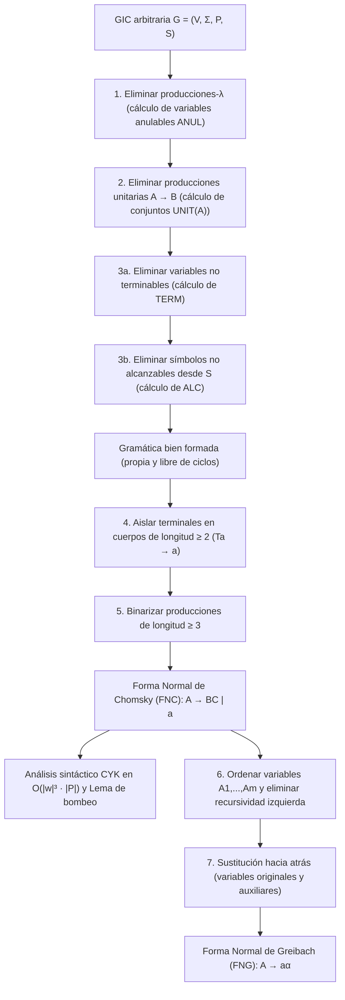
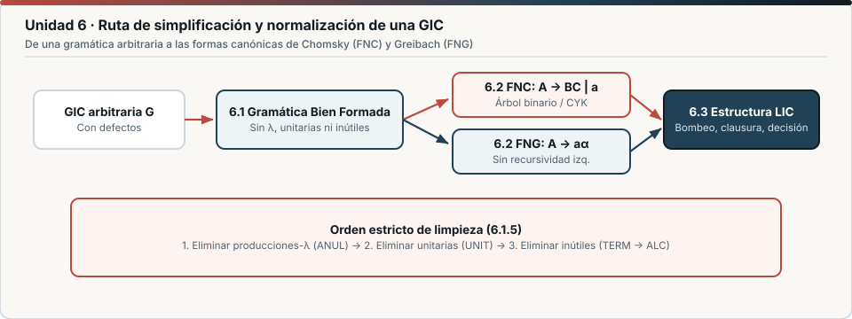

# Unidad 6: Lenguajes Independientes del Contexto

- **Duración:** 18 horas
- **Competencia(s) a desarrollar:** Estudia las diferentes formas y estructuras de las gramáticas independientes al contexto para desarrollar gramáticas eficientes.

## Panorama de la unidad

En las unidades anteriores se introdujeron las gramáticas independientes del contexto (GIC) como generadoras de lenguajes formales y los autómatas con pila (AP) como su modelo reconocedor equivalente. Sin embargo, una gramática diseñada de manera intuitiva suele contener redundancias —símbolos que nunca generan cadenas terminales o nunca se alcanzan desde el símbolo inicial, producciones vacías que complican el análisis sintáctico y reglas unitarias que alargan innecesariamente las derivaciones— o presentar estructuras inadecuadas para construir analizadores sintácticos eficientes.

Esta unidad profundiza en la teoría algebraica y estructural de los lenguajes independientes del contexto (LIC). En primera instancia, se estudian las **transformaciones elementales** que permiten limpiar una GIC hasta convertirla en una **gramática bien formada** sin alterar el lenguaje que genera. Posteriormente, se analizan las dos **formas canónicas** fundamentales —la **Forma Normal de Chomsky (FNC)** y la **Forma Normal de Greibach (FNG)**—, que imponen restricciones estrictas sobre el lado derecho de las producciones para habilitar algoritmos de reconocimiento en tiempo polinomial como **CYK** y derivaciones deterministas en tiempo lineal respecto a la longitud de la cadena. Finalmente, se examina la **estructura intrínseca de los LIC**: el **Lema de bombeo** para demostrar que ciertos lenguajes escapan a la potencia de las GIC, sus **propiedades de clausura** y la frontera entre los problemas **decidibles** e **indecidibles** asociados a estas gramáticas.

## Flujo de simplificación y normalización de una GIC

El siguiente diagrama resume la secuencia canónica de transformaciones que preservan el lenguaje generado (o lo preservan salvo la cadena vacía $\lambda$ cuando se pasa a las formas normales estrictas) desde una GIC arbitraria hasta las formas normales de Chomsky y Greibach:

## Subtemas

- [6.1 Transformaciones elementales de gramáticas](6-1-transformaciones-elementales-de-gramaticas.md)
  - **6.1.1 Equivalencia de gramáticas:** Criterios de equivalencia estricta ($L(G_1) = L(G_2)$) y equivalencia salvo $\lambda$ ($L(G_1) - \{\lambda\} = L(G_2) - \{\lambda\}$).
  - **6.1.2 Transformación de gramáticas mediante substitución y expansión:** Reglas formales de sustitución de variables, introducción de variables auxiliares y factorización por la izquierda.
  - **6.1.3 Eliminación de producciones inútiles:** Cálculo de variables terminables ($TERM$) y alcanzables ($ALC$), con demostración de por qué el orden no puede invertirse.
  - **6.1.4 Reemplazo de producciones no generativas:** Eliminación de producciones-$\lambda$ mediante variables anulables ($ANUL$) y eliminación de producciones unitarias mediante clausura unitaria ($UNIT$).
  - **6.1.5 Gramáticas bien formadas:** Integración del orden estricto ($\lambda \to$ unitarias $\to$ inútiles) para obtener gramáticas limpias y libres de ciclos.
- [6.2 Formas canónicas de gramáticas](6-2-formas-canonicas-de-gramaticas.md)
  - **6.2.1 Gramáticas en forma normal:** Forma Normal de Chomsky (FNC), algoritmo de conversión, teorema de longitud de derivación ($2|w|-1$ pasos) y algoritmo de programación dinámica CYK.
  - **6.2.2 Gramáticas en forma estándar:** Forma Normal de Greibach (FNG), eliminación de la recursividad izquierda directa e indirecta y algoritmo completo de conversión.
- [6.3 Estructura de los lenguajes independientes al contexto](6-3-estructura-de-los-lenguajes-independientes-al-contexto.md)
  - **Lema de bombeo para LIC:** Demostración mediante árboles binarios en FNC y pruebas de no independencia del contexto para lenguajes clásicos.
  - **Propiedades de clausura:** Clausura bajo operaciones regulares, intersección con regulares, homomorfismos y reflexión; no clausura bajo intersección, complemento y diferencia.
  - **Algoritmos de decisión para GIC:** Problemas decidibles (vacío, pertenencia y finitud/infinitud) frente a problemas indecidibles (equivalencia, universalidad y ambigüedad).

## Referencias

- Acevedo Juárez, A. (2006). *Teoría de la computación* [Tesis de licenciatura, Instituto Tecnológico de Celaya].
- De Castro Korgi, R. (2004). *Teoría de la computación: Lenguajes, autómatas, gramáticas*. Universidad Nacional de Colombia.
