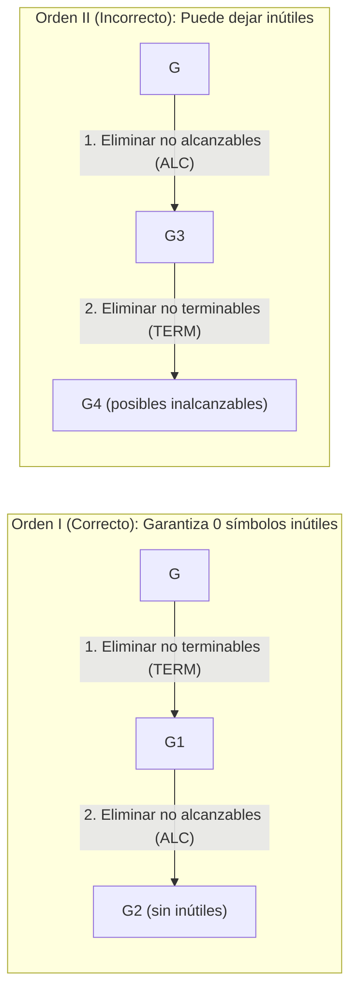

# 6.1 Transformaciones elementales de gramáticas

Una gramática independiente del contexto (GIC) $G = (V, \Sigma, P, S)$ puede diseñarse de múltiples maneras para generar un mismo lenguaje. En la práctica —especialmente en el diseño de analizadores sintácticos para compiladores y en las demostraciones teóricas sobre lenguajes independientes del contexto (LIC)—, las gramáticas construidas de forma directa suelen incluir reglas redundantes, símbolos inaccesibles, producciones que derivan la cadena vacía $\lambda$ o simples renombramientos entre variables.

Las **transformaciones elementales** son procedimientos algorítmicos que modifican el conjunto de variables $V$ y el conjunto de producciones $P$ preservando el lenguaje generado. Su propósito es depurar una gramática hasta transformarla en una **gramática bien formada**, punto de partida indispensable para obtener formas normales canónicas (De Castro Korgi, 2004; Acevedo Juárez, 2006).

---

## 6.1.1 Equivalencia de gramáticas

### Definición formal

Sean $G_1 = (V_1, \Sigma_1, P_1, S_1)$ y $G_2 = (V_2, \Sigma_2, P_2, S_2)$ dos gramáticas independientes del contexto.

1. **Equivalencia estricta:** Se dice que $G_1$ y $G_2$ son **equivalentes** (denotado $G_1 \equiv G_2$) si y solo si generan exactamente el mismo lenguaje (De Castro Korgi, 2004, p. 83):
   $$L(G_1) = L(G_2)$$
   donde $L(G) = \{w \in \Sigma^* \mid S \Rightarrow_G^+ w\}$ (o equivalentemente $S \Rightarrow_G^* w$, dado que $S \notin \Sigma$).

2. **Equivalencia salvo $\lambda$:** Se dice que $G_1$ y $G_2$ son **equivalentes salvo $\lambda$** si coinciden en todas sus cadenas no vacías:
   $$L(G_1) - \{\lambda\} = L(G_2) - \{\lambda\}$$
   En particular, cuando $G_2$ carece de producciones que permitan derivar la cadena vacía ($\lambda \notin L(G_2)$), la condición se expresa simplemente como:
   $$L(G_1) - \{\lambda\} = L(G_2)$$

### Explicación intuitiva y propiedades

La relación $\equiv$ sobre el conjunto de todas las GIC es una **relación de equivalencia** (reflexiva, simétrica y transitiva). Dos gramáticas equivalentes pueden tener conjuntos de variables por completo distintos, diferente número de producciones e incluso generar árboles de derivación estructuralmente diferentes para la misma cadena (lo que se conoce como **equivalencia débil**, frente a la equivalencia fuerte basada en isomorfismo de árboles).

La noción de **equivalencia salvo $\lambda$** adquiere importancia central al estudiar transformaciones hacia formas normales (Sección 6.2). Como las producciones en Forma Normal de Chomsky o de Greibach nunca tienen $\lambda$ en su lado derecho (salvo en la extensión que añade explícitamente $S' \to \lambda$), cualquier algoritmo que elimine por completo las producciones-$\lambda$ transforma $G$ en una gramática $G'$ equivalente salvo $\lambda$. Si $\lambda \in L(G)$ y se requiere equivalencia estricta, basta introducir una nueva variable inicial $S'$ con las producciones $S' \to S \mid \lambda$.

### Ejemplo 1: Equivalencia estricta y equivalencia salvo $\lambda$

Considérense las tres gramáticas siguientes sobre $\Sigma = \{a, b\}$:

$$G_1: \quad S \to aSb \mid \lambda$$

$$G_2: \quad \begin{cases} S \to aAb \mid \lambda \\ A \to aAb \mid ab \end{cases}$$

$$G_3: \quad S \to aSb \mid ab$$

- En $G_1$, cada aplicación de $S \to aSb$ agrega simultáneamente una $a$ a la izquierda y una $b$ a la derecha, terminando con $S \to \lambda$. Así, $L(G_1) = \{a^n b^n \mid n \ge 0\}$.
- En $G_2$, la variable $S$ produce $\lambda$ directamente o inicia con $aAb$, donde $A$ genera $\{a^{m-1}b^{m-1} \mid m \ge 1\}$ mediante $m-1$ pasos y $A \to ab$. Por tanto, $L(G_2) = \{\lambda\} \cup \{a^m b^m \mid m \ge 1\} = \{a^n b^n \mid n \ge 0\} = L(G_1)$. En consecuencia, $G_1$ y $G_2$ son **estrictamente equivalentes**.
- En $G_3$, toda derivación termina aplicando $S \to ab$, por lo que $L(G_3) = \{a^n b^n \mid n \ge 1\}$. Aunque $L(G_3) \neq L(G_1)$, se cumple $L(G_1) - \{\lambda\} = L(G_3)$, de modo que $G_1$ y $G_3$ son **equivalentes salvo $\lambda$**.

---

## 6.1.2 Transformación de gramáticas mediante substitución y expansión

Para reescribir producciones sin alterar el lenguaje generado, existen tres operaciones básicas de manipulación sintáctica: la **substitución** de una variable por sus producciones, la **expansión** (introducción de variables auxiliares) y la **factorización izquierda**.

### Regla de substitución

**Teorema (Substitución de variables; De Castro Korgi, 2004, Lema 4.12.3; Acevedo Juárez, 2006, pp. 105–106).** Sea $G = (V, \Sigma, P, S)$ una GIC que contiene una producción de la forma
$$A \to \alpha B \beta, \quad \text{con } \alpha, \beta \in (V \cup \Sigma)^* \text{ y } B \in V.$$
Sean $B \to \gamma_1 \mid \gamma_2 \mid \dots \mid \gamma_r$ todas las producciones en $P$ cuya cabeza es $B$ (si $B$ no tiene producciones en $P$, entonces $r = 0$). Sea $G' = (V, \Sigma, P', S)$ la gramática obtenida al reemplazar la producción $A \to \alpha B \beta$ en $P$ por las $r$ producciones:
$$A \to \alpha \gamma_1 \beta \mid \alpha \gamma_2 \beta \mid \dots \mid \alpha \gamma_r \beta$$
(eliminando $A \to \alpha B \beta$ si $r = 0$). Entonces $L(G') = L(G)$.

*Demostración.*
- ($L(G') \subseteq L(G)$): Cada producción nueva $A \to \alpha \gamma_i \beta$ de $G'$ puede simularse en $G$ en dos pasos: $A \Rightarrow_G \alpha B \beta \Rightarrow_G \alpha \gamma_i \beta$. Por inducción sobre el número de pasos, toda cadena terminal derivada en $G'$ también es derivable en $G$.
- ($L(G) \subseteq L(G')$): Sea $S \Rightarrow_G^+ w$ con $w \in \Sigma^*$. Si la derivación nunca usa $A \to \alpha B \beta$, también es válida en $G'$. Si la usa, sea $A \to \alpha B \beta$ la primera aparición de esa regla; dado que $w$ no contiene variables, la ocurrencia concreta de $B$ introducida en ese paso debe reescribirse más adelante mediante alguna producción $B \to \gamma_i \in P$ (si $r = 0$, tal derivación terminal no existe). Como en una GIC las reescrituras son independientes del contexto, podemos reordenar la derivación aplicando $B \to \gamma_i$ inmediatamente después de $A \to \alpha B \beta$, lo cual equivale exactamente a aplicar en un solo paso la nueva regla $A \to \alpha \gamma_i \beta \in P'$. Eliminando por inducción todas las apariciones de $A \to \alpha B \beta$, se obtiene una derivación válida en $G'$. $\blacksquare$

### Expansión (introducción de variables auxiliares)

Es la operación inversa a la substitución. Si una producción tiene la forma $A \to \alpha \delta \beta$ con $\delta \in (V \cup \Sigma)^+$ y $|\delta| \ge 2$ (o $\delta = a \in \Sigma$ en presencia de otros símbolos), se puede introducir una nueva variable $X \notin V$ y reemplazar $A \to \alpha \delta \beta$ por el par de producciones:
$$A \to \alpha X \beta, \qquad X \to \delta.$$
Como la única regla de $X$ es $X \to \delta$, sustituir $X$ en $A \to \alpha X \beta$ mediante el teorema anterior recupera exactamente la gramática original; por lo tanto, $L(G') = L(G)$. Esta técnica es la base para acortar cuerpos largos de producciones y aislar terminales al construir la Forma Normal de Chomsky.

### Factorización por la izquierda

Cuando una variable $A$ posee múltiples alternativas que comparten un mismo prefijo no vacío $\alpha \in (V \cup \Sigma)^+$,
$$A \to \alpha \beta_1 \mid \alpha \beta_2 \mid \dots \mid \alpha \beta_k \mid \gamma_1 \mid \dots \mid \gamma_m$$
(donde ninguna $\gamma_j$ inicia con $\alpha$), la **factorización por la izquierda** consiste en extraer el prefijo común $\alpha$ introduciendo una nueva variable $A' \notin V$:
$$A \to \alpha A' \mid \gamma_1 \mid \dots \mid \gamma_m, \qquad A' \to \beta_1 \mid \beta_2 \mid \dots \mid \beta_k.$$
Sustituyendo $A'$ en $A \to \alpha A'$ por el teorema de substitución se recuperan exactamente las producciones originales, lo que prueba que la equivalencia se conserva. En ingeniería de compiladores, la factorización izquierda elimina el no determinismo de prefijo en analizadores sintácticos descendentes predictivos (tipo LL).

### Ejemplo 2: Substitución, expansión y factorización izquierda

**Parte A (Substitución; adaptado de Acevedo Juárez, 2006, p. 106).** Considérese la gramática:
$$G: \quad \begin{cases} S \to aAb \mid bBa \\ A \to aSb \mid ab \\ B \to bSa \mid ba \end{cases}$$
Aplicando la regla de substitución para $A$ en $S \to aAb$ y para $B$ en $S \to bBa$, obtenemos:
$$S \to aaSbb \mid aabb \mid bbSaa \mid bbaa$$
Dado que $A$ y $B$ ya no aparecen en ninguna producción de $S$, resultan inalcanzables (como se formalizará en 6.1.3) y pueden suprimirse, logrando una gramática equivalente con una única variable:
$$G': \quad S \to aaSbb \mid aabb \mid bbSaa \mid bbaa.$$

**Parte B (Factorización izquierda y expansión).** Sea la gramática para sentencias condicionales simples:
$$G_{\text{cond}}: \quad \begin{cases} S \to \text{if } E \text{ then } S \text{ else } S \mid \text{if } E \text{ then } S \mid \text{stmt} \\ E \to \text{cond} \end{cases}$$
Las dos primeras producciones de $S$ comparten el prefijo $\alpha = \text{if } E \text{ then } S$. Factorizando por la izquierda con una variable nueva $S'$:
$$G_{\text{cond}}': \quad \begin{cases} S \to \text{if } E \text{ then } S S' \mid \text{stmt} \\ S' \to \text{else } S \mid \lambda \\ E \to \text{cond} \end{cases}$$
Si además deseamos expandir la regla $S \to \text{if } E \text{ then } S S'$ para aislar la cláusula de cabecera en una variable auxiliar $H$, podemos escribir $S \to H S S' \mid \text{stmt}$ y $H \to \text{if } E \text{ then }$, conservando exactamente el mismo lenguaje generado.

---

## 6.1.3 Eliminación de producciones inútiles

Una gramática puede contener variables y producciones que nunca contribuyen a la generación de cadena terminal alguna. Identificarlas y removerlas simplifica la gramática sin afectar el lenguaje generado.

### Definiciones formales

Sea $G = (V, \Sigma, P, S)$ una GIC (De Castro Korgi, 2004, Def. 4.8.1, p. 102):

1. **Variable terminable (o generadora):** Una variable $A \in V$ es **terminable** si existe al menos una cadena de terminales $w \in \Sigma^*$ tal que $A \Rightarrow_G^* w$. En particular, si existe una producción $A \to w$ con $w \in \Sigma^*$ (incluyendo $A \to \lambda$), entonces $A$ es terminable.
2. **Variable alcanzable (o accesible):** Una variable $A \in V$ es **alcanzable** si existen cadenas $u, v \in (V \cup \Sigma)^*$ tales que $S \Rightarrow_G^* uAv$. Por definición, la variable inicial $S$ siempre es alcanzable ($S \Rightarrow_G^* S$). Análogamente, un terminal $a \in \Sigma$ es alcanzable si aparece en alguna forma sentencial derivable desde $S$.
3. **Símbolo útil e inútil:** Un símbolo $X \in V \cup \Sigma$ es **útil** si aparece en alguna derivación completa de una cadena terminal desde $S$, es decir, si existen $u, v \in (V \cup \Sigma)^*$ y $w \in \Sigma^*$ tales que:
   $$S \Rightarrow_G^* uXv \Rightarrow_G^* w.$$
   Una variable es **útil** si es tanto alcanzable como terminable (en el orden adecuado); en caso contrario, se denomina **variable inútil**. Toda producción que contenga al menos un símbolo inútil es una **producción inútil**.

### Algoritmo 1: Cálculo de las variables terminables ($TERM$)

Construimos de manera ascendente el conjunto de variables capaces de derivar cadenas de terminales (De Castro Korgi, 2004, Secc. 4.8.2):

1. **Inicialización:**
   $$TERM_1 := \{A \in V \mid \exists (A \to w) \in P \text{ con } w \in \Sigma^*\}.$$
2. **Iteración:** Para $i \ge 1$,
   $$TERM_{i+1} := TERM_i \cup \{A \in V \mid \exists (A \to w) \in P \text{ con } w \in (\Sigma \cup TERM_i)^*\}.$$
3. **Condición de paro:** Como $TERM_1 \subseteq TERM_2 \subseteq \dots \subseteq V$ y $V$ es finito, existe $k \ge 1$ tal que $TERM_k = TERM_{k+1}$. Definimos $TERM := TERM_k$.

Si $S \notin TERM$, ninguna cadena terminal puede derivarse de $S$, por lo que $L(G) = \emptyset$. Si $S \in TERM$, se forma una gramática equivalente $G_1 = (TERM, \Sigma, P_1, S)$ conservando únicamente las producciones de $P$ cuyos símbolos pertenezcan por completo a $TERM \cup \Sigma$.

### Algoritmo 2: Cálculo de las variables alcanzables ($ALC$)

Partiendo de la variable inicial $S$, exploramos hacia adelante qué símbolos pueden aparecer en formas sentenciales (De Castro Korgi, 2004, Secc. 4.8.3):

1. **Inicialización:**
   $$ALC_1 := \{S\}.$$
2. **Iteración:** Para $i \ge 1$,
   $$ALC_{i+1} := ALC_i \cup \{A \in V \mid \exists (B \to uAv) \in P \text{ con } B \in ALC_i \text{ y } u, v \in (V \cup \Sigma)^*\}.$$
3. **Condición de paro:** Por finitud de $V$, existe $k \ge 1$ tal que $ALC_k = ALC_{k+1}$. Definimos $ALC := ALC_k$.

El conjunto de terminales alcanzables $\Sigma'$ está integrado por todos los $a \in \Sigma$ que aparecen en el lado derecho de alguna producción cuya cabeza pertenece a $ALC$. Formamos $G_2 = (ALC, \Sigma', P_2, S)$ restringiendo $P$ a las producciones con cabeza en $ALC$.

### ¿Por qué el orden no puede invertirse?

Al combinar ambos algoritmos sobre una GIC $G$, existen dos órdenes posibles:

**Teorema (Orden estricto para eliminar símbolos inútiles; De Castro Korgi, 2004, p. 106).** Si $L(G) \neq \emptyset$ y se aplica primero el Algoritmo 1 ($TERM$) para obtener $G_1$ y después el Algoritmo 2 ($ALC$) sobre $G_1$ para obtener $G_2$, entonces $G_2$ es equivalente a $G$ y no contiene ningún símbolo inútil.

*Demostración.* Toda producción eliminada al pasar de $G$ a $G_1$ contiene una variable no terminable, por lo cual jamás puede participar en una derivación $S \Rightarrow^* w \in \Sigma^*$; así $L(G_1) = L(G)$. Análogamente, ninguna producción eliminada al pasar de $G_1$ a $G_2$ es alcanzable desde $S$, por lo que $L(G_2) = L(G_1) = L(G)$.

Falta probar que toda variable $A$ que permanece en $G_2$ es **útil** (es decir, alcanzable y terminable en $G_2$). Por construcción de $ALC(G_1)$, toda variable $A$ en $G_2$ es alcanzable desde $S$ mediante reglas que solo involucran variables en $ALC(G_1)$, luego $A$ sigue siendo alcanzable en $G_2$. Por otra parte, como $A$ estaba en $G_1$, existe una cadena $w \in \Sigma^*$ tal que $A \Rightarrow_{G_1}^* w$. Ahora bien, toda variable $X$ que aparece en esa derivación de $A$ es alcanzable desde $A$ en $G_1$; como $A$ es alcanzable desde $S$ en $G_1$, por transitividad $X$ también es alcanzable desde $S$ en $G_1$, de modo que $X \in ALC(G_1)$. En consecuencia, toda la derivación $A \Rightarrow_{G_1}^* w$ se conserva intacta en $G_2$, y $A$ sigue siendo terminable en $G_2$. $\blacksquare$

#### Contraejemplo de inversión de orden (De Castro Korgi, 2004, p. 105)

Considérese la gramática:
$$G: \quad \begin{cases} S \to a \mid AB \\ A \to aA \mid \lambda \end{cases}$$

- **Orden I (correcto: primero $TERM$, luego $ALC$):**
  1. $TERM(G) = \{S, A\}$ ($B$ no tiene producciones, no es terminable). Se elimina $S \to AB$:
     $$G_1: \quad S \to a, \qquad A \to aA \mid \lambda.$$
  2. $ALC(G_1) = \{S\}$. Al eliminar $A$ (no alcanzable en $G_1$), resulta:
     $$G_2: \quad S \to a.$$
     Aquí $L(G_2) = \{a\} = L(G)$ y no quedan variables inútiles.

- **Orden II (incorrecto: primero $ALC$, luego $TERM$):**
  1. En $G$, desde $S$ se alcanza $S \to AB$, por lo que $ALC(G) = \{S, A, B\}$ y $G_3 = G$.
  2. Luego $TERM(G_3) = \{S, A\}$, que elimina $B$ y la regla $S \to AB$:
     $$G_4: \quad S \to a, \qquad A \to aA \mid \lambda.$$
     En $G_4$, la variable $A$ es **inalcanzable** desde $S$: el Orden II dejó una variable inútil porque eliminar a la variable no terminable $B$ rompió la única ruta que hacía alcanzable a $A$.

### Ejemplo 3: Eliminación completa de símbolos inútiles (De Castro Korgi, 2004, p. 106)

Eliminar las variables inútiles de la siguiente gramática $G$:
$$G: \quad \begin{cases} S \to SBS \mid BC \mid Bb \\ A \to AA \mid aA \\ B \to aBCa \mid b \\ C \to aC \mid ACC \mid abb \\ D \to aAB \mid ab \\ E \to aS \mid bAA \\ F \to aDb \mid aF \end{cases}$$

**Etapa 1: Cálculo de variables terminables ($TERM$):**
- $TERM_1 = \{B, C, D\}$, pues $B \to b$, $C \to abb$ y $D \to ab$.
- $TERM_2 = \{B, C, D\} \cup \{S, F\} = \{B, C, D, S, F\}$, pues $S \to BC$ ($B, C \in TERM_1$) y $F \to aDb$ ($D \in TERM_1$).
- $TERM_3 = \{B, C, D, S, F\} \cup \{E\} = \{B, C, D, S, F, E\}$, pues $E \to aS$.
- $TERM_4 = TERM_3$ ($A$ solo tiene $A \to AA \mid aA$, por lo que nunca puede derivar una cadena sin variables).

La única variable no terminable es $A$. Suprimimos $A$ y toda producción en la que aparezca ($A \to \dots$, $C \to ACC$, $D \to aAB$, $E \to bAA$), obteniendo $G_1$:
$$G_1: \quad \begin{cases} S \to SBS \mid BC \mid Bb \\ B \to aBCa \mid b \\ C \to aC \mid abb \\ D \to ab \\ E \to aS \\ F \to aDb \mid aF \end{cases}$$

**Etapa 2: Cálculo de variables alcanzables ($ALC$) en $G_1$:**
- $ALC_1 = \{S\}$.
- $ALC_2 = \{S\} \cup \{B, C\} = \{S, B, C\}$ (desde $S \to SBS \mid BC \mid Bb$).
- $ALC_3 = \{S, B, C\}$ (las producciones de $B$ y $C$ solo mencionan $B, C, a, b$).

Las variables $D, E, F$ son inalcanzables. Al suprimirlas obtenemos la gramática equivalente $G_2$, completamente libre de símbolos inútiles:
$$G_2: \quad \begin{cases} S \to SBS \mid BC \mid Bb \\ B \to aBCa \mid b \\ C \to aC \mid abb \end{cases}$$

---

## 6.1.4 Reemplazo de producciones no generativas

Se consideran **producciones no generativas** (o no expansivas en longitud) aquellas que borran símbolos (**producciones-$\lambda$**) o que únicamente renombran una variable por otra (**producciones unitarias**). Ambas impiden acotar directamente la longitud de las derivaciones en función del tamaño de la cadena terminal producida, además de introducir ciclos potenciales como $A \Rightarrow^+ A$.

### Eliminación de producciones-$\lambda$

#### Definiciones
- Una **producción-$\lambda$** es una regla de la forma $A \to \lambda$ con $A \in V$ (De Castro Korgi, 2004, Def. 4.9.1).
- Una variable $A \in V$ es **anulable** si $A \Rightarrow_G^* \lambda$.

#### Algoritmo para calcular las variables anulables ($ANUL$)
1. **Inicialización:**
   $$ANUL_1 := \{A \in V \mid (A \to \lambda) \in P\}.$$
2. **Iteración:** Para $i \ge 1$,
   $$ANUL_{i+1} := ANUL_i \cup \{A \in V \mid \exists (A \to X_1 X_2 \dots X_m) \in P \text{ con } X_1, \dots, X_m \in ANUL_i\}.$$
3. **Condición de paro:** Cuando $ANUL_{k+1} = ANUL_k$, se define $ANUL := ANUL_k$.

#### Teorema de eliminación de producciones-$\lambda$

**Teorema (De Castro Korgi, 2004, Teorema 4.9.3).** Dada una GIC $G = (V, \Sigma, P, S)$, se puede construir una GIC $G' = (V, \Sigma, P', S)$ sin producciones-$\lambda$ tal que $L(G') = L(G) - \{\lambda\}$. Además, si $\lambda \in L(G)$ (esto es, $S \in ANUL$), añadiendo $S \to \lambda$ (o $S' \to S \mid \lambda$ con una nueva variable inicial $S'$ si se requiere que la variable inicial no figure en lados derechos) se obtiene una gramática estrictamente equivalente a $G$.

*Construcción de $P'$:*
1. Para cada producción $A \to X_1 X_2 \dots X_m$ de $P$ con $m \ge 1$, añadir a $P'$ todas las producciones $A \to \alpha$ que resulten de **mantener o suprimir**, de todas las $2^r$ formas posibles, cada ocurrencia de los $r$ símbolos $X_j$ pertenecientes a $ANUL$, **descartando el caso en que se suprimen todos los símbolos** ($\alpha = \lambda$).
2. No incluir ninguna producción $A \to \lambda$ para $A \in V$ (salvo $S \to \lambda$ si $\lambda \in L(G)$ y se busca equivalencia estricta).

*Justificación:* Por inducción sobre la longitud de las derivaciones, $A \Rightarrow_{G'}^+ w$ (con $w \in \Sigma^+$) si y solo si $A \Rightarrow_G^+ w$: cada paso en $G$ que borra posteriormente una subsecuencia de variables anulables en $X_1 \dots X_m$ queda precalculado mediante la variante correspondiente en $P'$ donde dichas variables ya fueron omitidas.

#### Ejemplo 4: Eliminación de producciones-$\lambda$ (De Castro Korgi, 2004, pp. 108–109)

Eliminar las producciones-$\lambda$ de la gramática:
$$G: \quad \begin{cases} S \to AB \mid ACA \mid ab \\ A \to aAa \mid B \mid CD \\ B \to bB \mid bA \\ C \to cC \mid \lambda \\ D \to aDc \mid CC \mid ABb \end{cases}$$

1. **Cálculo de $ANUL$:**
   - $ANUL_1 = \{C\}$ (por $C \to \lambda$).
   - $ANUL_2 = \{C\} \cup \{D\} = \{C, D\}$ (por $D \to CC$).
   - $ANUL_3 = \{C, D\} \cup \{A\} = \{C, D, A\}$ (por $A \to CD$).
   - $ANUL_4 = \{C, D, A\} \cup \{S\} = \{C, D, A, S\}$ (por $S \to ACA$).
   - $ANUL_5 = \{C, D, A, S\}$ (las producciones de $B$ contienen el terminal $b$, luego $B \notin ANUL$).

2. **Construcción de $P'$** (simulando la anulación de variables en $\{C, D, A, S\}$, notando que $B \notin ANUL$):
   - De $S \to AB$: suprimiendo o manteniendo $A$, obtenemos $S \to AB \mid B$.
   - De $S \to ACA$: como $A, C \in ANUL$, se obtienen las combinaciones no vacías $S \to ACA \mid CA \mid AA \mid AC \mid A \mid C$.
   - De $S \to ab$: $S \to ab$. Además, como $S \in ANUL$ ($\lambda \in L(G)$), si deseamos equivalencia estricta conservamos $S \to \lambda$.
   - De $A \to aAa \mid B \mid CD$: obtenemos $A \to aAa \mid aa \mid B \mid CD \mid C \mid D$.
   - De $B \to bB \mid bA$: $B \to bB \mid bA \mid b$ (suprimiendo $A$ en $bA$).
   - De $C \to cC \mid \lambda$: $C \to cC \mid c$ (eliminando $C \to \lambda$).
   - De $D \to aDc \mid CC \mid ABb$: $D \to aDc \mid ac \mid CC \mid C \mid ABb \mid Bb$.

Resulta así la gramática equivalente:
$$G': \quad \begin{cases} S \to AB \mid ACA \mid ab \mid B \mid CA \mid AA \mid AC \mid A \mid C \mid \lambda \\ A \to aAa \mid B \mid CD \mid aa \mid C \mid D \\ B \to bB \mid bA \mid b \\ C \to cC \mid c \\ D \to aDc \mid CC \mid ABb \mid ac \mid C \mid Bb \end{cases}$$

Nótese que en $G'$ aparecieron nuevas producciones unitarias ($S \to B$, $S \to A$, $S \to C$, $A \to C$, $A \to D$, $D \to C$), lo que evidencia por qué las producciones unitarias deben tratarse **después** de eliminar las producciones-$\lambda$.

---

### Eliminación de producciones unitarias

#### Definiciones
- Una **producción unitaria** es una regla de la forma $A \to B$ con $A, B \in V$ (De Castro Korgi, 2004, Def. 4.10.1).
- El **conjunto unitario** (o **clausura unitaria**) de una variable $A \in V$ es el conjunto de todas las variables alcanzables desde $A$ usando cero o más producciones unitarias:
  $$UNIT(A) := \{X \in V \mid A \Rightarrow_{\text{unit}}^* X\}.$$
  Por definición (derivación en $0$ pasos), siempre se cumple $A \in UNIT(A)$.

#### Algoritmo para calcular $UNIT(A)$
Para cada $A \in V$:
1. **Inicialización:** $UNIT_1(A) := \{A\}$.
2. **Iteración:** Para $i \ge 1$,
   $$UNIT_{i+1}(A) := UNIT_i(A) \cup \{X \in V \mid \exists (Y \to X) \in P \text{ con } Y \in UNIT_i(A)\}.$$
3. **Condición de paro:** Cuando $UNIT_{k+1}(A) = UNIT_k(A)$, se define $UNIT(A) := UNIT_k(A)$.

#### Teorema de eliminación de producciones unitarias

**Teorema (De Castro Korgi, 2004, Teorema 4.10.3).** Dada una GIC $G = (V, \Sigma, P, S)$, existe una GIC equivalente $G' = (V, \Sigma, P', S)$ sin producciones unitarias.

*Construcción de $P'$:* Para cada variable $A \in V$ y cada $B \in UNIT(A)$, por cada producción **no unitaria** $(B \to \alpha) \in P$ (es decir, con $\alpha \notin V$), incluir la producción $A \to \alpha$ en $P'$. No incluir ninguna producción unitaria en $P'$.

*Justificación:* Cualquier derivación en $G$ puede descomponerse en cadenas maximales de pasos unitarios $A \Rightarrow_{\text{unit}}^* B$ seguidas inmediatamente de una regla no unitaria $B \to \alpha$ (o por una terminación directa si $\alpha \in \Sigma^*$). Como $B \in UNIT(A)$ si y solo si $A \Rightarrow_{\text{unit}}^* B$, la regla directa $A \to \alpha \in P'$ simula toda la cadena de pasos unitarios en un único paso, y recíprocamente toda regla de $P'$ corresponde a una derivación válida en $G$. $\blacksquare$

> [!IMPORTANT]
> Si $G$ aún contuviera producciones-$\lambda$ (por ejemplo, $B \to \lambda$), al ser $\lambda \notin V$ una regla no unitaria, la eliminación de producciones unitarias añadiría $A \to \lambda$ para todo $A$ tal que $B \in UNIT(A)$, propagando nuevas producciones-$\lambda$. Por ello es imprescindible **eliminar primero las producciones-$\lambda$** y solo después las producciones unitarias.

#### Ejemplo 5: Eliminación de producciones unitarias con ciclo (De Castro Korgi, 2004, p. 111)

Eliminar las producciones unitarias de:
$$G: \quad \begin{cases} S \to AS \mid AA \mid BA \mid \lambda \\ A \to aA \mid a \\ B \to bB \mid bC \mid C \\ C \to aA \mid bA \mid B \mid ab \end{cases}$$

1. **Cálculo de los conjuntos unitarios:** (nótese el ciclo unitario $B \to C$ y $C \to B$)
   - $UNIT_1(S) = \{S\} \implies UNIT(S) = \{S\}$.
   - $UNIT_1(A) = \{A\} \implies UNIT(A) = \{A\}$.
   - $UNIT_1(B) = \{B\} \implies UNIT_2(B) = \{B, C\} \implies UNIT_3(B) = \{B, C\} \implies UNIT(B) = \{B, C\}$.
   - $UNIT_1(C) = \{C\} \implies UNIT_2(C) = \{C, B\} \implies UNIT_3(C) = \{C, B\} \implies UNIT(C) = \{C, B\}$.

2. **Construcción de $P'$:** Conservamos las producciones no unitarias de cada variable y añadimos a $B$ las no unitarias de $C$, y a $C$ las no unitarias de $B$:
   $$G': \quad \begin{cases} S \to AS \mid AA \mid BA \mid \lambda \\ A \to aA \mid a \\ B \to bB \mid bC \mid aA \mid bA \mid ab \\ C \to aA \mid bA \mid ab \mid bB \mid bC \end{cases}$$

---

## 6.1.5 Gramáticas bien formadas

### Definición

Se dice que una GIC $G = (V, \Sigma, P, S)$ es una **gramática bien formada** (también llamada **gramática propia** o **gramática reducida**) si satisface simultáneamente tres condiciones:

1. **No tiene símbolos inútiles:** Toda variable $A \in V$ es terminable y alcanzable desde $S$ (salvo si $L(G) = \emptyset$, caso en que $P = \emptyset$ y $V = \{S\}$).
2. **No tiene producciones-$\lambda$:** Ninguna regla tiene forma $A \to \lambda$, excepto eventualmente $S \to \lambda$ cuando $\lambda \in L(G)$ (en cuyo caso se suele pedir además que $S$ no aparezca en el lado derecho de ninguna producción).
3. **No tiene producciones unitarias:** Ninguna regla tiene forma $A \to B$ con $A, B \in V$.

**Propiedad (Ausencia de ciclos):** Toda gramática bien formada está automáticamente **libre de ciclos** $A \Rightarrow_G^+ A$ ($A \in V$). En efecto, si $G$ no tiene producciones-$\lambda$ ni producciones unitarias, toda producción (distinta de $S \to \lambda$, si $S$ no aparece en lados derechos) tiene la forma $A \to a$ ($a \in \Sigma$) o $A \to \alpha$ con $|\alpha| \ge 2$. Por lo tanto, cualquier derivación desde una variable $A$ que conserve al menos una variable debe aumentar estrictamente la longitud de la forma sentencial o terminar sin variables, haciendo imposible regresar a la cadena unitaria $A$.

### Orden estricto de simplificación

Para transformar cualquier GIC $G$ en una gramática bien formada equivalente en una sola pasada sin reintroducir defectos, se debe aplicar el **orden estricto**:

$$\text{1. Eliminar producciones-}\lambda \;\longrightarrow\; \text{2. Eliminar producciones unitarias} \;\longrightarrow\; \text{3. Eliminar símbolos inútiles } (TERM \to ALC)$$

- **¿Por qué Paso 1 antes que Paso 2?** Eliminar producciones-$\lambda$ puede generar nuevas producciones unitarias (e.g., $A \to BC$ con $C \to \lambda$ produce $A \to B$), pero eliminar producciones unitarias nunca genera nuevas producciones-$\lambda$ si ya fueron eliminadas.
- **¿Por qué Paso 2 antes que Paso 3?** Eliminar producciones unitarias puede dejar variables desconectadas e inalcanzables desde $S$ (Acevedo Juárez, 2006, pp. 101–102); en cambio, eliminar símbolos inútiles (en el orden estricto $TERM \to ALC$) jamás introduce producciones-$\lambda$ ni producciones unitarias. *(Nota: si se opta por limpiar símbolos inútiles antes que producciones-$\lambda$ y unitarias, como en De Castro Korgi, 2004, p. 113, debe repetirse la verificación de alcanzabilidad tras eliminar unitarias si alguna variable quedó aislada).*

### Ejemplo integrador completo

Transformar la siguiente gramática $G$ en una **gramática bien formada** equivalente, siguiendo el orden estricto:
$$G: \quad \begin{cases} S \to AB \mid a \\ A \to BC \mid B \\ B \to bB \mid C \mid \lambda \\ C \to c \mid F \mid D \\ D \to dD \\ E \to aS \\ F \to f \end{cases}$$

Obsérvese que $G$ presenta todos los defectos posibles: una producción anulable ($B \to \lambda$), ciclos o cadenas unitarias ($A \to B \to C \to F$ y $C \to D$), una variable no terminable ($D \to dD$) y una variable inalcanzable ($E \to aS$).

#### Paso 1: Eliminación de producciones-$\lambda$
Calculamos el conjunto $ANUL$:
- $ANUL_1 = \{B\}$ (por $B \to \lambda$).
- $ANUL_2 = \{B, A\}$ (por $A \to B$).
- $ANUL_3 = \{B, A, S\}$ (por $S \to AB$, con $A, B \in ANUL_2$).
- $ANUL_4 = \{B, A, S\}$ ($C, D, E, F$ siempre producen al menos un símbolo no anulable o no terminan).

Construimos $G_1$ generando todas las variantes no vacías (y conservando $S \to \lambda$ pues $S \in ANUL$, aunque en caso de exigir $S$ no recursiva se usaría $S' \to S \mid \lambda$):
$$G_1: \quad \begin{cases} S \to AB \mid A \mid B \mid a \mid \lambda \\ A \to BC \mid C \mid B \\ B \to bB \mid b \mid C \\ C \to c \mid F \mid D \\ D \to dD \\ E \to aS \mid a \\ F \to f \end{cases}$$
Nótese cómo la eliminación de $B \to \lambda$ creó las nuevas producciones unitarias $S \to A$, $S \to B$ y $A \to C$.

#### Paso 2: Eliminación de producciones unitarias
Calculamos la clausura unitaria de cada variable en $G_1$ (considerando las reglas unitarias $S \to A$, $S \to B$, $A \to B$, $A \to C$, $B \to C$, $C \to F$, $C \to D$):
- $UNIT(S) = \{S, A, B, C, D, F\}$
- $UNIT(A) = \{A, B, C, D, F\}$
- $UNIT(B) = \{B, C, D, F\}$
- $UNIT(C) = \{C, D, F\}$
- $UNIT(D) = \{D\}$
- $UNIT(E) = \{E\}$
- $UNIT(F) = \{F\}$

Reemplazando las producciones unitarias por las reglas no unitarias heredadas de sus conjuntos unitarios, obtenemos $G_2$:
$$G_2: \quad \begin{cases} S \to AB \mid BC \mid bB \mid dD \mid a \mid b \mid c \mid f \mid \lambda \\ A \to BC \mid bB \mid dD \mid b \mid c \mid f \\ B \to bB \mid dD \mid b \mid c \mid f \\ C \to dD \mid c \mid f \\ D \to dD \\ E \to aS \mid a \\ F \to f \end{cases}$$
Adviértase que la variable $F$ (originalmente alcanzable a través de $C \to F$) ahora quedó **inalcanzable** desde $S$.

#### Paso 3: Eliminación de símbolos inútiles ($TERM \to ALC$)

- **Subetapa 3a ($TERM$ en $G_2$):**
  - $TERM_1 = \{S, A, B, C, E, F\}$ (todas poseen al menos una producción puramente terminal).
  - $TERM_2 = TERM_1$ ($D$ solo tiene $D \to dD$).
  Por tanto, $D$ es no terminable y se suprimen $D$ y todas las producciones que la contienen, dando $G_3$:
  $$G_3: \quad \begin{cases} S \to AB \mid BC \mid bB \mid a \mid b \mid c \mid f \mid \lambda \\ A \to BC \mid bB \mid b \mid c \mid f \\ B \to bB \mid b \mid c \mid f \\ C \to c \mid f \\ E \to aS \mid a \\ F \to f \end{cases}$$

- **Subetapa 3b ($ALC$ en $G_3$):**
  - $ALC_1 = \{S\}$.
  - $ALC_2 = \{S, A, B, C\}$ (de $S \to AB \mid BC \mid bB$).
  - $ALC_3 = \{S, A, B, C\}$.
  Las variables $E$ y $F$ son inalcanzables. Al suprimirlas obtenemos finalmente la gramática bien formada $G_4$:
  $$G_4: \quad \begin{cases} S \to AB \mid BC \mid bB \mid a \mid b \mid c \mid f \mid \lambda \\ A \to BC \mid bB \mid b \mid c \mid f \\ B \to bB \mid b \mid c \mid f \\ C \to c \mid f \end{cases}$$

**Verificación:** En $G_4$, cada variable en $\{S, A, B, C\}$ es terminable y alcanzable desde $S$; no existen producciones unitarias ni producciones-$\lambda$ (salvo $S \to \lambda$, y además $S$ no aparece en ningún lado derecho); y cualquier derivación de $G$ (como $S \Rightarrow AB \Rightarrow BC \Rightarrow C \Rightarrow F \Rightarrow f$) se reproduce directamente en $G_4$ ($S \Rightarrow f$).

---

## Ejercicios propuestos

1. **Equivalencia y substitución.** Demuestra si las siguientes gramáticas son estrictamente equivalentes, equivalentes salvo $\lambda$ o no equivalentes. Luego, en $G_2$, sustituye la variable $A$ en la producción $S \to aAb$ y simplifica:
   $$G_1: \quad S \to aSb \mid \lambda \qquad G_2: \quad \begin{cases} S \to aAb \mid aB \\ A \to aAb \mid \lambda \\ B \to b \end{cases}$$

2. **Factorización por la izquierda.** Aplica factorización por la izquierda y, si es necesario, expansión de variables auxiliares a la siguiente gramática de expresiones aritméticas y llamadas de función:
   $$E \to \text{id} \mid \text{id}(L) \mid \text{id}[E] \mid (E), \qquad L \to E,L \mid E.$$

3. **Eliminación de símbolos inútiles e inversión de orden.** Encuentra una gramática sin variables inútiles equivalente a $G$ aplicando el algoritmo en el orden estricto ($TERM \to ALC$). Comprueba qué ocurre si se invierte el orden en esta gramática:
   $$G: \quad \begin{cases} S \to SS \mid SBB \mid CCE \\ A \to aE \mid bE \\ B \to bB \mid Db \\ C \to aC \mid bB \\ D \to aDb \mid ab \mid \lambda \\ E \to aA \mid bB \end{cases}$$

4. **Eliminación de producciones-$\lambda$ y unitarias.** Transforma la siguiente gramática en una gramática bien formada siguiendo el orden estricto ($\lambda \to$ unitarias $\to$ inútiles):
   $$G: \quad \begin{cases} S \to BCB \mid D \\ A \to aA \mid ab \\ B \to bBa \mid A \mid DC \\ C \to aCb \mid D \mid b \\ D \to aB \mid \lambda \\ E \to cE \mid a \end{cases}$$

5. **Demostración teórica.** Demuestra formalmente que si $G = (V, \Sigma, P, S)$ es una GIC sin producciones-$\lambda$ ni producciones unitarias, entonces ninguna variable $A \in V$ puede derivar una forma sentencial que consista únicamente en $A$ en uno o más pasos (es decir, no existe derivación $A \Rightarrow_G^+ A$).

---

## Referencias

- Acevedo Juárez, A. (2006). *Teoría de la computación* [Tesis de licenciatura, Instituto Tecnológico de Celaya].
- De Castro Korgi, R. (2004). *Teoría de la computación: Lenguajes, autómatas, gramáticas*. Universidad Nacional de Colombia.
