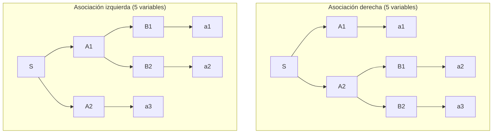

# 6.2 Formas canónicas de gramáticas

Una vez que una gramática independiente del contexto (GIC) ha sido depurada en una **gramática bien formada** (sin producciones-$\lambda$, sin producciones unitarias y sin símbolos inútiles), es posible imponer restricciones adicionales sobre el formato sintáctico del lado derecho de todas sus producciones. Estas representaciones estandarizadas se denominan **formas normales** o **formas canónicas** (De Castro Korgi, 2004; Acevedo Juárez, 2006).

Lejos de ser meras curiosidades formales, las formas canónicas cumplen un doble papel fundamental:
1. Permiten demostrar resultados estructurales profundos sobre todos los lenguajes independientes del contexto (LIC), como el Lema de bombeo (Sección 6.3).
2. Hacen posible el diseño de algoritmos eficientes de análisis sintáctico y decisión de pertenencia —en particular, el algoritmo **CYK** mediante la Forma Normal de Chomsky y la correspondencia directa con autómatas con pila sin transiciones-$\lambda$ mediante la Forma Normal de Greibach.

---

## 6.2.1 Gramáticas en forma normal

### Forma Normal de Chomsky (FNC)

#### Definición formal
Una GIC $G = (V, \Sigma, P, S)$ se encuentra en **Forma Normal de Chomsky (FNC)** si satisface las condiciones siguientes (De Castro Korgi, 2004, Secc. 4.11, p. 113; Acevedo Juárez, 2006, Secc. 3.4, p. 93):

1. $G$ no posee variables ni símbolos inútiles.
2. $G$ no posee producciones-$\lambda$ (salvo, opcionalmente, $S \to \lambda$ cuando $\lambda \in L(G)$, en cuyo caso se exige además que $S$ no aparezca en el lado derecho de ninguna producción).
3. Toda producción en $P$ (distinta de $S \to \lambda$) adopta exactamente una de estas dos formas:
   - **Producción binaria:** $A \to BC$, con $A, B, C \in V$.
   - **Producción simple (terminal):** $A \to a$, con $A \in V$ y $a \in \Sigma$.

En particular, una gramática en FNC carece por completo de producciones unitarias ($A \to B$). Asimismo, en aplicaciones como el Lema de bombeo o el análisis sintáctico, suele garantizarse que la variable inicial sea **no recursiva** (que no aparezca en el cuerpo de ninguna producción):

**Teorema (Eliminación de recursividad del símbolo inicial; De Castro Korgi, 2004, Teorema 4.11.2).** Dada una GIC $G = (V, \Sigma, P, S)$, la gramática $G' = (V \cup \{S'\}, \Sigma, P \cup \{S' \to S\}, S')$, con $S' \notin V$, cumple $L(G') = L(G)$ y su símbolo inicial $S'$ no aparece en el lado derecho de ninguna producción de $G'$.

### Algoritmo constructivo de conversión a FNC

**Teorema (Conversión a FNC; De Castro Korgi, 2004, Teorema 4.11.1).** Toda GIC $G$ es equivalente a una gramática en Forma Normal de Chomsky (permitiendo $S' \to \lambda$ si $\lambda \in L(G)$, o equivalente salvo $\lambda$ en sentido estricto).

El procedimiento constructivo consta de cinco pasos:

1. **Separación de la variable inicial (opcional si $S$ aparece en algún cuerpo o si $\lambda \in L(G)$):** Añadir una nueva variable inicial $S' \notin V$ con la regla $S' \to S$.
2. **Obtención de una gramática bien formada:** Aplicar el orden estricto de la Sección 6.1.5 (eliminar producciones-$\lambda$, luego producciones unitarias y finalmente símbolos inútiles en el orden $TERM \to ALC$). Si $\lambda \in L(G)$, conservar únicamente $S' \to \lambda$.
   Tras este paso, toda producción distinta de $S' \to \lambda$ tiene la forma $A \to a$ ($a \in \Sigma$) o $A \to X_1 X_2 \dots X_m$ con $m \ge 2$ y $X_j \in V \cup \Sigma$.
3. **Aislamiento de terminales en cuerpos de longitud $\ge 2$:** Para cada terminal $a \in \Sigma$ que aparezca en alguna producción de longitud $m \ge 2$, introducir una nueva variable $T_a \notin V$ con la única producción $T_a \to a$, y reemplazar cada ocurrencia de $a$ en cuerpos de longitud $\ge 2$ por $T_a$.
4. **Binarización de producciones de longitud $\ge 3$:** Toda producción resultante es ahora de la forma $A \to B_1 B_2 \dots B_m$ con $B_j \in V$. Si $m = 2$, ya está en FNC. Si $m \ge 3$, introducir $m - 2$ variables nuevas $Z_1, Z_2, \dots, Z_{m-2}$ y sustituir la producción por la cadena binaria:
   $$A \to B_1 Z_1, \qquad Z_1 \to B_2 Z_2, \qquad \dots, \qquad Z_{m-2} \to B_{m-1} B_m.$$
5. **Verificación final:** Todas las reglas (salvo eventualmente $S' \to \lambda$) son de la forma $A \to BC$ o $A \to a$, y todas las variables nuevas introducidas en los pasos 3 y 4 son terminables y alcanzables.

### Ejemplo 1: Conversión completa a FNC (adaptado de De Castro Korgi, 2004, pp. 114–116)

Convertir a FNC la siguiente gramática $G$:
$$G: \quad \begin{cases} S \to AB \mid aBC \mid SBS \\ A \to aA \mid C \\ B \to bbB \mid b \\ C \to cC \mid \lambda \end{cases}$$

1. **Variable inicial no recursiva y análisis de símbolos inútiles:**
   Como $S$ aparece en $S \to SBS$, si se requiere variable inicial no recursiva puede introducirse $S' \to S$; en este ejemplo observaremos además que $\lambda \notin L(G)$ ($S$ siempre exige al menos una $b$ proveniente de $B$).
   - Variables terminables: $TERM = \{B, C, S, A\}$ (todas).
   - Variables alcanzables: $ALC = \{S, A, B, C\}$ (todas).
   No hay variables inútiles en $G$.

2. **Eliminación de producciones-$\lambda$:**
   Calculamos $ANUL_1 = \{C\}$, $ANUL_2 = \{C, A\}$, $ANUL_3 = \{C, A\}$. Al suprimir $C \to \lambda$ y simular sus anulaciones obtenemos $G_1$:
   $$G_1: \quad \begin{cases} S \to AB \mid aBC \mid SBS \mid B \mid aB \\ A \to aA \mid C \mid a \\ B \to bbB \mid b \\ C \to cC \mid c \end{cases}$$

3. **Eliminación de producciones unitarias:**
   Calculamos $UNIT(S) = \{S, B\}$, $UNIT(A) = \{A, C\}$, $UNIT(B) = \{B\}$, $UNIT(C) = \{C\}$. Sustituyendo $S \to B$ y $A \to C$, se obtiene la gramática bien formada $G_2$:
   $$G_2: \quad \begin{cases} S \to AB \mid aBC \mid SBS \mid aB \mid bbB \mid b \\ A \to aA \mid a \mid cC \mid c \\ B \to bbB \mid b \\ C \to cC \mid c \end{cases}$$

4. **Aislamiento de terminales:**
   Introducimos $T_a \to a$, $T_b \to b$ y $T_c \to c$ para los cuerpos de longitud $\ge 2$:
   $$G_3: \quad \begin{cases} S \to AB \mid T_a BC \mid SBS \mid T_a B \mid T_b T_b B \mid b \\ A \to T_a A \mid T_c C \mid a \mid c \\ B \to T_b T_b B \mid b \\ C \to T_c C \mid c \\ T_a \to a, \quad T_b \to b, \quad T_c \to c \end{cases}$$

5. **Binarización:**
   Las producciones de longitud $3$ son $S \to T_a BC$, $S \to SBS$, $S \to T_b T_b B$ y $B \to T_b T_b B$. Introducimos $T_1 \to BC$, $T_2 \to BS$ y $T_3 \to T_b B$ (nótese que $T_3$ puede compartirse entre $S$ y $B$):
   $$G_4: \quad \begin{cases} S \to AB \mid T_a T_1 \mid S T_2 \mid T_a B \mid T_b T_3 \mid b \\ A \to T_a A \mid T_c C \mid a \mid c \\ B \to T_b T_3 \mid b \\ C \to T_c C \mid c \\ T_1 \to BC, \quad T_2 \to BS, \quad T_3 \to T_b B \\ T_a \to a, \quad T_b \to b, \quad T_c \to c \end{cases}$$
   *(Si además se exige que la variable inicial sea no recursiva, basta agregar $S' \to AB \mid T_a T_1 \mid S T_2 \mid T_a B \mid T_b T_3 \mid b$ y declarar $S'$ como símbolo inicial).*

### Teorema de longitud de derivación en FNC

En una gramática en FNC, el árbol de derivación de cualquier cadena no vacía $w \in \Sigma^+$ tiene una estructura binaria sumamente regular: cada nodo interno asociado a una regla binaria $A \to BC$ se ramifica exactamente en dos hijos variables, y cada variable pre-terminal $A \to a$ origina una única hoja terminal.

**Teorema (Longitud exacta de derivación en FNC; De Castro Korgi, 2004, p. 136).** Sea $G = (V, \Sigma, P, S)$ una GIC en Forma Normal de Chomsky. Para toda cadena $w \in \Sigma^+$ de longitud $n = |w| \ge 1$, toda derivación $S \Rightarrow_G^* w$ tiene exactamente **$2n - 1$ pasos** (equivalentemente, su árbol de derivación contiene exactamente $2n - 1$ nodos etiquetados con variables: $n - 1$ nodos binarios y $n$ nodos pre-terminales).

*Demostración (por inducción fuerte sobre $n = |w| \ge 1$).*
- **Caso base ($n = 1$):** Si $w = a \in \Sigma$, como toda regla binaria produce al menos dos variables (que por ausencia de producciones-$\lambda$ derivan cadenas de longitud $\ge 2$), el único modo de derivar $w$ es mediante una sola producción simple $S \to a$. Esta derivación tiene $1 = 2(1) - 1$ pasos.
- **Paso inductivo:** Supongamos cierto que para toda variable $X \in V$ y toda cadena $u \in \Sigma^+$ con $1 \le |u| < n$, cualquier derivación $X \Rightarrow_G^* u$ consta de $2|u| - 1$ pasos. Sea $w \in \Sigma^+$ con $|w| = n \ge 2$ y consideremos una derivación $A \Rightarrow_G^* w$. El primer paso debe emplear una producción binaria $A \to BC$ (pues una producción simple solo generaría longitud $1$). De este modo, $w$ se particiona como $w = w_1 w_2$ con $B \Rightarrow_G^* w_1$ y $C \Rightarrow_G^* w_2$. Al no haber producciones-$\lambda$ utilizables desde $B$ o $C$, se cumple $|w_1| \ge 1$ y $|w_2| \ge 1$, luego $|w_1| < n$ y $|w_2| < n$. Por hipótesis de inducción, las subderivaciones de $w_1$ y $w_2$ toman $2|w_1| - 1$ y $2|w_2| - 1$ pasos, respectivamente. Sumando el paso inicial $A \to BC$, el número total de pasos es:
  $$1 + (2|w_1| - 1) + (2|w_2| - 1) = 2(|w_1| + |w_2|) - 1 = 2n - 1. \quad \blacksquare$$

Por ejemplo, para una cadena de longitud $n = 3$ como $a_1 a_2 a_3$, solo existen dos formas posibles de árbol binario en FNC, ambas con $2(3) - 1 = 5$ nodos etiquetados con variables:

### Aplicación de la FNC al algoritmo CYK

Probar todos los árboles posibles con $2n - 1$ variables requeriría tiempo exponencial respecto a $n$. El **algoritmo CYK** (Cocke–Younger–Kasami) aprovecha la estructura binaria de la FNC para resolver el problema de pertenencia $w \in L(G)$ en tiempo polinomial $O(n^3 \cdot |P|)$ mediante **programación dinámica** (De Castro Korgi, 2004, Secc. 4.15, pp. 136–139).

Sea $w = a_1 a_2 \dots a_n \in \Sigma^+$ ($n \ge 1$) y $G$ una gramática en FNC. Para $1 \le i \le n$ y $1 \le j \le n - i + 1$, definimos el conjunto:
$$X_{i,j} := \{A \in V \mid A \Rightarrow_G^+ a_i a_{i+1} \dots a_{i+j-1}\}$$
es decir, las variables que derivan la subcadena de $w$ que comienza en la posición $i$ y tiene longitud $j$.

#### Recurrencia y algoritmo CYK
1. **Caso base ($j = 1$, subcadenas de longitud $1$):** Para cada $i \in \{1, \dots, n\}$,
   $$X_{i,1} = \{A \in V \mid (A \to a_i) \in P\}.$$
2. **Paso inductivo ($j = 2, 3, \dots, n$):** Para cada $i \in \{1, \dots, n - j + 1\}$, una variable $A$ deriva la subcadena $a_i \dots a_{i+j-1}$ si y solo si existe una regla binaria $A \to BC$ y un punto de partición $k \in \{1, \dots, j - 1\}$ que divide la subcadena en un prefijo de longitud $k$ (iniciado en $i$) y un sufijo de longitud $j - k$ (iniciado en $i + k$):
   $$X_{i,j} = \{A \in V \mid \exists (A \to BC) \in P, \; \exists k \in \{1, \dots, j - 1\} \text{ con } B \in X_{i,k} \text{ y } C \in X_{i+k,\, j-k}\}.$$
3. **Decisión:** $w \in L(G) \iff S \in X_{1,n}$. (Si $w = \lambda$, basta comprobar directamente si $(S \to \lambda) \in P$).

### Ejemplo 2: Ejecución del algoritmo CYK paso a paso (adaptado de De Castro Korgi, 2004, pp. 137–138)

Considérese la siguiente gramática en FNC:
$$G: \quad \begin{cases} S \to BA \mid AC \\ A \to CC \mid b \\ B \to AB \mid a \\ C \to BA \mid a \end{cases}$$

#### Caso A: Cadena $w = bbab$ ($n = 4$)
- **Columna $j = 1$** (reglas simples para $a_1=b, a_2=b, a_3=a, a_4=b$):
  $$X_{1,1} = \{A\}, \quad X_{2,1} = \{A\}, \quad X_{3,1} = \{B, C\}, \quad X_{4,1} = \{A\}.$$
- **Columna $j = 2$** ($k = 1$):
  - $X_{1,2}$ ($X_{1,1} X_{2,1} = \{AA\}$): $\emptyset$.
  - $X_{2,2}$ ($X_{2,1} X_{3,1} = \{AB, AC\}$): $\{B, S\}$ (por $B \to AB$ y $S \to AC$).
  - $X_{3,2}$ ($X_{3,1} X_{4,1} = \{BA, CA\}$): $\{S, C\}$ (por $S \to BA$ y $C \to BA$).
- **Columna $j = 3$** ($k \in \{1, 2\}$):
  - $X_{1,3}$ ($X_{1,1} X_{2,2} \cup X_{1,2} X_{3,1} = \{AB, AS\} \cup \emptyset$): $\{B\}$ (por $B \to AB$).
  - $X_{2,3}$ ($X_{2,1} X_{3,2} \cup X_{2,2} X_{4,1} = \{AS, AC\} \cup \{BA, SA\}$): $\{S, C\}$ (por $S \to AC, S \to BA, C \to BA$).
- **Columna $j = 4$** ($k \in \{1, 2, 3\}$):
  - $X_{1,4}$ ($X_{1,1} X_{2,3} \cup X_{1,2} X_{3,2} \cup X_{1,3} X_{4,1} = \{AS, AC\} \cup \emptyset \cup \{BA\}$): $\{S, C\}$.

| Posición $i$ | Símbolo $a_i$ | $j=1$ | $j=2$ | $j=3$ | $j=4$ |
| :---: | :---: | :---: | :---: | :---: | :---: |
| $i=1$ | $b$ | $\{A\}$ | $\emptyset$ | $\{B\}$ | $\{S, C\}$ |
| $i=2$ | $b$ | $\{A\}$ | $\{B, S\}$ | $\{S, C\}$ | — |
| $i=3$ | $a$ | $\{B, C\}$ | $\{S, C\}$ | — | — |
| $i=4$ | $b$ | $\{A\}$ | — | — | — |

Como $S \in X_{1,4}$, se concluye que $bbab \in L(G)$. Además, retrocediendo en la tabla (siguiendo $S \to AC$ con $A \in X_{1,1}$ y $C \in X_{2,3}$) se reconstruye una derivación de exactamente $2(4) - 1 = 7$ pasos:
$$S \Rightarrow AC \Rightarrow bC \Rightarrow bBA \Rightarrow bABA \Rightarrow bbBA \Rightarrow bbaA \Rightarrow bbab.$$

#### Caso B: Cadena $w = abba$ ($n = 4$)
- **Columna $j = 1$** ($a_1=a, a_2=b, a_3=b, a_4=a$):
  $$X_{1,1} = \{B, C\}, \quad X_{2,1} = \{A\}, \quad X_{3,1} = \{A\}, \quad X_{4,1} = \{B, C\}.$$
- **Columna $j = 2$:**
  - $X_{1,2}$ ($X_{1,1} X_{2,1} = \{BA, CA\}$): $\{S, C\}$.
  - $X_{2,2}$ ($X_{2,1} X_{3,1} = \{AA\}$): $\emptyset$.
  - $X_{3,2}$ ($X_{3,1} X_{4,1} = \{AB, AC\}$): $\{B, S\}$.
- **Columna $j = 3$:**
  - $X_{1,3}$ ($X_{1,1} X_{2,2} \cup X_{1,2} X_{3,1} = \emptyset \cup \{SA, CA\}$): $\emptyset$.
  - $X_{2,3}$ ($X_{2,1} X_{3,2} \cup X_{2,2} X_{4,1} = \{AB, AS\} \cup \emptyset$): $\{B\}$.
- **Columna $j = 4$:**
  - $X_{1,4}$ ($X_{1,1} X_{2,3} \cup X_{1,2} X_{3,2} \cup X_{1,3} X_{4,1} = \{BB, CB\} \cup \{SB, SS, CB, CS\} \cup \emptyset$): $\emptyset$.

| Posición $i$ | Símbolo $a_i$ | $j=1$ | $j=2$ | $j=3$ | $j=4$ |
| :---: | :---: | :---: | :---: | :---: | :---: |
| $i=1$ | $a$ | $\{B, C\}$ | $\{S, C\}$ | $\emptyset$ | $\emptyset$ |
| $i=2$ | $b$ | $\{A\}$ | $\emptyset$ | $\{B\}$ | — |
| $i=3$ | $b$ | $\{A\}$ | $\{B, S\}$ | — | — |
| $i=4$ | $a$ | $\{B, C\}$ | — | — | — |

Como $S \notin X_{1,4}$, se decide que $abba \notin L(G)$.

---

## 6.2.2 Gramáticas en forma estándar

En la terminología clásica (De Castro Korgi, 2004, Secc. 4.12; Acevedo Juárez, 2006, Secc. 3.5), la **forma estándar** o **Forma Normal de Greibach (FNG)** exige que cada producción produzca inmediatamente un símbolo terminal en su primer carácter, seguido únicamente de cero o más variables.

### Definición formal de la Forma Normal de Greibach (FNG)

Una GIC $G = (V, \Sigma, P, S)$ está en **Forma Normal de Greibach (FNG)** si:
1. $G$ no tiene variables inútiles ni producciones-$\lambda$ (excepto eventualmente $S \to \lambda$ con $S$ no recursiva si $\lambda \in L(G)$).
2. Todas las producciones de $P$ (distintas de $S \to \lambda$) son de la forma:
   $$A \to a\alpha, \quad \text{donde } a \in \Sigma \text{ y } \alpha \in V^*$$
   es decir, $A \to a$ (producción simple) o $A \to a B_1 B_2 \dots B_k$ con $B_i \in V$.

**Propiedad notable:** En toda derivación en FNG, cada aplicación de regla genera exactamente **un símbolo terminal** al frente de la forma sentencial. Por consiguiente, toda cadena $w \in L(G)$ de longitud $n = |w| \ge 1$ se deriva en exactamente **$n$ pasos** (en contraste con los $2n - 1$ pasos de la FNC). Esto permite construir directamente un autómata con pila no determinista sin transiciones-$\lambda$ que reconozca $L(G)$ leyendo un símbolo de entrada por cada transición.

### Eliminación de la recursividad por la izquierda

**Definición (De Castro Korgi, 2004, Def. 4.12.1).** Una variable $A \in V$ es **recursiva a la izquierda (directa)** si posee una producción de la forma $A \to A\alpha$ con $\alpha \in (V \cup \Sigma)^*$. Más en general, es **recursiva a la izquierda** (directa o indirecta) si existe una derivación $A \Rightarrow_G^+ A\alpha$.

Este tipo de reglas expanden el árbol sintáctico indefinidamente hacia la izquierda sin consumir símbolos terminales, por lo que resultan incompatibles con la FNG y con el análisis sintáctico descendente recursivo.

**Teorema (Eliminación de la recursividad a la izquierda directa; De Castro Korgi, 2004, Teorema 4.12.2; Acevedo Juárez, 2006, Secc. 3.7).** Sean las producciones de una variable $A \in V$ particionadas en dos grupos:
$$A \to A\alpha_1 \mid A\alpha_2 \mid \dots \mid A\alpha_n \qquad \text{(recursivas a la izquierda)}$$
$$A \to \beta_1 \mid \beta_2 \mid \dots \mid \beta_m \qquad \text{(ninguna }\beta_j\text{ comienza con }A\text{)}$$
donde $n \ge 1, m \ge 1$ y $\alpha_i, \beta_j \in (V \cup \Sigma)^*$. Introduciendo una variable completamente nueva $Z \notin V$, las producciones anteriores pueden reemplazarse sin alterar el lenguaje generado por:
$$A \to \beta_1 \mid \beta_2 \mid \dots \mid \beta_m \mid \beta_1 Z \mid \beta_2 Z \mid \dots \mid \beta_m Z$$
$$Z \to \alpha_1 \mid \alpha_2 \mid \dots \mid \alpha_n \mid \alpha_1 Z \mid \alpha_2 Z \mid \dots \mid \alpha_n Z.$$

*Demostración.* En la gramática original, toda cadena derivada de $A$ en la que ya no queda ninguna $A$ en el extremo izquierdo se obtiene aplicando $k \ge 0$ veces las reglas recursivas $A \to A\alpha_{i_r}$ y finalizando esa cadena izquierda con una regla no recursiva $A \to \beta_j$:
$$A \Rightarrow A\alpha_{i_1} \Rightarrow A\alpha_{i_2}\alpha_{i_1} \Rightarrow \dots \Rightarrow A\alpha_{i_k}\dots\alpha_{i_1} \Rightarrow \beta_j \alpha_{i_k}\dots\alpha_{i_1}.$$
Por tanto, $A$ genera exactamente el conjunto de formas sentenciales $\{\beta_1, \dots, \beta_m\}\cdot\{\alpha_1, \dots, \alpha_n\}^*$.
Con las nuevas producciones, $Z$ genera recursivamente por la derecha $\{\alpha_1, \dots, \alpha_n\}^+$ (al elegir $\alpha_r Z$ seguido de $\alpha_s$), mientras que $A$ deriva $\beta_j$ (caso $k = 0$) o $\beta_j Z$ seguido de una derivación de $Z$ (casos $k \ge 1$). Así, el conjunto de formas sentenciales generadas por $A$ coincide exactamente con $\{\beta_1, \dots, \beta_m\}\cdot\{\alpha_1, \dots, \alpha_n\}^*$. $\blacksquare$

### Algoritmo completo de conversión a FNG

**Teorema (Conversión a FNG; De Castro Korgi, 2004, Teorema 4.12.4).** Toda GIC sin la cadena vacía (o salvo $\lambda$) es equivalente a una gramática en Forma Normal de Greibach.

Partimos de una gramática $G$ previamente convertida a **Forma Normal de Chomsky** (sin $S \to \lambda$), aunque el método también aplica a cualquier gramática bien formada. El algoritmo consta de cuatro pasos:

1. **Ordenamiento de las variables originales:** Enumerar las variables originales en un orden fijo $A_1, A_2, \dots, A_m$ (con $A_1 = S$).
2. **Fase ascendente (orden creciente $i = 1, 2, \dots, m$):** Transformar las producciones de $A_i$ de modo que toda regla de $A_i$ comience con un **terminal** $a \in \Sigma$ o con una **variable $A_k$ de índice $k > i$**:
   - Mientras exista alguna regla $A_i \to A_j \gamma$ con $j < i$, aplicar la regla de **substitución** (Lema 4.12.3) reemplazando $A_j$ por todas sus producciones actuales. Como las producciones de $A_j$ ya comienzan con terminales o con variables de índice $> j$, tras a lo sumo $i - j$ sustituciones el primer símbolo tendrá índice $k \ge i$ o será un terminal.
   - Si quedan producciones con recursividad izquierda directa ($A_i \to A_i \alpha$), eliminarlas aplicando el Teorema 4.12.2 e introduciendo una nueva variable auxiliar $Z_i$. Como ningún $\beta$ en las reglas no recursivas comienza con $A_i$, ahora todas las reglas de $A_i$ comienzan con terminal o con $A_k$ ($k > i$).
3. **Fase descendente (sustitución hacia atrás, $i = m, m-1, \dots, 1$):**
   - Para $i = m$, al no existir variables originales de índice mayor que $m$, todas las producciones de $A_m$ ya comienzan con un terminal.
   - Descendiendo para $i = m-1, \dots, 1$: sustituir el primer símbolo de cada regla $A_i \to A_k \gamma$ ($k > i$) usando las producciones de $A_k$, las cuales ya comienzan todas con un terminal.
4. **Normalización de las variables auxiliares $Z_i$:** Como toda regla $Z_i \to \alpha \mid \alpha Z_i$ proviene de cuerpos de producciones de la FNC original (o de sustituciones cuya cabeza $A_j \to \beta Z_j$ solo deja variables $Z_j$ al final del cuerpo, nunca al principio), el primer símbolo de toda regla de $Z_i$ es un terminal o una variable original $A_k$. Aplicando la regla de substitución a ese primer símbolo $A_k$ (cuyas producciones ya están en FNG), todas las producciones de $Z_i$ quedan en la forma $Z_i \to a\delta$.

> [!NOTE]
> Aunque el algoritmo garantiza siempre una FNG equivalente, las sucesivas sustituciones pueden provocar un crecimiento combinatorio en el número de producciones (por ejemplo, una gramática sencilla de 8 producciones en FNC puede expandirse a más de cien producciones en FNG; De Castro Korgi, 2004, p. 124).

### Ejemplos desarrollados paso a paso

#### Ejemplo 3: Conversión directa a FNG (De Castro Korgi, 2004, p. 122)

Convertir a FNG la siguiente gramática en FNC:
$$G: \quad \begin{cases} S \to AA \mid a \\ A \to AA \mid b \end{cases}$$

- **Paso 1 (Orden):** $A_1 = S$, $A_2 = A$.
- **Paso 2 (Fase ascendente):**
  - Para $i = 1$ ($S$): $S \to AA \mid a$. La regla $S \to AA$ comienza con $A = A_2$ ($2 > 1$), y $S \to a$ comienza con terminal. Se mantiene sin cambios.
  - Para $i = 2$ ($A$): $A \to AA \mid b$ presenta recursividad izquierda directa ($\alpha = A$, $\beta = b$). Introducimos $Z$:
    $$A \to b \mid bZ, \qquad Z \to A \mid AZ.$$
- **Paso 3 (Fase descendente):**
  - $A$ ya tiene todas sus reglas iniciando con el terminal $b$.
  - En $S \to AA$, sustituimos la primera $A$ por $b \mid bZ$:
    $$S \to bA \mid bZA \mid a.$$
- **Paso 4 (Normalización de $Z$):**
  En $Z \to A \mid AZ$, sustituimos la $A$ inicial por $b \mid bZ$ (simplificando duplicados):
  - De $Z \to A$: $Z \to b \mid bZ$.
  - De $Z \to AZ$: $Z \to bZ \mid bZZ$.

La gramática final en FNG es:
$$G_{\text{FNG}}: \quad \begin{cases} S \to bA \mid bZA \mid a \\ A \to b \mid bZ \\ Z \to b \mid bZ \mid bZZ \end{cases}$$

#### Ejemplo 4: Conversión a FNG con recursividad izquierda indirecta

Convertir a FNG la siguiente gramática en FNC (donde la variable $B$ depende de $S$, generando recursividad izquierda mutua o indirecta):
$$G: \quad \begin{cases} S \to AB \\ A \to BS \mid b \\ B \to SA \mid a \end{cases}$$

- **Paso 1 (Orden):** $A_1 = S$, $A_2 = A$, $A_3 = B$.
- **Paso 2 (Fase ascendente):**
  - Para $i = 1$ ($S$): $S \to AB$ empieza por $A_2$ ($2 > 1$). Se conserva.
  - Para $i = 2$ ($A$): $A \to BS \mid b$ empieza por $A_3$ ($3 > 2$) o por $b$. Se conserva.
  - Para $i = 3$ ($B$): $B \to SA \mid a$ comienza por $S = A_1$ ($1 < 3$).
    1. Sustituimos $S \to AB$: $B \to ABA \mid a$. Ahora comienza por $A = A_2$ ($2 < 3$).
    2. Sustituimos $A \to BS \mid b$: $B \to BSBA \mid bBA \mid a$.
    3. Apareció recursividad izquierda directa $B \to BSBA$ (con $\alpha = SBA$ y $\beta_1 = bBA$, $\beta_2 = a$). La eliminamos introduciendo $Z$:
       $$B \to bBA \mid a \mid bBAZ \mid aZ, \qquad Z \to SBA \mid SBAZ.$$
- **Paso 3 (Fase descendente, de $A_3 = B$ hacia $A_1 = S$):**
  - $B$ ya inicia siempre con terminal ($a$ o $b$).
  - En $A \to BS \mid b$, sustituimos la $B$ inicial:
    $$A \to bBAS \mid aS \mid bBAZS \mid aZS \mid b.$$
  - En $S \to AB$, sustituimos la $A$ inicial:
    $$S \to bBASB \mid aSB \mid bBAZSB \mid aZSB \mid bB.$$
- **Paso 4 (Normalización de $Z$):**
  En $Z \to SBA \mid SBAZ$, sustituimos la $S$ inicial por sus 5 producciones ya en FNG:
  $$\begin{aligned}
  Z \to \; & bBASBBA \mid aSBBA \mid bBAZSBBA \mid aZSBBA \mid bBBA \mid \\
           & bBASBBAZ \mid aSBBAZ \mid bBAZSBBAZ \mid aZSBBAZ \mid bBBAZ.
  \end{aligned}$$

Todas las producciones obtenidas son de la forma $X \to t\alpha$ con $t \in \{a, b\}$ y $\alpha \in \{S, A, B, Z\}^*$. Podemos comprobarlo con la cadena $abaa$:
- En $G$: $S \Rightarrow AB \Rightarrow BSB \Rightarrow aSB \Rightarrow aABB \Rightarrow abBB \Rightarrow abaB \Rightarrow abaa$ (7 pasos).
- En $G_{\text{FNG}}$: $S \Rightarrow aSB \Rightarrow abBB \Rightarrow abaB \Rightarrow abaa$ (exactamente $4 = |abaa|$ pasos).

---

## Ejercicios propuestos

1. **Conversión a FNC.** Convierte las siguientes gramáticas a Forma Normal de Chomsky (en el inciso b, garantiza además que la variable inicial sea no recursiva):
   - **(a)** $S \to ABC \mid BaC \mid aB$, $\; A \to Aa \mid a$, $\; B \to BAB \mid bab$, $\; C \to cC \mid c$.
   - **(b)** $S \to aASb \mid BAb$, $\; A \to Aa \mid a \mid \lambda$, $\; B \to BAB \mid bAb$, $\; C \to cCS \mid \lambda$.

2. **Algoritmo CYK.** Dada la gramática en FNC:
   $$G: \quad \begin{cases} S \to BA \mid AB \\ A \to CA \mid a \\ B \to BB \mid b \\ C \to BA \mid c \end{cases}$$
   construye las tablas del algoritmo CYK para decidir si pertenecen a $L(G)$ las cadenas: **(i)** $w_1 = bca$, **(ii)** $w_2 = acbc$, **(iii)** $w_3 = cabb$.

3. **Eliminación de recursividad izquierda.** Elimina la recursividad izquierda directa e indirecta de la gramática:
   $$S \to Aa \mid b, \qquad A \to Ac \mid Sd \mid a.$$

4. **Conversión a FNG.** Encuentra una gramática equivalente en Forma Normal de Greibach para:
   - **(a)** $S \to CA \mid AC \mid a$, $\; A \to BA \mid AB \mid b$, $\; B \to AA \mid a \mid b$, $\; C \to AC \mid CC \mid a$.
   - **(b)** $S \to SC \mid AA \mid a$, $\; A \to CA \mid AB \mid a$, $\; B \to AC \mid b$, $\; C \to CA \mid AS \mid b$ *(sugerencia: primero asegúrate de trabajar sin recursividad de $S$ si mantienes $\lambda$, o aplica directamente el orden $S, A, B, C$ sobre la gramática ya en FNC)*.

---

## Referencias

- Acevedo Juárez, A. (2006). *Teoría de la computación* [Tesis de licenciatura, Instituto Tecnológico de Celaya].
- De Castro Korgi, R. (2004). *Teoría de la computación: Lenguajes, autómatas, gramáticas*. Universidad Nacional de Colombia.
