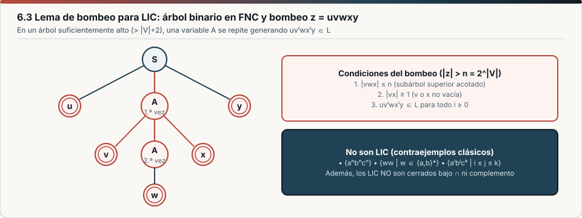
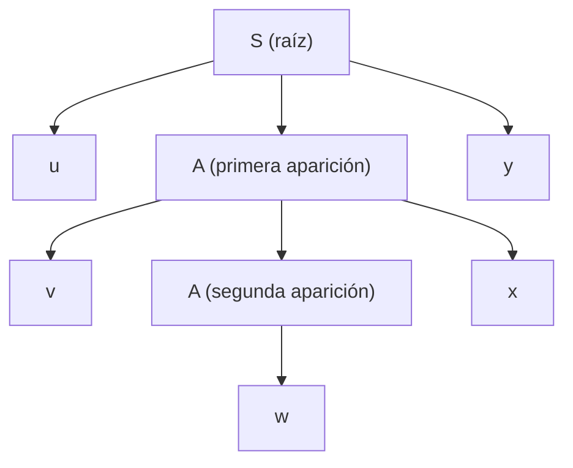
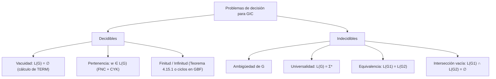

# 6.3 Estructura de los lenguajes independientes al contexto

El estudio de las formas normales permite responder preguntas profundas acerca del alcance real de las gramáticas independientes del contexto (GIC): ¿qué propiedades estructurales comparten obligatoriamente las cadenas suficientemente largas de todo lenguaje independiente del contexto (LIC)?, ¿qué operaciones entre lenguajes preservan la independencia del contexto y cuáles la rompen?, ¿qué preguntas sobre una GIC pueden responderse mediante un algoritmo y cuáles son intrínsecamente irresolubles?

Esta sección aborda tres pilares teóricos de la clase de los LIC (De Castro Korgi, 2004, Secc. 4.13–4.15): el **Lema de bombeo**, las **propiedades de clausura** y los **algoritmos de decisión**.

---

## 6.3.1 Lema de bombeo para lenguajes independientes del contexto

Al igual que existe un lema de bombeo para lenguajes regulares basado en la repetición de estados en un autómata finito, existe un lema análogo para LIC —demostrado originalmente por Bar-Hillel, Perles y Shamir— que se deduce de la repetición de variables en un árbol de derivación en **Forma Normal de Chomsky**. Su utilidad principal consiste en **demostrar por contradicción que ciertos lenguajes no son independientes del contexto**.

### Resultados previos sobre árboles en FNC

Sea $G = (V, \Sigma, P, S)$ una gramática en FNC (con variable inicial no recursiva). El árbol de derivación de cualquier cadena $w \in \Sigma^+$ es un árbol binario (salvo los nodos pre-terminales que tienen un único hijo terminal).

**Lema previo (Cota de longitud por profundidad; De Castro Korgi, 2004, Teorema 4.13.1 y Corolario 4.13.2).** Si la trayectoria más larga desde la raíz hasta una hoja en un árbol de derivación de $S \Rightarrow_G^* w$ ($w \in \Sigma^+$) tiene como máximo $k + 2$ nodos ($k \ge 0$), entonces $|w| \le 2^k$. Dicho a la inversa (*contrarrecíprocamente*), si la cadena es muy larga ($|w| > 2^k$), el árbol tiene que ser suficientemente alto: la trayectoria más larga contendrá al menos $k + 3$ nodos (es decir, al menos $k + 2$ nodos etiquetados con variables antes de alcanzar la hoja terminal).

*Esquema inductivo:* Para $k = 0$ (trayectoria de $2$ nodos: $S \to a$), $|w| = 1 = 2^0$. Si la raíz se ramifica en dos subárboles cuyas trayectorias más largas tienen a lo sumo $(k - 1) + 2$ nodos, cada subárbol genera a lo sumo $2^{k-1}$ hojas terminales, dando en total $|w| \le 2^{k-1} + 2^{k-1} = 2^k$.

### Enunciado y demostración del Lema de bombeo

**Teorema (Lema de bombeo para LIC; De Castro Korgi, 2004, Secc. 4.13.3, p. 127).** Sea $L$ un lenguaje independiente del contexto. Existe una constante $n \ge 1$ (llamada **constante de bombeo** de $L$) tal que toda cadena $z \in L$ con $|z| > n$ puede descomponerse en cinco subcadenas $z = uvwxy$ que satisfacen simultáneamente:
1. $|vwx| \le n$.
2. $v \neq \lambda$ o $x \neq \lambda$ (es decir, $|vx| \ge 1$).
3. $uv^i w x^i y \in L$ para todo $i \ge 0$.

*(Nota de notación: tomando $n' = n + 1$, el enunciado equivale exactamente a exigir $|z| \ge n'$ en lugar de $|z| > n$, con la misma cota $|vwx| \le n'$).*

*Demostración.* Si $L$ es finito o $L \subseteq \{\lambda\}$, basta elegir $n$ igual a la longitud máxima de las cadenas de $L$ (o $n = 1$); en ese caso la propiedad se cumple de forma automática (*por vacuidad*), porque no existe ninguna cadena en $L$ con longitud mayor que $n$. Supongamos que $L$ contiene cadenas no vacías arbitrariamente largas. Por los teoremas de la Sección 6.2.1, existe una gramática en FNC $G = (V, \Sigma, P, S)$ con variable inicial no recursiva tal que $L(G) = L$ (y $S \to \lambda$ no interviene en derivaciones de cadenas no vacías).

Sea $k = |V|$ el número de variables de $G$ y elijamos la constante $n = 2^k$. Tomemos cualquier cadena $z \in L$ con $|z| > n = 2^k$, y consideremos un árbol de derivación para $S \Rightarrow_G^* z$.

1. **Existencia de una variable repetida:** Por el lema previo, como $|z| > 2^k$, la trayectoria más larga desde la raíz $S$ hasta las hojas contiene al menos $k + 3$ nodos. Examinemos los **últimos $k + 2$ nodos** de esa trayectoria (de arriba hacia abajo): el último es un terminal $a \in \Sigma$, y los $k + 1$ nodos inmediatamente anteriores están etiquetados con variables de $V$. Como $|V| = k$, por el principio del palomar al menos una variable $A \in V$ aparece repetida en ese tramo (nótese que $A \neq S$, pues $S$ es no recursiva y solo puede figurar en la raíz).

2. **Descomposición $z = uvwxy$:** Sean la aparición superior e inferior de $A$ en dicho segmento. Dividiendo las hojas generadas por debajo y por fuera de estas dos apariciones de $A$, existen cadenas $u, v, w, x, y \in \Sigma^*$ tales que:
   $$S \Rightarrow_G^* uAy, \qquad A \Rightarrow_G^+ vAx, \qquad A \Rightarrow_G^* w,$$
   de donde $z = uvwxy$.

3. **Verificación de la condición (1) ($|vwx| \le n$):** Al haber tomado la aparición superior de $A$ dentro de los últimos $k + 1$ nodos variables de la trayectoria más larga, el subárbol con raíz en esa aparición superior de $A$ tiene una trayectoria máxima de a lo sumo $k + 2$ nodos. Por el lema previo, las hojas de ese subárbol cumplen $|vwx| \le 2^k = n$.

4. **Verificación de la condición (2) ($v \neq \lambda$ o $x \neq \lambda$):** El primer paso de la subderivación $A \Rightarrow_G^+ vAx$ debe emplear una producción binaria $A \to BC$ (no existen reglas unitarias ni producciones-$\lambda$ para $A \neq S$). Como $A$ vuelve a aparecer en alguno de los subárboles de $B$ o $C$, el otro subárbol (que deriva a una subcadena no vacía de $v$ o de $x$, al carecer $G$ de producciones anulables) produce al menos un terminal. Por tanto, no es posible que $v = \lambda$ y $x = \lambda$ simultáneamente.

5. **Verificación de la condición (3) ($uv^i w x^i y \in L$ para todo $i \ge 0$):**
   - Para $i = 0$, sustituimos directamente $A \Rightarrow_G^* w$ en la aparición superior de $A$: $S \Rightarrow_G^* uAy \Rightarrow_G^* uwy \in L$.
   - Para $i \ge 1$, iteramos $i$ veces la subderivación $A \Rightarrow_G^+ vAx$ antes de cerrar con $A \Rightarrow_G^* w$:
     $$S \Rightarrow_G^* uAy \Rightarrow_G^* uvAxy \Rightarrow_G^* \dots \Rightarrow_G^* uv^i A x^i y \Rightarrow_G^* uv^i w x^i y \in L. \quad \blacksquare$$

### Aplicaciones: demostraciones de lenguajes que no son LIC

El esquema general para demostrar que un lenguaje $L$ no es LIC por contradicción consta de cuatro pasos:
1. Suponer que $L$ es LIC; por el Lema de bombeo, existe una constante $n \ge 1$.
2. Elegir estratégicamente una cadena concreta $z \in L$ (en función de $n$) tal que $|z| > n$.
3. Analizar **todas** las descomposiciones posibles $z = uvwxy$ compatibles con $|vwx| \le n$ y $vx \neq \lambda$.
4. Para cada caso, exhibir un valor entero $i \ge 0$ (habitualmente $i = 2$ o $i = 0$) tal que $uv^i w x^i y \notin L$, llegando a una contradicción.

#### Ejemplo 1: $L_1 = \{a^m b^m c^m \mid m \ge 0\}$ no es LIC (De Castro Korgi, 2004, p. 129)

Supongamos que $L_1$ es LIC y sea $n$ su constante de bombeo. Consideremos la cadena $z = a^n b^n c^n \in L_1$, cuya longitud es $|z| = 3n > n$. Por el lema, $z = uvwxy$ con $|vwx| \le n$ y $v \neq \lambda$ o $x \neq \lambda$.

Como $|vwx| \le n$, la subcadena $vwx$ **no puede contener simultáneamente los tres símbolos $a$, $b$ y $c$** (cualquier subcadena de $a^n b^n c^n$ que incluya $a$ y $c$ debe abarcar los $n$ símbolos $b$ completos más al menos una $a$ y una $c$, teniendo longitud $\ge n + 2$). Distinguimos dos casos exhaustivos:

- **Caso 1:** Alguna de las cadenas $v$ o $x$ contiene dos o más símbolos distintos (por ejemplo, $a$ y $b$, o $b$ y $c$). Al bombear con $i = 2$, en $uv^2 w x^2 y$ aparecerá al menos una $b$ antes de una $a$ o una $c$ antes de una $b$, violando el orden $a^* b^* c^*$; por tanto, $uv^2 w x^2 y \notin L_1$.
- **Caso 2:** Tanto $v$ como $x$ son homogéneas (cada una consta de un solo tipo de terminal o es vacía). Como $vwx$ carece de al menos uno de los tres símbolos $\{a, b, c\}$ y $vx \neq \lambda$, al pasar a $uv^2 w x^2 y$ aumenta la cantidad de al menos uno de los símbolos presentes en $vx$, mientras que el símbolo ausente en $vwx$ conserva exactamente $n$ apariciones. En consecuencia, los conteos dejan de ser iguales y $uv^2 w x^2 y \notin L_1$.

En todos los casos se contradice que $uv^2 w x^2 y \in L_1$, luego $L_1$ **no es un LIC**.

#### Ejemplo 2: $L_2 = \{ww \mid w \in \{a, b\}^*\}$ no es LIC

Supongamos que $L_2$ es LIC con constante de bombeo $n \ge 1$. Elegimos la cadena $z = a^n b^n a^n b^n \in L_2$ (aquí $w = a^n b^n$ y $|z| = 4n > n$). Por el lema, $z = uvwxy$ con $|vwx| \le n$ y $|vx| \ge 1$. Como cada uno de los cuatro bloques de $z$ tiene longitud $n$ y $|vwx| \le n$, existen tres ubicaciones posibles para $vwx$:

- **Caso 1: $vwx$ queda contenida íntegramente en la primera mitad $a^n b^n$ (primeras $2n$ posiciones).**
  Bombeamos hacia abajo con $i = 0$ obteniendo $z' = uwy$, cuya longitud es $4n - s$ con $s = |vx|$ ($1 \le s \le n$).
  - Si $s$ es impar, $|z'|$ es impar y por tanto $z' \notin L_2$.
  - Si $s = 2k$ es par ($1 \le k \le n/2$), $z'$ tiene longitud par $4n - 2k$ y cada mitad debe tener longitud $2n - k$. Como todos los símbolos suprimidos pertenecían a las primeras $2n$ posiciones de $z$, los últimos $2n$ símbolos de $z'$ siguen siendo $a^n b^n$. Luego, la segunda mitad de $z'$ es el sufijo de longitud $2n - k$ de $a^n b^n$, esto es, $a^{n-k} b^n$, que **termina en $b$** ($n \ge 1$). En cambio, la primera mitad de $z'$ (longitud $2n - k$) abarca los $2n - 2k$ símbolos sobrevivientes de la primera mitad original más los primeros $k$ símbolos de la segunda mitad original ($a^k$, pues $k < n$), por lo que **termina en $a$** ($k \ge 1$). Así, las dos mitades no coinciden y $uwy \notin L_2$.

- **Caso 2: $vwx$ cruza la frontera central entre el segundo bloque ($b^n$) y el tercer bloque ($a^n$).**
  Al tener $|vwx| \le n$, $vwx$ no puede tocar el primer bloque $a^n$ ni el cuarto bloque $b^n$. Al bombear hacia abajo con $i = 0$, $z' = uwy = a^n b^{n - r} a^{n - q} b^n$ donde $r + q = |vx| \ge 1$ ($0 \le r, q \le n$).
  - Si $r = n$ (entonces $q = 0$), $z' = a^{2n} b^n$ de longitud $3n$; si $3n$ es impar no está en $L_2$, y si es par su primera mitad es $a^{3n/2}$ mientras su segunda mitad contiene $b^n$, imposible.
  - Simétricamente, si $q = n$ ($r = 0$), $z' = a^n b^{2n}$, cuya primera mitad inicia con $a$ y la segunda inicia con $b$, imposible.
  - Si $0 \le r < n$ y $0 \le q < n$ (con $r + q \ge 1$), para que $z' = tt$ con $t \in L_2$ las dos mitades deberían tener las mismas longitudes en sus bloques de $a$ y de $b$: en particular $n = n - q$ y $n - r = n$, lo que implicaría $r = q = 0$, contradiciendo $r + q \ge 1$. Luego $uwy \notin L_2$.

- **Caso 3: $vwx$ queda contenida íntegramente en la segunda mitad $a^n b^n$ (últimas $2n$ posiciones).**
  Por simetría con el Caso 1, al tomar $i = 0$ ($z' = uwy$): si $|vx|$ es impar, $|z'|$ es impar; si $|vx| = 2k$ ($1 \le k \le n/2$), la primera mitad de $z'$ es $a^n b^{n-k}$ (que **inicia con $a$**), mientras que la segunda mitad comienza con los últimos $k$ símbolos de la primera mitad original ($b^k$, que **inicia con $b$**). De nuevo $uwy \notin L_2$.

En todos los casos se contradice el Lema de bombeo, concluyendo que $L_2 = \{ww \mid w \in \{a, b\}^*\}$ **no es un LIC**.

#### Ejemplo 3: $L_3 = \{a^i b^j c^k \mid 0 \le i \le j \le k\}$ no es LIC

Supongamos que $L_3$ es LIC con constante de bombeo $n \ge 1$, y sea $z = a^n b^n c^n \in L_3$ ($|z| = 3n > n$). Por el Lema de bombeo, $z = uvwxy$ con $|vwx| \le n$ y $vx \neq \lambda$. Como $|vwx| \le n$, la subcadena $vwx$ no puede contener a la vez $a$ y $c$, por lo cual solo hay dos casos posibles:

- **Caso 1: $vwx$ no contiene $c$ (se ubica dentro de $a^n b^n$).**
  - Si $v$ o $x$ contiene tanto $a$ como $b$, entonces $uv^2 w x^2 y$ rompe el orden $a^* b^* c^*$ y no pertenece a $L_3$.
  - Si $v$ y $x$ son homogéneas, sea $v x$ formada por $r$ símbolos $a$ y $s$ símbolos $b$ ($r + s \ge 1$). Bombeando hacia arriba ($i = 2$) se obtiene $uv^2 w x^2 y = a^{n+r} b^{n+s} c^n$. Si $s \ge 1$, entonces $\#_b = n + s > n = \#_c$, violando $j \le k$; si $s = 0$, necesariamente $r \ge 1$, por lo que $\#_a = n + r > n = \#_b$, violando $i \le j$. Así, $uv^2 w x^2 y \notin L_3$.

- **Caso 2: $vwx$ no contiene $a$ (se ubica dentro de $b^n c^n$).**
  *(Observación clave: en este caso bombear hacia arriba no sirve si $vx \in c^+$, pues aumentar $c$ preserva $i \le j \le k$; debemos bombear hacia abajo con $i = 0$).*
  - Si $v$ o $x$ contiene tanto $b$ como $c$, entonces $uv^2 w x^2 y$ contiene alguna $c$ antes de una $b$, quedando fuera de $L_3$.
  - Si $v$ y $x$ son homogéneas, sean $r$ símbolos $b$ y $s$ símbolos $c$ los eliminados al tomar $i = 0$ ($r + s = |vx| \ge 1$). La cadena resultante es $uwy = a^n b^{n-r} c^{n-s}$. Si $r \ge 1$, se tiene $\#_a = n > n - r = \#_b$, violando $i \le j$; si $r = 0$, entonces $s \ge 1$ y resulta $\#_b = n > n - s = \#_c$, violando $j \le k$. En ambos subcasos, $uwy \notin L_3$.

Al llegar a una contradicción en todos los casos, demostramos que $L_3$ **no es un LIC**.

---

## 6.3.2 Propiedades de clausura de los lenguajes independientes del contexto

Una operación binaria o unaria sobre lenguajes posee la propiedad de **clausura** respecto a la familia de los LIC si al aplicarla sobre lenguajes independientes del contexto produce siempre otro lenguaje independiente del contexto. A diferencia de los lenguajes regulares (que son cerrados bajo todas las operaciones booleanas y regulares), los LIC presentan asimetrías características.

### Operaciones bajo las cuales los LIC son cerrados

**Teorema (Clausura bajo operaciones regulares; De Castro Korgi, 2004, Teorema 4.14.1).** Sean $L_1 = L(G_1)$ y $L_2 = L(G_2)$ dos LIC generados por $G_1 = (V_1, \Sigma, P_1, S_1)$ y $G_2 = (V_2, \Sigma, P_2, S_2)$, donde suponemos sin pérdida de generalidad que $V_1 \cap V_2 = \emptyset$ (mediante renombramiento de variables). Sea $S \notin V_1 \cup V_2$ una nueva variable inicial. Entonces son también LIC:

1. **Unión ($L_1 \cup L_2$):** Generado por $G_{\cup} = (V_1 \cup V_2 \cup \{S\}, \Sigma, P_1 \cup P_2 \cup \{S \to S_1, S \to S_2\}, S)$.
2. **Concatenación ($L_1 L_2$):** Generado por $G_{\cdot} = (V_1 \cup V_2 \cup \{S\}, \Sigma, P_1 \cup P_2 \cup \{S \to S_1 S_2\}, S)$.
3. **Clausura de Kleene ($L_1^*$):** Generado por $G_* = (V_1 \cup \{S\}, \Sigma, P_1 \cup \{S \to S_1 S, S \to \lambda\}, S)$. *(De forma análoga, la clausura positiva $L_1^+$ se genera sustituyendo $S \to \lambda$ por $S \to S_1$).*

**Teorema (Clausura bajo intersección con un lenguaje regular).** Si $L$ es un LIC y $R$ es un lenguaje regular sobre $\Sigma$, entonces $L \cap R$ es un LIC.

*Construcción mediante producto cartesiano de autómatas:* Por la equivalencia vista en las Unidades 4 y 5, existe un autómata finito con pila no determinista (AFPN) $M_L = (Q_L, q_{0,L}, F_L, \Sigma, \Gamma, z_0, \Delta_L)$ que acepta $L$ por estado final, y un autómata finito determinista (AFD) $M_R = (Q_R, \Sigma, q_{0,R}, F_R, \delta_R)$ que acepta $R$. Construimos el AFPN producto:
$$M = (Q_L \times Q_R,\; (q_{0,L}, q_{0,R}),\; F_L \times F_R,\; \Sigma,\; \Gamma,\; z_0,\; \Delta)$$
cuya función de transición ejecuta en paralelo a $M_L$ y $M_R$:
- Para cada transición con lectura de entrada $a \in \Sigma$: si $(q', \gamma) \in \Delta_L(q, a, s)$, entonces $((q', \delta_R(p, a)), \gamma) \in \Delta((q, p), a, s)$.
- Para cada transición espontánea ($\lambda$): si $(q', \gamma) \in \Delta_L(q, \lambda, s)$, entonces $((q', p), \gamma) \in \Delta((q, p), \lambda, s)$ (el componente de $M_R$ permanece inmóvil porque no se consumió símbolo de la cinta).

Una cadena $w \in \Sigma^*$ lleva a $M$ desde $(q_{0,L}, q_{0,R})$ a un estado de $F_L \times F_R$ si y solo si simultáneamente es aceptada por $M_L$ y por $M_R$; luego $L(M) = L \cap R$, que es por tanto un LIC. $\blacksquare$

> [!TIP]
> **Uso combinado con el Lema de bombeo:** La clausura bajo intersección con regulares simplifica muchas pruebas de no independencia del contexto. Por ejemplo, para probar que $L = \{w \in \{a,b,c\}^* \mid |w|_a = |w|_b = |w|_c\}$ no es LIC, si lo fuera entonces $L \cap a^* b^* c^* = \{a^n b^n c^n \mid n \ge 0\}$ también lo sería (por ser $a^* b^* c^*$ regular), contradiciendo el Ejemplo 1 de la Sección 6.3.1.

Otras propiedades de clausura positivas (De Castro Korgi, 2004, Secc. 4.14):
- **Homomorfismos ($h(L)$):** Si $h : \Sigma^* \to \Gamma^*$ es un homomorfismo y $L = L(G)$ es LIC, sustituyendo cada terminal $a \in \Sigma$ en los cuerpos de las producciones de $G$ por $h(a)$ se obtiene una GIC para $h(L)$ (Teorema 4.14.3).
- **Reflexión ($L^R = \{w^R \mid w \in L\}$):** Invirtiendo el orden de los símbolos en el lado derecho de cada producción ($A \to \alpha^R$) se obtiene una GIC que genera $L^R$.

### Operaciones bajo las cuales los LIC no son cerrados

**Teorema (No clausura bajo operaciones booleanas; De Castro Korgi, 2004, Teorema 4.14.2).** La colección de los LIC **no es cerrada** bajo:
1. **Intersección ($L_1 \cap L_2$).**
2. **Complemento ($\overline{L} = \Sigma^* - L$).**
3. **Diferencia ($L_1 - L_2$).**

*Demostración.*
1. **Intersección:** Considérense los dos lenguajes sobre $\Sigma = \{a, b, c\}$:
   $$L_1 = \{a^i b^i c^j \mid i, j \ge 0\}, \qquad L_2 = \{a^i b^j c^j \mid i, j \ge 0\}.$$
   Ambos son LIC, generados respectivamente por las gramáticas:
   $$G_1: \quad \begin{cases} S \to AB \\ A \to aAb \mid \lambda \\ B \to cB \mid \lambda \end{cases} \qquad G_2: \quad \begin{cases} S \to AB \\ A \to aA \mid \lambda \\ B \to bBc \mid \lambda \end{cases}$$
   Sin embargo, su intersección es $L_1 \cap L_2 = \{a^i b^i c^i \mid i \ge 0\}$, que demostramos en la Sección 6.3.1 que **no es un LIC**.

2. **Complemento:** Si los LIC fueran cerrados bajo complemento, entonces para cualesquiera dos LIC $L_1, L_2$, por las leyes de De Morgan tendríamos:
   $$L_1 \cap L_2 = \overline{\overline{L_1} \cup \overline{L_2}}.$$
   Como los LIC son cerrados bajo unión, $L_1 \cap L_2$ sería siempre un LIC, contradiciendo el punto 1.

3. **Diferencia:** Si los LIC fueran cerrados bajo diferencia, para cualquier LIC $L$ sobre $\Sigma$, dado que $\Sigma^*$ es regular (y por tanto LIC), su complemento $\overline{L} = \Sigma^* - L$ sería siempre un LIC, contradiciendo el punto 2. $\blacksquare$

### Tabla comparativa de propiedades de clausura

| Operación | Lenguajes Regulares | Lenguajes Independientes del Contexto (LIC) |
| :--- | :---: | :---: |
| Unión ($L_1 \cup L_2$) | Cerrado | **Cerrado** |
| Concatenación ($L_1 L_2$) | Cerrado | **Cerrado** |
| Clausura de Kleene ($L^*$) | Cerrado | **Cerrado** |
| Intersección ($L_1 \cap L_2$) | Cerrado | **No cerrado** |
| Intersección con regular ($L \cap R$) | Cerrado | **Cerrado** |
| Complemento ($\overline{L}$) | Cerrado | **No cerrado** |
| Diferencia ($L_1 - L_2$) | Cerrado | **No cerrado** |
| Homomorfismo ($h(L)$) | Cerrado | **Cerrado** |
| Reflexión ($L^R$) | Cerrado | **Cerrado** |

### Ejemplo 4: Construcción por clausura y prueba por homomorfismo

- **Construcción (De Castro Korgi, 2004, p. 132):** Obtener una GIC para $L_1 L_2^*$ donde $L_1 = ba^+$ y $L_2 = \{a^i b^j a^i \mid i \ge 0, j \ge 1\}$.
  Generamos $L_1$ con $G_1$: $S_1 \to bA$, $A \to aA \mid a$; y $L_2$ con $G_2$: $S_2 \to aS_2 a \mid bB$, $B \to bB \mid \lambda$. Aplicando primero la construcción de estrella sobre $G_2$ ($S_3 \to S_2 S_3 \mid \lambda$) y luego la concatenación con $G_1$ ($S \to S_1 S_3$), resulta:
  $$G: \quad \begin{cases} S \to S_1 S_3 \\ S_1 \to bA, \quad A \to aA \mid a \\ S_3 \to S_2 S_3 \mid \lambda \\ S_2 \to aS_2 a \mid bB, \quad B \to bB \mid \lambda \end{cases}$$

- **Prueba de no-LIC por homomorfismo (De Castro Korgi, 2004, p. 133):** Probar que $L = \{0^i 1^i 2^i 3^i \mid i \ge 0\}$ sobre $\{0, 1, 2, 3\}$ no es LIC.
  Si $L$ fuera LIC, también lo sería $h(L)$ bajo el homomorfismo $h(0)=a$, $h(1)=b$, $h(2)=c$, $h(3)=\lambda$. Sin embargo, $h(L) = \{a^i b^i c^i \mid i \ge 0\}$, que sabemos no es LIC. Por tanto, $L$ tampoco es LIC.

---

## 6.3.3 Algoritmos de decisión para gramáticas independientes del contexto

Un **problema de decisión** para una propiedad $\mathcal{P}$ de GIC plantea si existe un procedimiento algorítmico que, dada cualquier GIC $G$ (y posiblemente una cadena o una segunda GIC), termine siempre respondiendo **SÍ** o **NO**.

### Problemas decidibles

1. **Problema de la vacuidad:** *Dada una GIC $G = (V, \Sigma, P, S)$, ¿es $L(G) = \emptyset$ (o equivalentemente, $L(G) \neq \emptyset$)?*
   - **Algoritmo:** Ejecutar el algoritmo para encontrar el conjunto $TERM$ de variables terminables (Sección 6.1.3). Entonces $L(G) \neq \emptyset \iff S \in TERM$ (De Castro Korgi, 2004, p. 135).
   - **Complejidad:** Polinomial en el tamaño de la gramática.
   - *(Variante relacionada: decidir si $\lambda \in L(G)$ se resuelve calculando $ANUL$ en la Sección 6.1.4 y comprobando si $S \in ANUL$).*

2. **Problema de la pertenencia:** *Dada una GIC $G = (V, \Sigma, P, S)$ y una cadena $w \in \Sigma^*$, ¿se cumple $w \in L(G)$?*
   - **Algoritmo:** Si $w = \lambda$, verificar si $S \in ANUL$. Si $|w| \ge 1$, convertir $G$ a una gramática equivalente en Forma Normal de Chomsky (salvo $\lambda$) y ejecutar el **algoritmo CYK** (Sección 6.2.1); entonces $w \in L(G) \iff S \in X_{1,|w|}$.
   - **Complejidad:** $O(|w|^3 \cdot |P_{\text{FNC}}|)$ (polinomial en $|w|$ una vez obtenida la FNC).

3. **Problema de la finitud / infinitud:** *Dada una GIC $G = (V, \Sigma, P, S)$, ¿es $L(G)$ infinito (o finito)?*
   - **Algoritmo vía FNC y Lema de bombeo (De Castro Korgi, 2004, Teorema 4.15.1, p. 139):**
     Sea $G' = (V', \Sigma, P', S')$ una gramática en FNC equivalente a $G$ salvo $\lambda$, con variable inicial $S'$ no recursiva y $k = |V'|$. Entonces **$L(G)$ es infinito si y solo si existe alguna cadena $z \in L(G')$ tal que:**
     $$2^k < |z| \le 2^{k+1}.$$
     *Demostración:* Si existe $z \in L(G')$ con $2^k < |z| \le 2^{k+1}$, por la demostración del Lema de bombeo (donde la constante de bombeo es $n = 2^k$), $z = uvwxy$ con $|vx| \ge 1$, luego $L(G')$ contiene las infinitas cadenas distintas $uv^i w x^i y$ ($i \ge 0$). Recíprocamente, si $L(G)$ es infinito, posee cadenas de longitud mayor que $2^k$; tomando una cadena $z \in L(G')$ de longitud mínima superior a $2^k$, si fuera $|z| > 2^{k+1}$ podríamos descomponerla por el lema en $z = uvwxy$ con $|vwx| \le 2^k$ y $|vx| \ge 1$, de donde la cadena más corta $uwy \in L(G')$ tendría longitud:
     $$|uwy| = |z| - |vx| \ge |z| - |vwx| > 2^{k+1} - 2^k = 2^k,$$
     contradiciendo la minimalidad de $z$. Por tanto, debe cumplirse $2^k < |z| \le 2^{k+1}$. $\blacksquare$
     Basta entonces comprobar mediante CYK todas las cadenas sobre $\Sigma$ de longitudes en $(2^k, 2^{k+1}]$ (conjunto finito, aunque de tamaño exponencial en $k$).
   - **Algoritmo alternativo en tiempo polinomial (grafo de dependencias):** Primero se transforma $G$ a una gramática bien formada (Sección 6.1.5). Dado que ya no hay producciones-$\lambda$ ni producciones unitarias ni símbolos inútiles, $L(G)$ es infinito si y solo si el grafo dirigido cuyas aristas son $(A, B)$ para cada producción $A \to \alpha B \beta$ contiene algún ciclo.

### Problemas indecidibles

Existen preguntas fundamentales sobre las GIC que son **indecidibles**, es decir, para las cuales **ningún programa o algoritmo general puede dar siempre la respuesta correcta en tiempo finito** (en cursos avanzados de computabilidad se demuestra esto reduciéndolas a problemas imposibles clásicos como saber si un programa arbitrario se detiene o el Problema de Correspondencia de Post; De Castro Korgi, 2004, p. 140):

1. **Problema de la ambigüedad:** *Dada una GIC $G$, ¿es $G$ ambigua?* (Indecidible; incluso cuando se sabe que el lenguaje es no ambiguo).
2. **Problema de la universalidad (totalidad):** *Dada una GIC $G$, ¿genera todas las cadenas posibles sobre su alfabeto, es decir, $L(G) = \Sigma^*$?* (Indecidible).
3. **Problema de la equivalencia:** *Dadas dos GIC $G_1$ y $G_2$, ¿generan el mismo lenguaje, es decir, $L(G_1) = L(G_2)$?* (Indecidible; si fuera decidible, podríamos comparar $G$ contra una gramática trivial para $\Sigma^*$ y decidir la universalidad).
4. **Problema de la inclusión y de la intersección vacía:** *¿Es $L(G_1) \subseteq L(G_2)$? ¿Es $L(G_1) \cap L(G_2) = \emptyset$?* (Ambos indecidibles).

### Comparación de decidibilidad: Lenguajes Regulares vs. LIC

| Problema | Lenguajes Regulares (AFD / GR) | Lenguajes Independientes del Contexto (GIC) |
| :--- | :---: | :---: |
| Vacuidad ($L = \emptyset$) | Decidible | **Decidible** |
| Pertenencia ($w \in L$) | Decidible ($O(\|w\|)$) | **Decidible** ($O(\|w\|^3)$ vía CYK) |
| Finitud / Infinitud | Decidible | **Decidible** |
| Universalidad ($L = \Sigma^*$) | Decidible | **Indecidible** |
| Equivalencia ($L_1 = L_2$) | Decidible | **Indecidible** |
| Inclusión ($L_1 \subseteq L_2$) | Decidible | **Indecidible** |
| Disjunción ($L_1 \cap L_2 = \emptyset$) | Decidible | **Indecidible** |
| Ambigüedad de gramática | N/A (AFD siempre determinista) | **Indecidible** |

### Ejemplo 5: Aplicación paso a paso de algoritmos de decisión

Considérese la gramática:
$$G: \quad \begin{cases} S \to AB \mid a \\ A \to BC \\ B \to bA \mid b \\ C \to aC \end{cases}$$

1. **Decisión de vacuidad ($L(G) \neq \emptyset$):**
   Calculamos $TERM$:
   - $TERM_1 = \{S, B\}$ (por $S \to a$ y $B \to b$).
   - $TERM_2 = \{S, B\}$ ($C$ solo tiene $C \to aC$, no termina; $A \to BC$ depende de $C$, no termina).
   Como $S \in TERM$, se responde **SÍ**, $L(G) \neq \emptyset$ ($a \in L(G)$).

2. **Decisión de finitud / infinitud:**
   Eliminamos primero las variables no terminables ($A$ y $C$) obteniendo $G_1: S \to a, \; B \to b$. Luego calculamos alcanzables desde $S$: $ALC(G_1) = \{S\}$, resultando la gramática bien formada $G_2: S \to a$ (que ya está en FNC con $S$ no recursiva y $k = |V'| = 1$).
   - Criterio por ciclos: $G_2$ no tiene ciclos de dependencias entre variables.
   - Criterio del Teorema 4.15.1: habría que buscar cadenas de longitud $2^1 < |z| \le 2^2$ ($3$ o $4$), pero $G_2$ solo genera la cadena $a$ de longitud $1$.
   En conclusión, $L(G)$ es **finito** (de hecho, $L(G) = \{a\}$).

3. **Decisión de pertenencia para $w = ba$:**
   Sobre $G_2$ en FNC, $S \to a$ no produce $ba$ (tabla CYK de longitud $2$: $X_{1,1} = \emptyset$, $X_{2,1} = \{S\}$, $X_{1,2} = \emptyset$), por lo que $ba \notin L(G)$.

---

## Ejercicios propuestos

1. **Lema de bombeo.** Utiliza el Lema de bombeo para LIC para demostrar que los siguientes lenguajes no son independientes del contexto:
   - **(a)** $L = \{a^i b^i c^j \mid j \ge i\}$ sobre $\Sigma = \{a, b, c\}$.
   - **(b)** $L = \{0^i 1^{2i} 0^i \mid i \ge 1\}$ sobre $\Sigma = \{0, 1\}$.
   - **(c)** $L = \{a^i b^j c^i d^j \mid i, j \ge 0\}$ sobre $\Sigma = \{a, b, c, d\}$.
   - **(d)** $L = \{a^p \mid p \text{ es primo}\}$ sobre $\Sigma = \{a\}$.

2. **Propiedades de clausura e intersección con regulares.**
   - **(a)** Construye mediante el Teorema de clausura una GIC para $(L_1 \cup L_2)L_3^*$ donde $L_1 = ab^*a$, $L_2 = a \cup b^+$ y $L_3 = \{a^i b a^i \mid i \ge 0\}$.
   - **(b)** Usando únicamente propiedades de clausura (en particular intersección con lenguajes regulares u homomorfismos) y resultados ya demostrados en esta unidad, prueba que $L = \{w \in \{0, 1, 2\}^* \mid |w|_0 = |w|_1 = |w|_2\}$ no es LIC, sin aplicar directamente el Lema de bombeo sobre $L$.

3. **Clausura bajo reflexión.** Demuestra constructivamente que si $L$ es un LIC, entonces su reflexión $L^R = \{w^R \mid w \in L\}$ también es un LIC.

4. **Algoritmos de decisión.** Dada una GIC arbitraria $G = (V, \Sigma, P, S)$ y un número entero positivo fijo $m$ (por ejemplo $m = 100$), diseña algoritmos de decisión para determinar:
   - **(i)** ¿Contiene $L(G)$ alguna cadena de longitud exactamente $m$?
   - **(ii)** ¿Contiene $L(G)$ alguna cadena de longitud mayor que $m$? *(Sugerencia: combina la clausura bajo intersección con lenguajes regulares con el algoritmo de vacuidad, o emplea la cota del Teorema 4.15.1).*
   - **(iii)** ¿Existen dos variables distintas $A, B \in V$ tales que $A \Rightarrow_G^* B$?

---

## Referencias

- Acevedo Juárez, A. (2006). *Teoría de la computación* [Tesis de licenciatura, Instituto Tecnológico de Celaya].
- De Castro Korgi, R. (2004). *Teoría de la computación: Lenguajes, autómatas, gramáticas*. Universidad Nacional de Colombia.
